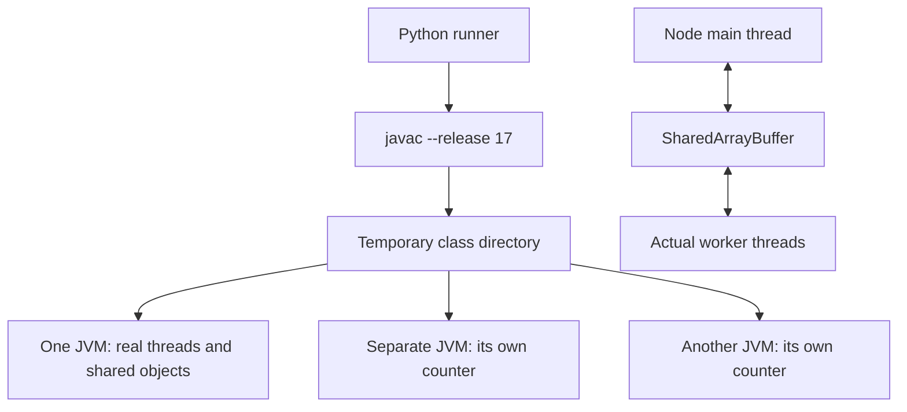

# Local concurrency lab: Java atomics, publication, ABA and locks

Status: **draft educational lab**. Reader: an engineer comfortable with threads/records and [linearizable transitions](../../../guides/synchronization/01-distributed-state/README.md). This lab exposes controlled shared-memory failures, implements atomic/order boundaries, and distinguishes local safety from durable distributed state.

Questions: why can volatile increments lose work; what does CAS compare; what publishes ordinary payload; why does A→B→A hide stale assumptions; why must a waiter recheck its predicate; and why can separate JVMs each succeed on unrelated local cells?

## 1. Setup

Requirements: Python 3, a JDK with java/javac, optionally Node for comparison. Sources compile with `--release 17`; validation used **OpenJDK 25.0.1+8-27**, **Python 3.14.7** and **Node 26.7.0**. Older compatible runtimes were not tested. No dependencies, Maven/Gradle, databases or containers are needed.

```sh
cd examples/synchronization/05-local-concurrency
python3 run.py
node workers.mjs
```

If Java shims have no selected version, pass a JDK root without changing global configuration:

```sh
python3 run.py --jdk /path/to/jdk
```

In this workspace the validated command is:

```sh
python3 run.py --jdk /home/shreyas/.local/share/mise/installs/java/25.0.1
```

That absolute path is environment-specific. The runner creates a temporary build directory, compiles there, runs the scenarios and launches two additional JVMs, then removes its directory. It does not install/select Java or write classes beside source. `npm run test:js` aliases the Node checks; no npm install is required.

Expected Java ending after individual PASS lines:

```text
Java scenarios passed: 20
PASS two JVMs each increment their own local counter to 1
Java validation: 20 in-process scenarios + 1 process-boundary scenario passed
```

Expected Node output:

```text
PASS four workers atomically add 20000 shared increments
PASS atomic flag publication exposes ordinary shared payload
PASS one event loop still loses a logical update across await
JavaScript scenarios passed: 3
```

Unsafe demonstrations pass only when the specified bad result appears. These are controlled counterexamples, not recommendations. Finite successful tests do not prove every schedule or memory-model outcome was covered.

## 2. Directory and process boundaries

```text
05-local-concurrency/
  ConcurrencyLab.java  algorithms, forced schedules and assertions
  run.py               disposable compile/JVM runner with timeouts
  workers.mjs          actual shared-worker and event-loop comparison
  package.json         optional Node script; no dependencies
  README.md            setup, walkthrough and limits
```



The separate JVMs each return 1 because each constructs its own AtomicInteger. Neither local cell supplies a database commit, replicated history or network authority.

## 3. Java scenario map

| Scenario | Expected evidence |
|---|---|
| Forced volatile RMW | Both read 0 before either writes; final value 1 |
| Fetch-and-add | Four threads × 5,000 = 20,000 |
| AtomicReference identity | Equal-valued fresh record fails CAS; actual expected reference succeeds |
| Value returns to old value | 0/v0→1/v1→0/v2 rejects original snapshot |
| Versioned CAS retry | Coherent final value/version 20,000/20,000 |
| Impure speculative retry | Two committed increments, three attempted side effects |
| Volatile publication | Reader observing ready sees payload 42 |
| Release/acquire publication | Matching flag observation exposes payload 99 |
| Pointer-only ABA | Stale CAS reinstates popped node B |
| Stamped ABA | Reference A/stamp3 rejects expected A/stamp0 |
| Immutable-link stack | Four concurrent pushers, then four poppers; 4,000 unique values retained |
| Condition signal without item | Waiter rechecks and waits; later receives item 7 |
| Interrupted waiter | Wait exits without leaking its lock |
| Semaphore capacity | At most two active work bodies; all permits restored |
| Read/write lock | Read upgrade tryLock fails; downgrade retains read ownership |
| Ordered two-lock transfer | Total balance remains 20,000 |
| Actual recorded history | Four atomic calls admit real-time-respecting order |
| Fabricated invalid histories | Duplicate outcome and real-time reversal rejected |
| Separate atomic fields | Intermediate logical total 199 is observable |
| k-mer windows | ACGACG, k=3 gives ACG:2, CGA:1, GAC:1 |

### VersionedCounter and retry purity

`AtomicReference<State>` publishes an immutable `(value,version)` pair. Increment reads the actual reference, computes both next fields, and attempts one CAS. Success is its local linearization point; failure rereads/recomputes. `Math.addExact` rejects overflow. The loop provides no per-thread time/fairness guarantee.

`replace` consumes a snapshot reference and never mutates or reinstalls that snapshot. Returning to value zero uses a new record/version, so the stale reference fails. The retry-side-effect test increments a local attempt counter before CAS and forces a failed attempt: it demonstrates why logging/sending effects inside a recomputed function can repeat. It sends no real external message or payment.

### ABA and immutable links

The unsafe stack schedule begins A→B→C. One thread reads A and remembers successor B. Another pops A/B, changes A.next to C, and pushes the same A reference. The stale CAS sees A again and installs obsolete B. Latches order the schedule deliberately; it is not a weak-memory accident.

`AtomicStampedReference.get(stampHolder)` captures the pair coherently; corresponding pair CAS fails after stamps 1,2,3. A real stamp needs a wrap/reuse policy. Reading reference and stamp through separate calls would not capture one atomic pair.

The separate `Stack` uses immutable successor links, fresh wrappers and JVM GC. Head may return to an earlier valid immutable link after a push/pop; that benign ABA does not change its saved successor. GC protects retained object lifetime, not every semantic-history assumption. No object pool or native reclamation is implemented.

### Publication and waiting

Java readers wait with a deadline for the appropriate volatile/acquire flag, then inspect ordinary payload. The common thread start gate precedes payload creation; it does not itself publish that later write. These positive examples do not require an unsafe plain-field test to reproduce stale memory on this hardware.

The Node reader announces readiness, then checks an atomic flag in a loop around Atomics.wait. The main thread writes ordinary payload, atomically stores the flag and notifies. Wait is confined to a worker so the main event loop is not blocked. The event-loop case separately forces two async read/modify/write operations to read zero before either resumes after await; it ends at one despite a single JavaScript thread.

`OneSlot` guards item with a ReentrantLock and notEmpty/notFull conditions. await releases/reacquires the lock; while loops recheck predicates. The artificial signal-without-item represents a wake with a false predicate, not a forced VM spurious wakeup. Interruption exits through finally. Semaphore acquire/release similarly brackets work; test helpers propagate worker failures through Futures.

### History checker

The checker searches completed fetch-and-increment orders from initial zero while respecting recorded response-before-invocation edges. Four real calls and fabricated bad histories exercise it. It does not handle arbitrary objects, unfinished operations or exhaustive scheduling. Instrumentation affects execution; a small accepted history is evidence for that history only.

## 4. Limits, performance and diagnosis

Tests deliberately use barriers/latches. Those also add memory ordering, so these schedules must not be described as observed weak-memory reorderings. Latches/Futures have timeouts; the Python runner kills an overlong JVM. No uninterruptible live deadlock is deliberately created. No jcstress/JMH, exhaustive model checker or other-architecture measurements are included.

Contended counters share a hot cache-coherence cell; CAS failures repeat work and the immutable stack allocates nodes. Read/write locking can cost more than a mutex for tiny sections or frequent writes. These checks provide no throughput/fairness benchmark.

A timeout suggests ownership/cancellation/scheduling failure; inspect thread dumps and waits. A wrong count suggests split RMW or a lost exception; duplicated values suggest bad update identity/reuse. Never treat added sleep/yield as a visibility fix. Worker cancellation must release acquired resources; memory success does not make later disk/network effects atomic.

Validation date: 2026-10-14. Java: 20 in-process passes plus one process-boundary check. Node: three passes. Temporary build resources are removed by the runner. See [the guide](../../../guides/synchronization/13-local-concurrency/README.md) and [evidence notes](../../../guides/synchronization/13-local-concurrency/RESEARCH.md) for correctness arguments and review gaps.

Final documented-command rerun: 20 Java scenarios, one JVM-boundary check and three Node checks passed. Local-path/fence validation covered 43 Markdown documents; new-file whitespace and git diff --check passed. Temporary class directories were removed; no global Java settings or external services were changed.
