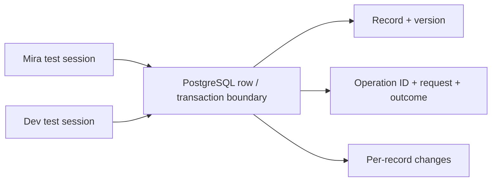

# Project A: versioned updates and transaction histories

This project implements a fixed-record PostgreSQL store with atomic expected-version updates, durable replay results and a per-record change log. It also compares that server decision boundary with a Java shared-memory CAS store. It uses real PostgreSQL sessions; no third-party Node package is required.

Requirements: Node.js 18+, Docker Compose v2, and Java 17+ (tested JDK 25). PostgreSQL image is pinned to `postgres:18.4-alpine`; record its digest when reproducing validation. Docker must be accessible to the invoking user.

```text
a-versioned-store/
  compose.yml          isolated PostgreSQL 18 container; no network or ports
  schema.sql           records, replay results, changes and submit_increment
  psql-session.mjs     controlled multi-session adapter and retry loop
  postgres.test.mjs    explicit concurrency schedules and assertions
  VersionedStore.java  immutable local versions, AtomicReference/AtomicInteger
  README.md            execution, walkthrough, limitations and hardening
```

Run from repository root:

```sh
docker compose --env-file /dev/null -p sync-masterclass-lab -f examples/synchronization/a-versioned-store/compose.yml up -d --wait
node examples/synchronization/a-versioned-store/postgres.test.mjs
java examples/synchronization/a-versioned-store/VersionedStore.java
```

The JDK source-file launcher avoids a separate compile step. If Java is installed but not selected by a version manager, invoke that JDK's `bin/java` directly; no global setting change is required.

Each database run creates a unique schema in the dedicated `sync_lab` database, verifies PostgreSQL major version 18, and drops only that generated schema when finished. It never accepts a production database URL. The fixed container name must be unused before starting; do not substitute an unrelated existing database container. The lab uses trust authentication exclusively inside a container with no network interfaces beyond loopback and no published ports.

After working through the project, remove only its container/volume:

```sh
docker compose --env-file /dev/null -p sync-masterclass-lab -f examples/synchronization/a-versioned-store/compose.yml down --volumes
```

This removes the isolated lab data. Retain that volume if you intentionally want to inspect it. An interrupted test can leave a uniquely named schema for diagnosis.

## Architecture and invariants



`submit_increment` claims an operation identity with a unique key, checks replay payload equality, and compares the expected record version in the atomic UPDATE. On acceptance it commits record, recorded result and change entry in one transaction. Rejection is also retained so a replay cannot reinterpret the original decision after state changes. Bigint result values/versions are encoded as strings to preserve precision in JavaScript.

One submission scope is the fixed `counter` record in one generated schema. Production identities need tenant/object/generation scope. The function is `SECURITY INVOKER` by default and this lab has no authentication/authorization API. Callers must not be allowed to bypass its policy by unrestricted writes in a real deployment.

## Walkthrough

1. Inspect lost updates: two sessions read 0 and assign 1. Real row locking serializes assignments but does not restore the lost increment intent.
2. Inspect atomic increments: hold Mira's transaction open, start Dev's update, and verify a `Lock` wait through `pg_stat_activity`. Commit Mira; Dev updates the current row and produces 2.
3. Inspect expected-version CAS: the stale condition returns zero rows; deliberate fresh-base retry succeeds.
4. Inspect final-unit reservation: the waiting conditional decrement rechecks its predicate after the first commit and returns zero rows.
5. Inspect snapshots: Read Committed refreshes between reads; Repeatable Read keeps its earlier view. Two Repeatable Read decisions updating different doctor rows can both commit and leave zero on call.
6. Inspect `serializable`: first-attempt barriers ensure both doctors read two. Mira commits, Dev fails serialization, rolls back and rereads the whole decision; its second attempt sees one and keeps that doctor on call.
7. Discard a function response, mutate again, then replay the first ID through another session. It returns the original value/version, not the newest value, without adding an effect or change entry.
8. Concurrent duplicate identities wait on uniqueness/transaction completion; only one effect is accepted. Rollback removes all three provisional artifacts. Additional cases reject CHECK/NOT NULL/unique/foreign-key violations and create a real opposing-lock deadlock, observe one SQLSTATE 40P01 victim, then roll back both participants.

Expected SQL checks: lost-update result 1; safe increments 2; final stock 0; Repeatable Read doctor count 0 in the deliberately unsafe history; Serializable count 1 with Dev reads `[2,1]`; replay returns original accepted value/version strings and exactly one log entry per accepted ID. The test runner prints actual server version and individual tests.

Expected Java output:

```text
stale update rejected; record=State[value=1, version=1]
CAS counter: 20000; AtomicInteger tickets before final CAS: 20000
checks: first/stale CAS, version history, concurrent increments, AtomicInteger CAS passed
```

`AtomicReference.compareAndSet` compares the expected immutable object reference. The record version separately rejects callers whose earlier state is obsolete even if the value has returned to its original value. Four threads perform 20,000 successful increments; `AtomicInteger` supplies local atomic tickets and explicit stale-CAS checks. This does not coordinate another JVM or survive a restart.

## Failure, performance and hardening

The Node adapter is intentionally a trusted-fixture SQL console, not a parameterized application driver. It invokes `psql` without interpolating a shell command from caller input, bounds query duration, and uses output markers. SQL statements must remain authored fixtures; production requests require parameter binding and a proper connection pool.

Lock-observation and read barriers establish schedules; sleeps are only bounded polling/backoff. High contention serializes the counter row and increases retries. Per-record history avoids claiming a database sequence is global commit order. Long transactions and replay retention cost resources. Do not delete operation results before the permitted retry horizon without reset/rejection rules.

The tests establish transaction/isolation behavior on a real database and lost-ACK replay by discarding a response. They do not test power loss, database restart/failover, disk corruption, network partition, multi-region replication, external side effects or hostile clients. WAL/durability settings and storage must meet the intended commit promise. Java checks are local correctness assertions, not a benchmark.

Production hardening: enforce domain constraints for every writer, scope IDs by tenant/object, authorize before result disclosure, persist outbox/checkpoint boundaries, pin image digest, pool connections, expose precise conflict/rejection responses, bound retries, track lock/retry rates, and test real process/storage/failover failures. See the [database guide](../../../guides/synchronization/06-database-concurrency/README.md).

Validation: 2026-10-13, PostgreSQL 18.4 and Node.js v26.7.0: 14 SQL subtests passed (15 reported tests including the parent), zero failures. Java 25.0.1 passed all embedded assertions with four threads and 20,000 increments. Image digest: `sha256:9a8afca54e7861fd90fab5fdf4c42477a6b1cb7d293595148e674e0a3181de15`; observed fsync, synchronous_commit and full_page_writes were all on. No power-loss/failover testing. The temporary container and scoped volume were removed after validation.
