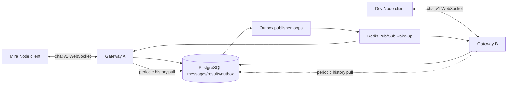

# Project B: durable WebSocket chat with broker-assisted fan-out

Status: educational implementation. Requires Node.js 22+ and Docker Compose v2; tested Node v26.7.0. Pinned clients: `pg@8.23.1`, `redis@6.3.0`, `ws@8.22.0`. `package-lock.json` records transitive versions. PostgreSQL 18.4 stores messages/results/outbox; Redis 7.4.3 Pub/Sub carries only wake-up hints.

```text
b-durable-chat/
  package.json / package-lock.json  dependency and command definitions
  compose.yml                      isolated database/broker, loopback-only ports
  lab-config.mjs                   discover those dedicated Docker endpoints
  schema.sql                       channels, memberships, messages, results, outbox
  repository.mjs                   parameterized transactions and paged history
  server.mjs                       authenticated WebSocket gateway and outbox loop
  client.mjs                       validated contiguous projection and CLI client
  setup.mjs                        initialize the persistent demo schema
  demo.mjs                         two-gateway replay and reconnect walkthrough
  chat.test.mjs                    real processes, sockets and crash scenarios
  README.md                        protocol, execution, guarantees and limits
```

## Setup and execution

From the repository root:

```sh
docker compose --env-file /dev/null -p sync-masterclass-chat -f examples/synchronization/b-durable-chat/compose.yml up -d --wait
cd examples/synchronization/b-durable-chat
npm ci --ignore-scripts
npm run init
npm run serve
```

The service prints its loopback URL, normally `ws://127.0.0.1:8089/chat`. In separate terminals, from the project directory:

```sh
npm run client -- ws://127.0.0.1:8089/chat M general
npm run client -- ws://127.0.0.1:8089/chat D general
```

Type a message, `/cursor` to inspect the checkpoint, or `/quit` to close. Output uses JSON escaping rather than printing untrusted terminal control characters directly. `mira-demo` and `dev-demo` are public fixture tokens, not real authentication credentials; the Node client sends them in an Authorization header. Channel `private` is readable/writable only by M in the seed data. Each socket subscribes to one channel.

Run the scripted demo and tests from that directory:

```sh
npm run demo
npm test
```

For individual names where a test reporter summarizes by file:

```sh
node chat.test.mjs
```

Demo expected output:

```text
committed sequence=1; replay same ID=true
reconnected after 1; received only missing sequence=2
database messages=2
```

The demo/tests use unique `chat_lab_<random>` schemas; they delete only their own schema and close all gateway processes/sockets. The manual CLI uses persistent `chat_demo`. A later manual run sees its existing history. No application database URL is accepted; endpoint discovery reads only the named lab containers. Both database and broker ports bind to 127.0.0.1 with Docker-assigned host ports. Container names must be unused before first setup.

After stopping manual servers/clients, remove only this lab's resources from the repository root:

```sh
docker compose --env-file /dev/null -p sync-masterclass-chat -f examples/synchronization/b-durable-chat/compose.yml down --volumes
```

That deletes this lab's persistent chat history. Retain the scoped volume instead if you want to study it later.

## Architecture and authoritative state



Message data and accepted order live in PostgreSQL. Redis holds no authoritative message history. Publishers read committed outbox rows, publish channel-only hints, then mark them published. A crash between publish and mark can repeat a hint. Publishing to zero subscribers still does not deliver a message to an offline client. Gateways always fetch authorized history using their cursor, so duplicated or lost hints do not change the committed log.

A channel's locked `next_seq` row allocates a sequence inside the acceptance transaction. The next accepted writer cannot advance that channel past an uncommitted preceding allocation. Rollback restores the allocation. This is a per-channel committed prefix, not a global order across channels. Contention serializes one hot channel by design.

## Protocol and identity boundaries

HTTP upgrade requires Bearer fixture authentication and `chat.v1` subprotocol; payload envelopes require `v:1`. Unsupported Origin headers are rejected. Authentication maps a token to server-side user identity; no client-supplied author field is accepted.

Example submission:

```json
{"v":1,"kind":"submit","requestId":"rpc-1","opId":"M:device1:1","channel":"general","body":"Hello Dev"}
```

`requestId` correlates this RPC response. `opId` identifies the logical submission across retries/connections. The database uniqueness scope is `(userId,opId)` and stores channel plus exact body for reuse checking. Another user has a separate identity namespace. Changed content/channel under the same scoped ID is rejected.

An accepted response includes original message UUID, channel sequence (decimal string), author, body and channel epoch. It returns the original outcome even if later messages exist. It is sent after database COMMIT. Receiving that ACK does **not** advance the channel stream checkpoint.

Subscribe with a valid durable position:

```json
{"v":1,"kind":"subscribe","requestId":"rpc-2","channel":"general","cursor":{"epoch":null,"seq":"0"}}
```

Null epoch/zero is the initial position. Reconnect uses the server-issued epoch and last applied sequence. Pages carry `after`, `highWater`, `entries`, `nextCursor` and `hasMore`. Each page is read with membership and channel head under one Repeatable Read snapshot. A new page may have a later high-water mark; it still continues after the prior prefix.

The client checks context, exact sequence continuity, high-water bounds and matching next cursor before changing its projection. It does not advance to highWater just because the first page mentioned it. Invalid/future cursors return BAD_CURSOR; wrong/expired generations return RESET_REQUIRED. Reset/snapshot installation is a future Project C mechanism, not implemented here. The floor-expiry test changes metadata; it does not implement history pruning.

## Critical functions

`Repository.submit` acquires a membership share lock, claims the logical ID, checks replay input, updates the channel's sequence, inserts message/outbox and records the result before commit. Revocation deleting that membership conflicts with its lock. Historical replay rechecks membership before disclosing a recorded result. Transactions overlapping revocation may complete under the declared decision/snapshot policy; completed revocation blocks subsequently authorized operations. This cannot erase data a client already received.

`Repository.page` reads a coherent authorized history page and orders by the qualified **numeric** `m.seq`. Serialization converts bigint sequences to strings only at the API boundary. A regression with 23 messages caught an earlier text-alias ORDER BY bug that sorted 10 before 2; the continuity guard rejected that page rather than silently advancing a checkpoint.

`publishPending` publishes before marking. It has no exclusive claim/lease, so several gateway loops can send duplicate hints. This is deliberate and safe for wake-ups; it would not justify duplicate external billing/mail effects. Bounded polling and coalesced gateway pumps recover missed hints. Runtime Redis disconnection has no automatic reconnect in this lab; existing gateway polling can still serve history, while starting a new gateway currently requires Redis to connect.

`pump` serializes page reads per socket, checks current membership on each page, and advances a volatile *sent* cursor after queuing the frame. That cursor is not proof of client persistence. On disconnect the client supplies its own applied checkpoint. Multiple pages are bounded per pass; backpressure closes a slow connection with a resume instruction.

`projectPage` builds a new memory projection only after complete validation. It has no local disk transaction. `ChatClient` keeps only new entries received since the supplied checkpoint; the resume caller owns previously persisted state. The CLI has no durable outbox or automatic reconnect. Project C adds those local durability responsibilities.

## Tests and failure schedules

Two pure projection checks and thirteen integration scenarios are included (16 reported tests counting the integration parent). Scenarios cover authentication/subprotocol/channel boundaries, cross-gateway Redis fan-out with a 60-second pull timer, concurrent duplicate submissions, ACK-versus-checkpoint distinction, parameter binding and invalid Unicode, 23-entry pagination, incremental offline resume, completely suppressed publications, revocation, invalid cursors, actual SIGKILL before commit, actual SIGKILL after commit before ACK, and repeated outbox hints.

The crash cases run separate gateway processes. PostgreSQL remains alive. Before-commit crash leaves zero message/result/outbox and a reusable first sequence. After-commit crash leaves one message; replay on a fresh process returns the same accepted message without duplication. Fault controls are environment settings in the supervisor, never WebSocket commands. Client projection remains memory-only; these tests do not establish client crash durability.

## Performance, security and hardening

Limits: 4 KiB UTF-8 body; 32 KiB inbound JSON frame; 10 entries/page; 32 connections/gateway; 32 queued commands/socket; a small token bucket; 256 KiB queued-output budget. Compression is disabled. These are educational limits, not measured capacity targets. Polling each subscriber independently and scanning pending outbox rows are inefficient at scale. Large channels serialize on one sequence row; replicas of a gateway do not remove that bottleneck.

Authorization tokens are public fixtures and no TLS is implemented. Database credentials are also local fixture values. Any trusted local process with database access can bypass gateway rules. Production needs real identities/expiring tokens, tenant isolation, least-privilege roles, controlled membership changes, TLS, audited schema migrations, bounded retry policy and startup/dependency cleanup. `/health` is a process liveness response, not a complete database/broker readiness test.

No message edit/delete/reaction/read-receipt/presence semantics are implemented. No broker/database restart, failover, power-loss, WAN congestion or encryption test is claimed. Snapshots/compaction, durable client queues and protocol migration remain later work. The guides explain those obligations explicitly.

See [synchronization-engine architecture](../../../guides/synchronization/08-sync-engine/README.md) and [messaging](../../../guides/synchronization/09-messaging/README.md).

Validation: 2026-10-13; Node v26.7.0, PostgreSQL 18.4, Redis 7.4.3, pinned packages above. Final run: 16 tests passed, zero failures; demo matched three documented lines. PostgreSQL fsync/synchronous_commit/full_page_writes were all on. Image identities are recorded in the guide research notes. After the final test/demo run, the isolated chat containers, network and disposable database volume were removed. Local Markdown path/fence checks and git diff --check passed.
