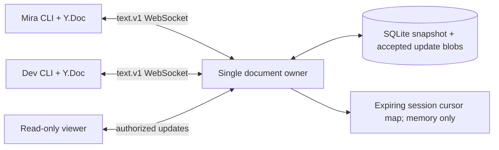

# Project D: collaborative text with Yjs and a durable provider

Status: **draft educational implementation**. Audience: engineers who understand [OT](../../../guides/synchronization/04-ot/README.md), [CRDTs](../../../guides/synchronization/05-crdts/README.md) and [engine commit boundaries](../../../guides/synchronization/08-sync-engine/README.md). This project makes a small command-line text editor collaborate over actual WebSockets. It shows library convergence, reconnect, selective undo, relative cursor anchors and durable server acknowledgment. It does not implement a graphical/rich-text editor or durable client storage.

## 1. What the implementation proves and assumes

The shared object is one Yjs document with one `Y.Text` named `body`, initially `Hello`. Mira and Dev can edit; Viewer can read. Each live client has its own Y.Doc. The server retains a merged Yjs snapshot and accepted binary updates in SQLite. There must be exactly **one server owner** of that file; two processes with independent cached documents could overwrite each other's accepted state even though SQLite serializes transactions.

CRDT item identities are independent of authenticated user identities. Yjs handles merge and duplicate application. Our provider handles document access, encoding, storage, reconnect and ephemeral presence. This custom protocol is not the standard y-websocket wire protocol or y-protocols Awareness.

## 2. Setup

Validated on **Node 26.7.0**, bundled SQLite **3.53.4**, Yjs **13.6.33**, ws **8.22.0**. Exact dependency pins and transitive versions are recorded in package-lock.json. No containers or external database are needed.

```sh
cd examples/synchronization/d-collaborative-text
npm ci --ignore-scripts
npm test
npm run demo
```

The installation reported no npm audit findings at validation time; that is a dated registry result, not proof that dependencies are safe against every input.

Expected demo output, excluding npm banners and a runtime warning:

```text
offline: Mira="Hello Mira"; Dev="Hello Dev"
merged: both contain Mira and Dev; equal=true
selective undo: "Hello Dev"
```

The relative order of concurrent Mira/Dev insertions follows Yjs identities and is not promised to match connection order. The demo therefore checks retention and equality, rather than hardcoding the combined string. Node/lib0 emitted a localStorage availability ExperimentalWarning in this runtime; the example uses no localStorage persistence and still passed. It does not enable a storage file to conceal the warning.

### Manual editor

Terminal 1:

```sh
node cli.mjs serve data/server.sqlite 8087
```

Terminal 2:

```sh
node cli.mjs client M ws://127.0.0.1:8087/document
```

Terminal 3:

```sh
node cli.mjs client D ws://127.0.0.1:8087/document
```

At a client prompt, try:

```text
insert 5 !
flush
cursor 5
show
undo
redo
offline
insert 0 local-
online
flush
quit
```

Commands use UTF-16 indices into the current local text. `insert INDEX TEXT` retains the rest of the line as text; `delete INDEX LENGTH` removes a range. Client methods reject splitting a surrogate pair, but do not implement grapheme-cluster navigation. `cursor` sends one presence renewal, which expires after 15 seconds without another renewal. Viewer uses actor `V` and receives updates without editing rights.

`offline` retains the local document and pending blobs in memory. **Exiting/crashing the client can lose unacknowledged work.** Server-acknowledged work survives a server process restart using the same database file. Project C covers durable local queues; its semantic-record persistence is not automatically a Yjs binding. A production client must atomically retain CRDT state/update evidence before promising local save.

## 3. Directory and architecture

```text
d-collaborative-text/
  package.json / package-lock.json  pinned library/runtime setup
  protocol.mjs                     canonical binary frames, IDs, bounds
  store.mjs                        candidate validation and SQLite commit
  server.mjs                       authenticated room, fan-out and presence
  client.mjs                       Y.Doc, edit/undo, provider and anchors
  cli.mjs                          interactive commands / server launcher
  demo.mjs                         disconnected concurrent insert/undo
  editor.test.mjs                   merge, transport, security and crash tests
```



## 4. Protocol walkthrough

On connection, the server sends a complete CRDT snapshot, insertion state vector, durable acceptance sequence, document epoch, fixture role and server-bound session ID. The client refuses a changed epoch when it already holds a private branch. Otherwise it applies the snapshot with origin `REMOTE`, which prevents the provider from echoing the received update back as a local edit.

A writer computes `Y.encodeStateAsUpdate(localDoc, serverVector)` and submits missing evidence, including deletion evidence. It also resends original memory-pending blobs. Aggregated and original blobs can overlap; Yjs idempotence prevents repeated character effects. Their bytes/hashes can differ, so the SQLite row count need not equal user gestures or character insertions.

Local edit/undo updates are captured from the document's update event and queued under SHA-256 of the binary blob. Each pending blob is sent once per connection; an in-flight set prevents a rapid edit from resending every older blob. Connection loss clears in-flight tracking but keeps pending evidence. There is no active-socket ACK timeout/retry scheduler or automatic reconnect; the CLI's `online` command initiates recovery.

An update envelope is:

```text
{type:'update', v:1, epoch, id:sha256(bytes), update:base64(bytes)}
```

Before acceptance, the server checks current write permission, epoch and hash. It clones the current CRDT, applies the blob to the candidate and checks visible plain-text/root/size limits. It commits the candidate snapshot and original blob/hash/sequence together. Only after COMMIT does it replace the live document, ACK the sender and broadcast to currently authorized readers.

The ACK proves retained update bytes and the resulting CRDT snapshot committed under configured storage assumptions. It does not prove every dependency integrated, every recipient applied it or a human read it. Out-of-order Yjs evidence can wait for a missing predecessor; the persistence test shows that such pending evidence survives snapshot encode/reopen. Rejecting the missing predecessor later can leave earlier evidence unresolved. Candidate projection checks are not an exhaustive hostile-encoding or domain-invariant verifier.

### Distinguish three identities

- Yjs internal client/item clocks identify CRDT evidence and determine merge behavior.
- Authenticated actor/session determines who may access this document or publish this cursor.
- Blob hash identifies an exact provider submission encoding for disk replay.

A blob hash is not a stable user-gesture ID. The server sequence orders storage acceptance, not causal text position. A state vector is not an authorization token or a durable user receipt.

## 5. Key mechanisms

`DocumentStore.accept` builds a candidate before touching live state. A thrown validation or pre-commit fault leaves the server's old memory and disk state. A crash after commit before ACK leaves the new disk state; reconnect imports that snapshot and safely repeats CRDT evidence. The same blob/hash returns its previous sequence after current authorization.

`EditorClient.connect` merges the server snapshot without replacing the private Y.Doc, computes a difference and resends queued blobs. This preserves both branches in the same document epoch. Merging a fresh unrelated server's initial text into an old branch is unsafe; the epoch test refuses it and preserves the original local text for review.

`Y.UndoManager` tracks `LOCAL` transactions. Remote provider transactions are excluded. Undo/redo themselves create CRDT updates and travel through the provider. The concurrent test removes Mira's contribution while retaining Dev's; undo is not loading a historical entire-document snapshot. Undo history is memory-only and may depend on retained CRDT identities.

`anchor` creates a Yjs relative position. `resolve` maps it to an index in the receiver's current Y.Doc, or null if unavailable. A cursor tied to the end of `Hello` resolves to index 6 after `X` is inserted at the beginning. Session identity/actor come from the server, not supplied cursor labels.

Presence is a custom server session map with expiry and connection cleanup. It never enters SQLite. A heartbeat tests connection liveness; cursor expiry separately prevents an old selection from appearing indefinitely current. The library's optional Awareness protocol is a separate supported choice. [Yjs Awareness documentation](https://docs.yjs.dev/api/about-awareness)

## 6. Tests and expected evidence

The final suite reported **18 tests passed, zero failures** on 2026-10-13. It uses actual WebSockets and file-backed SQLite; crash cases use actual server child-process SIGKILL. See the guide's [validation record](../../../guides/synchronization/11-collaboration/RESEARCH.md) for final results.

Cases cover:

- reordered/duplicated/missing-dependency CRDT updates;
- deletion divergence despite equal insertion state vectors;
- live network edits and post-commit ACK;
- disconnected concurrent insertion and selective undo/redo;
- moving relative cursor anchors and expiring presence;
- UTF-16 surrogate-pair boundaries;
- read-only forged frames and current revocation;
- malformed binary, unsupported wire version and unexpected document roots;
- duplicate blob replay with reauthorization;
- unresolved dependency evidence across stored snapshot/reopen;
- server SIGKILL before commit and after commit before ACK;
- changed document epoch and rapid in-flight editing.

No client process-crash durability, browser binding, host-power loss, TLS, WAN capacity, multi-server ownership, exhaustive fuzzing or formal library proof is claimed. Tests/demo close their sockets/stores and remove only their disposable files. Manual `data/` persists and is ignored by Git.

## 7. Performance and failure handling

Limits: 4,096 UTF-16 text units, 64 KiB individual update blobs, 256 KiB encoded CRDT state, 128 KiB inbound frames, 512 KiB output budget, 32 sessions and 100 memory-pending blobs. A reconnect difference can exceed the individual update limit even when the full state is within its limit; larger applications need chunking or a distinct bounded bootstrap path. Rate limits and document-size rejection can deny a private branch without removing it from memory.

Each accepted blob clones/encodes a complete document and performs synchronous SQLite work on the event loop. This is expensive and stalls unrelated sockets. Real services need measured per-document queues, incremental persistence, snapshots, worker isolation, ownership fencing and recovery rules. Do not start a second owner against the same file; SQLite mutual exclusion does not merge stale in-memory candidates.

Diagnose stalled convergence by inspecting `lastError`, epoch, pending/in-flight IDs, server snapshot/sequence and authorization. If state vectors match but text differs, examine deletion exchange and full encoded evidence. If only cursors vanish, examine lease/heartbeat state rather than replaying document history. A client `flush` waits for its pending blob ACKs; it does not certify that every other client has applied them.

## 8. Security and hardening

Tokens are public fixtures, transport is loopback WS, and no application encryption exists. Trusted writers can submit arbitrary Yjs identities; internal item client IDs are not cryptographic authorship. Projection/root/size validation bounds this teaching example but is not a complete malicious-binary sandbox. Revocation stops future writes and broadcasts; it cannot retract previously received text.

A real implementation needs TLS/session validation, tenant/document routing, proper leases/fencing, per-document authorization, bounded parsing and deferred-structure policies, durable clients, structured error recovery and private-branch export. Do not store permissions as collaboratively writable CRDT content and then trust those same writers to grant themselves rights. Rich text needs schema validation, sanitization, rendering and editor bindings beyond this plain-text model.

Read [collaboration architectures](../../../guides/synchronization/11-collaboration/README.md) for the application distinctions and [Yjs update APIs](https://docs.yjs.dev/api/document-updates) for the library/provider boundary. Status remains draft pending technical review.

Final validation: npm test and npm run demo passed; a separate CLI offline/reconnect/undo/redo/show workflow passed. Local Markdown path/fence checks and new-file whitespace checks passed across the documented scope; git diff --check passed. Disposable test/demo/CLI services and files were closed/removed. Dependencies remain installed in ignored node_modules.
