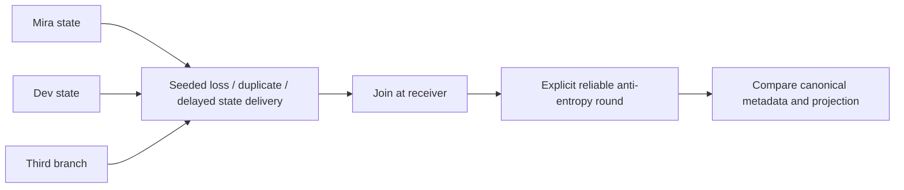

# Project E: replicated structures under adverse delivery

Status: draft. Reader: an engineer who understands the [CRDT chapter](../../../guides/synchronization/05-crdts/README.md) and wants to distinguish a merge proof from dissemination and domain correctness. Scope: compatible, in-memory state-based replicas. No sockets, disk persistence, identity service or production garbage collection.

Central questions: which evidence must a state carry; can duplication/reordering change the result; what repairs message loss; and which application invariants remain unproved by convergence?

## Setup and directory

From the repository root, with Node 26.7.0 (validated) and no dependencies:

```sh
cd examples/synchronization/e-crdts
npm test
npm run demo
```

```text
e-crdts/
  package.json            run adapter tests and the existing datatype tests
  replication.mjs         branch fixtures, adverse delivery and reliable repair
  replication.test.mjs    ten seeds per datatype; negative semantic cases
  demo.mjs                four verified convergence results
  README.md               assumptions, walkthrough and hardening
../03-crdts/model.mjs      shared datatype implementations
../03-crdts/model.test.mjs  algebra, histories and intent counterexamples
../g-fault-harness/        reusable logical scheduler/journal
```

Project E reuses the implementation developed with the CRDT chapter. The [datatype lab](../03-crdts/README.md) documents G/2P/OR sets, G/PN counters, LWW/MV registers, fixed-key maps, sequences and limited rich text. Keeping one implementation makes the guide and delivery experiment test the same rules. `npm test` runs its 23 tests plus seven new replication tests; these are 30 tests, rather than 30 new datatype implementations.

## Architecture and mechanism



`fixtures()` allocates exclusive writer branches. Counter components carry cumulative counts, tags carry add identities plus removal evidence, titles carry dots and causal context, and sequences retain insertion anchors and deletion IDs. These are full states, not increments or index-based commands. `replicate()` sends three rounds through the logical scheduler, captures complete post-delivery states, then reliably joins each final snapshot into every replica. The source snapshots are captured before that repair loop so receiver iteration cannot silently manufacture a favorable schedule.

The expected state is a join of all original branches. The oracle compares canonical metadata as well as visible values: equal text alone can hide incompatible deletion history. The final reliable round is finite because the test stops new writes, preserves all original evidence and exchanges full states. In a continuously changing service, anti-entropy must run repeatedly and eventually convey every required update. Delay/drop schedules here are logical application delivery, not kernel/network packet faults.

## Worked example

Assume exclusive actors M, D and S, each with an empty G-counter. M adds two, D adds three and S adds four. Their states are respectively `{M:2}`, `{D:3}` and `{S:4}`. A duplicate `{M:2}` at D changes D to `{D:3,M:2}`, then leaves it unchanged. Joining maxima preserves each original component. Missing S messages leave a partial value, possibly five. The explicit final reliable exchange supplies `{S:4}`; every replica reaches nine.

Expected demo output:

```text
counter: ["9","9","9"]; convergence verified
tags: [["urgent"],["urgent"],["urgent"]]; convergence verified
title: [["Proposal","Plan"],["Proposal","Plan"],["Proposal","Plan"]]; convergence verified
sequence: ["XaYt","XaYt","XaYt"]; convergence verified
```

The tag removal suppresses the observed S addition, while the unseen concurrent D addition survives. The title retains both concurrent alternatives. Sequence branches insert X after c, Y after a, and delete c. Deleted c remains an anchor, so X survives. The shared sequence is an educational insertion tree with a defined sibling order, not a production text library.

Variation: set `loss:1,repair:false`. Counter values stay two, three and four. Setting `repair:true` supplies the missing evidence and yields nine. This exposes the difference between merge safety and dissemination liveness.

## Verification, failure and costs

Seven adapter tests exercise four datatypes across ten seeds replayed twice, total loss with/without repair, writer-identity reuse and an inventory counterexample. The reused 23 tests cover join laws on finite fixtures and the remaining structures. Finite test success is not a proof over all valid states.

If visible results differ after repair, inspect canonical evidence before changing rendering. Check whether an actor was reused, a removal was discarded, a missing ancestor was never delivered or the fixture violates causal closure. Never fix a failing oracle by discarding causal metadata. The reused writer test converges to one despite two intended increments; the PN inventory test converges to minus one despite individually valid local decrements.

The adapter has three replicas, three rounds and full cloned state payloads. Costs grow with state/history size; BigInt, Map and Set need a lossless wire codec before real networking. The scheduler records per-message trace entries and is bounded; these tests are not capacity measurements. Production requires durable writer identity/state, current authorization, bounded decoding, anti-entropy, snapshot-generation policy and a justified metadata-retention/GC protocol. Use [Project C](../c-offline-engine/README.md) for durable acceptance boundaries, [Project D](../d-collaborative-text/README.md) for library-backed collaborative text, and [Project G](../g-fault-harness/README.md) for actual HTTP/process fault boundaries.

Validation: 2026-10-14, Node 26.7.0; `npm test` passed 23 reused datatype tests and seven adapter tests, zero failures. `npm run demo` matched all four lines above. Full validation boundaries are recorded in the [handbook evidence notes](../../../guides/synchronization/16-handbook/RESEARCH.md). Reviewer: pending. Open issues: hostile wire states, persistence, membership lifecycle and safe compaction are outside this implementation.
