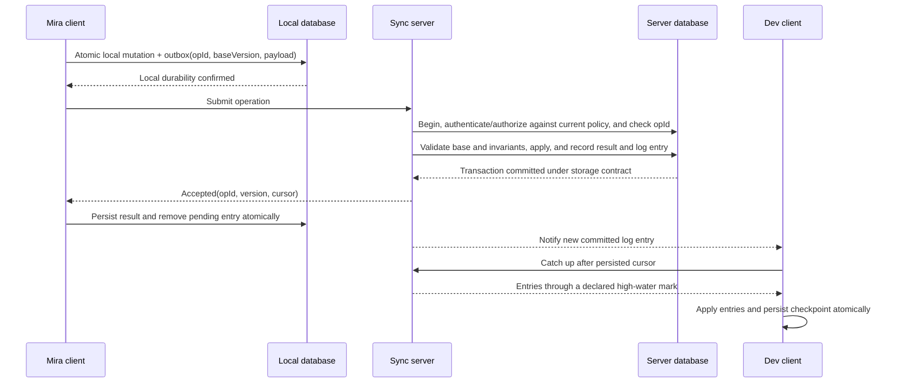

# Distributed state and synchronization from first principles

## 1. The reader's problem and this guide's boundary

After this guide, you should be able to describe a synchronization design as a state machine, an observation contract, a failure model and a recovery protocol. You should be able to explain why an ordinary retry can repeat an effect, why a total order does not preserve every user's intent, and why a converged result can violate a business rule.

The central questions are: what does shared state mean without shared memory; what information survives disconnection; how do causality and consistency restrict observations; when must operations coordinate; and how does a client know what to replay? Full OT transforms, CRDT types, database protocols and transport mechanics belong to the later chapters listed in the [master index](../README.md). This guide supplies the prerequisites rather than a substitute for those chapters.

Use the [notation reference](../NOTATION.md) throughout. Work through the document history below before reading the consistency table; then run the [foundation lab](../../../playground/synchronization/00-foundations/README.md).

## 2. Shared state is a contract over observations

Suppose Mira and Dev both see a document with ID `doc-7` and text `cat`. The computers hold two different memory objects. The shared identifier means that the application treats them as representations of one logical object. It does not establish that their bytes match or that their reads occurred at the same time.

Model a replica by a state `s` and transition `apply(s,o)`. An operation `o` might be `setTitle("Draft")`, `insert(1,"X")` or `addComment(id,text)`. The transition specifies the resulting state and any response. A **history** records invocations, responses, sends, receives and failures. A **consistency contract** restricts which histories are legal. Without that contract, saying that the machines are synchronized has no precise meaning.

Separate three requirements:

- **Safety:** a forbidden outcome never occurs, such as spending one inventory unit twice.
- **Liveness:** an accepted change eventually reaches an eligible replica, assuming communication and processing eventually resume.
- **Convergence:** replicas eventually agree on equivalent logical state once the relevant updates have arrived and no new updates intervene.

A log that sorts every edit and discards all but one can converge while losing work. A protocol that refuses every request can avoid unsafe writes while making no useful progress. Correctness must name all relevant requirements and their assumptions.

### What is being exchanged?

| Exchange | Example | What the receiver still needs |
|---|---|---|
| State | Entire document or its fields | Version/dominance rules; whether missing fields mean deletion |
| Operation | `insert(afterElement=e8, text="X")` | Operation identity, dependencies, indexing rules and interpretation |
| Event | `CommentCreated` or `TitleChanged` | Whether it is a committed fact, projection input or merely a notification |
| Message | Bytes sent over a connection | Decode, authenticate, decide effect, commit and deduplicate |

An operation is usually a request for a transition. A domain event usually describes an accepted fact. An event log can encode operations, and a message can contain a snapshot. These categories concern semantics, not mutually exclusive wire formats. Delivering a message neither proves that a transition was accepted nor that it survived a crash.

### Roles describe different dimensions

**Local state** lives on the current device. **Authoritative state** is what the application's authority has accepted. **Replicated state** is a representation of shared data. **Cached state** is a performance copy whose freshness follows its cache policy. **Persisted state** survives the failures promised by its storage contract.

These labels overlap. A local database can be persisted and replicated while holding edits that the server will reject. A server cache can contain the latest accepted state while its disk lags. Authority is about decision rights; persistence is about survival. Neither implies the other.

## 3. One document, progressively harder histories

All examples below are constructed histories, not descriptions of a proprietary product. Initially, positions count ASCII characters and the document is `cat` at version 0.

### 3.1 One edit with delay

Mira inserts `X` at position 1, producing `cXat`. Before Dev receives the change, Dev still sees `cat`. Different observations can be legal under a stale-replica contract. Under a linearizable read contract, a read that starts after Mira's successful authoritative write must reflect that write or a later legal write; an offline local read cannot make that unconditional promise.

A responsive editor often displays Mira's speculative state immediately. The UI should distinguish local persistence from accepted synchronization. A status label such as “saved” needs an explicit meaning: saved on this device, accepted by the server, or durably replicated under a specified policy.

### 3.2 Two disconnected inserts

Both users edit version 0:

| Actor | Local operation | Local result |
|---|---|---|
| Mira | `insert(1,"X")` | `cXat` |
| Dev | `insert(2,"Y")` | `caYt` |

Apply Dev's original index to Mira's result: `cXYat`. Apply Mira's original index to Dev's result: `cXaYt`. Both replicas received the same operations and still differ. The operations used offsets in different base states.

Fixing message loss does not fix this. The protocol needs a shared serialization with rebasing, an OT transformation, stable sequence identities, or a conflict interface. Even a globally sorted operation list only supplies repeatable execution; it does not prove that Dev's insertion stays after the intended `a`.

### 3.3 Concurrent deletion and a dependent action

Mira deletes the document while Dev, offline, adds a comment to it. A delete-wins policy can retain the comment only in rejected-work history. An add-wins policy can resurrect data the deleter expected to remove. A separate archive state may preserve the comment without restoring normal visibility. These are domain choices, not consequences of packet order.

If Dev first creates a section and then comments on that section, the comment depends on the creation. Receiving the comment first requires buffering, replay in dependency order, or a representation that retains unresolved references. A deterministic sort by random operation ID can put the dependency after its use.

### 3.4 Concurrent valid operations can violate a rule

There is one remaining seat. Mira and Dev each read `remaining=1`. Each independently accepts `reserve(1)`. Their local states satisfy `remaining≥0`. Combining both reservations produces `remaining=-1`.

The issue is not merely conflicting writes to one field. It is that the right to consume the last unit was issued twice. Serialize reservations, use an atomic conditional decrement, allocate disjoint reservation rights in advance, or allow overbooking and define compensation. Only the last option changes the invariant.

Whether operations can merge safely depends on the operations **and** their invariants. Invariant-confluence research formalizes this relationship under its execution model; it does not say that all constraints can be enforced without coordination. [Bailis et al., 2014](https://www.vldb.org/pvldb/vol8/p185-bailis.pdf)

## 4. Independent processes and incomplete knowledge

A **process** executes transitions. A **node** is a failure/placement participant such as a machine or service instance. A **replica** holds some shared data; a **client** requests or speculates on changes; a **server** serves requests. A **leader** coordinates decisions in a declared group, and followers replicate those decisions. An authoritative game server additionally decides simulation outcomes. These roles can share a process but should not be confused.

Threads with shared memory can use a memory model and atomic operations over the same location. Different machines communicate by messages. A local mutex cannot stop another machine from writing its own copy. Distributed atomicity requires a shared authoritative resource or a protocol that establishes the corresponding decision.

**Replication** copies data for availability, locality or read capacity. **Partitioning/sharding** assigns different subsets to different owners. A shard can itself have several replicas. **Coordination** constrains independent decisions so they meet a shared requirement. A system can partition most work and coordinate only a few high-contention rules.

### A timeout is ambiguous

After a request times out, the following histories can produce the same client observation:

1. The request never reached the server.
2. The server received it but has not committed it.
3. The server committed it and crashed before responding.
4. The server committed it and its response was lost or delayed.

The client cannot distinguish these from silence alone. Retrying is necessary for progress but unsafe without a replay contract. Choosing a timeout improves practical suspicion and latency bounds; it does not turn suspicion into proof of failure in a network with unbounded delay.

A partition can leave two processes each believing that it is leader. Prevent split-brain effects by making authority verifiable: for example, a consensus group governs writes, or a storage resource checks a monotonically increasing fencing token. Merely attaching an epoch to a request does nothing unless the resource rejects stale epochs.

### Delivery and effect are separate

At-most-once handling suppresses retries or duplicates but may lose work. At-least-once delivery retries under eventual-connectivity and retention assumptions; duplicate delivery is expected. A deduplicated transaction can provide one logical effect for a durable operation ID.

An increment is not idempotent: two applications add two. Setting a field to `7` is algebraically idempotent if nothing intervenes, but an old repeated set after a newer set can still overwrite valid work. Idempotency alone does not establish freshness or authorization.

A durable acceptance transaction should atomically record:

```text
(operation identity, request fingerprint, result, state mutation, change-log entry)
```

On replay, the server checks identity and fingerprint, returns the recorded result, and does not reapply the mutation. Different payloads sharing one identity must be rejected. Deduplication retention must match the allowed retry horizon, or expired identities need an explicit rejection protocol.

“Exactly once” must name the boundary. A database transaction can atomically commit the mutation and dedup record. It cannot by itself atomically charge an unrelated payment service. An outbox plus an idempotent downstream consumer, or a distributed commit protocol where supported, addresses additional boundaries. If the downstream effect has neither transactional participation nor idempotency, retry ambiguity remains.

## 5. Time, causality and order

Physical time helps with deadlines, human display and measuring delay. Clock skew is a difference between clock readings; drift is their rate error. An unsynchronized wall-clock comparison can choose a winner that actually happened earlier. Even perfect readings would not tell you whether one editor had observed another's change.

Define `a → b` when the same process performs `a` before `b`, when `a` sends a message received at `b`, or when transitivity establishes a path. If neither `a → b` nor `b → a`, the events are concurrent. This is a partial order. [Lamport, 1978](https://www.microsoft.com/en-us/research/publication/time-clocks-ordering-events-distributed-system/)

A Lamport clock increments locally and, on receive, advances to one beyond the maximum of the local value and received value. Causal precedence implies increasing timestamps; increasing timestamps do not prove causal precedence. Sorting `(clock,actorId)` gives a total order compatible with causality only when those clock rules are followed. It adds an arbitrary order between concurrent events. [Lamport, 1978](https://www.microsoft.com/en-us/research/publication/time-clocks-ordering-events-distributed-system/)

A full vector clock keeps one counter per participant, increments its own counter at each local event, and merges received counters componentwise before advancing the receiver's counter. With complete tracked participants and correct propagation, componentwise dominance reveals causal ancestry. Neither vector dominating the other reveals concurrency.

Example, components ordered `[M,D]`: Mira's edit has `[1,0]`; Dev's independent edit has `[0,1]`. They are incomparable. After Dev receives Mira's edit and records another event, Dev can have `[1,2]`, which dominates both. Vector storage grows with tracked participants; membership churn and compact causal representations require additional design. The [mathematics](../02-mathematics/README.md) and [conflict](../03-conflict-resolution/README.md) chapters derive those comparisons and their costs.

Sequence numbers order one log scope. They need not order two channels. Epochs distinguish different log or leader generations. A fencing token rejects obsolete authority. None of these automatically tracks the complete causal history of independently generated offline operations.

## 6. Contracts for reads and transactions

“Strong consistency” is underspecified. Name the model and scope.

| Contract | Obligation | What it does not establish |
|---|---|---|
| Linearizability | Each operation appears atomic between invocation and response; preserves real-time precedence | Multi-operation business transaction safety without a transaction boundary |
| Sequential consistency | One legal order preserves each process's program order | Real-time order across processes |
| Causal consistency | Observations respect causal dependencies | A single order for independent concurrent updates |
| Eventual consistency | After updates stop and propagation succeeds, replicas settle to agreement | Fresh reads, bounded catch-up, intent preservation |
| Read-your-writes | A session does not read a state predating its own accepted writes | Other sessions' freshness |
| Monotonic reads | A session does not move backward in the relevant version/history order | Always reading the newest state |
| Serializability | Committed transactions behave like a serial execution | Real-time transaction order unless strict serializability is promised |
| Snapshot isolation | Transactions read a stable snapshot with defined write-conflict checks | Prevention of all invariant violations, especially write skew |

For linearizability, suppose Mira's `setTitle("A")` completes before Dev invokes a read. With no later write, returning the old title is illegal. Overlapping writes can be ordered either way, provided the resulting sequential history matches the object's specification. A local atomic reference and a distributed register can be judged by this same abstract condition, although their implementations and failures differ. [Herlihy and Wing, 1990](https://www.cs.cmu.edu/~wing/publications/HerlihyWing90.pdf)

Sequential consistency preserves program order but can place another process's stale read before the completed write in the chosen global history when no relevant process-order constraints prohibit it. [Lamport, 1979](https://www.microsoft.com/en-us/research/publication/make-multiprocessor-computer-correctly-executes-multiprocess-programs/?lang=ko-kr)

A session guarantee requires implementation state: sticky reads to a sufficiently current replica, a minimum version token, or waiting for catch-up. Merely reusing a connection does not establish it after failover.

Database isolation concerns interactions among transactions. Replication consistency concerns observations across copies and time. A serializable primary can feed a lagging replica whose reads are stale. A linearizable key-value API can still require extra machinery for an atomic transfer across two keys.

Write skew example: two doctors are on call. Each transaction reads both rows and removes a different doctor after seeing the other on call. Their writes do not overlap, but together violate “at least one doctor on call.” Snapshot isolation can admit this; a serializable implementation must reject or prevent the incompatible committed history. PostgreSQL 18 documents its isolation behavior and requires retry of the complete transaction after relevant serialization failures. [PostgreSQL 18](https://www.postgresql.org/docs/18/transaction-iso.html)

Strong eventual consistency adds a useful property: replicas that have incorporated the same updates have equivalent states, plus the model's eventual-delivery and termination requirements. CRDTs establish this through constraints on merge or operation algebra. This does not establish application invariants or intent. Detailed proof and type-specific assumptions are reserved for the CRDT chapter. [Shapiro et al., 2011](https://www.lip6.fr/Marc.Shapiro/papers/2011/Comprehensive-CRDTs-RR7506-2011-01.pdf)

## 7. What coordination costs and why partitions matter

### CAP through an indistinguishable read

Assume a replicated read/write register, arbitrary message delay/loss between partitions, and the CAP meaning of availability: requests at nonfailed nodes must complete successfully under the model.

A partition separates `A` and `B`. A write `x=1` completes at `A`. A later read starts at `B`. No message carrying the write can reach `B`. Its local evidence is identical to a history where the write never happened. If it returns a stale value, it violates linearizability in the first history. If it waits indefinitely, it violates availability. A generic error does not satisfy this availability contract.

This argument concerns behavior during a partition. It does not mean a healthy system permanently selects two properties, and partition tolerance is not a feature that makes failed links work. Recovery still needs rules for divergent accepted histories. [Gilbert and Lynch, 2002](https://groups.csail.mit.edu/tds/papers/Gilbert/Brewer6.pdf)

PACELC adds the normal-operation question: coordinating replicas can trade latency against consistency even without a partition. It is a design framework; exact lower bounds depend on the protocol and network model. [Abadi, 2012](https://www.cs.umd.edu/~abadi/papers/abadi-pacelc.pdf)

### Quorum overlap is a building block

Let `N` be the fixed number of replicas for an object, `W` the number acknowledging a write, and `R` the number responding to a read. If `R+W>N`, any such read and write groups intersect: otherwise their disjoint union would contain more than `N` participants. Example: `N=3,W=2,R=2` guarantees at least one shared participant.

That participant's version can help a read discover the write. It does not make arbitrary quorum protocols linearizable. Concurrent writes, incomplete writes, changing membership, obsolete leaders, sloppy quorums, version selection and read repair all need rules. If `R=1,W=1,N=3`, no overlap is guaranteed. Smaller response sets reduce waiting but weaken this route to freshness. Dynamo's historical protocol combines configurable response counts with versioning and reconciliation; it should not be reduced to the overlap equation. [Dynamo, 2007](https://www.allthingsdistributed.com/2007/10/amazons_dynamo.html)

### Consensus selects compatible committed history

A replicated state machine can apply the same deterministic commands from the same initial state and committed order. Consensus-backed log replication establishes agreement on that order despite modeled failures; deterministic application also requires eliminating unrecorded randomness, time reads and external effects.

Raft uses leader terms, elections, log rules and majority replication; its commit rule constrains when an entry may advance commitment, including current-term restrictions. A majority response by itself is not a complete consensus implementation. Progress depends on a sufficiently stable communicating majority, while the safety argument handles delayed messages under its model. [Ongaro and Ousterhout, 2014](https://raft.github.io/raft.pdf)

Consensus answers which commands are accepted in what order. It cannot decide whether an offline user's obsolete text position preserves intent. Server validation and application reconciliation remain necessary.

### Same constraints, different user contracts

- Editor: immediate speculative local edits; convergence/causality for document data; explicit acceptance and permission checks on reconnect.
- Chat: durable accepted messages and per-channel recovery; presence/typing can expire without replaying every transition.
- Game: authoritative accepted outcomes; local prediction for responsiveness; old movement snapshots may be discarded.
- Inventory or finance: conditional transitions and atomic invariants; a disconnected client may record an intent but cannot unconditionally promise the scarce resource.

These are illustrative designs. None asserts a particular named product's present architecture.

## 8. Design choices must be combined

| Choice | Fits when | Benefit and cost | Characteristic failure |
|---|---|---|---|
| State-based replication | Mergeable state or bounded snapshots | Tolerates skipped intermediate messages; full state can be large | Plain snapshots overwrite unrepresented concurrent work |
| Operation-based replication | Small edits and useful intent/dependencies | Efficient deltas; history and replay rules are required | Missing, duplicated or misordered noncommuting operations |
| Central authority | Validation or scarce resources need one decision path | Simpler accepted order; availability and latency follow authority placement | Disconnected clients cannot confirm changes |
| Decentralized replicas | Independent writes and mergeable domains | Offline progress; metadata and invariant constraints increase | Convergent but semantically invalid merge |
| Server-authoritative | Clients are untrusted or simulation is shared | Enforces outcomes; server capacity and trust become central | Predictive clients disagree until corrected |
| Peer-to-peer | Direct exchange is feasible and trust assumptions permit | Avoids some central hops; discovery, NAT and membership add work | Peers disappear or disagree about authority |
| Optimistic concurrency | Conflicts are tolerable and detectable | Responsive speculation; abort/rebase/repair work follows | Stale edit appears accepted before rejection |
| Pessimistic concurrency | Exclusive control is worth waiting for | Prevents specified conflicts; leases/locks can block work | Stale holder acts after lease loss without fencing |
| Pull | Periodic freshness is sufficient | Simple recovery path; interval adds delay and polling cost | Missed changes without cursor retention |
| Push | Low notification delay matters | Fast when connected; slow consumers require backpressure | Broadcast lost during disconnect |
| Bidirectional | Both ends originate updates | Natural collaboration; must distinguish echoed from new changes | Echo loop or duplicate effect |
| Snapshot | History is large or new replica starts | Bounded catch-up; creates transfer and consistency-boundary cost | Snapshot and following log leave a gap |
| Incremental | Changes are sparse and history retained | Less transfer; retention and cursor machinery required | Cursor points into compacted history |

These are orthogonal dimensions. A server-authoritative system can use optimistic local views, push notifications and pull catch-up. State-based CRDTs impose special merge rules; merely sending JSON snapshots is not a CRDT. Operation replication may still send periodic snapshots.

## 9. Trace one durable mutation

This example uses a single server transaction boundary and a server log per document. It is not yet an implementation of offline text merging.



The client outbox and mutation share a transaction so a crash cannot leave visible local work with no pending transmission. The server atomically commits its mutation, dedup result and log so replay returns the original acceptance. Acknowledgment is sent after the chosen durability boundary. Notification is an optimization: Dev's catch-up path obtains durable history if notification is missed.

If Mira crashes before receiving the acknowledgment, its durable outbox causes replay. If it crashes after receiving the acknowledgment but before clearing the outbox, replay is still safe. If Dev persists its cursor before applying its entries, a restart can skip data permanently; apply and checkpoint must share the relevant durable boundary.

Authorization must be checked before returning sensitive recorded results. Repeated submissions cannot use old credentials to bypass current access policy. An accepted historical mutation can remain accepted while a now-revoked user is forbidden from reading its current result.

A snapshot must represent a known log boundary `k`; catch-up begins strictly after `k` in the same history generation. Compaction cannot delete all evidence needed by permitted offline retries or old deletion histories without a reset/rejection protocol. Longer offline support therefore costs retained history, metadata, or more expensive resynchronization.

## 10. Worked executable experiment

Assumptions: one Node process, deterministic in-memory records, ASCII text and explicit schedules. It models logic, not disk durability, networking or security. Setup and complete source are in the [lab](../../../playground/synchronization/00-foundations/README.md).

1. Run `node playground/synchronization/00-foundations/demo.mjs` from the repository root.
2. Observe the unsafe read-modify-write counter: two readers derive `1` from `0`, leaving `1` after two writes.
3. Observe conditional writes: exactly one first attempt succeeds. The loser rereads and retries, reaching `2`.
4. Observe timeout replay: the same increment identity returns its old result and the counter stays `1`; another identity increments to `2`.
5. Observe the two text orders: `cXYat` and `cXaYt` differ despite identical operation sets.
6. Run `node --test playground/synchronization/00-foundations/foundations.test.mjs`. Tests check outcomes and a conflicting reuse of an identity.

Meaningful variation: retry a *set-to-value* user edit after rereading. Unlike an increment, recomputing a value is not necessarily preserving the original user intent. A CAS rejection detects obsolete assumptions; it does not choose the correct repair.

The dedup store in the lab has no persistence. Kill the process and its identities disappear. Production safety needs the database transaction described above; a green in-memory test cannot establish crash recovery.

## 11. Failures, diagnosis and recovery

| Symptom | Check | Recovery and prevention |
|---|---|---|
| Counter or message appears twice | Same logical request got different IDs? Dedup and mutation atomic? | Reconcile confirmed duplicates; preserve identity across retries |
| User edit disappears | Whole-state overwrite? LWW timestamp? Unflushed local queue? | Recover retained local/history data; add conflict detection and durable outbox |
| Replicas disagree after catch-up | Compare incorporated operation IDs, schema versions and deterministic replay | Locate first divergent transition; replay from verified snapshot |
| Dependent object missing | Was a child applied before parent or after deletion? | Buffer dependencies or apply domain deletion policy |
| Cursor advances but data absent | Check apply/checkpoint transaction and stream generation | Reset from valid snapshot; fix atomic checkpointing |
| Old node writes after failover | Resource checked epoch/fencing token? | Reject obsolete authority; reconcile unauthorized writes |
| Reconnect hangs indefinitely | Retention expired? Backpressure? Poison operation? | Explicit reset or rejection; retain unsynced work for recovery |

Log operation identity, actor, object, base/accepted version, authority epoch and commit outcome. Avoid logging private document contents or secrets. Distinguish local pending count, accepted-but-not-observed lag and replay failure rate. Counts alone cannot detect semantically incorrect merges; compare histories and invariant predicates.

## 12. Security and operational boundaries

Clients can forge operations. Authenticate identity and authorize every relevant object/channel before acceptance or disclosure. Revalidate invariants server-side; an optimistic UI is not evidence of permission. Tenant ID supplied by a client must not by itself determine access. A replay can be harmless to state and still leak a response to a revoked actor.

An encrypted server may route opaque operations and enforce some envelope rules, but cannot generally validate semantic invariants hidden inside ciphertext. That limitation must change the trust model or the accepted guarantees. Transport encryption secures a channel; it does not turn an authorized malicious client into an honest participant.

For deployment, first specify the authoritative decision boundary, storage failure assumptions, retry retention and offline horizon. Measure accepted-update latency separately from speculative rendering latency. Verify restart recovery before optimizing compression or fan-out. Do not infer multi-region safety from a single-region transaction.

## 13. Invariants, assumptions and design rules

- Name state, authority, operation identity and observation contract before choosing transport.
- Same operations imply same state only under the required ordering, transformation or merge rules.
- Convergence, durable acceptance, intent preservation and authorization need separate arguments.
- A timeout reveals missing evidence, not absence of a committed effect.
- Atomically couple mutations with replay records and log/checkpoint boundaries.
- Separate causal dependencies from arbitrary tie-breaking and wall-clock timestamps.
- Coordinate precisely where domain constraints require it; disconnected speculation is not guaranteed acceptance.
- State the progress assumptions behind eventual guarantees and the reset rules behind compaction.

## Review and open issues

The foundational explanations are complete for their stated abstract model. Continue with [mathematics](../02-mathematics/README.md), [CRDTs](../05-crdts/README.md), [networking](../07-networking/README.md) and [the implementation handbook](../16-handbook/README.md) for the detailed mechanisms and executable boundaries. Primary CAP and CRDT report copies were checked during release review; see [the review record](../REVIEW.md). No proprietary product implementation is claimed.

## Release review

Status: **ready — complete for the stated educational scope**.
Reviewer: Codex (AI technical and editorial review); no independent human review claimed.
Review date: 2026-10-14.
Open issues: none blocking this educational release.
Scope limits and further validation: Abstract failure model and educational lab; deployment-specific safety requires the later implementation and production chapters.

See [the review record](../REVIEW.md) and [actual validation output](../VALIDATION.json).
