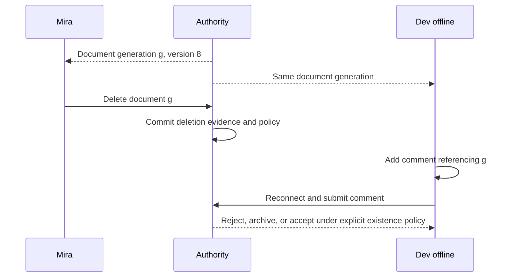

# Conflict resolution: detection, merge semantics and invariant preservation

## 1. The problem is choosing an acceptable history

Mira and Dev can each make a valid edit against the state they see. Their edits may still be incompatible. A conflict policy must decide whether to accept both, rewrite their interpretation, retain alternatives, reject one, or ask a person. That decision changes the application contract.

The reader has studied the [foundation](../01-distributed-state/README.md) and the [mathematical reference](../02-mathematics/README.md). This guide answers: what constitutes a conflict; what evidence detects it; what each resolution algorithm actually does; which guarantees follow; what work can be lost; and which invariants require coordination. It treats text, record fields, collections, relationships and permissions as different semantic problems.

OT and CRDTs receive dedicated algorithm chapters next. Here their mechanisms are explained enough to compare policies and work through concrete histories, without claiming a complete structured editor. Database and security chapters later develop actual transaction/revocation protocols. The [lab](../../../examples/synchronization/01-math-conflicts/README.md) implements the policies explicitly bounded below.

## 2. Classify what failed before selecting a remedy

| Problem | Small history | Why ordinary delivery is insufficient |
|---|---|---|
| Lost update | Both read counter 0; both write 1 | One assignment overwrites the other's derived increment |
| Write-write conflict | Both replace title from the same base | Receiving both replacements does not choose an acceptable title |
| Read-modify-write race | Read stock; then reserve after another writer | The precondition was checked before the actual transition |
| Stale read | User sees an older permission or task state | Action may be based on assumptions no longer true |
| Stale write | Delayed edit overwrites a newer accepted version | Receipt time is not generation or causal time |
| Semantic conflict | Independent field edits create `start > end` | Different fields can participate in one invariant |
| Structural conflict | Delete parent while adding child | Merge must define object existence and reference validity |
| Authority conflict | Offline user writes after revocation | Mergeability does not grant permission |

“Concurrent” means neither operation causally depends on the other; it does not mean equal timestamps. A stale read can occur without a concurrent writer if a cache simply lags. A syntactic overlap can be harmless, such as two identical desired title values. Conversely, distinct record keys can be semantically coupled.

State equality is also insufficient evidence of freshness. A value can go from A to B and back to A while an old reader still holds A. A version or generation distinguishes those histories; a value-only comparison can miss them.

## 3. A common worked record

The base object is:

```json
{"title":"Draft","status":"open","start":10,"end":20}
```

Mira changes `title` to `Plan` and `start` to 18. Dev changes `status` to `closed` and `end` to 12. Each local schedule remains valid: Mira sees `[18,20]`, Dev sees `[10,12]`. A fieldwise merge yields title `Plan`, status `closed`, and schedule `[18,12]`: converged but invalid.

Use this history to distinguish four questions:

1. **Detection:** do we know that a branch used an old base?
2. **Selection:** which values or operations survive?
3. **Convergence:** can every eligible replica compute the same result?
4. **Validity and intent:** does that result satisfy domain rules and represent acceptable user work?

No generic policy supplies all four automatically. Treat each accepted object/history invariant as a predicate `I(s)`. For the schedule, it is `start≤end`. A merge that visits disjoint fields still needs to validate the resulting object.

## 4. Last-write-wins: a total order over candidates

**Problem and assumptions.** A scalar field needs one selected value; losing candidates are acceptable or retained elsewhere. Each write has a stable, unique ordering key. All replicas must use the same comparison and the same meaning for equal keys.

**Algorithm.** Store `(stamp, actorId, opId, value)` and select the maximum ordering key. Ties at the timestamp are resolved by actor and operation identity. A repeated identity with different content is invalid; accepting it can make otherwise equal keys select different values on different replicas.

**Concurrent example.** Mira writes `Plan` with key `(10,M,M:1)`, Dev writes `Proposal` with `(10,D,D:1)`. With actor order `D<M`, `Plan` wins on both replicas regardless of delivery order. The order is a policy, not proof that Mira edited later or intended to replace Dev's work.

For physical timestamps, suppose Mira's clock is 5 seconds ahead. At true time 1 second she writes a stamp of 6; Dev writes later at true time 2 seconds with stamp 2. Mira wins even though Dev's edit is later. A forged far-future timestamp can suppress legitimate updates for a long time. Lamport-based keys can respect causal precedence if their clock protocol is obeyed, but still select arbitrarily among concurrent edits. See the [clock models](../02-mathematics/README.md#7-clock-uncertainty-as-an-interval).

**Correctness.** Maximum under a total order is associative, commutative and idempotent: any grouping/order/duplication picks the same greatest candidate. This guarantees selection convergence for the same candidate set. It does not preserve all writes, dependencies or coupled invariants.

**Costs and limits.** With bounded keys, one selected field needs constant metadata and comparison count, plus its value bytes. Keeping audit history instead grows with writes. Per-field LWW avoids whole-object overwrite but can combine invalid fields. A deletion represented as an ordinary winning value needs retained deletion evidence; physically erasing it allows old state to reappear.

**Fit.** Approximate presence or an explicitly overwritable preference can tolerate selection loss. It is a poor default for text, permission grants or scarce inventory. Clock validation reduces abuse but does not infer user intent. The lab uses explicit stable total keys solely to demonstrate these mechanics; it is not a clock service.

## 5. Versions, optimistic concurrency and CAS

**Problem and assumptions.** Prevent an assignment based on an obsolete record. One authoritative component provides an atomic compare-and-update boundary. Each accepted change advances a version that is not reused within that record generation.

**Algorithm.** Read `(value,v)`. Submit a desired transition with expected version `v`. At the authority, compare current version and expected version within the same atomic operation; if equal, validate and apply, then advance the version. Otherwise return a conflict with enough permitted information to repair the attempt.

| Step | Mira | Dev | Accepted record |
|---|---|---|---|
| 1 | Reads version 4 | Reads version 4 | `Draft,4` |
| 2 | CAS `4 → Plan` succeeds | — | `Plan,5` |
| 3 | — | CAS `4 → Proposal` fails | `Plan,5` |
| 4 | — | Re-read, choose new action | No forced overwrite |

**Correctness.** If two updates compare the same version atomically and the first advances it, both cannot succeed. A separate read followed by an unconditional update fails this proof. Multi-object invariants need a transaction or another shared decision boundary. Record deletion/recreation should change generation or otherwise prevent an old version from matching a new object.

HTTP can expose a version-like precondition using a strong ETag and `If-Match`; an origin evaluates the condition before performing the state-changing method, commonly returning 412 if it fails. The ETag is opaque and need not be a numeric counter. The actual mutation still needs race-safe enforcement at the origin. [RFC 9110, June 2022, §13.1.1](https://www.rfc-editor.org/rfc/rfc9110.txt)

**Costs and limits.** One version per record and one comparison; conflict rate and retries dominate under contention. A whole-record version rejects some disjoint field edits unnecessarily. Per-field versions allow more concurrency but cannot ignore cross-field rules. Offline CAS requests may all fail after days of change. Detection is useful precisely because it refuses to silently decide that obsolete work is safe.

**Fit.** Task status transitions, settings, inventory records and human-reviewable forms. Retry a commutative increment by rereading and recomputing; do not automatically retry “set price to the value I saw plus 10%” if the user's business decision depended on the old quote.

### Atomic operations and conditional transitions

A database or authoritative service can preserve a rule directly at transition time:

```sql
UPDATE inventory
SET remaining = remaining - 1,
    version = version + 1
WHERE id = $1 AND remaining >= 1
RETURNING remaining, version;
```

This is a transition, not an unconditional assignment derived from a prior client read. Under PostgreSQL 18 Read Committed, a concurrent updater can wait and reevaluate the condition on the updated row, so two requests cannot both decrement the same final unit through this statement. Zero returned rows means no matching available unit (or missing record, if the API has not distinguished that case). [PostgreSQL 18, Read Committed](https://www.postgresql.org/docs/18/transaction-iso.html#XACT-READ-COMMITTED)

The example assumes correctly typed columns, a nonnegative initial state and all relevant writers following enforced constraints; schema and transaction setup belong to Project A. Repeating the statement can consume another unit. Idempotency records and reservations still need to share a commit boundary. External payment is another boundary. The SQL is explanatory and is not presented as an executed database experiment in this installment.

## 6. Three-way merge: compare both branches to their ancestor

**Problem and assumptions.** Combine independent edits when the common base `B` is available and its identity is reliable. Work at a defined granularity: scalar fields in this lab; lines or syntax nodes require different algorithms.

For each field, compare local value `L` and remote value `R` to `B`:

| Condition | Result |
|---|---|
| `L=R` | Keep the common value |
| `L=B` | Keep `R` |
| `R=B` | Keep `L` |
| Otherwise | Retain a conflict with base and both candidates |

“Missing” must be represented distinctly from `null`, an empty string or a value not sent by a partial request. If a full branch removes a field and the other leaves it unchanged, the deletion survives. If the other changes it, deletion-versus-change is a conflict.

**Concurrent example.** Base `{title:Draft,status:open}`; Mira `{title:Plan,status:open}`; Dev `{title:Draft,status:closed}`. The rules select `{title:Plan,status:closed}`. If Dev instead changes title to `Proposal`, title is unresolved. The lab omits unresolved fields from its returned partial merge and returns a separate conflict list; that partial object must not be committed as though it were complete.

**Correctness.** At the chosen granularity, unchanged sides cannot overwrite a one-sided change, and equal concurrent values do not require a choice. The table is symmetric in branches. It is not a general associative two-state merge operator: a third branch needs an ancestor model and possibly another conflict. A “clean” merge means syntactic compatibility under these rules, not verified semantics.

**Costs and limits.** A flat record with `f` scalar fields takes `O(f)` visits plus copying. Larger values require equality/diff costs. Base snapshots or reconstructable history consume storage. Wrong ancestors can manufacture or conceal conflicts. Text alignment and nested object schemas require specialized machinery. Git documents its merge/conflict representations, including display of the base in `diff3` style; those displays help inspect competing changes but do not verify application semantics. [Git merge documentation, accessed 2026-10-13](https://git-scm.com/docs/git-merge)

**Fit.** Offline forms, source-control changes and configuration with a review step. Merge disjoint fields, then check the entire object's invariants, including the invalid schedule from §3. Availability of the base is a protocol requirement, so retention/reset choices affect this strategy.

## 7. Application-defined policies make semantics explicit

**Problem and assumptions.** The domain supplies a meaningful operation algebra or priority rule. Define policies over operations, not just JSON layouts. Document what happens on duplicates, concurrency, deletion and unauthorized input.

Examples:

- **Maximum progress:** keep the greatest verified checkpoint. Mira records 40, Dev 60; merge gives 60. Maximum converges, but completion evidence must be validated and a reset requires a separate generation.
- **Independent increments:** apply unique `addHours(2)` and `addHours(3)` to 4, obtaining 9 in either order. Deduplicate IDs; ordinary addition is not idempotent.
- **Task transitions:** permit `open→closed` only under a current rule/version. A universal “closed always wins” rule prevents legitimate reopening unless reopening has its own generation/causal semantics.
- **Permissions:** revoke may dominate concurrent grant, or authority may serialize grants and revocations. Either choice must address old authorization evidence, not just final set membership.

**Correctness.** Prove the chosen algebra's required properties and the domain invariant separately. Maximum progress is idempotent and commutative. Unique increments commute. Neither says that both writers were allowed to perform the operation.

**Costs and limits.** Max needs one value; increments need dedup history or a specialized counter representation; transitions can need transaction reads across objects. Arbitrary “merge callbacks” run in different versions can produce incompatible answers. A deterministic sort over operations also fails if validation depends on wall-clock time or an external service not represented in the history.

**Fit.** Reaction membership, independent task attributes and monotonic evidence, when their operation semantics actually match the model. Avoid policies inferred solely from user-interface field types.

## 8. Version vectors detect concurrent candidates

**Problem and assumptions.** Multiple writers need to distinguish overwritten ancestors from incomparable branches. Use complete, correctly maintained writer metadata in the relevant object scope. A vector of arbitrary timestamps does not supply this evidence.

**Algorithm.** Each writer advances its component and carries causal knowledge from observed versions. Componentwise dominance marks a candidate as causally obsolete; incomparable candidates are concurrent. A multi-value policy retains the incomparable frontier rather than discarding it by a total tie-break.

Constructed title history with writer order `[M,D]`:

| Write | Vector | Value | Frontier after arrival |
|---|---|---|---|
| Mira | `[1,0]` | `Plan` | `Plan` |
| Dev independently | `[0,1]` | `Proposal` | `Plan`, `Proposal` |
| Mira observes both, chooses merged title | `[2,1]` | `Project plan` | `Project plan` |

If old `[0,1]` is replayed, the `[2,1]` context still dominates it. Throwing away causal context when deleting obsolete payloads can make it reappear. Dense vectors cost linear time/space in tracked writers; the exact relationship between full event vectors and causal order is developed in [Mattern, 1989](https://pages.cs.wisc.edu/~remzi/Classes/739/Fall2018/Papers/mattern89.pdf).

**Correctness and limitations.** Concurrent alternatives stay visible; selection remains a separate policy. Fixed writers and nonreused counters are strong assumptions. A scalar server version can detect stale writes but cannot by itself encode ancestry among independently advancing offline branches.

**Lab representation.** The lab deliberately retains an immutable grow-only map of *all* observed title writes and computes the maximal-vector frontier. Union of equal-identity/equal-content writes is safe under duplicates. This has straightforward causal evidence but unbounded history; it is not a compact production multi-value-register implementation. With `h` writes and `r` counters, its naive frontier projection takes `O(h²r)`.

**Fit.** User-visible alternatives in offline record editing and diagnostics. A production multi-value register must retain enough causal context after pruning values and define how a resolution incorporates the observed alternatives.

## 9. CRDTs: select representations whose merge contract converges

**Problem and assumptions.** Accept independently generated updates without requiring an immediate global decision, when the datatype's concurrency semantics are acceptable. Each design has a specific delivery/identity/causality contract.

State-based constructions use monotonic state under a partial order and a join merge. Operation-based constructions rely on specified commutation and dissemination rules, often including causal delivery and duplicate suppression. These are sufficient constructions, not proof that every collection of commutative-looking user commands is safe. [Shapiro et al., RR-7506, January 2011, §2.3](https://www.lip6.fr/Marc.Shapiro/papers/2011/Comprehensive-CRDTs-RR7506-2011-01.pdf)

### Worked observed-remove tags

Give every tag addition a unique identity. A remove records the identities that the remover observed for that tag. Merge addition evidence and removed-identity evidence by union; a tag is present if at least one addition identity has not been removed.

| Step | Mira | Dev |
|---|---|---|
| Agreed start | `urgent` added with `S:1` | Same |
| Disconnected actions | Remove observed `S:1` | Add `urgent` again with `D:1` |
| Evidence after union | Adds `S:1,D:1`; removed `S:1` | Same |
| Projection | `urgent` present through `D:1` | Same |

The concurrent unseen addition survives; a later remove that observes both identities removes the tag. This is a semantic policy, not an implementation bug. Observed-remove set work explicitly studies these concurrency choices and metadata optimization. [Bieniusa et al., 2012](https://arxiv.org/abs/1210.3368)

**Correctness.** Union makes delivery order and duplication irrelevant to retained evidence. Projection is deterministic. If an addition with a removed ID is replayed, retained removal evidence suppresses it. The lab uses this simple tombstone form; its validation rejects reused addition identities with different tag payloads.

**Costs and limits.** Add IDs and removals grow with history; a naive merge is linear in retained evidence. A remove operation must carry observed IDs, not re-evaluate “remove whatever exists now” on a recipient, which would erase concurrent unseen adds. Garbage collection requires evidence of stability or a reset that excludes obsolete histories.

**Fit.** Tags/reactions with acceptable add-wins behavior, counters with appropriate semantics, and sequence structures designed for text. A set of recipients is not automatically a safe permissions model. A convergent counter can become negative under independently accepted decrements; safe bounded counters require rights allocation or coordination. Rich-text CRDTs require definitions for ordering, formatting, identity and deletion, covered in their dedicated guide.

## 10. OT: transform the operation's context

**Problem and assumptions.** An operation refers to positions in a document version that differs from the receiving state. OT transforms it against operations absent from its original context. The control algorithm must ensure that transformations compare appropriate contexts, not arbitrary pairs from unrelated histories.

**Concurrent example.** Base `cat`. Mira inserts `X` at position 1, Dev inserts `Y` at position 2. Apply Mira first and shift Dev's original position to 3, giving `cXaYt`. Apply Dev first, leave Mira's position at 1, also giving `cXaYt`. For same-position inserts, a stable priority rule determines which shifts. Delete/insert and delete/delete pairs need their own rules, including no-op results when the same element is deleted twice.

A pairwise obligation is:

```text
apply(apply(s,a), T(b,a)) ≈ apply(apply(s,b), T(a,b))
```

Here `s` is the common base, `a,b` concurrent operations in that base, and `T(x,y)` an operation transformed to apply after `y`. With our indices, both sides yield `cXaYt`. This condition is necessary for that diamond; more operations and different transformation paths require further algorithm-specific obligations. The original groupware work introduced operational transformation and warned that its pairwise condition alone was insufficient. [Ellis and Gibbs, 1989](https://sigmodrecord.org/?download_id=10728&smd_process_download=1)

**Costs and limits.** A remote operation can require transformation through `k` unacknowledged local operations, so a straightforward queue uses `O(k)` transform calls plus retained operation data. Text storage and structured transformations add their own cost. A replacement is not automatically an indivisible delete-plus-insert in every algorithm. Unicode positions and rich-text trees must be explicitly modeled.

**Fit.** Collaborative text where a well-specified control algorithm and transform implementation match the topology. Central serialization can simplify which transformation paths occur; it does not remove rebasing. OT is not a general remedy for inventory, permissions or arbitrary nested objects. No incomplete insert-only transform is presented here as a full editor; the OT chapter will implement and test its bounded algorithm.

## 11. Transactional conflict detection protects a declared decision

**Problem and assumptions.** An accepted transition depends on several reads or writes. A database transaction boundary must cover those dependencies, and its isolation contract must prevent the forbidden history.

**Algorithm family.** Pessimistic schemes acquire appropriate locks before conflicting decisions. Optimistic schemes record versions/read dependencies and validate before commit, aborting incompatible work. Serializable implementations may use locking, dependency tracking or validation; a universal “version of each written row” check is insufficient if the decision depended on other rows.

**Worked write-skew history.** Mira and Dev are on call. Each reads both doctors as on call, then clears only their own row. Their write sets differ, so snapshot write-write checks may allow both. The final state has no doctor on call. A serializable decision must not commit both outcomes from those reads. Retrying the aborted transaction rereads the full decision state and leaves the last doctor on call. PostgreSQL 18 distinguishes Repeatable Read from Serializable and documents whole-transaction retries. [PostgreSQL 18, Serializable](https://www.postgresql.org/docs/18/transaction-iso.html#XACT-SERIALIZABLE)

**Correctness.** Serializability gives a serial equivalent of committed transactions; correct transition logic and enforced constraints are still required. A perfectly serial transaction that explicitly writes invalid state remains invalid. This mechanism protects a server decision now; it does not reconstruct the intent behind an offline form edited last week.

**Costs and limits.** Read/write sets, locks or dependency metadata grow with the transaction. Contention causes waits or repeated work; cross-shard decisions require an explicit distributed protocol. Remote API effects are outside an ordinary local transaction. Use the [retry-load model](../02-mathematics/README.md#6-loss-acknowledgments-and-retry-amplification) to understand how retries can worsen contention, while recognizing that conflict retries are often correlated.

**Fit.** Financial transfers, scarce inventory, coupled records and validated state transitions. Let mergeable independent attributes use less coordination when their actual invariants permit it. Invariant-confluence analysis makes the operation/invariant pairing explicit under its model. [Bailis et al., 2014](https://www.vldb.org/pvldb/vol8/p185-bailis.pdf)

## 12. Deterministic and human-assisted decisions

**Deterministic policy.** Given the same complete candidates, code version and inputs, every replica chooses the same output. Stable ordering, max selection, CRDT projection and specified transformation can all be deterministic. A hash or lexical winner cannot supply a semantic justification; preserve audit evidence when work is discarded. Comparators must be protocol-defined—locale-dependent sorting can differ across devices.

**Human-assisted algorithm.** Persist base, candidate values/operations, affected dependencies and decision version. Present them to an authorized reviewer. The reviewer submits a resolution referencing the candidates it observed. Atomically check the expected conflict version or encode the resolution's causal context; if a new candidate arrived, refresh rather than silently discarding it.

**Worked example.** Mira chooses “Project plan” after seeing title candidates `Plan` and `Proposal`. Before submission, Dev adds `Roadmap`. A CAS against the two-candidate conflict version fails; alternatively, a causal multi-value register can show the new concurrent `Roadmap` alongside the resolution. A human click is still a concurrent operation.

**Correctness, costs and fit.** Review can preserve intent that algorithms cannot infer, but it needs durable candidates, authorization and a safe submission boundary. Storage grows with retained conflicts; human time usually dominates computation. Unreviewed conflict backlogs reduce usefulness and create hidden loss if clients overwrite them. Suitable cases include meaningful prose, offline business forms and configuration, rather than every cursor movement or game tick. Equal edits can be auto-merged before asking a person.

## 13. Structured objects, deletion and dependent operations

### Nested maps and collections

A patch to `/style/fill` and a patch to `/style/opacity` can be independent if style objects retain stable identity and the values have no coupled rule. Replacing `/style` while another branch edits `/style/fill` is a parent/child conflict. Blind recursive merge can resurrect a deleted child or attach an old child's edits to a newly created object with the same key.

Lists add order and identity. “Remove row at index 3” is not stable when another user inserts before it. Give rows stable IDs, then specify ordering separately. An OR-set can express membership but not ordered positions or spreadsheet formula/reference semantics. Moving a tree node needs cycle prevention as well as selected parent/order; per-property LWW can converge on a cycle.

### Deletion and resurrection policies



Delete-wins can reject the comment and retain it as recoverable local work. Add-wins can preserve data but unexpectedly restore visibility. Archive can keep the content without reinstating the document. A recreated document should get a new identity/generation so an old comment is not silently attached to it.

Deletion evidence cannot be discarded merely because one connected replica acknowledged it. A days-old device can replay earlier additions. Safe reclamation must establish that eligible old histories cannot return or force them through a reset that preserves/reviews unsent work.

### Permission revocation and dependencies

A comment generated after a locally cached grant may arrive after authoritative revocation. The server must reauthorize the submission under a declared policy. Backdated client timestamps do not prove that an operation was allowed. Even a correct observed-remove permissions set can be unsuitable if its concurrent-add rule reinstates access.

A dependent operation references what it needs: parent identity/generation, accepted creation operation or causal context. Buffer unknown prerequisites with limits and fetch them; reject permanently invalid references under explicit rules. Unbounded buffering of forged dependencies is a resource-exhaustion path.

## 14. Compare the policies on the same criteria

| Approach | Evidence/algorithm | Preserves | Main failure | Straightforward cost | Appropriate context |
|---|---|---|---|---|---|
| LWW | Stable total key, max candidate | One deterministic winner | Discarded valid edits; clock/intent mismatch | Constant winner metadata per field | Overwritable scalar preferences |
| Three-way | Base plus both branches, field/diff rules | Nonoverlapping edits; alternatives | Wrong base or semantic conflict after clean merge | Fields/history plus diff cost | Offline forms/config review |
| Version/CAS | Atomic expected-version comparison | Prevents obsolete-base acceptance | No automatic intent repair; contention | Constant version, retries | Record transitions/settings |
| Conditional operation | Check invariant and transition atomically | Declared local rule | Duplicated effect or wider uncaptured invariant | Row lookup/lock/transaction | Atomic increments, reservations |
| Causal/MV | Dominance; retain concurrent frontier/context | Alternative writes and causal supersession | Missing context resurrects candidates | Writer and frontier/history metadata | Offline scalar conflicts |
| CRDT | Datatype-specific joins/commutation | Specified concurrent semantics/convergence | Intent/invariant mismatch, metadata growth | Type/history dependent | Sets, counters, collaborative sequences |
| OT | Transform against missing context | Specified positional interpretation | Incorrect transform/control/history | Pending transforms plus document work | Collaborative text with defined protocol |
| Serializable transaction | Lock/dependency/validation protocol | Serial equivalent of valid transitions | Invalid logic or external effects | Dependency sets, coordination, retries | Cross-record business rules |
| Domain rule | Explicit meaningful algebra/priority | Domain-defined result | Unproven algebra or discarded intent | Rule-dependent | Monotonic evidence, custom transitions |
| Human-assisted | Durable candidates plus versioned resolution | Reviewable semantic choice | New conflict races, unbounded backlog | History plus human effort | Meaningful ambiguous edits |

“Constant” excludes value bytes and storage lookup costs. No generic asymptotic bound covers all OT or CRDT implementations.

## 15. Choose by application semantics

These are design patterns, not verified claims about named products.

| Domain | Useful state and policy | What needs stronger treatment | What to measure |
|---|---|---|---|
| Text document | OT or sequence CRDT; scalar metadata separately | Formatting, Unicode, undo, deletion, permissions | Convergence failures, cursor drift, preserved edit history |
| Spreadsheet | Stable cell IDs and defined formula/reference edits | Recalculation dependencies, structural row/column edits, financial rules | Formula/reference validity, conflicting cell edits |
| Tasks/projects | Field merges or scalar CAS; comments by stable IDs | Workflow transitions, parent cycles, coupled schedules | Rejection/conflict rate, orphan references |
| Chat | Stable message IDs, idempotent append, per-message edit versions | Delete/edit races, membership, receipt semantics | Duplicate effects, missed accepted messages, lag |
| Game entities | Server decides simulation and validates inputs | Prediction repair, stale snapshots, cheating | Correction magnitude, delay, accepted impossible actions |
| Inventory/finance | Atomic conditional or serializable transitions; allocate rights if offline acceptance is required | Global scarcity, payment boundary, duplicate reservation | Invariant violations, retry rate, reconciliation backlog |
| Relational records | Versioned updates and constraints/transactions | Offline intent, multi-row invariants, migration | Serialization failures, invalid references, stale write rejection |

For high-contention objects, reducing the operation footprint can help more than changing the transport. Incrementing a reaction counter is not the same as replacing an entire document. Conversely, splitting a transaction into independent writes can destroy the invariant that justified it.

## 16. Worked reconciliation after three days offline

Assume full branch snapshots with a known base, title conflicts preserved for review, schedule validated as one unit, tags as observed-remove identities, and server-side current authorization. No client has been promised unconditional acceptance.

1. Base version 8 has the record in §3 and tag addition `urgent:S:1`.
2. Mira changes title to `Plan`, start to 18, and removes observed tag `S:1`.
3. Dev changes title to `Proposal`, end to 12, and adds `urgent:D:1`.
4. Three-way merge detects the title conflict. Both schedule changes are syntactically one-sided, but the resulting `[18,12]` fails the invariant; retain both proposals instead of committing the combined schedule.
5. Tag evidence unions and projects `urgent` present due to `D:1`. Do not report that Mira's request to remove every possible future urgent tag succeeded; the defined operation removed observed membership only.
6. Server checks current permission before accepting changes or revealing merged contents. A revoked branch retains recoverable work but is rejected for shared acceptance under this policy.
7. An authorized reviewer selects a title and a valid schedule against the current reconciliation version. New concurrent work forces refresh or remains visible through causal candidates.
8. Client atomically persists acceptance/conflict outcomes and updates its pending queue/checkpoint. Replaying the same submissions returns those outcomes instead of repeating effects.

Expected verification: no accepted schedule has `start>end`; both title candidates remain available until a safe resolution; tag results agree in both merge orders; duplicate replay does not add new tag identities; revoked writes do not gain acceptance. A client can converge to a conflict-bearing object rather than one silently selected scalar.

Variation: the base snapshot has expired. Do not claim an old partial object is the base. Fetch retained history if permitted; otherwise use an explicit reset and replay/review the preserved local operations under current state. The recovery policy is part of the offline contract.

## 17. Failure diagnosis and recovery

| Symptom | Likely mechanism | Inspect and recover |
|---|---|---|
| Lost title with no conflict | Whole-state overwrite or LWW | Recover candidate history; introduce base/version evidence |
| A deleted tag returns | Removed IDs/context discarded | Restore tombstones or reset stale histories safely |
| Recreated object gets old comments | Reused identity/generation | Separate incarnations; migrate orphan work explicitly |
| CAS always fails after reconnect | Correct detection of obsolete branch or excessive version scope | Retain local work; merge/rebase rather than blind retry |
| Clean field merge creates invalid schedule | Coupled invariant ignored | Validate merged object; preserve branches for repair |
| Every replica shows same unauthorized data | Authorization failure despite convergence | Enforce access before apply/disclosure; audit accepted history |
| Third concurrent edit breaks a text algorithm | Pairwise transform proof/control insufficient | Replay exact history; verify context and algorithm obligations |
| Conflict resolution loses a new candidate | Unconditional reviewer write | CAS conflict version or include causal context |

Record base and accepted versions, operation IDs, candidate vectors, policy/code version and rejection reasons. Protect contents and permissions in logs. Do not “fix convergence” by deleting the branch that exposes data loss without retaining evidence and restoring affected work.

## 18. Invariants, assumptions and design rules

- Detect obsolete evidence before silently overwriting work.
- Choose field/operation identity and granularity from semantics.
- A deterministic choice needs a separate intent and invariant justification.
- CAS detects conflict; it does not decide a repair.
- Three-way merge requires the correct ancestor and post-merge validation.
- Preserve causal/deletion evidence across every permitted replay horizon.
- A CRDT's concurrency policy is an application choice, not universal correctness.
- Transform context and control logic are part of OT correctness.
- Authorization and external side effects need their own decision boundaries.
- Treat human resolution as a concurrent, versioned operation.

## Sources, limitations and review

Follow the [annotated sources and further reading](../SOURCES-AND-FURTHER-READING.md) from causal ordering to datatype algebra and transaction theory. This installment implements LWW selection, flat three-way merging, an audit-backed causal frontier and a tombstone observed-remove set. Full OT/CRDT architectures, database-backed integration and production reclamation are subsequent work. No named product's internals are inferred.

Reviewer: pending technically informed reader.
Review date: pending.
Open issues: independent technical review; dedicated OT/CRDT/database chapters; durable process/network failure tests; production causal-context compaction and permission protocol. The code's finite educational tests do not prove universal correctness or security.
