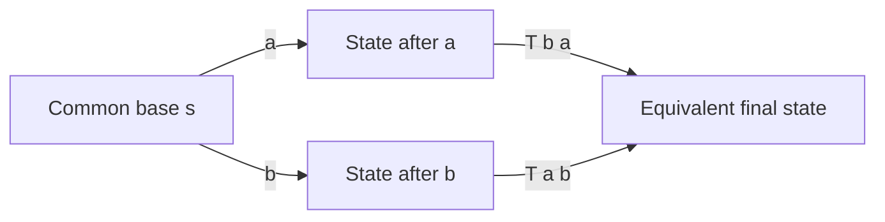
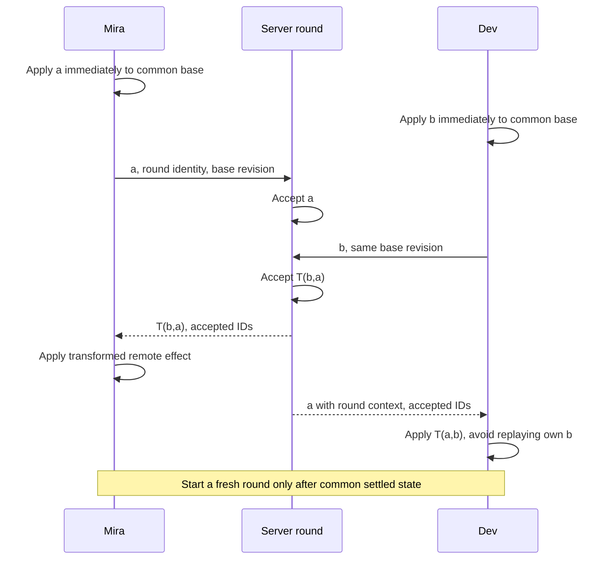

# Operational transformation: context, transformations and protocol correctness

## 1. Reader, scope and motivating questions

An editor must display typing before a network round trip completes. That creates local branches: operations refer to different document versions when they meet. Operational transformation (OT) changes an operation's representation so it can apply in another context while preserving defined effects.

This guide takes an engineer from offsets to transform functions, then to histories, client buffers, server state and production failure boundaries. Questions it must answer: what context does a position refer to; how do insertions and deletions transform; what do TP1 and TP2 require; how does server serialization help; how are pending operations and acknowledgments handled; and why do Unicode, replacement, formatting and undo add complexity?

Read the [conflict guide](../03-conflict-resolution/README.md) first. The [CRDT guide](../05-crdts/README.md) uses stable identities instead of this positional representation. Here the executable algorithm covers one ASCII character per insert/delete and a **two-client, one-operation-per-client round**. It demonstrates pairwise correctness and an explicit three-operation failure. It is not a continuous editor or Project D. Historical OT research introduced the transformation approach for responsive group editing; subsequent control algorithms and representations matter to its guarantees. [Ellis and Gibbs, 1989](https://sigmodrecord.org/?download_id=10728&smd_process_download=1)

## 2. A position is a statement about a document version

For string `s` of length `n`, insertion positions are gaps `0…n`; deletion positions are elements `0…n−1`. Define operations:

```text
I(p,x,id): insert character x at gap p
D(p,id):   delete original element at p
N(id):    do nothing, retaining operation identity
```

`p` is a zero-based offset in a particular base string, `x` one printable ASCII character, and `id` a unique stable ASCII identity. For this lab, character count and JavaScript string length agree. An operation's identity survives transformation even when its position changes or it becomes a no-op.

Mira and Dev start with `cat`. Mira's `I(1,X,M:1)` produces `cXat`; Dev's `I(2,Y,D:1)` produces `caYt`. Dev intended the gap after `a`. On `cXat`, that gap is now 3. Delivering the original offset 2 gives `cXYat`, which changes its meaning. Server-order replay without transformation still applies an obsolete coordinate.

The **context** of an operation is the document state/history in which its coordinates and preconditions are meaningful. A revision, causal history or state-space path may identify it. Two operations being compared directly must have equivalent appropriate contexts; integers alone do not prove this.

A history records operations and their contexts. An operation generated after another local operation depends on it. A replacement's delete and insertion are therefore not automatically two concurrent operations in the original base.

## 3. Inclusion transformation: the operation expressed after another

Write `T(a,b)` for operation `a` adjusted to run after concurrent operation `b`, where both originally refer to the same base. This is inclusion transformation: the new context includes `b`'s effect. It does not mean execute `a` twice or replace it with an unrelated user action.

For two concurrent operations, compare the diamond:



The notation in diagram edges abbreviates `T(b,a)` and `T(a,b)`. Equality concerns specified document observations, not network arrival order.

### 3.1 Insert against insert

Let `a=I(p,x,id_a)`, `b=I(q,y,id_b)`. Define smaller ASCII identity as earlier when both use the same gap. Shift `a` right by one if `q<p`, or if `q=p` and `id_b<id_a`; otherwise retain `p`:

```text
T(I(p,x,id_a), I(q,y,id_b)) = I(p+shift,x,id_a)
shift = 1 if q<p or (q=p and id_b<id_a); otherwise 0
```

All variables refer to the common base. For distinct gaps at 1 and 2 in `cat`, Mira stays at 1 after Dev, while Dev moves to 3 after Mira. Both paths give `cXaYt`.

For both at gap 1, IDs `D:1<M:1` order Dev's Y before Mira's X. Mira's adjusted position is 2 and Dev's remains 1. Both paths give `cYXat`. Arrival order does not decide the tie. Lexical priority has no inherent relationship to user importance or intention; it is the declared policy.

### 3.2 Insert against delete

Let `a=I(p,x,id_a)`, `b=D(q,id_b)`. Deleting an element strictly before a gap removes one preceding position. At the same offset, the insertion remains in the gap before the deleted original character:

```text
T(I(p,x,id_a), D(q,id_b)) = I(p−shift,x,id_a)
shift = 1 if q<p; otherwise 0
```

Base `cat`; insert X at 1 while deleting `a` at 1. Delete first gives `ct`, then insert at 1 gives `cXt`. Inserting first requires the complementary deletion rule to avoid deleting X.

### 3.3 Delete against insert

Let `a=D(p,id_a)`, `b=I(q,y,id_b)`. The original target shifts right if insertion is before **or at** its position:

```text
T(D(p,id_a), I(q,y,id_b)) = D(p+shift,id_a)
shift = 1 if q≤p; otherwise 0
```

For the same example, Mira first gets `cXat`; Dev's delete of original `a` transforms from 1 to 2, yielding `cXt`. The different strictness in §3.2 and §3.3 is necessary: insertion targets a gap; deletion targets an existing element.

### 3.4 Delete against delete

Let `a=D(p,id_a)`, `b=D(q,id_b)`:

```text
T(D(p,id_a), D(q,id_b)) = N(id_a)       if p=q
                         D(p−1,id_a) if q<p
                         D(p,id_a)   if q>p
```

Deleting original `a` twice from `cat` must produce `ct`, not `c` or an invalid offset. The second transformed delete becomes a no-op. Two distinct deletes at 0 and 2 in `cat` yield `a` on either path, with the second position adjusted as needed.

Transforming a no-op, or transforming against a no-op, leaves the other's effect unchanged. Duplicate delivery of the *same* identity is handled by protocol deduplication, not by treating it as another concurrent user operation. The lab rejects transformation of an identity against itself.

These rules are authored as a bounded educational algorithm, not extracted as a complete production protocol. Source-level implementations are in the [lab](../../../playground/synchronization/02-ot/README.md).

## 4. What correctness actually requires

### TP1: a pair has an equivalent final state

For a base state `s` and two valid concurrent operations `a,b`:

```text
apply(apply(s,a),T(b,a)) ≈ apply(apply(s,b),T(a,b))
```

`apply` is the state transition and `≈` equality of logical document observations. Preconditions include valid base offsets, distinct identities and a shared context. In §3.1 the two sides both equal `cXaYt`.

The case split explains the pairwise result: insertions before a target shift it, deletions before it contract it, equal inserts follow stable priority, and duplicate target deletions eliminate one effect. The lab exhaustively checks all 220 pairs from its generated operation alphabet over base lengths 0–4. This is finite evidence; the case reasoning is the argument for the bounded signature. Neither establishes a general editing system.

### TP2: transforming a third operation must not depend on equivalent paths

For concurrent `a,b,c` in one base, a stronger path obligation is:

```text
T(T(c,a), T(b,a)) = T(T(c,b), T(a,b))
```

Both sides express `c` in a context containing `a` and `b`. Under protocols that may reach that context along either path, transform results must agree in the required sense. The actual obligations of an OT system depend on its permitted transformation paths and its richer operation representation.

Research has exhibited limitations of simple position-only signatures under general TP1/TP2 requirements. Those results must be read with their operation/control model; they are not a statement that every centralized OT system is impossible. [Randolph, Boucheneb, Imine and Quintero, 2013](https://arxiv.org/pdf/1302.3292)

### A runnable TP2 counterexample

Start with `ab`. Define:

- `a=I(0,X,M:1)`;
- `b=D(0,C:1)`, deleting original `a`;
- `c=I(1,Y,D:1)`, intending the gap after original `a`.

| Transformation path | Intermediate result after a and b | Third operation's transformed offset | Final |
|---|---|---:|---|
| a then T(b,a) | `Xb` | 1 | `XYb` |
| b then T(a,b) | `Xb` | 0 | `YXb` |

First path: c shifts from 1 to 2 against inserted X; deletion at 1 then contracts it to 1. Second path: deleting original `a` contracts c to 0. Mira's insertion is also at 0; the simplified same-gap rule puts `D:1` before `M:1`, keeping c at 0. The earlier deletion collapsed distinct original gaps, and the basic representation no longer distinguishes their provenance.

Pairwise state convergence succeeded. Path independence failed. `tp2Witness()` returns both offsets and both documents, and a regression test expects their inequality. Sorting IDs more carefully at equal offsets cannot recover context already discarded.

### Other required obligations

A complete design also needs valid transformed operations, preserved causal dependencies, eventual dissemination/recovery, stable operation identity, safe acknowledgment handling, and an application definition of intent. A convergent result can still format the wrong text or lose an undo target. A rejected malicious edit must not remain accepted merely because it helped other speculative edits transform.

## 5. Server serialization and control algorithms

A server chooses an accepted order, but a client has already applied its own local operations. Sending canonical offsets directly to that client's speculative view can target the wrong characters. The client needs a transformation path from accepted state to its visible branch.

Jupiter-style work studies state spaces for client/server OT, rather than assuming an arbitrary queue of pairwise transforms is sufficient. A later original study models two-dimensional and compact n-ary state spaces and establishes behavior under that protocol model. [Wei, Huang and Lu, OPODIS 2018, extended paper](https://arxiv.org/pdf/1708.04754)

The distinction is important: TP2 can be an obligation on transforms when control permits multiple equivalent paths, or a control algorithm can constrain which paths occur and establish its own proof. Attaching a server revision to the lab's failed signature does not itself prove such constraints.

### Two-client bounded round implemented here

The lab admits one concurrent operation from each client against one agreed base. Each client applies locally. The server can choose either arrival order and uses the complementary transform for the second operation. Each client integrates the other via its corresponding diamond edge. Acknowledgments identify the two accepted operations; a new round is allowed only after everyone has the settled final state.

This barrier avoids the three-operation path admitted by the regression witness. It also prevents ordinary continuous typing from being sent in the same round. The restriction is deliberately visible: it is a teaching model, not a responsive general-purpose editor. More buffered user work requires a full control design and proof.



The code simulates this schedule in memory. It has no durable server transaction, real acknowledgments or reconnection transport.

## 6. Client state: shadow, outstanding operation and buffer

A useful continuous-editor model distinguishes:

- **Confirmed shadow:** client knowledge of the server's accepted prefix.
- **Outstanding operation:** submitted but not yet acknowledged, represented in its tracked context.
- **Buffer:** later local work, based on the speculative state after the outstanding operation.
- **Visible document:** confirmed shadow plus transformed pending local work.

For a chosen proven control algorithm, maintain the reconstruction invariant:

```text
visible ≈ applyAll(confirmedShadow, pendingInItsSequentialContexts)
```

This equation defines the relationship, not a universal implementation. If confirmed text is `cat`, pending insert X at 1 followed by Y at 2 reconstructs `cXYat`; the second operation's context is after the first. Treating both as operations generated in `cat` changes their meaning.

When a remote operation `r` is in the context of the pending queue's first operation, each crossed pair must update **both** sides. Schematic logic:

```text
for each pending operation q in contextual order:
    oldQ = q
    oldR = r
    q = T(oldQ, oldR)
    r = T(oldR, oldQ)
apply remaining r to visible document
```

Computing the second transform with already-transformed q is a context error. At the same time, advance the confirmed shadow by the appropriate canonical remote event. This loop is only valid inside a control algorithm whose context, priority and path obligations are satisfied; using it with our TP2-failing lab for arbitrary histories is unsupported.

For an acknowledgment of local work, do not reapply its effect to the visible document. Advance the confirmed prefix, remove the corresponding pending identity, and promote/send buffered work with the correct base/context. Check the canonical accepted representation against the transformed pending representation under the protocol. Server-side rejection requires preserving and repairing the speculative branch; simply removing a rejected queue entry can invalidate later dependent offsets.

## 7. Server state, recovery and history retention

The server needs authoritative document state, a versioned accepted history, operation identities/results, and protocol-specific per-client state or transform context. A new submission is validated and transformed against exactly the missing relevant history, not against all prior operations regardless of ancestry. If dependencies have not arrived, buffer within bounds or request catch-up. Authorize before revealing or accepting document data.

Accepted document mutation, history entry and replay result must share a durable boundary. A timeout can mean commit without response. A replay returns the stored decision; raw inserts are not idempotent. If all transform history since a client's base was compacted, the server cannot honestly transform from unknown context.

Recovery options include retained old history, a defined snapshot/reset protocol that preserves unsent work for merge/review, or explicit rejection of too-old edits. A snapshot alone does not explain how an old pending offset should map into it. Rolling versions must preserve transform semantics and indexing units, or route incompatible clients to an explicit upgrade/reset boundary.

See the foundation's [durable mutation trace](../01-distributed-state/README.md#9-trace-one-durable-mutation) and the [history budgets](../02-mathematics/README.md#11-storage-compaction-and-merge-complexity). Consensus or replicated database commit protects accepted history from split-brain, but does not repair a logically incorrect transform.

## 8. Replacement, ranges and undo

Deleting b at 1 then inserting X at 1 transforms `abc` into `aXc`. The insertion's base is after the deletion. Modeling replacement as two independent concurrent operations in `abc` is wrong. A transaction-like compound operation can preserve grouping, but its transform needs to specify interaction with concurrent edits inside the replaced region.

Suppose Mira replaces word `cat` with `dog` while Dev inserts `X` inside the original word. Options include preserving X relative to surviving anchors, treating replacement as deletion of observed elements plus new insertion, or marking a semantic conflict. Convergence can be achieved under each, but their user experience differs. State the policy before building a range transform.

A range delete may encounter concurrent insertions, overlapping deletes and splits. Preserving an unseen insertion can require an originally contiguous deletion to become several ranges. A single start/end pair may be insufficient. Applying transforms to byte offsets while retaining rich-text paths adds another coordinate system.

Undo is a new operation against current shared state, not automatically replay of an inverse at its old position. Undoing Mira's insertion should target her effect rather than remove Dev's later insertion at the same offset. Store effect identity/history and transform the inverse appropriately, or define an explicit alternative. Restoring a whole old document state loses other users' work.

## 9. Unicode, selections and structured text

JavaScript strings index UTF-16 code units. `"😀".length` is 2, while it is one Unicode scalar. `"e\u0301"` contains two scalars but commonly one extended grapheme cluster. An operation protocol must choose and version its indexing convention; client UI segmentation must map to it consistently.

Unicode text segmentation defines grapheme boundaries, including combining marks and emoji sequences. This guide consulted UAX #29 revision 49, Unicode 18.0.0, dated 2026-09-01, through its versioned report. [Unicode UAX #29, revision 49](https://unicode.org/reports/tr29/tr29-49.html)

This is evidence for segmentation, not permission to assume every runtime ships that version. If one client deletes one UTF-16 code unit from a surrogate pair, it can create invalid text for another's scalar-based protocol. If clients normalize text differently, offsets can diverge. Declare whether normalization occurs and avoid silent normalization on replay.

Cursors and selections need their own policy. At an insertion exactly at a cursor, **before affinity** leaves it before the new text; **after affinity** moves it after. The lab's `mapCursor` implements that choice. A selection has two endpoints and possibly different affinities; a deletion can collapse it. Presence updates are ephemeral and tied to a document version or anchor; they need not live in the durable document log.

IME composition may temporarily create local text that the user has not committed. The editor integration must coordinate composition and remote updates rather than publishing every transient DOM state as a semantic operation.

Rich text adds hierarchical blocks, marks, embedded objects and constraints. Inserting a paragraph, merging blocks and formatting a span involve object paths, identities and range interpretation. Replacing a parent can invalidate child paths; tree moves can create cycles. Define primitive operations and their pair interactions, admissible histories and schema invariants. A plain-text TP1 test cannot establish these properties.

## 10. OT and CRDTs compared under the same requirements

| Requirement | OT design considerations | CRDT design considerations |
|---|---|---|
| Concurrent text | Transform operation context with a specified control algorithm | Integrate stable identities and datatype-specific ordering |
| Offline edits | Retain/reconstruct required history or define branch/reset policy | Retain required identity/causal/delete evidence and exchange missing changes |
| Metadata | Pending/history/control state; compression/compaction protocol | IDs, causal metadata, tombstones and indexes; compaction protocol |
| Central service | Often simplifies admissible paths and accepted order | Can still enforce authorization, persistence and fan-out |
| Peer-to-peer | Decentralized context/path obligations can be substantial | Often compatible with independent merging; library sync assumptions still matter |
| Intent | Depends on transforms and operation semantics | Depends on sequence/format/delete semantics |
| Correctness evidence | Transform plus control plus failure model | Datatype algebra plus delivery plus failure model |

Neither label determines latency, memory use, full offline usability or security. Compare the exact algorithm and workload. The [CRDT guide](../05-crdts/README.md) develops the counterpart representations and their costs. Claims about proprietary products require specific sources and are not inferred here.

## 11. Run and inspect the lab

From repository root:

```sh
node playground/synchronization/02-ot/demo.mjs
node playground/synchronization/02-ot/model.test.mjs
```

Walkthrough:

1. `diamond` creates both speculative branches, computes complementary transforms and checks final text.
2. `transform` separates four type pairs and the same-position tie rule. Look for the strict vs non-strict comparisons derived in §3.
3. `oneRound` produces canonical accepted operations in either arrival order. Replaying those operations from the common base matches both clients.
4. `tp2Witness` deliberately calculates incompatible third-operation representations after equivalent paths.
5. `mapCursor` exposes an explicit presence-affinity policy separate from edit transforms.

Expected demo: both concurrent insert paths yield `cXaYt`; duplicate-target deletion yields `ct`; the bounded insert/delete round yields `cXt`; the TP2 witness yields `XYb` versus `YXb`. The lab README contains complete expected output and validation details.

Meaningful variation: admit a third independent operation or allow arbitrary new local operations before the round settles. The bounded round's argument no longer applies. Retain the counterexample instead of weakening assertions to make that unsupported architecture appear correct.

Performance: the bounded transform is constant work; string application copies text. Crossing k pending operations costs k transform calls, excluding rich operation work. Large outstanding windows, frequent full-string rebuilding, remote fan-out and retained history have different bottlenecks. Use the [mathematical reference](../02-mathematics/README.md) to budget them.

## 12. Failure diagnosis, safety and operation

| Symptom | Mechanism to check | Repair/prevention |
|---|---|---|
| Both clients agree but delete wrong character | Transform applied in wrong context/index unit | Preserve base/context; replay exact operation history |
| Third concurrent operation diverges | Missing path/control obligation | Use supported algorithm/representation; retain witness as regression |
| Local insertion appears twice after ACK | Own operation replayed or identity lost | Match accepted IDs and remove pending effect without double apply |
| Cursor drifts while text converges | Stale presence version or undefined affinity | Map from correct version or use stable anchors |
| Reconnect corrupts edits | Base history discarded; pending queue not durable | Explicit reset preserving unsent work; safe history retention |
| Formatting/undo removes another edit | Plain offset inverse or coarse range policy | Identify intended effect and define structured semantics |

Protect against huge pending queues, malformed offsets, oversized transforms and malicious identities. A valid transformed edit can still be unauthorized. Server-side authorization and document-schema checks precede accepted commit; rejected speculative work needs a recovery path. Log IDs, versions, operation types and policy versions while minimizing private contents.

## 13. Invariants and limits

- Positions belong to document contexts and indexing conventions.
- A transform preserves identity while changing representation.
- Transform both sides of a crossed pair using their original shared context.
- TP1 establishes a pairwise diamond; additional paths need additional proof/control.
- Server serialization supplies an accepted order, not automatic client correctness.
- Acknowledgment must not repeat an already visible local effect.
- Replacement, ranges, undo, Unicode and structured documents expand the operation contract.
- Durable history and authorization are independent of transform algebra.

## Release review

Status: **ready — complete for the stated educational scope**.
Reviewer: Codex (AI technical and editorial review); no independent human review claimed.
Review date: 2026-10-14.
Open issues: none blocking this educational release.
Scope limits and further validation: Two-client bounded OT round with documented TP2 counterexample; no general continuous OT editor or universal correctness claim.

See [the review record](../REVIEW.md) and [actual validation output](../VALIDATION.json).
