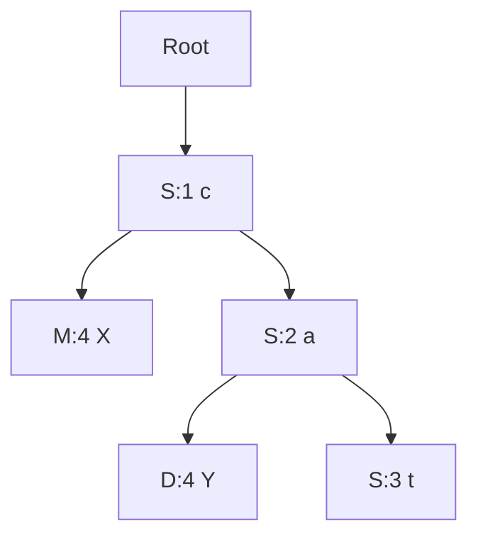

# CRDTs: convergent algebra, causal evidence and application semantics

## 1. Reader, scope and questions

A conflict-free replicated data type (CRDT) constrains representation, updates and merge/delivery rules so permitted independent updates lead to equivalent replica state. It can remove the need for an immediate shared decision for those operations. Its name does not mean users never disagree or that every business constraint survives a merge.

This guide is for an engineer who understands the [foundation](../01-distributed-state/README.md) and [conflict policies](../03-conflict-resolution/README.md). It answers: why particular algebra converges; how state-based and operation-based assumptions differ; why deletions need evidence; how sets, counters, registers, maps and sequences encode that evidence; why rich text requires more than plain text; and what must remain after compaction.

Each datatype below has state, local operations, merge/delivery, a divergent history, correctness argument, costs, limitations and fit. The [lab](../../../examples/synchronization/03-crdts/README.md) implements all the listed categories, with an intentionally simple sequence and rich-text policy. Production library integration, durable offline protocols and full Project E/G infrastructure remain separate deliverables. The [OT guide](../04-ot/README.md) provides the alternative operation-context approach.

## 2. Two paths to convergence

### 2.1 State-based: monotonic information and joins

Let `S` be the set of valid replica states, `≤` an information order, and `x ⊔ y` their least upper bound, called a join. A **join-semilattice** gives every pair such a least upper bound. Local updates must move upward in the information order, and merge computes the join. This is a standard sufficient state-based construction. [Shapiro et al., RR-7506, 2011, §2.3](https://www.lip6.fr/Marc.Shapiro/papers/2011/Comprehensive-CRDTs-RR7506-2011-01.pdf)

The useful laws are:

```text
x ⊔ y = y ⊔ x                       commutative
(x ⊔ y) ⊔ z = x ⊔ (y ⊔ z)           associative
x ⊔ x = x                           idempotent
```

`x,y,z` are compatible valid states of the same logical object, with the same schema and identity conventions. These laws remove sensitivity to merge order, grouping and duplicate state messages. They do not cover conflicting payload reuse under one identity or invalid encodings.

Derive the laws from the least-upper-bound definition: swapping inputs leaves the same bounds; regrouping three inputs computes the least bound containing all three; the least bound of a state with itself is itself. Because each merge also includes the receiver's previous information, an old snapshot cannot move it backward.

If all relevant information eventually reaches every eligible replica after updates stop, each approaches the join of that information. A permanently lost update that never appears in any later surviving state cannot be recovered by algebra. Repeated anti-entropy—exchange to discover and repair differences—supplies the progress mechanism.

A concrete example is set union: `{M:1} ⊔ {D:1}` is `{M:1,D:1}` in either order. Receiving `{M:1}` again changes nothing. The [mathematical reference](../02-mathematics/README.md#9-operation-algebra-and-state-equivalence) proves its membership argument.

### 2.2 Operation-based: permitted order and commutation

An operation has a local preparation phase that captures necessary context and a downstream effect that other replicas apply. Concurrent effects must commute under the datatype's contract; dependent effects follow its delivery requirements. Raw increments commute but are not idempotent, so repeated delivery needs one-effect handling. A transport must not silently change “remove these observed additions” into “remove whatever exists when delivered.”

Many classic operation-based designs assume reliable causal delivery with nonduplicate effects. Other designs make effects idempotent or buffer missing dependencies. Name the exact design instead of claiming all CRDT operations tolerate arbitrary loss/reordering/duplication. Verification work explicitly incorporates a network model and message identity into convergence proofs. [Gomes et al., 2017](https://martin.kleppmann.com/papers/crdt-isabelle-oopsla17.pdf)

### 2.3 Delta-state: smaller joinable evidence

A delta-state design transmits joinable fragments instead of the whole state. For a G-counter, one updated actor component can be a fragment; for a register or remove-capable collection, payload fragments may need causal context. An arbitrary JSON patch is not automatically a joinable delta.

Delta-state research defines delta-mutators and anti-entropy rules, distinguishing eventual convergence from additional causal-merging conditions. [Almeida, Shoker and Baquero, preprint 2016; journal version 2018](https://arxiv.org/pdf/1603.01529)

For example, a fragment `{M:3}` joins with `{M:2,D:5}` to produce `{M:3,D:5}`. D's evidence is preserved. Shipping only a new counter *total* of 3 cannot represent that rule.

### 2.4 Strong eventual consistency and its boundaries

Strong convergence concerns replicas with the same incorporated updates: they have equivalent observations. Eventual delivery supplies eventual incorporation, and operations must terminate under the model. This is compatible with users seeing temporary different states and with reads returning local stale information.

Convergence does not supply linearizability, bounded synchronization delay, durability, access control or intent preservation. A datatype can converge to a conflict-bearing frontier or to negative inventory. The decision of which states count as valid application states needs its own [invariant-closure argument](../02-mathematics/README.md#convergence-and-invariant-closure-need-different-proofs).

## 3. Grow-only set (G-set)

**State:** set `A` of immutable values. **Update:** add by inserting into `A`. **Merge:** union. **Read:** members of `A`.

| Step | Mira | Dev |
|---|---|---|
| Base | `{}` | `{}` |
| Independent update | `{comment-M}` | `{comment-D}` |
| Merge either way | `{comment-M,comment-D}` | Same |
| Duplicate old snapshot | Unchanged | Unchanged |

Subset order makes union a join. Adds grow information; duplicates do not create additional membership. The proof depends on consistent equality/encoding of elements: “same comment” needs a stable identity if payloads can be equal or edited.

A hash-set implementation merges in expected time linear in the total input membership and uses space proportional to unique members. The lab's immutable local `gAdd` copies state; optimized implementations can mutate under appropriate local isolation. No remove exists. Use it for immutable evidence, known IDs or append-only membership where that restriction fits. It is unsuitable for mutable task tags unless another layer records removals.

## 4. Two-phase set (2P-set)

**State:** `(A,R)`, where `A` records additions and `R` permanent removals. **Update:** add to `A` if not permanently removed; remove an observed member by adding it to `R`. **Merge:** union each component. **Read:** `A \ R`.

Mira and Dev start with urgent in `A`. Mira removes it, producing `A={urgent},R={urgent}`. Dev's old state still has `A={urgent},R={}`. Merging yields removed membership. Replaying Dev cannot restore it. Both components grow under subset order, even though visible membership shrinks.

The cost is retained unique values plus removed values; a direct merge is linear in evidence. A value cannot be re-added once removed. The lab throws rather than silently accepting that impossible request. If each logical incarnation has a new identity, a new incarnation can be added, but that changes the application's membership model.

Use for permanent retirement or one-time membership identities. Reusable tags, reactions and editable lists need more expressive semantics. Throwing away `R` after all currently connected users agree can resurrect an old member from an offline device.

## 5. Observed-remove set (OR-set)

**State:** unique addition IDs mapped to values, plus removed addition IDs. **Add:** allocate a new identity and record `(value,id)`. **Remove:** capture the currently observed live addition IDs for that value and add those IDs to removed evidence. **Merge:** union both components with equal-ID/equal-payload validation. **Read:** values with at least one live addition ID.

| History | Additions | Removed IDs | Visible |
|---|---|---|---|
| Base | `urgent:S:1` | none | urgent |
| Mira removes observed membership | same | `S:1` | absent |
| Dev adds while disconnected | `S:1,D:1` | none | urgent |
| Joined | `S:1,D:1` | `S:1` | urgent |
| Later remove observes both | same | `S:1,D:1` | absent |

Concurrent unseen addition survives. Capturing IDs at the source gives remove a stable meaning; computing removals afresh at the receiver would erase unobserved additions and change the policy. This concurrency semantics and compact alternatives are studied in observed-remove set research. [Bieniusa et al., 2012](https://arxiv.org/pdf/1210.3368)

The tombstone implementation converges because compatible addition records and removed-ID evidence union independently, and the projection is deterministic. It tolerates removal arriving before its addition: the later addition is suppressed by the retained ID. Identity reuse with a different value is rejected, not resolved by arrival order.

Space grows with additions and removals, even when visible membership is small. A bulk merge can be linear in evidence, while the lab repeatedly clones state and can be slower. Compact variants may replace explicit tombstones with causal context; “tombstone-free” does not mean no deletion/causal evidence. Removing context is unsafe without a proof/reset boundary.

Fit: add-wins tags or reactions where this semantic choice is acceptable. Permissions may require revoke-wins or authority-enforced ordering; a convergent add-wins recipient set can violate intended access policy.

## 6. Grow-only counter (G-counter)

A replicated scalar merged by maximum loses independent increments. Instead use one nonnegative cumulative component per exclusive writer.

**State:** `P[actor]`, initially zero. **Increment at writer w:** increase only `P[w]`. **Merge:** componentwise maximum. **Read:** sum components.

Let `r` be tracked writers and `Pᵢ` a component:

```text
value(P) = Σᵢ₌₁ʳ Pᵢ
merge(P,Q)[i] = max(P[i],Q[i])
```

The components count distinct writers' cumulative increments, not packet counts. Mira increments twice and holds `{M:2}`; Dev increments three times and holds `{D:3}`. Join yields `{M:2,D:3}`, reading 5. Replaying `{M:2}` leaves 5. Each component monotonically advances; product order and max give a join.

Two devices cannot independently share the same writer identity without synchronizing that component. If both independently advance M from 0 to 1, max produces 1 rather than 2. The lab includes that assumption violation as a counterexample. Restore old local state under a reused identity and the same risk returns. Allocate fresh writer incarnations or enforce durable exclusive ownership; no generic identity-reset shortcut is safe.

Metadata and full merge scale with `r`. With mutable indexed state a local increment can update one component; this immutable lab copies its map. BigInt avoids floating-point integer overflow, but wire encoding must preserve it. If writers churn forever, components grow forever unless a safe retirement scheme consolidates evidence.

Fit: independent accumulating counts. It does not produce globally unique sequential primary keys; two local reads of the same sum can choose the same purported next ID. Automerge's counter documentation similarly separates increments from numeric assignment and warns against using replicated counters as unique key allocators. [Automerge counters, accessed 2026-10-13](https://automerge.org/docs/reference/documents/counters/)

## 7. Positive-negative counter (PN-counter)

**State:** two G-counters `(P,N)`. Increment advances one's P component; decrement advances one's N component. Merge both by componentwise max. Read the positive total minus the negative total:

```text
value(P,N) = Σ P[i] − Σ N[i]
```

`P[i],N[i]` are nonnegative cumulative contributions for writer i. Both vectors grow even when the observed result decreases. Example: Mira `P[M]=4,N[M]=1`, Dev `P[D]=2,N[D]=3`; after merge both read `6−4=2`. Duplicate state cannot add contributions twice.

Space and full merge cost are linear in writer count, with roughly twice the G-counter component payload. Positive and negative updates must never be represented by lowering a max-merged component.

The type permits negative results. Initial stock is one, encoded in `P[S]=1`. Mira decrements in `N[M]`, Dev independently in `N[D]`. Each locally reads zero; joined result is −1. The merge is correct for a PN-counter and incorrect for accepted nonnegative stock. Allocate bounded rights, coordinate reservations, or change the acceptance promise with compensation. A mathematical counter does not establish a stock protocol.

Fit: deltas that may legitimately cross zero. Scarcity needs extra semantics. Repeated *operation* increments also need deduplication even though repeated *state snapshots* are idempotent.

## 8. Last-writer-wins register (LWW-register)

**State:** one value plus a totally ordered key. **Assign:** generate a key that advances beyond causally observed writes if the intended sequential assignment semantics require that. **Merge:** choose maximum key. **Read:** selected value.

The lab reuses the [conflict-guide selector](../03-conflict-resolution/README.md#4-last-write-wins-a-total-order-over-candidates). Key `(stamp,actor,id)` compares identically everywhere; equal keys with unequal payloads are invalid. Assignments `Plan@(10,M,M:1)` and `Proposal@(10,D,D:1)` choose Plan under the declared ASCII order. Either merge path chooses the same candidate.

Max under a total order is associative, commutative and idempotent. However, selecting maximum among arbitrary stamps only proves deterministic selection. To implement “a later causally informed assignment overwrites what it observed,” the local key-generation rule must honor that observation. Wall-clock skew can violate it; Lamport advancement can enforce it under its protocol assumptions.

Winner metadata is bounded per register plus value size, assuming bounded identities/stamps. Audit history is extra storage. Lost candidates cannot be reconstructed from the winner. Fit: deliberately overwritable scalars. It is not a text merge algorithm or reliable permission-revocation protocol.

## 9. Multi-value register (MV-register): keep context while pruning values

The earlier lab kept every write for causal-frontier projection. This installment implements a smaller state that drops obsolete payloads while retaining their causal meaning.

**State:** live entries keyed by dot `(actor,counter)`, plus a context `C[actor]` recording the observed gap-free prefix of that actor's writes for this object. **Assumptions:** one exclusive persistent writer per actor; complete causally closed state; counter increments without reuse; same object/generation.

**Assign:** after observing current state, allocate the next dot for the local actor, replace live entries with that assignment, and preserve the context of everything it supersedes. **Merge:** for each candidate dot:

- if present on both sides with equal payload, retain it;
- if present only on one side and the other context does **not** cover it, retain it as unseen;
- if absent from the other live entries but covered by its context, omit it as superseded.

Join contexts componentwise by maximum. Dot coverage means its counter is at most the corresponding context counter. The rule works because a context prefix denotes actual observed writes, not the largest arbitrary number a packet claimed.

| State | Live entries | Context |
|---|---|---|
| Mira after assign Plan | `(M,1):Plan` | `M:1` |
| Dev after independent assign Proposal | `(D,1):Proposal` | `D:1` |
| Joined | both candidates | `M:1,D:1` |
| Mira resolves after observing both | `(M,2):Project plan` | `M:2,D:1` |
| Rejoin stale Dev snapshot | only Project plan | `M:2,D:1` |

Dev's old dot is absent from the resolution's entries but covered by its context; it stays superseded. Merely deleting its payload without retaining context would make “old suppressed” indistinguishable from “never seen.”

The proof intuition is a per-dot knowledge state: unseen, live with payload, or observed-and-superseded. Merging combines knowledge, while superseded evidence dominates old live evidence. Compatible identities have fixed payloads. Context compression is valid only for the assumed prefixes. Full state dissemination can carry those contexts without network causal ordering; sending isolated live entries with an invented context is not equivalent.

At most one maximal concurrent assignment per actor remains under this exclusive-writer model; context grows with tracked actors and payloads with the frontier. Hash-based state merge scans live entries/context rather than all historical writes. This is an educational dot/context register, not an implementation claim about every library. A generic dotted causal map construction and merge obligations are developed in [delta-state CRDT research](https://arxiv.org/pdf/1603.01529).

Equal payloads from concurrent writes may remain distinct internal entries while a UI deduplicates displayed values. A human resolution is another causal write; a new unseen concurrent candidate can coexist with it. Fit: offline fields where alternatives matter. History/audit and malicious-context validation remain separate requirements.

## 10. Replicated maps: composition has semantic boundaries

### 10.1 Fixed-key product of registers

The lab map stores a LWW cell per key. Distinct keys join independently. Deleting a key stores a winning tombstone cell with `deleted=true`, distinct from a live `null` value. Reading omits tombstoned keys but merge retains them.

Mira deletes title with key 2; Dev still sends old title with key 1. Maximum keeps deletion. Mira's title deletion and Dev's unrelated status insertion both survive. A later greater-key title assignment restores that key under this declared policy. The result follows LWW ordering, not observed-remove membership semantics.

Convergence follows coordinatewise join: each key uses a convergent register, and absent keys denote no evidence. Storage grows with keys ever used, including tombstones; full merge scans them. Copying/lookup costs depend on the map implementation.

### 10.2 Observed-remove and nested maps

A richer map may give each key/object incarnation a unique identity, track observed removal and recursively merge child CRDTs. It must decide whether removing a key resets nested counters, how concurrent child updates survive, and whether re-adding the same label creates a new object. A key name is not sufficient identity for every subtree generation.

Example: Mira removes task `T` while Dev increments a counter inside it. A remove-wins model can hide the whole incarnation; update-wins can retain it; observed-remove logic can preserve an unseen incarnation. These are different datatype definitions. Blind recursive JSON merge can attach a stale child's operation to a recreated object.

Formal JSON CRDT work models maps, lists, assignments and deletions with explicit semantics rather than a generic recursive callback. [Kleppmann and Beresford, 2016 preprint](https://arxiv.org/pdf/1608.03960)

A product of convergent fields can still violate `start≤end` or parent-cycle rules. Map convergence does not establish multi-key transaction constraints. Use field CRDTs only where cross-field semantics permit them, or add a separate accepted decision boundary.

## 11. Replicated lists and sequences: stable identity plus order

Text is an ordered collection. A set union preserves membership but gives no acceptable text order. A sequence needs stable element identity, location evidence, a deterministic order of concurrent insertions and retained deletion/anchor evidence.

Two broad families illustrate the design space:

- **Position identifiers:** allocate a unique sortable identifier between neighbors; concurrent inserts receive tie-breaking identity. Identifier density and repeated insertions affect growth. Ordinary floating-point midpoints eventually run out of precision.
- **Reference/anchor structures:** record insertion relative to stable existing element IDs, then deterministically order competing branches. Deleted elements can remain as structural anchors.

Both need a precise list specification and user semantics. Formal verification of RGA and other types includes their operation and network assumptions; it does not transfer automatically to an arbitrary “RGA-like” implementation. [Gomes et al., 2017](https://martin.kleppmann.com/papers/crdt-isabelle-oopsla17.pdf)

### 11.1 The lab's explicit insertion tree

This is an authored educational CRDT, not a byte-compatible RGA implementation.

**State:** map of immutable nodes `(id,actor,clock,after,text)` and removed node IDs. `after` is a stable predecessor/anchor, or null for the root. `clock` advances beyond the maximum observed node clock; `id=(actor,clock)` is unique under exclusive writer incarnations. A child clock is greater than its anchor's clock. Each node contains one Unicode scalar.

**Insert:** allocate a node anchored to a known element, even if that anchor is hidden by deletion. **Delete:** retain the target ID in removed evidence. **Merge:** union nodes and removal IDs, reject equal-ID/different-content records, and validate known parent-clock ordering. **Read:** depth-first traverse children in descending `(clock,actor)` order. Omit removed nodes from visible output but traverse their children.

An initial chain has `S:1=c`, `S:2=a` after `S:1`, `S:3=t` after `S:2`. Mira inserts `M:4=X` after `S:1`; Dev inserts `D:4=Y` after `S:2`:



Descendant order follows the higher-clock new child before the older continuation. Both replicas project `cXaYt`. Deleting `S:1` hides c, while traversing its surviving children still yields `XaYt`. Physically removing `S:1` disconnects those descendants and breaks the representation.

If a child arrives before its anchor, retain it as unresolved evidence. It is not rendered under another arbitrary root. When the parent arrives, the subtree becomes reachable. A deletion ID arriving before its node still hides the node when it arrives. This state-based buffering tolerates reordering but needs eventual ancestor information and bounded pending storage.

### 11.2 Why this particular representation converges

Compatible immutable node records and removed-ID sets have union joins. A deterministic traversal produces the same visible sequence from the same evidence. Strictly increasing parent-to-child clocks prevent cycles in valid evidence. All nodes with complete valid ancestor chains have a deterministic place; unresolved nodes signal incomplete information.

The proof is about state equivalence under these rules. It does not prove optimal word preservation, move semantics, undo semantics or an arbitrary library's list specification. A single same-anchor two-word fixture stays as sibling subtrees, but that test is not a proof of maximal non-interleaving for every history.

Research demonstrates that some convergent list algorithms can interleave concurrent text in undesirable ways and distinguishes stronger non-interleaving properties. [Kleppmann et al., 2019](https://martin.kleppmann.com/papers/interleaving-papoc19.pdf) Fugue/FugueMax research studies those stronger properties explicitly. [Weidner and Kleppmann, 2023 preprint](https://arxiv.org/pdf/2305.00583)

### 11.3 Cost, indexing and application fit

Metadata grows with inserted nodes and removed IDs, not merely visible characters. A naive projection builds and sorts child lists, visits retained nodes and reconstructs the whole text; the lab is inefficient for large documents. Production designs can pack character runs and index visible rank/anchors with trees, but must preserve identities and semantics.

One Unicode scalar is not always one user-perceived character. The lab rejects lone surrogates, allows an emoji scalar, and represents combining `e` plus accent as two nodes. Editor caret/delete behavior must map grapheme boundaries to stable IDs. See [OT's Unicode discussion](../04-ot/README.md#9-unicode-selections-and-structured-text).

Fit: append/insert/delete ordered state under the selected policy. Reordering objects with move operations is another problem: delete-and-reinsert can duplicate logical entities or create cycles in structures. Do not add it without a distinct operation model.

## 12. Rich-text CRDTs: formatting is another concurrency model

Plain text specifies characters and order. Rich text also specifies which characters a mark covers, how marks overlap, what survives deletion, and what happens to insertions at range boundaries. A convergent character sequence plus arbitrary integer spans is insufficient: insertions shift offsets and collapse/deletion changes endpoints.

### 12.1 Executable per-element marks

The lab uses product state `(sequence,formatMap)`. A format cell is keyed by stable `(elementId,property)` and stores a LWW boolean. Marking captures explicit observed IDs; merging joins sequence evidence and cells independently. Deleted characters are hidden, while mark evidence is retained.

Mira marks original a bold; Dev concurrently inserts Y after it. Merged text is `caYt`, with only a bold. Both replicas agree. Y does not inherit formatting because the operation referenced observed IDs only. This is coherent, but users may expect a typed character inside a bold region to remain bold.

Similarly, turning bold off on selected IDs is an explicit false assignment, not physical deletion of the cell. Removing that evidence could let an old true cell revive. Marking n elements costs at least n per-element updates in this representation. The lab's scalar timestamp keys must obey the chosen sequential-formatting policy; merely picking a maximum cannot infer intended range behavior.

### 12.2 Span models and intent

A span-based design anchors endpoints to stable text identity and defines expansion at each boundary. Examples that need an answer:

| Concurrent action | Policy question |
|---|---|
| Type at start/end of a bold span | Does formatting expand onto the new text? |
| Type at a hyperlink boundary | Does the link expand, or remain on the original phrase? |
| Delete both endpoint characters | Where do the stable boundaries resolve? |
| Make a region bold while another unbolds part | Which properties survive, in what intervals? |
| Split or merge paragraphs | Which block identities and attributes persist? |

Peritext develops an intent model through such scenarios and anchors formatting evidence to stable character identifiers. It proves convergence for its specified algorithm, beyond merely preserving plaintext order. [Litt, Lim, Kleppmann and van Hardenberg, 2022](https://groups.csail.mit.edu/sdg/pubs/2022/Peritext_PACM_HCI_2022.pdf)

Automerge's documented rich-text interface exposes marks, expansion choices and block markers; the application must still choose a meaningful schema. [Automerge rich text, accessed 2026-10-13](https://automerge.org/docs/reference/documents/rich-text/)

The lab is **not** Peritext. It deliberately demonstrates the gap between convergent explicit marks and a full rich-text intent model. Schemas, links, embeds, normalization, IME integration, selection and undo expand the production requirements.

## 13. Deletion, causal stability and garbage collection

A delete is information: “this old ID is no longer visible.” Physical absence alone means either deleted or never seen. Old snapshots cannot distinguish those cases. Tombstones, contexts, versioned incarnations or accepted reset rules preserve the distinction.

Before reclaiming evidence, answer separately:

1. Can a delayed packet or offline replica reintroduce the old addition/value?
2. Does a still-live operation, cursor, formatting endpoint or descendant reference the deleted identity?
3. Can a restored backup or reused actor resurrect an old history?
4. Must undo, history or audit restore the deleted payload?
5. Does the protocol reject obsolete generation traffic after a reset?

Acknowledgment by all *currently connected* replicas does not cover days-old devices. Even acknowledgment by a fixed membership must be interpreted with its packet/restore and reclamation model. Causal stability can identify when relevant participants have incorporated causally prior evidence; safe collection also needs the datatype's reference and future-operation rules.

An optimized OR-set can keep compact causal context instead of explicit tombstones. Our MV-register removes obsolete payloads while retaining prefix coverage. The sequence may remove character payload under a richer implementation while preserving an anchor skeleton. These are different reclamation operations.

A reset can establish a new generation/snapshot and exclude older histories, but then reconnecting clients must preserve unsent work and rebase/review it through a supported path. Resetting a counter writer's ID or throwing away deletion IDs without such rules is not compaction.

For Yjs specifically, `Y.Doc` documents session client IDs and a garbage-collection setting; disabling GC supports restoration of old content. That implementation choice must be interpreted through Yjs's own encoding and snapshot rules, not copied as a generic permission to erase our anchors. [Yjs Y.Doc, accessed 2026-10-13](https://docs.yjs.dev/api/y.doc)

## 14. Local-first deployment and documented implementations

A CRDT supplies a datatype; an application still needs durable local storage, mutation capture, authorization, anti-entropy, snapshots, checkpoints, schema versioning and recovery. The server can route and persist changes without being the immediate merge authority, or enforce acceptance policy before redistribution. Local-first usability does not require peer-to-peer connectivity.

### Yjs

Official documentation states that binary document updates are commutative, associative and idempotent, and gives state-vector/difference APIs for catching up. That claim concerns its update representation; it is not a blanket claim about arbitrary callbacks or side effects fired by the surrounding application. [Yjs document updates, accessed 2026-10-13](https://docs.yjs.dev/api/document-updates)

Relative positions anchor cursors to the shared type rather than relying solely on offsets. [Yjs relative positions](https://docs.yjs.dev/api/relative-positions) Awareness/presence is separate from persisted document state. [Yjs awareness](https://docs.yjs.dev/getting-started/adding-awareness)

These properties do not persist a local edit to disk or authorize a user. Observe/send/persist update boundaries explicitly, suppress network echoes by origin where appropriate, and provide a durable catch-up path if a broadcast is lost.

### Automerge

Official conflict documentation describes deterministic winner selection for concurrent assignments while allowing access to competing values, rather than treating every object-field edit as a text merge. [Automerge conflicts, accessed 2026-10-13](https://automerge.org/docs/reference/documents/conflicts/)

Its documentation separates the core document/merge library from repository management concerns. [Automerge concepts](https://automerge.org/docs/reference/concepts/) The Rust synchronization API documents a reliable in-order stream assumption for that peer protocol. State convergence and a particular handshake protocol have different delivery requirements; do not infer that every sync message can be arbitrarily reordered because the underlying document is a CRDT. [Automerge sync API, accessed 2026-10-13](https://docs.rs/automerge/latest/automerge/sync/index.html)

These unversioned documentation snapshots are dated research evidence. No library dependency is installed or pinned by this installment. Project D must pin and test the chosen version, provider, persistence and editor bindings. No claim about Google Docs, Notion or another proprietary deployment follows from these library descriptions.

## 15. Cost and fit matrix

| Type | State/evidence | Merge/read cost in a straightforward bulk implementation | Main limit | Useful fit |
|---|---|---|---|---|
| G-set | Unique immutable members | Linear union; membership lookup with hash set | No removal | Append-only evidence |
| 2P-set | Add and permanent-remove sets | Linear evidence union/projection | No re-add of an identity | Permanent retirement |
| OR-set | Addition identities and removal/context | Linear retained evidence in simple form | Metadata and add-wins semantics | Reusable observed tags/reactions |
| G-counter | One cumulative component/writer | Linear writers for full merge/read | Exclusive writer IDs, churn | Independent accumulating counts |
| PN-counter | Positive/negative components | Linear writers | Can go negative | Signed accumulated deltas |
| LWW register | One total-key candidate | Constant comparisons plus value | Discards candidates, clock policy | Overwritable scalar |
| MV-register | Frontier and causal context | Scan candidates/writers | Context/membership assumptions | Offline field alternatives |
| Map | Per-key CRDT plus existence rules | Sum of contained merge costs | Cross-key invariants and reset semantics | Independent structured attributes |
| Sequence | Element IDs/order/delete evidence | Representation-specific; naive sort/traverse whole history | Metadata, intent and anchors | Plaintext/ordered objects under policy |
| Rich text | Sequence plus formatting/block evidence | Representation/span-specific | Boundary intent and schema | Collaborative formatted documents |

Costs name algorithmic variables rather than universal library performance. The lab repeatedly clones maps/sets and sorts views, so some costs are higher than the bulk algorithms in the table. Compression changes constants and layout, not the need to preserve required evidence.

## 16. Worked offline workspace and verification

Assume Mira and Dev start with `cat`, title `Draft`, urgent tagged by `S:1`, current authorization, and fixed writer incarnations.

1. Disconnected Mira inserts X after c, assigns title Plan, removes observed urgent, and bolds original a.
2. Dev inserts Y after a, assigns Proposal, and adds urgent under fresh `D:1`.
3. Exchange full compatible states in any order, including duplicate snapshots. The sequence projects `cXaYt`; the MV title retains Plan and Proposal; urgent remains through the unseen add; only original a has the explicit lab bold mark.
4. Mira observes both title candidates and assigns Project plan. Its context suppresses both older dots after replay; Dev's stale snapshot cannot restore Proposal.
5. Delete c. Descendants still render via its anchor; physically removing that node would orphan them.
6. Recheck authorization before accepting/disclosing shared changes. If Dev was revoked while offline, the algebra does not make its branch authorized; the acceptance/recovery protocol must decide what is retained privately or rejected.
7. Validate any cross-field/workflow invariants. Mergeable title/tags are not evidence that the workspace's business transitions are valid.

Run the [lab](../../../examples/synchronization/03-crdts/README.md) with its exact setup. `model.mjs` exposes representations, `demo.mjs` shows outcomes, and tests inspect raw evidence as well as projected values. The two implementations are intentionally separate: OT transforms offsets in contexts; this sequence joins stable identities.

Meaningful variation: duplicate writer M on two disconnected devices. The counter loses an increment and the MV-register can detect equal-dot/different-payload reuse. Another variation: erase old OR-set or sequence evidence, then replay stale state. The tests expose resurrection or missing descendants. A merged display alone would miss these protocol violations.

## 17. Diagnose failures and preserve evidence

| Symptom | Inspect | Recovery/prevention |
|---|---|---|
| Counter undercounts after merge | Writer identity/counter reuse | Retain operations for reconciliation; issue safe new incarnations |
| Counter exceeds stock or goes negative | Invariant not enforced by datatype | Rights allocation/atomic reservation or explicit compensation |
| Deleted object returns | Tombstone/context erased or incarnation reused | Restore evidence; fence obsolete generations |
| MV candidate resurfaces | Payload pruned without causal coverage | Repair context from valid history, not fabricated counters |
| Text lacks a branch | Missing ancestors/updates or invalid IDs | Fetch dependencies; show pending state; bound buffers |
| Converged text interleaves words | Sequence semantics insufficient for intended contract | Evaluate stronger list policy with actual histories |
| Formatting differs from expectation | Explicit marks vs expanding spans | Define boundary intent and schema before choosing model |
| All replicas leak revoked data | Authorization independent of convergence | Enforce current access at acceptance/disclosure boundaries |

Log operation IDs, object/generation, writer counters, unresolved dependency counts, state/update sizes and protocol versions. Avoid logging private text or marks unnecessarily. Compare hashes of canonical *logical* state at equivalent update frontiers; raw byte hashes can differ across equivalent encodings. Verify dropped-update recovery separately from merge law tests.

Authenticated identity does not guarantee honest counters, timestamps or claimed context. An adversary can forge future LWW stamps, deletion IDs, causal coverage or expensive histories. Validate envelopes, namespace ownership, resource limits and accepted semantic actions at the proper authority. Crash-tolerant datatype assumptions are not a Byzantine-security proof.

## 18. Invariants and design rules

- State-based convergence needs valid joins, monotonic updates and eventual information dissemination.
- Operation-based convergence needs the datatype's ordering and duplicate-effect contract.
- Visible deletion can coexist with retained monotonic evidence.
- Counter writers, dots and sequence identities must not be reused after rollback.
- Preserve context when pruning values, and anchors when hiding sequence elements.
- A convergent datatype can violate scarcity, access rules or rich-text intent.
- Map and rich-text composition require explicit existence/formatting semantics.
- Match safe compaction to offline horizons, membership, restore and reference rules.
- Library sync assumptions can be stronger than the underlying datatype merge assumptions.
- Durable local-first experience requires a synchronization engine around the datatype.

Reviewer: pending technically informed reader. Review date: pending. Status: **draft**.
Open issues: independent mathematical/technical review; pinned production-library integration in Project D; full Project E/G fault/persistence harness; production compaction and rich-text editor integration. Finite lab fixtures demonstrate the described mechanisms and limitations, not universal verification of a production editor.
