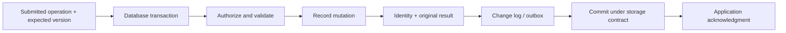

# Database concurrency: atomic decisions, snapshots, logs and replication

## 1. Reader, boundary and central questions

A synchronization server must turn a submitted intent into an accepted, recoverable decision. A database can provide an atomic boundary for that decision. It does not infer the intent behind a days-old document edit or choose an OT/CRDT policy.

This guide teaches an engineer who knows SQL how independent requests interact inside the authority: snapshots, locks, conditional transitions, constraints, transaction retries, durable logs, replication and distributed commit. Central questions: when is a read obsolete; which decision must be atomic; what does commit survive; what history can replicas expose; and how does the acceptance boundary support retry-safe synchronization?

Read the [conflict guide](../03-conflict-resolution/README.md) first. [Project A](../../../examples/synchronization/a-versioned-store/README.md) supplies complete setup, schema, Node test orchestration and Java source. Its PostgreSQL tests use actual concurrent database sessions. Replication, power loss and two-phase commit are explained but not tested by this installment. The [networking guide](../07-networking/README.md) explains why sending the response is another boundary.

## 2. A transaction is a proposed state transition

Model one decision as reads, validation and writes. A reservation reads a record, verifies capacity, decrements remaining units, records the operation identity and adds a change entry. The invariant is nonnegative accepted stock; the retry contract is one accepted effect per valid identity.

ACID describes several distinct obligations:

- **Atomicity:** all transactional effects commit together or none becomes a committed outcome.
- **Consistency:** correctly written transactions and enforced constraints preserve declared rules. The database cannot invent missing business rules.
- **Isolation:** concurrent transactions' observations/effects obey the chosen isolation model.
- **Durability:** committed effects survive the specified failures, given storage and commit settings.

None supplies exactly-once external email or payment. Nor does “all-or-nothing” require every reader to instantly observe a commit on an asynchronous standby.



An ordinary process mutex can serialize requests in one process, but another process or a restart bypasses it. Database transactions/constraints govern all writers using that shared database boundary. Restrict direct table writes if policy requires the submission function; otherwise an authorized bypass can invalidate the proof.

## 3. MVCC: reads choose versions, writes still contend

Multiversion concurrency control (MVCC) retains versions so readers can inspect a consistent snapshot without forcing every ordinary read to block concurrent writers. An update creates a newer tuple version; visibility depends on transaction status and snapshot rules. Uncommitted/aborted versions are not ordinary committed data.

PostgreSQL uses this model alongside table/row/advisory locks. “Reads do not block writes” describes ordinary snapshot reads, not every operation: explicit locking reads and schema changes have their own conflicts. [PostgreSQL 18 MVCC introduction](https://www.postgresql.org/docs/18/mvcc-intro.html)

Example: Mira starts a snapshot seeing value 10. Dev commits 11. Mira can still read 10 under a transaction snapshot, while a new statement under a different isolation contract can read 11. Both refer to one logical record; neither shares a live memory variable with the other client.

Old versions consume space until no relevant snapshot needs them and cleanup can proceed. Long-running transactions and replication retention can extend history lifetimes. Vacuum reclaims database tuple/storage history under database rules; it does not know whether an offline app still needs a deleted-object tombstone or old operation identity. [PostgreSQL 18 routine vacuuming](https://www.postgresql.org/docs/18/routine-vacuuming.html)

## 4. Isolation models and their scope

| Model | What a transaction normally observes/guarantees | Remaining issue |
|---|---|---|
| Read Uncommitted | Generic SQL category can allow dirty reads; PostgreSQL maps it to Read Committed | Labels differ across databases |
| Read Committed | PostgreSQL ordinary statements read a new committed snapshot per statement | Stale read-modify-write decisions and multi-statement anomalies |
| Repeatable Read / snapshot isolation | PostgreSQL keeps a transaction snapshot and rejects specified conflicting writes | Different-row write skew can remain |
| Serializable | Committed transactions admit a serial equivalent under the implementation contract | Aborts/retries; application logic and external effects still matter |
| Strict serializability | Serializable transaction history also respects real-time precedence | Requires this explicit guarantee; not implied by every use of “serializable” |

PostgreSQL's implementation can exceed minimum SQL anomaly prohibitions: its Repeatable Read avoids phantom reads but can admit serialization anomalies. Its snapshot starts at the first relevant statement, not necessarily when the application called BEGIN. [PostgreSQL 18 transaction isolation](https://www.postgresql.org/docs/18/transaction-iso.html)

Isolation describes transactions at the database boundary. Replication consistency describes observations across copies. A serializable primary can feed a lagging replica whose reads miss a completed commit. A local client cache can be older still. Read-your-writes through failover requires routing/waiting/version evidence, not just a transaction label.

## 5. Lost updates: row locking cannot repair obsolete intent

Project A initializes `records(id='counter',value=0,version=0)`. These SQL excerpts run in its selected schema; the complete harness establishes it without guessing a search path.

| Step | Mira session | Dev session | Committed value |
|---|---|---|---:|
| 1 | BEGIN; read value 0 | BEGIN; read value 0 | 0 |
| 2 | Assign 1; COMMIT | Retains derived value 1 | 1 |
| 3 | — | Assign 1; COMMIT | 1 |

```sql
BEGIN;
SELECT value, version FROM records WHERE id = 'counter';
-- Application derives 1 from its earlier read of 0.
UPDATE records SET value = 1, version = version + 1 WHERE id = 'counter';
COMMIT;
```

The database serializes writes to the row. It cannot know the literal 1 represented a second independent increment. Both assignments are individually legal under the tested Read Committed history. A lock acquired only at UPDATE does not retroactively validate the earlier calculation.

### Atomic increment

Express the transition at the authority:

```sql
UPDATE records
SET value = value + 1, version = version + 1
WHERE id = 'counter'
RETURNING value, version;
```

If Mira holds the row lock, Dev waits. When Mira commits, Dev increments the current applicable version, yielding 2. The test verifies the `Lock` wait before releasing Mira rather than relying on a sleep. This preserves increment semantics but repeating the logical request still increments again unless its identity is deduplicated.

### Version/CAS update

```sql
UPDATE records
SET value = value + 1, version = version + 1
WHERE id = 'counter' AND version = 0
RETURNING value, version;
```

The first version-0 decision succeeds and advances the version. A later identical expected-version request returns zero rows. That detects obsolete assumptions. Re-read and deliberately retry an increment; a form replacing a user-chosen price may require review instead.

Versions are generated within this record/generation scope and never reused. Delete/recreate needs a new identity/generation or another scheme excluding old versions. The `RETURNING` result is provisional inside a still-open transaction; acceptance is sent after commit.

## 6. Conditional transitions enforce a scarce-resource rule

The last unit can be reserved with an atomic condition:

```sql
UPDATE records
SET value = value - 1, version = version + 1
WHERE id = 'counter' AND value >= 1
RETURNING value, version;
```

Assume this lab value represents remaining stock and is initially one. Mira decrements it and holds the transaction. Dev waits on the same row. After Mira commits, the current value is zero and Dev's condition fails. PostgreSQL documents condition reevaluation for competing Read Committed updates. [PostgreSQL 18, Read Committed](https://www.postgresql.org/docs/18/transaction-iso.html#XACT-READ-COMMITTED)

A row constraint `CHECK(value>=0)` protects storage against invalid negative values from other permitted writers, but does not prove every reservation was paired with payment or authorization. Also declare `NOT NULL`: SQL check expressions can accept unknown/null results. Unique constraints, foreign keys and exclusion constraints enforce different classes of rules; ordinary CHECK is not a general cross-row invariant mechanism. [PostgreSQL 18 constraints](https://www.postgresql.org/docs/18/ddl-constraints.html)

If the rule spans two rows, express one transaction covering both dependencies or restructure it into a shared guarded row/right allocation. Two individually atomic decrements do not automatically make a transfer atomic.

## 7. Pessimistic locks, granularity and deadlocks

A pessimistic decision can lock the relevant rows before reading/modifying them:

```sql
BEGIN;
SELECT id, value FROM records WHERE id = 'counter' FOR UPDATE;
-- Make the guarded decision using the returned current row.
UPDATE records SET value = value + 1, version = version + 1 WHERE id = 'counter';
COMMIT;
```

Locks restrict concurrent incompatible operations until release. PostgreSQL has table modes, row modes, and advisory locks with different contracts. MVCC ordinary readers can continue seeing versions while a writer holds row locks. A missing row is not necessarily protected by locking existing rows; insert races often need constraints, a guard row or serializable dependency handling. [PostgreSQL 18 explicit locking](https://www.postgresql.org/docs/18/explicit-locking.html)

Granularity trades precision for overhead. One workspace-wide lock avoids many races but serializes unrelated work. Row locks permit more concurrency but do not cover arbitrary relational predicates. Read/write lock terminology from local programming is useful orientation, but SQL lock modes and transaction lifetimes must be read specifically.

Deadlock history: Mira locks record A then needs B; Dev locks B then needs A. Neither can finish by waiting. The database detects a cycle and aborts a participant. Acquire shared resources in a consistent order, keep transactions short, set bounded wait/timeouts and retry an appropriate complete transaction. Do not hold a database transaction open during unbounded UI input or a remote API call.

Advisory locks work only if every relevant writer cooperates; a rogue/bypass writer ignores them. Session locks and transaction locks have different release behavior, especially with pooled connections. They are not distributed leases for an unrelated storage system unless that resource verifies authority.

## 8. Write skew and optimistic serializable execution

Two doctors are on call. Each may leave only when another remains. Both read two, then clear different rows:

| Transaction | Read dependency | Write |
|---|---|---|
| Mira | Dev is on call | Mira becomes off call |
| Dev | Mira is on call | Dev becomes off call |

There is no overlapping write target. The Project A Repeatable Read history commits both and leaves zero doctors. Checking only versions of **written** rows misses the read dependencies.

A serialization graph makes the problem visible. A node is a transaction; an edge means one transaction must precede another to explain an observed dependency. Mira's read of Dev before Dev writes supplies one read-write dependency; Dev's read of Mira before Mira writes supplies the opposite. A cycle cannot be explained by one serial order.

Serializable mechanisms can lock appropriately or validate/track dependencies optimistically. PostgreSQL's Serializable Snapshot Isolation (SSI) tracks relevant dependency patterns and can abort transactions to avoid serialization anomalies; these checks can be conservative rather than waiting for every full cycle. The original PostgreSQL SSI engineering paper explains its design. [Ports and Grittner, 2012](https://arxiv.org/pdf/1208.4179)

A correct retry begins a fresh transaction and reruns **all** reads, decisions and writes. Retrying only the failed UPDATE with the old “two doctors” decision repeats the bad logic. The tested schedule gives Dev first read 2, then—after serialization failure—fresh read 1; the second attempt leaves that doctor on call.

Project A's `serializable(session,work)` wraps BEGIN, callback, COMMIT, ROLLBACK and bounded jittered retries. It recognizes SQLSTATE `40001`; it also permits retry of `40P01` deadlocks under the callback's whole-decision contract. Unique violations may instead be permanent input conflicts, so blindly retrying every error is wrong. [PostgreSQL 18 serialization failure handling](https://www.postgresql.org/docs/18/mvcc-serialization-failure-handling.html)

The callback must not send irreversible messages before commit. Publish from a committed outbox or use a downstream idempotency/transaction mechanism. High contention increases wasted work and can overwhelm the retry budget. A serializable transaction that executes invalid business logic is still invalid application behavior.

## 9. Implement an atomic acceptance and replay boundary

Project A's `submit_increment(opId,expectedVersion,delta)` is a stored function for one fixed record scope. Its transaction contains:

1. Claim operation identity with a unique key.
2. If already accepted/rejected, verify the full recorded request fields match and return the original outcome.
3. Otherwise perform the conditional version/invariant UPDATE.
4. On acceptance, insert the per-record change entry.
5. Store the acceptance or rejection result and commit.

A concurrent duplicate waits on the conflicting identity transaction. On commit it sees the original outcome; on rollback there is no accepted identity and an appropriate new attempt can claim it. All provisional artifacts roll back together. The lab exercises both paths.

```mermaid
sequenceDiagram
  participant M as Mira client
  participant S as Submission handler
  participant DB as PostgreSQL
  M->>S: op M:1, expected version 0, delta 1
  S->>DB: Atomic claim + conditional update + result + log
  DB-->>S: Commit accepted value 1 / version 1
  S--xM: Application ACK lost
  M->>S: Replay exactly M:1 with same request
  S->>DB: Check current authorization, retrieve recorded outcome
  DB-->>S: Original acceptance; no repeated mutation
  S-->>M: Original value 1 / version 1
```

Authorization in the diagram is a production obligation; the fixture has no user-facing auth layer. Before returning a stored result, enforce current disclosure policy. The identity scope must include tenant/object/generation. Full parameter binding, controlled schemas/search paths and least-privilege database access are also production requirements; the lab's psql adapter accepts authored SQL fixtures only.

The accepted response can be older than current state: after Dev advances to value 2, replaying Mira still returns her original value/version 1. An acknowledgment is an answer about that operation, not necessarily a fresh object snapshot. A rejected identity similarly replays its original rejection; a revised attempt uses a new identity and intentional new input.

Bigint values/versions are returned as decimal strings to avoid JavaScript precision loss. A replay request that changes delta under the same identity is rejected. A unique constraint on IDs alone is insufficient if the state mutation committed separately.

## 10. WAL, transaction logs and actual durability

Write-ahead logging (WAL) records changes before corresponding data pages must reach durable storage. A commit can durably flush the required log without flushing every dirty table page. After a crash, recovery replays appropriate log information, reconstructing state; checkpoints bound recovery work but do not replace the log's ordering rules. [PostgreSQL 18 WAL introduction](https://www.postgresql.org/docs/18/wal-intro.html)

WAL is a database recovery/replication mechanism. An application event log describes business history or sync operations. They are related but not interchangeable: a WAL record need not carry the user's original semantic command or authorization evidence.

Durability depends on configuration and the underlying storage. `fsync`, synchronous commit behavior and full-page-write protection affect different failure paths. Asynchronous commit can acknowledge before the relevant WAL is flushed, trading a window of potential lost recent commits for lower latency. Storage devices/virtualization must honor the required flush contract. [PostgreSQL 18 WAL configuration](https://www.postgresql.org/docs/18/runtime-config-wal.html)

The tested lab reported `fsync=on`, `synchronous_commit=on`, `full_page_writes=on`. That records assumptions; it is not a power-loss test or proof of the host's storage hardware. Commit-before-response supports replay only if the commit survives the failures the application promises.

## 11. Replication, CDC and cursors

### Primary/standby replication

A primary accepts transactions and streams/log-ships replication information. Standbys can lag in receive, flush or replay progress. A commit at the primary can therefore precede visibility on a reader's standby. Asynchronous promotion can lose primary-acknowledged transactions that never reached the promoted replica.

Synchronous replication can wait for a configured set of standbys and a selected acknowledgment point. Remote write/flush and remote apply are different promises. Availability and latency depend on which standbys must answer and how failover chooses a valid authority. PostgreSQL documents these distinctions for its standby model. [PostgreSQL 18 standby servers](https://www.postgresql.org/docs/18/warm-standby.html)

A server role changing to “primary” does not fence every obsolete writer or resolve client speculative operations. Split-brain prevention, routing, backup history and client epochs remain system-level responsibilities.

### Logical replication and multi-primary writes

Logical replication transmits logical row changes between schemas/participants rather than simply copying physical pages. Constraint conflicts, existing rows and local subscriber modifications need explicit treatment. PostgreSQL 18 documents cases where apply stops on constraint violations and cases where missing rows are skipped; it is not an automatic intent-preserving multi-writer merge engine. [PostgreSQL 18 logical replication conflicts](https://www.postgresql.org/docs/18/logical-replication-conflicts.html)

Allowing writes at several primaries needs rules for duplicate keys, versions, deletes, dependencies, invariant enforcement and loops. Row replication cannot reconstruct a user's original text offset, reservation intent or offline branch ancestry after the application has reduced it to a replacement value. Choose the application merge model before treating database replication as synchronization.

### Change-data capture and replay

Change-data capture (CDC) exposes committed changes for downstream consumers. Logical decoding can support this; replication slots retain required WAL/history until consumer progress is recorded, and slow consumers can consume disk. Restart/recovery can resend previously delivered information, so downstream idempotency and checkpoint boundaries matter. [PostgreSQL 18 logical decoding concepts](https://www.postgresql.org/docs/18/logicaldecoding-explanation.html)

A cursor must identify a recoverable stream boundary, not merely a convenient number. PostgreSQL sequences can allocate numbers before transaction commit and can have gaps. Consider A allocated 1 but uncommitted, B allocated 2 and committed, and a reader advanced to 2. Later A commits; reading only IDs greater than 2 misses it. Sequence allocation order is not a safe committed-prefix order.

Project A avoids that claim by using **per-record versions** allocated while updating the same locked row; the next writer cannot advance that record before the earlier transaction commits/rolls back. It is not a global cross-record stream. Global catch-up needs a commit-aware log/CDC protocol, an explicit serialized log boundary, or a proven high-water-mark scheme. A WAL byte location by itself is not an application transaction/authorization cursor definition.

## 12. Two-phase commit and consensus solve different obligations

A cross-database transaction can have several participants. Two-phase commit (2PC) coordinates one atomic commit outcome:

1. **Prepare:** each participant durably promises it can commit and holds the required state/resources; a no vote leads to abort.
2. **Decision:** the coordinator durably records commit only after the necessary yes votes, then tells participants to commit; otherwise it records abort.

Once a participant is prepared, it cannot safely infer abort merely because the coordinator timed out. The decision might already be commit. Recovery must consult durable decision state and redeliver it. A coordinator failure can block prepared resources; forced unilateral resolution without decision evidence risks atomicity.

PostgreSQL exposes `PREPARE TRANSACTION`/prepared-transaction resolution for an external transaction manager. Prepared transactions can retain locks and obstruct cleanup; enabling them is not a general speed optimization. The lab does not enable or execute them. [PostgreSQL 18 PREPARE TRANSACTION](https://www.postgresql.org/docs/18/sql-prepare-transaction.html)

Consensus-backed replication establishes one group's agreed history despite modeled failures. It can replicate coordinator decisions or shard logs, but a majority in one shard does not by itself make a transaction across another shard atomic. Conversely, 2PC does not by itself elect a safe surviving leader or reconcile divergent replicas. Raft explains the consensus-backed log/leader model and its commit restrictions. [Ongaro and Ousterhout, 2014](https://raft.github.io/raft.pdf)

Compensating workflows are another design: commit stages separately and perform domain-specific corrective actions on failure. Compensation is not rollback in the ACID sense; an external observer may have seen intermediate state, and some effects cannot be undone exactly. Name that weaker workflow contract explicitly.

## 13. Local Java CAS and the distributed boundary

`AtomicReference<State>` stores an immutable `(value,version)` record in one JVM. `compareAndSet(expectedReference,newReference)` atomically compares the actual reference and installs the new state if it still matches. A version check can additionally reject an obsolete caller even when the value returns to an earlier value. Java documents the CAS and memory-effect contract. [Java SE 25 AtomicReference](https://docs.oracle.com/en/java/javase/25/docs/api/java.base/java/util/concurrent/atomic/AtomicReference.html)

The Project A code reads a snapshot, validates its version, creates a next immutable record and attempts CAS. On failure, an increment rereads/recomputes. `AtomicInteger.getAndIncrement` supplies one local atomic integer transition, while `compareAndSet` rejects an old expected integer. [Java SE 25 AtomicInteger](https://docs.oracle.com/en/java/javase/25/docs/api/java.base/java/util/concurrent/atomic/AtomicInteger.html)

The successful CAS is a local linearization point. It does not persist an operation result, coordinate another JVM or replicate state. A database conditional UPDATE has a server-side decision boundary and still requires transaction commit before durable acceptance. Both share the idea of atomic precondition enforcement; their failure domains differ.

A retry loop is not a promise that every thread completes promptly. Progress guarantees, memory ordering, ABA, tagged pointers and full Java concurrency primitives belong to the later local-concurrency guide. Here the assertions demonstrate the mechanism without claiming a fairness or performance result.

## 14. Run Project A and interpret the results

Follow the [project README](../../../examples/synchronization/a-versioned-store/README.md) for the isolated Docker setup and source-file Java launcher. The fixture database has no published ports and no connection to an application database. Tests create a unique schema and remove only that schema on completion.

The runnable test path traces a versioned operation through validation, mutation, replay result and log insertion. It observes actual lock waits, contrasting them with stale writes and snapshot-only decisions. Expected outcomes: lost update 1, atomic increments 2, last-unit reservation 0, unsafe doctor count 0, serializable count 1, stable original replay and one change per accepted ID. Java finishes with value/version 20,000 after four threads' increments.

Variation: replace atomic update/replay/log transaction with independent commits. Crash between them can leave a mutation with no replay record or a replay record with no mutation. The current tests verify rollback of the coupled artifacts, but actual process crash and storage/failover injection remain additional integration work.

Scaling considerations: one hot record serializes decisions; more connections do not make that row parallel. Partition independent objects, allocate independent rights where semantics permit, keep transactions short, index predicates and bound pool/queue size. The [mathematical reference](../02-mathematics/README.md) supplies retry/load/retention budgets. A large connection pool can amplify contention rather than increase throughput.

## 15. Failure diagnosis, recovery and security

| Symptom | Inspect | Recover/prevent |
|---|---|---|
| Counter undercounts | Literal stale assignment vs atomic operation | Reconcile accepted intents; use conditional transitions |
| Retry duplicates an effect | Mutation and dedup result committed separately | Repair from audit history; enforce one transaction boundary |
| Transaction repeatedly fails | SQLSTATE, hot rows, stale full-decision retry | Retry the entire decision with bounds; reduce contention |
| Lock waits/deadlock | `pg_stat_activity`, `pg_locks`, acquisition order | Abort timed-out work safely; consistent lock order |
| Replica misses a just-accepted edit | Receive/flush/replay lag and read routing | Wait/reroute using appropriate version evidence |
| CDC consumer stalls and disk grows | Slot retained WAL and checkpoint lag | Repair consumer; resnapshot under explicit reset policy |
| Sync cursor misses a late commit | Sequence allocation mistaken for committed prefix | Reconcile the gap; choose a commit-aware stream |
| Prepared transactions persist | Coordinator durable decision and prepared state | Resolve from evidence through the transaction manager |

Do not log credentials or document contents simply to diagnose versions. Scope identities and authorization to tenants and objects. Parameterize request values; qualify schemas/search paths; constrain database roles and direct writes. A transaction can atomically commit unauthorized work unless the authorization decision is included in the correct boundary. External side effects and stale permission evidence require explicit policies.

## 16. Invariants and limitations

- A snapshot is selected history, not necessarily the latest shared value.
- Atomic assignment can still lose a read-derived intent.
- Compare the version or enforce the domain precondition at transition time.
- Include read dependencies when reasoning about serializability.
- Retry all decision logic after an appropriate abort.
- Commit mutation, replay result and change/outbox together.
- Name storage/replication durability and read freshness separately.
- Sequence numbers, WAL positions and application cursors need explicit scopes.
- 2PC coordinates participants; consensus governs a replicated group's history.
- Database correctness does not replace application merge or authorization semantics.

Reviewer: pending technically informed reader. Review date: pending. Status: **draft**.
Open issues: independent technical review; database restart/power-loss/failover tests; production auth/connection-pool implementation; CDC and 2PC deployment experiments. The validated lab is a concrete transaction project, not a production database service.
