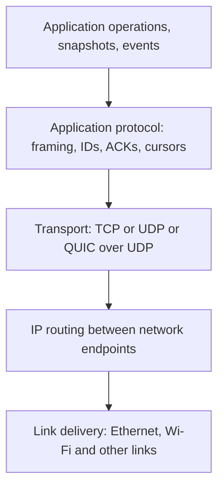

# Networking for synchronization: transport, framing, reliability and recovery

## 1. Reader, scope and central questions

A protocol must move information across an uncertain path. A synchronization engine additionally interprets, validates, persists and reconciles it. Transport selection should follow the meaning of that information, rather than the assumption that a persistent connection supplies correctness.

This guide equips an engineer to choose TCP, UDP or supported web transports; build message framing; distinguish several kinds of acknowledgment; handle backpressure and reconnection; and understand secure establishment, NAT traversal and application ordering. Questions: what does each layer guarantee; what is a packet versus a message; what may be skipped; when is retransmission safe; what survives reconnect; and which protocol duties are still ours?

Read [distributed-state foundations](../01-distributed-state/README.md), the [quantitative models](../02-mathematics/README.md) and [database commit boundaries](../06-database-concurrency/README.md). The [network lab](../../../playground/synchronization/04-networking/README.md) runs actual TCP/UDP loopback sockets plus deterministic parser/fault cases. It does not implement Internet-safe UDP, NAT, TLS or WebSocket servers. Messaging and game guides later use these foundations for durable chat and simulation.

## 2. TCP/IP is a suite, not one transport

Think in service boundaries:



IP addresses identify routed endpoints; ports demultiplex transport traffic to sockets. Links carry frames between neighbors; IP packets may cross many links and routers. TCP provides a byte stream between endpoints; UDP preserves datagrams without TCP's reliability/order machinery. QUIC adds a secure multiplexed transport over UDP. “TCP/IP” names a family/suite, so it is not an interchangeable competitor to UDP.

An application message can span several TCP segments, and one segment/read can contain pieces of several messages. A UDP datagram is one transport unit, but a large datagram may require IP fragmentation. Application events and database transactions are neither packets nor TCP segment boundaries.

Checksums detect specified corruption; they do not authenticate a malicious sender. IP delivery is not a shared-memory write or a durable application commit. IPv6's packet and fragmentation rules are specified independently of TCP/UDP. [RFC 8200, July 2017](https://www.rfc-editor.org/rfc/rfc8200.html)

## 3. TCP: reliable ordered bytes within one connection

TCP numbers stream bytes, acknowledges received ranges, detects missing information and retransmits. Its connection machinery establishes state and distinguishes connection lifecycle events. Applications receive ordered bytes, while segmentation and retransmission are transport details. TCP does not preserve application write boundaries. [RFC 9293, August 2022](https://www.rfc-editor.org/rfc/rfc9293.html)

If segment carrying bytes 100–199 is missing while 200–299 arrived, later contiguous stream delivery waits for the hole to be filled. This **head-of-line blocking** preserves ordered-stream semantics. For a durable operation sequence, that may match requirements. For replaceable position samples, waiting for an old missing sample can add latency without improving the current view.

A successful TCP acknowledgment means the peer transport received relevant bytes, not that its application parsed, authorized, committed or rendered them. A local send/write completion is earlier still. Closing/resetting a connection cannot tell a client whether an application mutation already committed. New connections start new transport state; retry-safe logical operation identities must survive that change.

A FIN ends sending in one direction; the application may still need to distinguish complete framed data from truncated input. A reset can abort communication with bytes or decisions in flight. Treat both as protocol events, not proof that no server effect occurred.

Small writes may be batched by transport and runtime. Options such as TCP_NODELAY change latency/packetization trade-offs but do not create message boundaries or replace congestion control. Measure the actual critical path rather than promising that a specific socket option always reduces end-to-end latency.

## 4. Application framing and bounded parsing

A receiver needs to identify complete messages in the byte stream. Common choices include fixed-size messages, delimiter framing with escaping, a length prefix, or a structured protocol that already defines message boundaries.

The lab uses a 4-byte unsigned big-endian **payload-byte length**, followed by UTF-8 JSON:

```text
[ length: 4 bytes ][ exactly length bytes of UTF-8 JSON ]
```

Decoder steps:

1. Accumulate enough bytes for the header.
2. Reject zero or excessive advertised length before waiting for its body.
3. Wait for the complete body; a partial header/body is not a malformed complete message yet.
4. Decode complete UTF-8 with explicit invalid-encoding rejection, then parse JSON.
5. Emit the message and continue through any coalesced frames.
6. On EOF, reject remaining partial bytes instead of inventing a complete message.

The lab's maximum body is 16 KiB. It is an authored resource bound, not a TCP limit. A header advertising gigabytes can otherwise force indefinite buffering or allocation. Bound connection-wide work as well: thousands of valid small frames can still exhaust parsing, queued operations or memory.

The tests cut a concatenated frame stream at every possible two-chunk boundary, including inside an emoji's UTF-8 encoding. Another feeds one byte at a time. Both recover the same messages. Sending two socket writes is not proof they will create two reads; parser tests deliberately control that independent schedule.

A naive concatenate-on-every-byte parser can copy quadratically. A production parser can use a bounded chunk queue/ring buffer and CPU budgets, while retaining exactly the same framing contract. Compression adds expanded-size limits; a small compressed input can generate a large body. Message schema/version validation occurs after framing and before accepting effects.

## 5. UDP: datagrams with application-specific obligations

UDP delivers separate datagrams and supplies port/length/checksum fields. It does not by itself promise delivery, ordering, duplicate suppression, connection establishment or congestion control. [RFC 768, August 1980](https://www.rfc-editor.org/rfc/rfc768.html)

This permits the application to distinguish traffic classes:

- durable commands need eventual known acceptance/rejection under a retry contract;
- latest snapshots can discard older/duplicate samples;
- recent game inputs may be bundled/repeated so the server obtains needed inputs without waiting for every old packet;
- lockstep inputs cannot simply be skipped because they drive deterministic future state.

Reliability is a semantic choice about *information*, not a requirement to resend every original datagram. A new packet may carry several still-needed logical inputs. The game guide will derive prediction and reconciliation from that distinction.

### Packet identity is not operation identity

An illustrative header might include protocol version, connection/session generation, packet number, channel kind, acknowledged packet ranges and payload size. A durable command inside has its own operation ID. A snapshot includes simulation tick/baseline identity; an ACK states whether it acknowledges packet receipt or an accepted effect.

| Field | Purpose | Failure if confused |
|---|---|---|
| Session/epoch | Reject old incarnation traffic | Delayed packet applied to a new match/document |
| Packet number | Detect loss/reorder/replay in transport scope | Retry mistaken for another business command |
| Operation ID | Stable logical request identity | Reconnect or retransmit repeats an increment |
| Tick/baseline | Interpret simulation/delta context | Delta applied against the wrong state |
| ACK range | Convey receipt of packets/info | Assumed to imply durable acceptance |
| Checkpoint/cursor | Resume an application history | Incomplete state silently skipped |

Counter widths, wrap rules and resets are protocol requirements. The lab's snapshot tracker accepts uint32 sequences only within one session and has no wrap handling. A production modular comparison can be unambiguous only under a bounded window/generation model; arbitrary old packets cannot always be ordered after wrap without extra evidence.

### Small datagrams and fragmentation

A 1,200-byte encoded budget is used by the lab. For orientation, IPv6 minimum MTU is 1,280 bytes; a basic 40-byte IPv6 header plus 8-byte UDP header leaves 1,232 bytes before additional encapsulation/application overhead. Those values do not prove 1,200 bytes works on every tunneled path.

Avoid assuming large fragmented datagrams will arrive reliably. Losing one needed fragment loses the assembled datagram; middleboxes may handle fragmentation poorly. Datagram transports can discover an appropriate packetization-layer path MTU under an explicit probing protocol. [RFC 8899, September 2020](https://www.rfc-editor.org/rfc/rfc8899.html)

If application-level reassembly is needed, bound total bytes, fragment count, concurrent assemblies and expiry; authenticate before allocating expensive resources where feasible. A partial message must not mutate shared state as though it were complete.

## 6. Reliability over UDP: receipts, retries and duplicate effects

A minimal bounded stop-and-wait scheme sends one logical command, waits for an application ACK and retries the **same identity** if the response is absent. This is enough to demonstrate retry ambiguity; it is not a high-throughput or public-Internet transport.

The lab deliberately creates this schedule:

| Attempt | Receiver action | Sender knowledge |
|---|---|---|
| 1 | Discard request before effect | No ACK; outcome unknown |
| 2 | Apply command, discard ACK | Still no ACK; effect actually happened |
| 3 | Deduplicate command, resend original outcome | One accepted memory effect confirmed |

The effect and replay record are synchronous in a memory ledger. Restarting that ledger loses its decision history. [Project A](../../../playground/synchronization/a-versioned-store/README.md) shows the durable database boundary needed for a persisted operation.

A production reliable datagram protocol needs an outstanding window, identity retention, receipt/ACK ranges, pacing, loss detection, adaptive timing, flow control, congestion response, security and reconnect state. Dependent messages need ordering/causal handling. Selective acknowledgments can avoid resending already received information, but lost ACKs still leave uncertainty until later evidence arrives.

A fixed 100 ms lab timer is not a standard RTO implementation or universal WAN tuning. TCP's retransmission-timeout specification tracks smoothed RTT and variability and applies its stated bounds/backoff. [RFC 6298, June 2011](https://www.rfc-editor.org/rfc/rfc6298.html) The [mathematical reference](../02-mathematics/README.md#6-loss-acknowledgments-and-retry-amplification) derives expected attempt load and why independent constant-loss models fail during overload.

A finite retry budget can expire after a committed effect whose ACK was lost. Return unknown completion and retain the operation identity for recovery; do not assign a fresh logical identity just to make the next attempt look new.

## 7. Congestion, flow control and application backpressure

These are three different constraints:

- **Congestion control** limits traffic to what the network path can sustain, responding to loss/delay/congestion signals.
- **Flow control** limits data to what the receiver can accept in its transport buffers.
- **Application backpressure** limits parsing, queued commands, storage transactions and output that the actual application can drain.

TCP's congestion and receiver windows constrain transport flight independently. Classic TCP congestion-control mechanisms are specified separately from its byte-stream interface; the exact algorithm deployed is implementation/configuration dependent. [RFC 5681, September 2009](https://www.rfc-editor.org/rfc/rfc5681.html)

UDP applications must implement suitable congestion behavior or use an established transport that does. Unbounded retries at a fixed rate can worsen loss and harm other traffic. UDP usage guidelines address congestion, message size and robustness; the lab does not implement their full deployment requirements. [RFC 8085, March 2017](https://www.rfc-editor.org/rfc/rfc8085.html)

In Node's TCP API, `socket.write()` can enqueue output; its boolean return and `drain` event support throttling. They are not remote commit signals. The lab pauses reads on write backpressure and disconnects a slow consumer beyond a small buffer bound. [Node net API, documentation accessed 2026-10-13](https://nodejs.org/docs/latest/api/net.html)

The browser WebSocket API exposes `bufferedAmount`, but developers must still enforce application queue limits; a send call does not await durable acceptance. [WHATWG WebSockets Standard, accessed 2026-10-13](https://websockets.spec.whatwg.org/)

Coalesce superseded presence/position samples if permitted. Preserve durable accepted work in a log and reset/disconnect a slow client with a catch-up route rather than falsely advancing its cursor. Fair scheduling across objects and separate priority budgets can prevent one large snapshot from delaying all small commands.

## 8. Latency, bandwidth and batching decisions

Use the [quantitative reference](../02-mathematics/README.md) for defined equations and assumptions. Important consequences for transport choice:

1. RTT gates acknowledgment cycles; stop-and-wait operation throughput is bounded even on high-bandwidth links.
2. Larger in-flight windows fill a long path but increase retained pending work and replay burden.
3. Batching lowers per-message overhead and adds wait; independent operations can pipeline, dependent ones need an interpretation rule.
4. Congested queues increase RTT and retry load, so yesterday's fixed timer can become a feedback problem.
5. Server queues, durable commit and remote render add latency after packet receipt.

Constructed comparison: 80 ms RTT and one-at-a-time acknowledgment limits a sender to 12.5 commands/s regardless of payload capacity. A TCP/WebSocket command window can pipeline requests while each retains its own operation ID and base/dependency rules. The same window does not allow arbitrary transactions to commit out of their required order.

Client/server clocks are not a safe one-way-delay measurement without error bounds. Use local monotonic elapsed measurements for RTT and trace stage durations, with declared uncertainty for cross-machine comparisons. Jitter is delay variation; average RTT alone cannot size an interpolation buffer or predict tail latency.

## 9. WebSocket, SSE, polling and long polling

| Mechanism | Direction/lifecycle | Useful fit | Needed application guarantees |
|---|---|---|---|
| Polling | Repeated request/response | Low update rates, simple HTTP integration | Cursor, cache/freshness policy, idempotent submission |
| Long polling | Server holds request until event/timeout | Event delivery where persistent upgrades are inconvenient | Missed-wakeup prevention, cursor and reconnect |
| SSE | Server-to-client event stream over HTTP | Notifications/feeds; writes through separate HTTP calls | Durable event IDs, retention and checkpoint rules |
| WebSocket | Bidirectional framed messages on a persistent channel | Collaborative edits, chat/presence | Acceptance, replay, authorization, catch-up and flow budgets |

### WebSocket

The classic protocol starts with HTTP/1.1 Upgrade and then exchanges text/binary messages, with framing/fragmentation and control frames. Client masking is a protocol requirement, not encryption. Ping/Pong tests connection responsiveness, not database commit. [RFC 6455, December 2011](https://www.rfc-editor.org/rfc/rfc6455.html)

WebSocket data order follows the connection's protocol/transport scope. Two gateway connections do not automatically share a global operation order. Reconnect does not replay missed messages unless the application defines a durable history and cursor. An established connection also does not imply perpetual access to every object; reauthorize subscriptions/operations and handle revocation.

WebSockets can be bootstrapped over HTTP/2 or HTTP/3 using their extended-CONNECT specifications; assuming every WebSocket always uses the original HTTP/1.1 upgrade/TCP path is incomplete. [RFC 8441, September 2018](https://www.rfc-editor.org/rfc/rfc8441.html), [RFC 9220, June 2022](https://www.rfc-editor.org/rfc/rfc9220.html)

### Server-Sent Events

SSE uses an HTTP event stream with fields such as data, event, id and retry. A blank line terminates an event; browser reconnect behavior can send Last-Event-ID. This offers a resume *mechanism*, not server-side retention or proof that the application durably applied the event. [WHATWG HTML SSE specification, accessed 2026-10-13](https://html.spec.whatwg.org/multipage/server-sent-events.html)

If browser dispatch advances its event-ID tracking while application processing fails, that is not the same as a durable application checkpoint. Define recovery explicitly when those boundaries differ. Upload operations still need a separate request/channel.

### Polling and long-polling race

Polling trades freshness for intervals and request overhead. Conditional validators and cursors can avoid unnecessary full-state downloads. Long polling reduces empty responses by waiting, but a naive “query empty, then subscribe” can miss a wakeup if a commit occurs between those steps.

Use a protocol that couples subscription with checking the durable stream, or rechecks after registration against a captured high-water mark. A bounded timeout eventually rechecks but may delay notification. Durable log catch-up prevents loss even if notification wakeups are imperfect. Concurrent long-poll requests need identity/session rules so overlapping responses cannot move the client backward.

## 10. QUIC: reliable streams over UDP, plus optional datagrams

QUIC is not merely “UDP without reliability.” It establishes secure transport state, flow-controlled streams, packet numbers/ACK processing and path migration. Loss in one stream need not block delivery of unrelated stream data in the same way a single shared TCP byte stream can. [RFC 9000, May 2021](https://www.rfc-editor.org/rfc/rfc9000.html)

This does not remove all dependencies or congestion coupling: streams share path capacity, and application state may require earlier data from another stream. Delivering a comment before its document creation still needs a semantic dependency rule.

The unreliable QUIC datagram extension supports non-retransmitted application data within a QUIC connection. It is a distinct facility from reliable ordered streams and has size/flow/congestion obligations. [RFC 9221, March 2022](https://www.rfc-editor.org/rfc/rfc9221.html)

Choose stream/datagram semantics per information class rather than replacing every TCP message with raw UDP. Browser/runtime/provider capabilities and deployment support must be checked for the chosen implementation/version. This lab makes no QUIC or WebTransport implementation claim.

## 11. Secure establishment, authentication and NAT

### TLS and application identity

TLS provides channel confidentiality/integrity and endpoint authentication under its certificate/key validation contract. Verify the intended endpoint, then authenticate and authorize the application's user/objects. TLS does not validate a game movement or reject a stale document base. TLS 1.3 early data has replay considerations; replay-sensitive mutations need the application's safeguards or a policy excluding those requests from early data. [RFC 8446, August 2018](https://www.rfc-editor.org/rfc/rfc8446.html)

WebSocket handshake Origin validation and session authentication matter for browser-facing servers. Successful protocol upgrade is not authorization to arbitrary workspace channels. Keep credentials out of logged URLs and enforce message/schema/rate limits even over an encrypted connection.

### NAT traversal

A NAT can map internal address/port to an external endpoint and filter incoming traffic. That mapping can expire or differ depending on the destination. A peer knowing an observed public address does not prove it can reach that address from every path.

STUN supplies mechanisms such as learning a server-observed reflexive address; it is not a universal relay or permission bypass. [RFC 8489, February 2020](https://www.rfc-editor.org/rfc/rfc8489.html)

ICE gathers candidates and performs connectivity checks to select usable candidate pairs. TURN supplies a relay when a direct path is unsuitable. Relays add bandwidth/latency/operating costs but can improve reachability. Authenticate relay use and consider privacy/address exposure. [RFC 8445, July 2018](https://www.rfc-editor.org/rfc/rfc8445.html), [RFC 8656, February 2020](https://www.rfc-editor.org/rfc/rfc8656.html)

Dedicated-server client connections reduce some peer-discovery requirements; peer-to-peer games/collaboration still need discovery, reachable paths, identity and trust rules. NAT hole punching is not a proof of secure participant identity, and this installment does not implement these protocols.

## 12. Four delivery paths with different semantics

| Information | Acceptance/durability | Ordering/retry | Recovery |
|---|---|---|---|
| Chat message | Authorize and commit immutable message/ID | Stable operation identity; declared per-channel accepted order | Durable history after cursor |
| Typing indicator | Usually ephemeral expiring state | Coalesce/latest valid update; no need to replay every keypress | Fresh indicator after reconnect |
| Presence | Lease/heartbeat-based participation estimate | Session generation and expiry | Re-establish session; absence is suspicion/expiry |
| Game movement input | Validate against authoritative simulation | Sequenced input history; retransmit/redundancy as required by game design | Authoritative snapshot plus acknowledged-input reconciliation |

A position snapshot is different from movement input: a snapshot may replace earlier state, while an input can be necessary to reproduce simulation. A durable message edit/delete similarly differs from ephemeral typing. The event's meaning determines the log, acknowledgment, expiry and replay policy.

If server output is delta-encoded, it must name a baseline the client actually has. Lost/missed baselines require a full snapshot or a dependency fetch, not applying the delta to whatever state happens to be cached. A transport ACK is not necessarily a checkpoint proving durable baseline application.

## 13. Reconnection is a synchronization protocol

```mermaid
sequenceDiagram
  participant C as Client
  participant G as New connection/gateway
  participant A as Authority and durable log
  C->>G: Authenticate; protocol version; stream generation; durable cursor
  G->>A: Reauthorize scope and validate cursor/retention
  A-->>C: Snapshot/reset boundary or changes through declared high-water mark
  C->>C: Atomically apply catch-up and persist checkpoint
  C->>A: Replay pending IDs with original requests
  A-->>C: Original outcomes or explicit new conflicts
  A-->>C: Continue live stream from the agreed boundary
```

Pending request identity survives reconnect. A new connection/session identity can fence ephemeral events, but should not silently replace the business operation ID with a fresh one. Otherwise an old unacknowledged acceptance becomes another mutation.

Snapshot plus tail needs a consistent boundary. Live subscription and catch-up must not leave a gap or replay a harmful non-idempotent effect. History retention expiry requires explicit reset/rejection, with locally unsent work preserved. Reconnect storms need pacing/backoff/jitter; reconnect correctness and capacity are separate tests.

A gateway can route bytes and track connections while an application/database owns acceptance and durable history. Sticky sessions can reduce routing work but failover still needs shared recoverable state. Global order across shards/regions requires a declared scope/coordination protocol, not merely the use of sockets.

## 14. Worked traces and lab walkthrough

For a durable increment, follow three knowledge boundaries:

1. Local socket queues framed bytes: no proof of remote receipt.
2. Receiver parses and returns the lab's application ACK: memory effect recorded, but no disk durability.
3. Project A commits mutation/result/log before an application response: durable under its tested configuration assumptions, although a missing response still needs replay.

Run the [network lab](../../../playground/synchronization/04-networking/README.md). `protocol.mjs` contains the length-prefix decoder, bounded command envelope, volatile replay ledger and latest-snapshot filter. `sockets.mjs` establishes ephemeral loopback endpoints and injects the two UDP losses. Tests distinguish deterministic parser schedules from actual network callbacks.

Expected outcomes: a repeated logical increment across two TCP connections returns result 1 twice with one surviving-server memory effect; a UDP request drop plus ACK drop causes at least three attempts with one memory effect; snapshot 12 is kept and older 11 ignored. The measured demonstration completed after three UDP attempts on this host. No timing/throughput benchmark follows from that observation.

Variation: replace the memory ledger with a new instance. Its identities/results vanish. Another replay can execute again in the new incarnation. Use the Project A transaction rather than declaring the socket reliable enough to solve this. Another variation: use latest-snapshot filtering for durable document operations; it can silently discard required history even though it is appropriate for replaceable samples.

Production simplifications are explicit: small bounds and one outstanding UDP operation; no secure channel, adaptive congestion controller, wide-area loss injection, NAT or durable server. The TCP/UDP tests close all loopback sockets; no listener is published beyond localhost.

## 15. Failure diagnosis and operational recovery

| Symptom | Inspect | Response |
|---|---|---|
| JSON parse failures only under load | TCP chunk boundaries mistaken for messages | Stateful framing; replay verified complete messages |
| Command duplicated after reconnect | New logical IDs or lost replay records | Retain identity and durable outcome boundary |
| Bytes arrive but UI stays stale | App queue, validation, commit, checkpoint, rendering | Trace each boundary; do not blame transport alone |
| Latest game view jumps backward | Missing sequence/session rejection | Declared snapshot ordering and reconciliation |
| Retries worsen loss | Overload, fixed aggressive timers, congestion | Bound/pause admission, adapt/pacing, jitter |
| Connection alive but memory grows | Slow consumer/unbounded queues | Flow budgets, coalescing or reset with catch-up |
| Long poll misses prompt updates | Check/subscribe race | Durable recheck/high-water protocol |
| UDP works on LAN only | NAT/filter/MTU/security/deployment path | Test candidate/relay strategy and actual path |
| Reconnect loses old edits | Cursor retention/generation mismatch | Explicit reset preserving pending user work |

Capture protocol version, connection/stream generation, operation ID, cursor and acknowledgment type in traces. Minimize sensitive payload logging. Monitor queued bytes, unique requests versus attempts, RTT variability, accepted-update latency, parser rejects, disconnect/reset rate and catch-up lag.

A large UDP response to an unauthenticated spoofed source can amplify traffic. Validate sources/sessions through established secure protocols, limit response work and avoid expensive allocations before validation. Message integrity and deduplication do not authorize an action. Slow/malformed clients must not hold unlimited buffers, transactions or dependency queues.

## 16. Invariants and limitations

- TCP/IP is a suite; choose transport services separately from application semantics.
- TCP orders bytes in one connection, not committed operations across reconnects.
- Framing must tolerate arbitrary splitting/coalescing and reject bounded invalid input.
- UDP reliability/order/congestion/security require an explicit design.
- Packet receipt, application acceptance, durable commit and user visibility are different ACK boundaries.
- Keep logical identity stable across retry and transport replacement.
- Congestion, receiver flow control and application backpressure are distinct.
- A cursor is a retained application-history contract, not simply a transport counter.
- Latest-value delivery fits replaceable state; required commands need their own history.
- TLS/NAT establishment does not establish authorization or sync correctness.

## Release review

Status: **ready — complete for the stated educational scope**.
Reviewer: Codex (AI technical and editorial review); no independent human review claimed.
Review date: 2026-10-14.
Open issues: none blocking this educational release.
Scope limits and further validation: Real loopback TCP/UDP examples; no Internet congestion, TLS/QUIC/NAT or MTU deployment validation.

See [the review record](../REVIEW.md) and [actual validation output](../VALIDATION.json).
