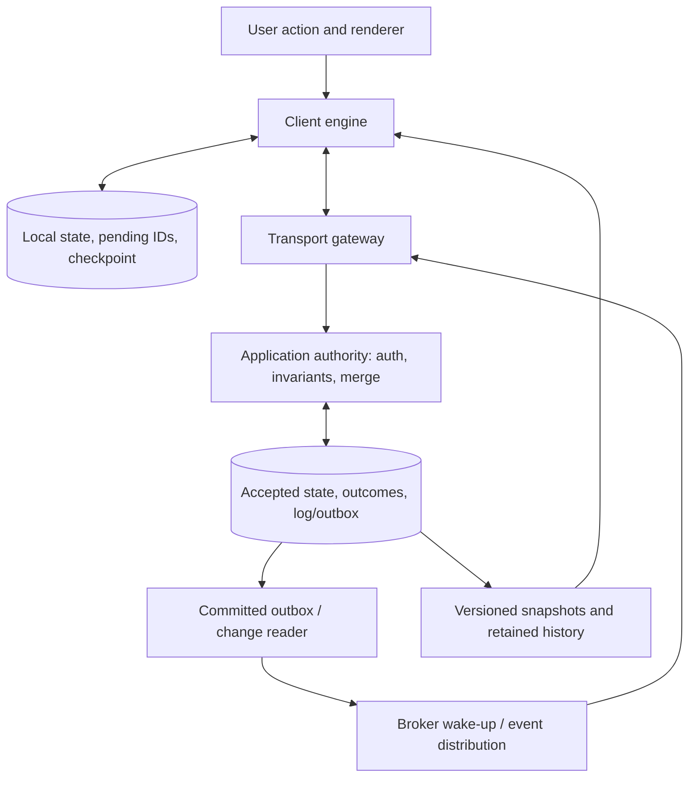

# Synchronization engines: durable intent, accepted history and replica recovery

## 1. Reader, scope and the component's purpose

A synchronization engine connects independent local decisions with an accepted shared history. It must preserve unsent work, convey it safely, choose or apply a conflict policy, and recover replicas after missed information or crashes. A socket supplies one delivery path; it does not supply these state transitions.

This guide is for an engineer who has read [database concurrency](../06-database-concurrency/README.md), [networking](../07-networking/README.md) and the [conflict guide](../03-conflict-resolution/README.md). It answers: what is persisted at each boundary; which component owns each responsibility; what evidence proves acceptance or catch-up; what can be compacted; how do versions, permissions and offline histories interact; and how does the design change with scale, regions or encryption?

The reference protocol below is an authored design, not a claim about a proprietary product. [Project B](../../../playground/synchronization/b-durable-chat/README.md) implements its server acceptance/log/fan-out/catch-up branch for immutable chat. Durable client outboxes and offline record reconciliation are Project C work. Full application/game semantics appear in later guides; mechanisms are cross-referenced rather than redefined here.

Central design artifacts are the operation envelope, local durable transaction, authoritative acceptance transaction, retained stream/checkpoint contract and recovery state machine. Choose them before transport and deployment topology.

## 2. Separate user intent, accepted base and displayed state

Suppose Mira sees document title Draft, goes offline, and changes it to Plan. Dev changes the accepted title to Proposal. Mira has a valid local intention, an obsolete confirmed base and a speculative view. They are not interchangeable copies of one authoritative value.

A useful client representation has:

- confirmed replicated state with its accepted checkpoint;
- durable pending operations including original identity and base/dependencies;
- operation outcomes and unresolved conflicts;
- a derived visible state that overlays or merges pending work according to the datatype policy.

Conceptually:

```text
visible = Rebuild(confirmed, pending, conflictPolicy)
```

`Rebuild` is a declared deterministic interpretation of accepted and pending evidence, not a universal function supplied by the word “sync.” For conditional records it may show a proposed value awaiting acceptance; for OT it maintains contextual pending transforms; for CRDTs it joins retained branch evidence. A rejected operation can remain visible as recoverable private work while no longer pretending to be accepted shared state.

Do not synchronize an optimistic entire object back as an unconditional replacement unless that is the intended policy. Capturing `increment(1)` preserves a different intent from capturing the resulting assignment `value=1`. Schema/domain knowledge determines what a local mutation means.

## 3. Architecture and ownership



A gateway manages connections, envelopes and flow budgets. Application authority validates permissions, domain rules and conflict semantics. The database enforces the chosen atomic commit boundary. A broker distributes work/notifications with its own delivery contract. A cache accelerates reads but needs a freshness/recovery rule. Snapshot storage needs a generation and log boundary. These can share a process in a small implementation; keeping responsibilities explicit makes failures diagnosable.

### All eighteen responsibilities and their proof boundaries

| Responsibility | Typical owner | Concrete mechanism and failure to prevent |
|---|---|---|
| 1. Local storage and mutation | Client engine/database | Atomically store proposed change and its pending identity; prevent visible work without replay evidence |
| 2. Change detection/capture | Editor/domain adapter | Emit semantic operations with base/dependencies; avoid ambiguous whole-object replacement |
| 3. Logs/journals/change tracking | Client, authority, database | Retain original intents and accepted changes separately; database WAL alone may not preserve user semantics |
| 4. Optimistic/local-first writes | Client engine/UI | Derive provisional state and reconcile outcomes; do not label local writes as shared acceptance |
| 5. Durable pending queue/outbox | Local database | Commit queue with local state; prevent crash gaps and identity changes on retry |
| 6. Encoding/batching/compression | Engine/transport adapter | Version envelope, bound decoded sizes, preserve per-op identity; avoid batch/fragment partial-commit ambiguity |
| 7. Transport/reconnect | Client/gateway | Authenticate, negotiate, resume from retained boundary; sockets alone do not recover missed history |
| 8. Identity/dedup/retry | Client and authority | Stable logical IDs; atomic request fingerprint/outcome; reject changed payload under reused ID |
| 9. Validation/authorization | Application authority/database | Recheck current object/tenant rights and invariants at acceptance/disclosure boundary |
| 10. Conflict/merge execution | Datatype authority/client | Execute specified CAS/OT/CRDT/domain policy with required context; do not hide discarded work |
| 11. ACK/checkpoints/cursors | Authority and client engine | ACK after commit; persist applied prefix with state; distinguish sent from applied cursor |
| 12. Snapshots/log compaction | Authority/storage | Snapshot at known projection/log boundary; preserve catch-up tail without gaps |
| 13. Incremental/delta sync | Log reader/datatype | Compare declared versions/state vectors/baselines; unknown baseline needs catch-up/reset |
| 14. Offline persistence/replay | Client engine/local database | Recover original pending work after restart; reauthorize and reconcile obsolete assumptions |
| 15. History/metadata GC | Datatype and retention controller | Prove no eligible stale history/reference can revive removed evidence, or fence a reset generation |
| 16. Crash/partial failure recovery | Every durable owner | Replay or roll back from each atomic boundary; don't infer no effect from silence |
| 17. Schema/protocol evolution | Client, server, migration owner | Preserve meaning across mixed versions; validate compatibility and explicit upgrade/reset paths |
| 18. Observability/verification | Engine/operators | Trace identities/frontiers and test forbidden histories, not just throughput |

The ownership table is a design contract. Project B implements a subset and its README explicitly lists what remains outside it. Client storage options such as IndexedDB and SQLite offer local transaction primitives, but their completion/durability lifecycles must be respected. [IndexedDB 3.0 specification, accessed 2026-10-13](https://www.w3.org/TR/IndexedDB/), [SQLite transactions](https://www.sqlite.org/lang_transaction.html)

## 4. Local atomicity: preserve work before sending

A local operation envelope needs stable object and operation identity, operation kind/payload, base/version or causal dependencies, client schema version and appropriate namespace. Credentials/session tokens can change on reconnect; the logical operation ID should not.

Illustrative conditional title edit:

```json
{"protocol":1,"opId":"M-deviceA:17","objectId":"doc-7","generation":"g3","kind":"set-title","baseVersion":"8","payload":{"title":"Plan"},"clientSchema":2}
```

The local database transaction commits the pending envelope and the corresponding local state/projection evidence together. Only then is the UI allowed to claim the promised local persistence point. Sending first leaves a window where the server accepted work that the local device cannot identify after restart. Updating state first and queue later leaves the opposite window: locally visible work with no durable transmission record.

A pending state machine can distinguish queued, in-flight, accepted, rejected and needs-review. In-flight is usually a transport attempt state; after a crash it returns to replayable queued/unknown, not automatically rejected. Avoid deleting pending work merely because a timer fired.

For browser storage, wait for the transaction's completion rather than treating one request success as durable completion, and respect active/inactive transaction lifetime rules. Arbitrary asynchronous work can outlive a transaction. Native SQLite atomic-commit behavior similarly depends on configured storage and journal/durability assumptions. [IndexedDB transactions](https://www.w3.org/TR/IndexedDB/#transactions), [SQLite atomic commit](https://www.sqlite.org/atomiccommit.html)

Project B's Node client is memory-only. Its server durability tests do not establish this local boundary. [Project C](../../../playground/synchronization/c-offline-engine/README.md) implements a concrete durable local store and crash tests.

## 5. Capture and encode operations without changing their meaning

Capture mutations at an explicit domain/editor layer, a versioned database change log, or an established CRDT/editor binding. Object observers that report only final JSON can lose the original read dependencies or positional context.

Batching several operation envelopes saves framing and transaction overhead, but define whether the batch is atomic, independently accepted or causally ordered. A response must identify each outcome. If a connection ends after half the frames arrive, the receiver must not invent acceptance for the remainder. Compression changes bytes, not operation identity or causality.

Bound compressed size, expanded size, operation count and parse/merge work. Dedup fingerprints must compare the canonical meaningful request, not an incidental connection ID or compressed representation. Unicode normalization, omitted defaults and field ordering can alter equality unless the protocol states canonicalization. Preserve exact technical units for positions and clocks; a string's encoded-byte count is different from its sequence coordinates.

A logical change log stores enough accepted evidence to reproduce downstream state. CDC that only reports final rows may support record replication but cannot automatically reconstruct a user's `insert` or permission-dependent workflow intent. See [database logs and CDC](../06-database-concurrency/README.md#11-replication-cdc-and-cursors).

## 6. Authoritative acceptance: one recoverable decision

On receipt:

1. Validate envelope/version/size and authenticate the connection's actor.
2. Resolve object/tenant/generation and enforce current authorization under a stated decision policy.
3. Claim/check the scoped operation identity and compare the original request.
4. Validate base/dependencies/invariants or run the selected merge policy.
5. Commit accepted state, recorded outcome and required log/outbox evidence together.
6. Return the original outcome only after the chosen durability boundary.

Replaying an old accepted operation should not reapply it. Reusing its ID with another payload must not silently select a different result. Historical-result disclosure still needs current authorization; deduplication is not an access bypass.

An accepted result describes that operation. It may have version 9 while the object is already version 12. Distinguish acknowledgment from fresh read. Rejected outcomes may be retained as immutable decisions, with corrected retries using new identities. A dependency that may still arrive differs from a permanently invalid action; buffer/fetch within bounds or return a typed retry/dependency requirement.

Project B uses a parameterized PostgreSQL transaction for message, original result and outbox. Its membership share lock conflicts with revocation, and its per-channel row serializes sequence allocation. A full synchronization engine must add the document/task merge policy rather than assuming immutable append solves every domain.

## 7. Trace one mutation through four distinct persistence points

```mermaid
sequenceDiagram
  participant M as Mira UI/engine
  participant L as Local database
  participant A as Authority
  participant DB as Accepted storage
  participant B as Broker
  participant D as Dev engine/storage
  M->>L: Atomic proposed change + durable pending envelope
  L-->>M: Local transaction complete
  M->>M: Render provisional state
  M->>A: Original opId/base/dependencies
  A->>DB: Authorize/validate; commit state + outcome + log/outbox
  DB-->>A: Chosen durable commit complete
  A-->>M: Accepted opId and original result
  M->>L: Atomically reconcile outcome and retire pending work
  DB->>B: Committed outbox publisher sends hint/event
  B-->>D: Change available; may be duplicated or missed
  D->>A: Fetch authorized changes after applied cursor
  A-->>D: Page through declared high-water mark
  D->>D: Validate; atomically persist projection + applied checkpoint
```

The four points are local intent persistence, authoritative accepted commit, sender outcome reconciliation, and receiver applied-checkpoint persistence. A broker send is another boundary but does not substitute for any of them.

Crashes around these points have different repairs:

| Crash point | Surviving evidence | Safe recovery |
|---|---|---|
| Before local transaction commits | Neither local change nor queued intent accepted locally | Roll back; report the actual persistence status |
| After local commit, before send | Original pending operation exists | Replay with same identity |
| Authority dies before commit | No committed accepted artifacts | Retry; original identity may claim a decision |
| Authority dies after commit, before ACK | Original accepted result/log exists | Replay returns original outcome |
| Sender sees ACK but crashes before retiring queue | Pending entry may remain | Duplicate-safe replay/reconcile |
| Receiver applies but does not persist checkpoint | State/checkpoint transaction decides which survived | Reapply safely if necessary |
| Receiver persists checkpoint before state in separate commits | Cursor may skip missing data | Repair from verified snapshot/history; redesign atomic boundary |

Project B tests actual gateway SIGKILL before and after COMMIT. PostgreSQL remains alive. The client and receiver-local crash points are not covered by those tests.

## 8. Live push and catch-up must share a retained boundary

Registering a live subscription and querying history independently can create a gap. Suppose a commit happens after the history query but before registration. A pure transient notification path loses the wake-up. Conversely, registering first can deliver a hint for data also returned by the initial history read.

Use a durable stream and a protocol that tolerates duplicate wake-ups and detects missing history. Register first, inspect the coherent durable state, then use notifications for further checks; add periodic catch-up as protection against notification loss. PostgreSQL's LISTEN documentation explicitly gives a register/commit-then-inspect sequence for its own notification race. [PostgreSQL 18 LISTEN](https://www.postgresql.org/docs/18/sql-listen.html)

Project B's Redis subscription is established before serving clients. Per-client page pumps serialize their cursor changes and coalesce hints. Gateways query committed messages after their last sent prefix; periodic pulls repair missed hints. New connections resume from the *client's* applied checkpoint, not from a lost gateway's sent cursor.

A robust page carries stream identity/generation, requested `after`, entries in declared order, next contiguous checkpoint and a snapshot-consistent high-water mark. Mentioning highWater=23 while returning entries 1–10 does not authorize checkpoint 23. The client must continue through 11–23.

Filtered subscriptions complicate continuity. If authorization hides events, a client cannot infer that every visible sequence is adjacent. Use an authorized filtered stream with its own cursor, or validated skip/watermark semantics that avoid disclosing hidden contents. Query/filter or permission changes may require backfill/reset; an old cursor in a different subscription scope is not automatically valid.

## 9. Reconnection and offline replay

```mermaid
stateDiagram-v2
  [*] --> Offline
  Offline --> Connecting: network available
  Connecting --> Authenticating: transport established
  Authenticating --> CatchingUp: identity and protocol accepted
  CatchingUp --> Replaying: coherent base installed
  Replaying --> Live: pending outcomes reconciled
  Live --> Offline: connection or process fails
  CatchingUp --> NeedsReset: history expired or generation changed
  Replaying --> NeedsReview: obsolete or unauthorized work
  NeedsReset --> CatchingUp: preserve pending work; install valid boundary
  NeedsReview --> Replaying: authorized resolution with new evidence
```



This is an illustrative ordering, not a requirement that every CRDT must rebase before sending. Conditional record edits often benefit from catch-up before deciding whether to retry/review. CRDT changes may join while catch-up proceeds, provided required identities/context survive. OT needs its control algorithm's supported base/history path.

After three days offline, Mira still has Plan against version 8 while accepted state is Proposal at 12. A conditional edit can be rejected as stale; a three-way policy can retain alternatives if the correct base is available; a causal register can expose both; a text sequence may merge captured stable IDs. None implies the server must accept a now-revoked user's work.

Preserve original queued data through authentication expiry, rejected replay and snapshot reset. Refresh credentials without inventing new operation IDs. A server-blind encrypted branch or obsolete schema may require explicit client upgrade/review. Losing network connectivity should not itself erase a user's work.

## 10. Snapshots, deltas and compaction

### Coherent snapshot plus tail

A snapshot needs object/stream generation, schema version, integrity information and a precise incorporated boundary k. Following updates start strictly after k in the same history. The snapshot state must actually include that prefix.

If a materialized projection is applied only through 90 while the source log is at 100, tagging its snapshot with 100 skips ten changes. Tag it with the projection's applied boundary or wait for it to catch up. A database repeatable snapshot can keep state and head coherent when both are updated atomically; it cannot magically make an independently lagging projection current.

Transfer chunks without exposing a partial installed state. Validate version/integrity, then atomically install snapshot and checkpoint; preserve pending local intents separately. Resume the tail before declaring caught-up. A new snapshot can reduce replay time when local apply capacity cannot exceed live ingress; see [the quantitative budgets](../02-mathematics/README.md#11-storage-compaction-and-merge-complexity).

### Delta semantics

A row change can carry before/after versions; a CRDT update can carry joinable metadata; a game delta can name a known baseline snapshot. These are different contracts. If the receiver lacks the base, fetch it or reset. “Delta” is not permission to merge arbitrary partial JSON into unknown state.

### Reclamation constraints

Application logs, dedup results, CRDT tombstones, sequence anchors, actor components and audit data have different safe-retirement conditions. Retaining one snapshot does not automatically make all of them disposable.

Define offline and retry horizons. A stale identity outside retained dedup history must be rejected or processed through a fenced reset policy, not silently treated as a new operation. Deleted-object evidence must prevent resurrection from permitted old branches. Sequence/formatting references can require anchors even after visible content is gone. See [CRDT reclamation](../05-crdts/README.md#13-deletion-causal-stability-and-garbage-collection).

Project B tests an explicit expired-cursor response by changing its floor metadata. It does not delete history, build snapshots or perform a reset installation. Those remain Project C/production work.

## 11. Schema and protocol evolution across disconnected clients

Track wire protocol, operation schema, persisted local schema and accepted stream generation separately. Versioning only the HTTP endpoint leaves queued operations from last month's schema ambiguous.

Prefer additive changes when old clients can still interpret required invariants. Renamed fields, new constraints or changed operation meaning need deterministic translation, explicit incompatibility, or a new generation. A migration must preserve identity and original request meaning; otherwise replay equality changes and accepted work can be duplicated/rejected incorrectly.

Example: old clients send a scalar status while new clients require a status plus transition reason. The server can permit old status operations only where a default reason is valid, translate under a documented versioned rule, or reject with an upgrade requirement while preserving local work. Silently discarding the reason undermines the new rule.

Rolling deployments must agree on merge/transform comparators, Unicode coordinate units and outcome encodings. A bug fix changing CRDT/OT interpretation may require repairing accepted history and migrating replicas, not just restarting one service. Mixed-client tests should replay old stored queues and snapshots under new code.

## 12. Scale, regions and encrypted synchronization

### Millions of clients

Partition by workspace/document/channel where its invariants permit. WebSocket gateways own connection state; shared storage/logs own recoverable history. Keep expensive per-object merge decisions out of every fan-out recipient when possible. Bound subscriptions, pending operations, page sizes and output buffers.

Project B polls every subscribed socket independently and has each gateway scan an outbox. At scale, batch reads by shared frontier, cache coherent pages, route object ownership, use leased/fenced worker claims and apply fair scheduling. A hot object's accepted order remains a contention point; adding gateways only increases transport capacity.

Sticky routing can reduce caches and per-client control-state movement but cannot be the only recovery mechanism. Reconnect storms need paced catch-up and retry budgets; measure accepted-update latency separately from optimistic render. Connection count alone misses queued work and fan-out amplification.

### Multiple regions

A regional authority can provide one decision path with remote latency; multi-writer regions need a supported merge/invariant model. Replicating accepted history asynchronously creates stale reads and possible acknowledged-write loss on unsafe promotion. Consensus/conditional rights and region routing must match the durability/consistency promise.

Preserve epochs/fencing through failover; a reconnecting client must know whether its original accepted operation survived, not simply receive a new socket. Region-local presence can be approximate while financial/shared-scarcity decisions coordinate more strongly. See [database replication](../06-database-concurrency/README.md#11-replication-cdc-and-cursors).

### End-to-end encryption

An opaque synchronization server can authenticate envelopes, limit bytes/rates, route by permitted metadata and retain encrypted history. It generally cannot inspect hidden document semantics, generate arbitrary plaintext merges or validate hidden inventory rules. Clients need a compatible encrypted update representation, integrity/identity rules, key distribution and state-version handling.

Revocation can limit future key access and server delivery but cannot erase plaintext/keys an old member already copied. Rotation, device onboarding and historical access must be part of the protocol. Group key management itself has state and ordering requirements; MLS specifies one such cryptographic group protocol, not a universal document-sync design. [RFC 9420, July 2023](https://www.rfc-editor.org/rfc/rfc9420.html)

Metadata such as object IDs, update timing and size may remain visible. Encrypted payloads still need resource and integrity checks. Convergence of ciphertext transport is not proof that decrypted application state satisfies invariants or author policy.

## 13. Observability and correctness tests

Trace operation identity, actor/tenant scope, base/dependencies, accepted outcome, stream epoch, sent/applied cursors and policy version. Separate queued, attempted, accepted, projected and persisted counts. Log minimal private content and never credentials merely to debug a cursor.

Useful metrics include pending age, retry attempts per unique op, conflict/rejection rate, accepted-to-visible lag, outbox age, retained bytes, snapshot install failures, cursor resets and unresolved dependencies. Averages do not establish convergence; compare canonical logical state at equivalent incorporated frontiers.

Test forbidden histories:

- kill before/after each atomic boundary;
- suppress all wake-ups and demand durable catch-up;
- duplicate one logical ID across simultaneous connections;
- reorder/duplicate pages or insert a gap and ensure checkpoint does not advance;
- revoke permission before historical replay;
- expire history and preserve pending work through explicit reset;
- replay old schemas and transformed operations;
- overload a slow client and recover from its last applied checkpoint.

Project B supplies concrete server, paging and broker cases; client persistence, migrations, snapshot/CRDT repair and wide-area failures need later tests. A throughput test that never compares histories can miss every one of these defects.

## 14. Worked reference through Project B

Run the [project](../../../playground/synchronization/b-durable-chat/README.md) and inspect these functions in order:

1. `Repository.submit`: current membership, immutable scoped request, locked channel sequence and atomic message/result/outbox commit.
2. `publishPending`: committed notification work, publish-before-mark and duplicate-safe wake-up semantics.
3. `pump` and `Repository.page`: serialized per-client catch-up with coherent authorized high-water boundary.
4. `projectPage`: validate complete contiguous page before updating state; ACK alone cannot advance stream position.
5. `chat.test.mjs`: actual process crashes before/after commit, two gateways, missing hints, pagination and permission checks.

Expected outcomes and complete commands are in the project README. Meaningful variation: replace its durable database log with only Redis Pub/Sub. A disconnected reader then has no replay source. Another variation: retire a client queue before confirmed acceptance or persist a cursor without its state; even a correct Project B server cannot recover work that the client wrongly discarded.

## 15. Invariants and review boundaries

- Preserve original intent and identity before claiming local durability.
- Make authoritative state, original outcome and required log/outbox one accepted decision.
- Treat wake-ups as hints when durable catch-up is the recovery mechanism.
- Advance only validated applied prefixes; sent/ACK/high-water positions are different evidence.
- Keep snapshots aligned with their actual projection boundary.
- Match reclamation, offline horizon, references and generation fencing.
- Reauthorize old work and old results; mergeability is not permission.
- Version persisted queues and interpretation rules, not just transport endpoints.
- State changes for scaling, regions and encryption must change their correctness argument explicitly.

## Release review

Status: **ready — complete for the stated educational scope**.
Reviewer: Codex (AI technical and editorial review); no independent human review claimed.
Review date: 2026-10-14.
Open issues: none blocking this educational release.
Scope limits and further validation: Lifecycle and atomic-boundary guide; distributed ownership, encryption, migrations and retention depend on the chosen deployment.

See [the review record](../REVIEW.md) and [actual validation output](../VALIDATION.json).
