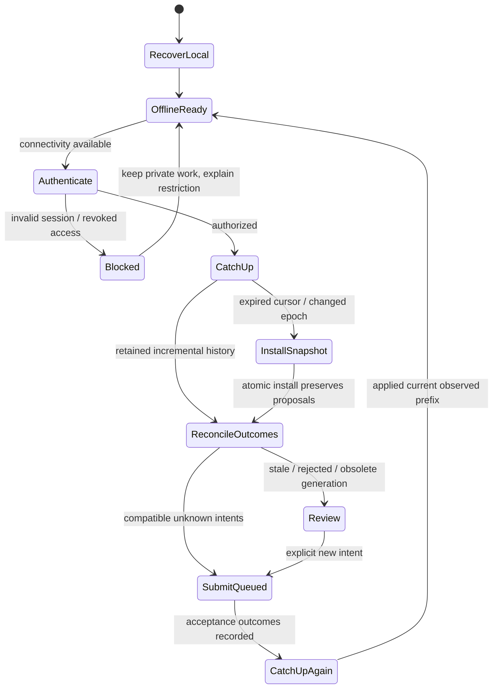

# Local-first software: durable work, offline divergence and reconnect recovery

## 1. Reader, scope and learning route

You know [conflict resolution](../03-conflict-resolution/README.md), [database atomicity](../06-database-concurrency/README.md) and [synchronization-engine boundaries](../08-sync-engine/README.md). You need to preserve user work locally, reconcile independently generated operations, and diagnose failures after long disconnection.

This guide answers seven questions:

1. What can a local write promise without contacting shared authority?
2. Which state, identities and dependencies must survive a client crash?
3. How does reconnect resolve ambiguous prior submissions before replaying work?
4. What happens when logs, tombstones, credentials or schemas changed while a device was away?
5. How can snapshots replace confirmed state without erasing or duplicating private work?
6. How do storage quotas, backups, multi-device operation and encryption change the contract?
7. Which domain rules require online coordination or explicitly limited offline rights?

The chapter covers durable local storage and a reference offline protocol. [Project C](../../../examples/synchronization/c-offline-engine/README.md) implements file-backed clients and an HTTP authority with CAS titles, independent increments, deletion, retained outcomes and snapshot fallback. It is a server-coordinated educational system. It does not implement a general CRDT platform, browser storage, peer discovery, encryption or production identity. Algorithm details are in the OT/CRDT chapters; production deployment and product-specific architecture remain adjacent work.

Read sections 2–5 for the smallest model; 6–9 for the complete reconnect example and retention; 10–13 for evolving/deploying a real client; and 14–16 for execution, diagnosis and review.

## 2. Local-first is a user contract before it is a topology

If opening a document and typing requires a server round trip, network availability participates in every interaction. A locally useful application reads its working state from the device and records proposed changes there first. The network then transports evidence between independent stores.

“Offline-first” usually emphasizes functioning without connectivity. The local-first research agenda includes responsiveness, offline work, collaboration and longer-term user control of data. Terminology varies; define the actual promises instead of treating a label as a correctness property. The 2019 research essay is a useful statement of those aspirations, not a specification proving every implementation meets them. [Kleppmann et al., local-first software, 2019](https://www.inkandswitch.com/essay/local-first/)

A server can remain the authoritative acceptance point while clients keep useful local replicas. A peer-to-peer design removes that particular authority topology but adds discovery, authorization distribution, relay, anti-entropy and replica-membership problems. CRDTs can make particular merges converge; they do not supply those surrounding systems automatically.

Specify at least three separate promises:

- **Local saved:** the device committed enough information to recover this work under its storage assumptions.
- **Shared accepted:** the operation passed the declared shared permission, conflict and invariant checks and reached the authority's commit boundary.
- **Replicated/applied:** another replica incorporated it through an identified checkpoint.

A UI may show all three stages. A spinner saying “saved” without specifying which stage creates an ambiguous data-loss expectation. An offline title edit can be locally saved yet later rejected as stale. The private proposal should remain recoverable even when shared acceptance fails.

## 3. The smallest useful state model

Let `B` be the confirmed local projection, `c` its applied checkpoint and `P` the ordered durable pending operations. Let `R` be retained outcomes/conflicts. The visible state is a policy-specific interpretation:

```text
visible = Rebuild(B, P, R)
```

`Rebuild` must be specified for the datatype. Project C overlays queued and accepted-but-not-yet-covered operations, excludes conflicts/rejections/review from the shared-looking view, and retains their original payloads separately. A CRDT client instead incorporates causal evidence according to its merge rules. An OT client maintains contextual transformed buffers rather than blindly replaying positional edits.

Pending work is not just a list of HTTP requests. It needs original identity, namespace/object generation, operation meaning, schema/protocol version, base/dependencies and sufficient payload to explain or recover it. Access tokens are replaceable transport credentials; operation identity is retained evidence.

Consider two representations after observing count 0:

```text
assign count = 2
increment count by 2
```

If another device increments by 3, assignment can overwrite its contribution while a semantic increment can produce 5. Conversely, an inventory decrement needs a nonnegative-stock policy; arithmetic composition alone does not enforce it. Local storage cannot turn a globally constrained transition into a safe independent one.

### Private work and shared truth can disagree

Mira locally proposes title Plan while the accepted title becomes Proposal. Store the confirmed Proposal and retained private Plan, with its base version. Do not replace the only copy of Plan during catch-up. Do not describe Plan as accepted after rejection. Offering compare, copy, merge or explicit resubmit lets a person decide the meaning of the conflict.

## 4. Atomic local capture: why queue and projection belong together

An implementation that writes local state and later writes a queue has two crash windows:

| Order | Crash window | Result |
|---|---|---|
| State first, queue later | Between writes | Visible/saved proposal with no transmission evidence |
| Queue first, state later | Between writes | Operation may replay while local state does not explain it |
| Both in one transaction | Before or after commit | Recover a coherent old or new state |

If visible state is derived from confirmed state and pending operations, one committed queue entry supplies both the proposal and replay evidence. Project C uses that design. If the application materializes the optimistic view, update that view and outbox in the same local transaction.

The write boundary must validate the intended operation, allocate a stable ID, preserve the base/dependency context, store the pending intent and commit before acknowledging local persistence. Never await a network operation inside the storage transaction. Local synchronization and rendering can proceed after commit.

In SQLite, the transaction controls atomic writes; WAL and synchronization settings qualify the persistence boundary. In IndexedDB, request success and transaction completion are distinct events, and transaction activity/lifetime constrain when requests may be issued. A convenient asynchronous wrapper must preserve those semantics. [SQLite transactions](https://www.sqlite.org/lang_transaction.html), [IndexedDB 3.0 transactions](https://www.w3.org/TR/IndexedDB/#transactions)

A local database is still fallible. Disk full, permission errors and transaction aborts mean the UI must not claim the proposed write was persisted. A process crash after commit but before returning an operation ID also leaves an ambiguous caller outcome: recover the queue before reenacting the user's action. A fresh ID for the same unknowingly saved gesture can create duplicate work.

## 5. Reconnection is a state machine, not “send everything”



A robust reconnect procedure:

1. Open local storage; recover the committed projection/checkpoint/queue. Reject an unsupported disk schema before overwriting its version marker.
2. Authenticate with current credentials. Establish authority/tenant/object/subscription identity and protocol compatibility.
3. Request incremental history or a snapshot, and resolve the status of retained operations whose previous submission may have succeeded.
4. Install confirmed state, covered outcomes and checkpoint atomically. Preserve unaccepted proposals and incompatible work.
5. Apply the declared conflict/dependency policy. Submit only eligible operations with original identities.
6. Commit returned outcomes locally, retaining accepted overlays until their effects are incorporated into the confirmed stream.
7. Pull/apply subsequent accepted changes. Continue while budgets and connection permit; progress does not require staying caught up with an infinitely fast writer forever.

Project C implements this order. Other algorithms can order push/pull differently if their context and ambiguity rules remain correct. “Pull first” by itself is insufficient: a pulled snapshot might already include an operation still marked pending locally.

### Retry policy names outcomes rather than guessing them

No response means unknown completion. Retry a logical submission with its original ID and unchanged meaning. The authority must persist the outcome in the same transaction as the effect. Retry transient transport/service failures with finite attempt/time budgets and jitter. Do not retry forbidden access, invalid schema or stale-version conflict as if waiting will repair the request.

A new token may authorize the same original operation. A newly computed payload or rebased version is a new intent and needs a new identity. Editing the payload under an old ID breaks deduplication.

## 6. Worked example: two devices away for several days

Assume one task `task-7`, initial title Draft, count 0, record version 0, authority epoch `g`, log head 0. Both devices have bootstrapped that state. The authority accepts conditional title replacements and independent positive increments. Tombstones forbid later mutations. We model days offline by the causal schedule; no operation uses elapsed days or wall-clock timestamps to choose a winner.

| Step | Mira local state/work | Dev local state/work | Authority |
|---|---|---|---|
| 0. Both synchronized | Confirmed Draft/0/v0 | Confirmed Draft/0/v0 | Draft/0/v0, head 0 |
| 1. Mira offline | Queue title Plan expecting v0; increment +2; visible Plan/2 | Still offline | Unchanged |
| 2. Dev offline | Original intents remain durable | Queue title Proposal expecting v0; increment +3; visible Proposal/3 | Unchanged |
| 3. Dev reconnects | Offline | Proposal title accepted; +3 accepted | Proposal/3/v2, head 2 |
| 4. History retention advances | Cursor remains 0 | Confirmed through 2 | Delete changes through 2; floor 2; retain current state and outcomes |
| 5. Mira reconnects | Install snapshot at 2 without erasing two original intents | No new work | Snapshot Proposal/3/v2 |
| 6. Mira submits | Title conflicts at expected v0; preserve Plan privately. Increment +2 accepted | No new work | Proposal/5/v3, head 3 |
| 7. Mira catches up | Confirmed Proposal/5; one title conflict remains | Can pull sequence 3 | Same accepted state |
| 8. Mira chooses combined title | New UUID, title Plan + Proposal expecting current v3 | Pull new accepted title | Plan + Proposal/5/v4, head 4 |

The title conflict is intentional evidence, not a convergence failure. The devices converge on accepted state while one retains a separate unresolved branch. Adding two increments preserves arithmetic intent; whole-record CAS for the title rejects stale assumptions. A per-field version could reduce unrelated conflicts, but must still enforce relationships between fields where those matter.

Verification: [Project C demo](../../../examples/synchronization/c-offline-engine/README.md) prints the offline views, the accepted count 5 with one title conflict, and the resolved title on both replicas. The test suite covers the same schedule with actual log pruning. Variation: delete the task before Mira reconnects. The snapshot retains its tombstone and both stale operations are rejected; neither resurrects it.

### Dependent operations need evidence beyond coincidental versions

Suppose Mira queues title First at v0 and title Second at speculative v1. Dev independently increments once, advancing the authority to v1. Mira's First fails, but Second's expected version happens to match v1. Accepting Second would let a child run although its assumed parent never happened.

Project C conditional operations retain a predecessor ID when based on an active local predecessor. The authority requires an accepted predecessor outcome before executing the child. Its tests show that matching versions alone are insufficient. Independent increments have no predecessor under this domain policy. A general engine needs an explicit dependency DAG, blocked-descendant states and a policy for changing or discarding parents; a linear queue is not a proof that every dependency is satisfied.

## 7. Snapshot installation must reconcile unknown successes

Mira queues increment +4. The server commits it, but the response is lost. Later the corresponding change entry is pruned. Mira still has queued +4 and cursor 0; the server snapshot says count 4 at head 1.

Naive reset:

```text
replace confirmed state with count 4
leave queued +4 active
display confirmed + pending = 8
```

Correct reset under this authority model:

```text
one server read snapshot: state at head 1 + outcome for original operation ID
one client write transaction:
  install count 4
  record original accepted outcome at sequence 1
  remove its now-covered pending overlay
  advance checkpoint to 1
commit
```

The result is 4. If the operation was never accepted, no such outcome exists; it remains queued and can be submitted subject to current rules. If the authority no longer knows, it cannot safely infer “never accepted.” Lost deduplication evidence is a change in the protocol's safety boundary.

Project C requests outcomes for at most 100 retained pending IDs and reads those outcomes with records/history in the same authority transaction. It installs them with the projection/checkpoint atomically. More general systems can use accepted-operation frontiers, actor sequence acknowledgments or datatype state vectors, but must prove equivalent incorporation knowledge.

### Large snapshots require staging

An entire single-task snapshot fits one transaction in the lab. For millions of records, stage chunks under a snapshot ID/epoch/schema and boundary. Validate chunk completeness and integrity before switching the active projection manifest. Keep receiving subsequent changes against the declared baseline. Do not expose half an old collection plus half a new collection as a coherent reset.

A snapshot must describe the projection actually represented, not merely the source's newest head. An asynchronously updated projection can lag its source. A delta must name an exact known baseline; a delta against unknown state is not recoverable by guessing.

## 8. Deletion, retention and garbage collection

Deleting a stored row without retained removal evidence leaves old offline replicas able to resend it as an apparently new object. A tombstone records the removed identity/generation or causal evidence. Whether delete wins, edit wins or a conflict is surfaced is a declared datatype/domain policy.

Project C retains the record with `deleted=true`; the authority rejects all mutations to it. That policy is simple and restrictive. Undo would be a new explicitly authorized transition, or a new object identity; it is not replaying an old stale edit. CRDT deletion needs the causal metadata rules explained in [CRDT reclamation](../05-crdts/README.md).

Three histories have different retention duties:

| History | Needed for | Deletion condition |
|---|---|---|
| Change log | Incremental catch-up | Snapshot fallback plus a declared retained floor can replace old entries |
| Operation outcomes/deduplication | Resolve unknown effects and safe retry | Retain until no eligible retry can refer to the old identity, or fence older generations/leases |
| Tombstones/causal context | Prevent revival by stale evidence | Prove relevant replicas cannot resubmit obsolete evidence, or require reset with identity/generation fencing |

Pruning a log is not permission to erase every outcome or tombstone. Project C actually prunes changes while retaining outcomes indefinitely. Its explicit operator epoch rotation deletes outcome history, preserves current task state and makes old unresolved operations review-only. The new epoch tells clients that replay assumptions changed; it cannot tell whether an unknown old increment was incorporated.

Unlimited offline duration and finite retained histories require a reset/rejoin contract. Track devices or issue expiring synchronization leases if the product accepts a maximum offline horizon. After expiry, permit local viewing/export of private work but require rebootstrap and review before admitting obsolete operations. Do not silently turn an expired offline replica into an authoritative writer.

### Retention has a measurable cost

For an illustrative outcome store, let `n=10,000` active clients, `r=200` operations/client/day, `d=365` retained days, and `b=160` encoded bytes/outcome. Assuming constant rates, one outcome per operation and no compression, raw storage is `n*r*d*b = 116,800,000,000` bytes, about 116.8 GB. Indexes, replicas, payload fingerprints and backups add cost. This is a capacity estimate, not a measured bound; retention design changes both correctness and storage.

## 9. Progress and performance while reconnecting

An offline client needs transfer and local application capacity, not just a functioning socket. Let `N` be retained entries to apply, `p` entries/page, `t` round-trip time, and `a` total local application time. A serialized page protocol has rough catch-up time:

```text
ceil(N/p) * t + a
```

Assume no overlapping requests, no transfer bottleneck, no new writes, fixed page sizes and no retries. For `N=20,000`, `p=200`, `t=0.08` seconds and `a=1` second, the estimate is `100*0.08+1 = 9` seconds. Byte transfer, query cost and slow storage can dominate instead. Pipelining reduces round-trip waiting but complicates checkpoint ordering and resource control. A snapshot may be cheaper than replaying every intermediate change, while still needing pending-operation reconciliation.

If ongoing arrival rate is `lambda` and sustained client apply rate is `mu`, stable catch-up requires `mu > lambda` under a stationary workload. With a backlog of 1,000 entries, `lambda=100/s` and `mu=150/s`, ideal drain time is `1,000/(150-100)=20` seconds. This assumes constant rates and ignores bursts/retries; at equal or higher arrival rate a client needs coalescing, a newer snapshot, filtered scope or more capacity.

Bound pages, decoded bytes, pending operations and each synchronization pass. Stop with an actionable budget outcome rather than an unbounded loop. Jitter reconnects after an outage to avoid simultaneous history reads from every device. Coalesce redundant independent assignments only when their semantics and already-submitted identities allow it; deleting a queued operation whose remote outcome is unknown is unsafe.

## 10. Schema and protocol evolution across disconnected devices

There are at least four versions: local disk schema, operation payload schema, wire protocol and shared data schema. One number cannot explain all compatibility decisions.

A cached record migration can add a local index or derived column without changing an already captured operation. Converting an old queued operation must preserve its meaning and identity contract. An old title-setting operation is not automatically equivalent to setting a newly introduced title/slug pair under changed uniqueness rules.

Illustrative migration procedure:

1. Inspect local schema/version before ordinary reads and writes.
2. Back up/export private work using a supported coherent storage method.
3. Migrate records, queue metadata and checkpoints in one transaction where possible; resume large migrations from explicit durable stages.
4. Keep queued original envelopes when compatibility translation occurs server-side, and define canonical fingerprint rules across versions.
5. Negotiate unsupported wire/operation versions explicitly. Preserve work for export/review if no semantics-preserving conversion exists.
6. Test a client that sleeps through several releases, not just adjacent current versions.

Project C supports version 1 and refuses future disk/wire versions. This is explicit compatibility detection, not a general migration implementation. Blindly setting `user_version=1` over an unknown database would destroy evidence about its format; the constructors check future markers first.

Rolling deployment needs old and new readers to understand accepted changes during the supported window. Removal of an operation kind must account for disconnected clients that still have it queued. Feature flags do not make those durable queues disappear.

## 11. Authentication expiration and permission changes

A stored operation says what a device intended, not what it is currently permitted to do. Refresh an expired authentication session through the actual identity protocol; bind the resulting actor to the original store and submission. Recheck object/tenant permission before mutation and before historical outcome/history disclosure. Credential replacement must not create new operation IDs.

Project C's test changes a fixture header to an expired token and observes 401; it does not implement token refresh. Its revocation test gates reads, writes and replay outcomes, preserving queued work locally. Real OAuth deployments need the current security guidance rather than embedding permanent bearer tokens. [OAuth 2.0 security BCP, RFC 9700, January 2025](https://www.rfc-editor.org/rfc/rfc9700.html)

Offline clients cannot learn revocation until communication or a prearranged expiry. A device already holding plaintext can continue reading that copy; a server cannot retract those bytes. A policy can limit future synchronization and keys, encrypt local storage, use platform protection and define local cache removal on reconnect. Those choices do not create instantaneous remote erasure.

A sync lease or offline capability can grant bounded rights in advance. It must name resource scope, expiry, spending/write limits and revocation semantics. For a shared inventory of two units, two unrestricted offline clients cannot each guarantee two globally valid reservations. Allocate disjoint rights, accept tentative reservations, or coordinate online. Domain safety determines the offline promise; a convergent UI does not settle overselling.

## 12. Multi-device storage, backup and ownership

Two devices for one user are independent replicas, not one process with shared memory. Give each a distinct writer/device incarnation where the datatype requires it. A restored backup can contain old counters, old pending IDs and stale checkpoints. Reusing operation IDs for different work is an error; replaying original work needs preserved meaning and outcome evidence. Actor counters require durable monotonic allocation or a fresh incarnation after restore; UUIDs avoid that counter reuse pattern but do not detect accepted effects by themselves.

A useful backup includes confirmed state, pending intents, outcomes/conflicts, checkpoint, schema metadata and identity binding. A server-only backup may omit the most valuable unsent work. Provide a user-readable export of unresolved proposals as well as a machine-restorable format. Verify restores by actually reopening and reconciling them.

SQLite WAL mode has associated state; copying only an actively changing main file is not a coherent backup procedure. Use supported online backup or a correctly quiesced backup contract. [SQLite online backup](https://www.sqlite.org/backup.html)

For browser clients, origin storage and IndexedDB offer local storage mechanisms, while the storage standard distinguishes best-effort and persistent storage. Requesting persistence can reduce automatic eviction under the browser's policy; it is not an off-device backup and does not prevent a user from clearing data or losing a device. Check storage failures and quotas. [WHATWG Storage living standard, accessed 2026-10-13](https://storage.spec.whatwg.org/)

Multiple tabs/processes need synchronization ownership or safe concurrent protocol execution. A local lease alone can leave an old owner still executing after expiry. Use generation checks/fencing at the local commit boundary, and stable operation IDs at shared authority. Project C has single-flight per client object and rejects stale checkpoint installation; it is not a complete multi-tab leader-election system.

A catastrophe restore that may discard accepted effects must not resume the old authority epoch while pretending its history is intact. Project C can detect a head behind an already applied cursor, but a client with an older cursor may have no evidence of rollback. Operators need generation fencing and reconciliation; checksums alone do not prove completeness of history.

## 13. End-to-end encryption and server-blind synchronization

Transport encryption protects the network path; the server can still see plaintext. End-to-end encryption keeps payload decryption at authorized clients. A blind server can store opaque envelopes, route them, deduplicate declared identities and enforce visible namespace membership. It cannot validate a hidden title's business meaning, resolve plaintext merge conflicts or build plaintext search without an additional mechanism.

An encrypted design must specify operation signatures/integrity, key epochs, nonce uniqueness, metadata visibility, member-device keys, key recovery and revocation. A server can enforce limits on encrypted sizes and declared roles, but cannot establish a plaintext invariant merely by trusting a client-provided “valid” flag. Merge can run on authorized clients if their datatype evidence is authenticated and context is complete.

Membership changes have two histories: application permission and key distribution. Removing a member should stop future key access under the chosen group protocol; it does not erase previously decrypted content or prove obsolete clients discarded keys. MLS specifies group-key security mechanisms, not document merge, application ordering or storage recovery. [RFC 9420, July 2023](https://www.rfc-editor.org/rfc/rfc9420.html)

Encrypted long-offline clients may need missing key epochs before decoding retained operations. Compacting those epochs without a rejoin/key-recovery plan can leave ciphertext permanently unreadable. Retain what the cryptographic protocol requires and treat key loss separately from missing synchronization history. Project C does not encrypt anything; this section describes design obligations, not validated implementation behavior.

## 14. Implementation path and real use cases

[Project C's README](../../../examples/synchronization/c-offline-engine/README.md) includes setup, directory map, CLI, code walkthrough and tests. Run:

```sh
cd examples/synchronization/c-offline-engine
npm test
npm run demo
```

The suite passed 25 tests on Node 26.7.0 / bundled SQLite 3.53.4. It uses actual SQLite files, actual HTTP, actual client/server SIGKILL and an explicit lost-response transport fault. The demo verifies independent title/increment work, actual change-log pruning, conflict retention and a fresh human-resolved intent. [Evidence and limits](RESEARCH.md)

| Context | Why this approach fits | Additional operating requirements | Measure of success |
|---|---|---|---|
| Personal notes across devices | Local reads/writes remain useful; conflicts can be presented | Export, key recovery, rich-text policy, storage lifecycle | Unsent work survives restart; convergence after reconnect |
| Field task collection | Intermittent coverage; durable capture matters more than immediate sharing | Offline permissions, attachments, duplicate identifiers, long migration gaps | No silently lost submissions; explicit stale/denied outcomes |
| Collaborative project records | Independent fields may merge, conditional transitions need authority | Relationships, roles, deleted references, dependency policies | Valid cross-object state plus retained user proposals |
| Shared text editor | Concurrent text needs context-aware operations | Real OT/CRDT integration, undo, Unicode and history | Convergence with declared intent/format semantics |
| Financial or scarce inventory transition | Global invariants can exceed offline knowledge | Online authority or preallocated bounded rights | No invalid committed transition; tentative UI clearly labeled |

These are illustrative choices, not confirmed product deployments. Local-first interaction can coexist with an online-only payment/permission transition inside the same application. Choose guarantees per operation, not once for the entire product.

## 15. Failure diagnosis and recovery

| Symptom | Likely boundary failure | Evidence to inspect | Recovery/design correction |
|---|---|---|---|
| Work disappears after app restart | UI acknowledged before local commit, storage eviction or wrong store binding | Transaction completion, quota errors, actor/tenant/store path | Preserve/export remaining work; fix commit acknowledgment; restore coherent backup |
| Counter displays twice after reset | Snapshot includes unknown queued success | Snapshot head, pending IDs, retained outcomes | Atomically reconcile outcomes with installed snapshot |
| Child edit executes after parent fails | Base version coincidentally matches unrelated state | Predecessor IDs and outcomes | Explicit dependencies; block or review children |
| Endless stale-write retries | Conflict misclassified as transport failure | Stored conflict reason and immutable payload | Present branch; create a new explicit intent |
| Deleted object returns | Missing removal evidence or admitted obsolete replica | Tombstone/generation/lease history | Restore removal evidence; fence reset; define resurrection policy |
| Queue survives but cannot upload | Revoked credentials/permission or schema | Auth error class, negotiated version, original envelopes | Reauthenticate if permitted; preserve private work for review/export |
| Checkpoint ahead of visible data | Cursor committed separately or malformed page admitted | Projection transaction and applied frontier | Restore/rebootstrap coherent state; couple commits |
| Old restored client repeats effects | Outcome history discarded or IDs reused | Backup generation, actor incarnation, dedup retention | Fence old generation; reconcile instead of blind replay |
| Reconnect never reaches current head | Apply rate below arrival rate or insufficient pass budget | Lag, page bytes, query/application timings | Snapshot/coalesce/filter; increase capacity; preserve progress |

When corruption or disk failure is suspected, avoid overwriting the only remaining private queue with a convenient fresh bootstrap. Preserve a coherent copy/export using supported storage recovery procedures before repair. The lab's integrity check and process-kill tests do not establish recovery from corrupted media.

Observability should record operation IDs, outcome classes, generation, confirmed cursor, retained floor, pending age and local persistence failures. Avoid logging private body text or tokens by default. A socket reconnect metric alone cannot reveal lost work.

## 16. Invariants, limitations and reading path

Core invariants:

1. Local acknowledgment follows a committed recoverable intent/projection boundary.
2. Original logical identities survive retries; changed intent receives a new identity.
3. Shared effect, original outcome and accepted change log share one authoritative commit boundary.
4. Client projection, covered outcomes, pending-state updates and applied checkpoint commit together.
5. Snapshot replacement preserves private work and reconciles previously unknown successes.
6. Stale versions, invalid dependencies, revocation and deletion receive explicit outcomes.
7. Compaction preserves eligible retry/removal evidence or fences old generations.
8. Local usefulness does not imply global invariant validity or immediate revocation knowledge.

Project C omits offline creation, browser storage, real token refresh, actual schema migrations, encrypted payloads, large snapshots, filters, attachments, multiple authoritative writers and safe outcome GC. Its tests establish process-restart behavior under the measured storage settings, not host-power durability, damaged-disk recovery, real days of suspension, WAN capacity or production security. Full review remains pending.

Further reading: start with the [2019 local-first research essay](https://www.inkandswitch.com/essay/local-first/) for the user contract; [SQLite transactions](https://www.sqlite.org/lang_transaction.html) and [WAL](https://www.sqlite.org/wal.html) for native local atomicity; [IndexedDB](https://www.w3.org/TR/IndexedDB/) and [Storage](https://storage.spec.whatwg.org/) for browser lifecycle; the existing [CRDT guide](../05-crdts/README.md) for decentralized merge evidence; and [MLS](https://www.rfc-editor.org/rfc/rfc9420.html) for the separate group-key problem. Sources and review gaps are recorded in [RESEARCH.md](RESEARCH.md).

Reviewer: pending technically informed reader. Review date: pending. Open issues: technical review and production mechanisms listed above. Status: **draft**.
