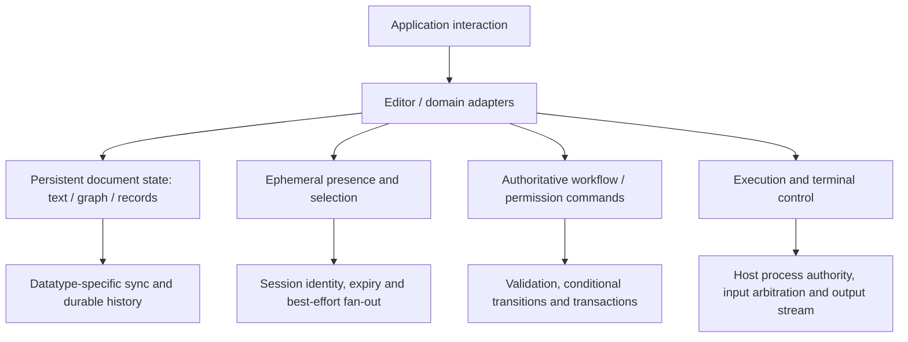
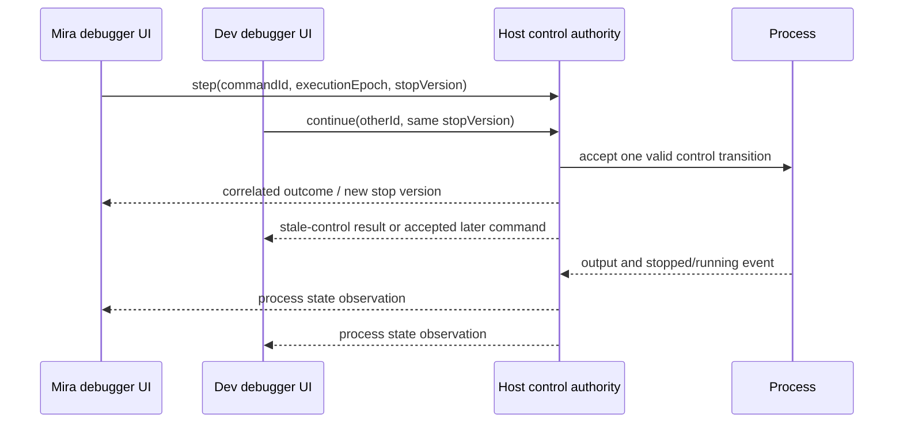
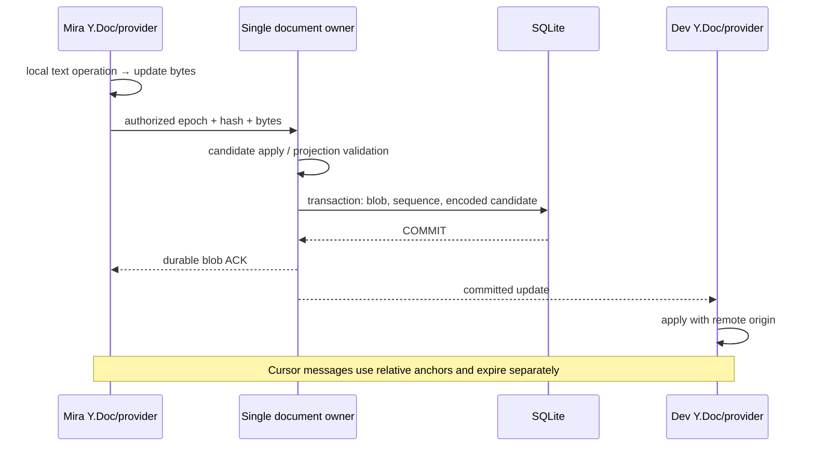

# Collaborative applications: text, object graphs, workflows and shared execution

## 1. Reader, scope and central questions

You understand [OT](../04-ot/README.md), [CRDTs](../05-crdts/README.md), [transactions](../06-database-concurrency/README.md), [engine boundaries](../08-sync-engine/README.md) and [offline recovery](../10-local-first/README.md). You need to turn those mechanisms into a coherent application, decide which operations may merge, and explain what users observe while acceptance and replication lag.

This guide answers: what is the replicated state; which user actions become which operations; what can merge independently; which invariants need authority; how are selection, presence, undo and history represented; how do execution and terminal control differ from editing; and what evidence supports actual product examples?

The scope is text documents, design graphs, task/page systems, messaging and collaborative development. Game simulation is the next branch. Full merge proofs are cross-referenced rather than restated. Product names identify requirements unless a dated primary report is explicitly cited. A user interface does not reveal a proprietary protocol.

[Project D](../../../playground/synchronization/d-collaborative-text/README.md) is a runnable command-line collaborative plain-text editor using a pinned Yjs library and a custom durable WebSocket provider. It adds selective undo and expiring relative-position presence. It is neither a graphical editor nor a rich-text implementation; its client state is memory-only.

## 2. One product usually contains several consistency domains

A document's text, membership, user cursors, billing, comments and executable processes do not share one useful conflict policy. A typing update may expire; a character insertion should survive duplicate delivery; a role grant must come from authorized authority; a payment cannot be replayed as a cosmetic edit.

Derive a protocol per domain before choosing a shared transport:

1. Name the object identity/generation and who may read or change it.
2. Define operations in domain terms, including dependencies.
3. State invariants and admissible concurrent histories.
4. Select merge/transformation/conditional acceptance accordingly.
5. Define local persistence, shared acceptance and remote application separately.
6. Choose catch-up/compaction and cursor/anchor behavior.
7. Define UI behavior for provisional, rejected, stale and expired evidence.

A shared WebSocket can multiplex these protocols, but it does not make them equivalent. Keep envelopes and durability labels distinct so a presence drop cannot accidentally mean document loss.

## 3. Google Docs-style text: positions are contextual

### 3.1 From a gesture to a text operation

A single-user editor can change a buffer at an integer offset. In a shared editor, that offset belongs to a document version. Starting from `ab`, Mira inserts X at gap 1 while Dev deletes a at position 0. Applying Mira's original offset to Dev's `b` puts X after b, although Mira intended the gap between the original a and b.

OT captures a contextual operation and transforms it against concurrent accepted operations under its control algorithm. A sequence CRDT captures identities and neighbor/ordering evidence that permit concurrent integration. Both need a correct editor binding, persistence and delivery protocol. See [OT worked transforms](../04-ot/README.md) and [sequence CRDTs](../05-crdts/README.md).

Replacement deserves an explicit policy. Delete+insert captured in one editor transaction groups a local action, but does not force two independent computers to see it as a globally serialized database transaction. A concurrent insertion may survive inside or adjacent to the replaced range according to the datatype. A wholesale `setText(latestString)` discards context and often overwrites independent work.

### 3.2 Indexing, Unicode and input methods

The binding must choose UTF-16 code units, Unicode scalar values or grapheme clusters. Y.Text counts UTF-16 units. A visible emoji can use two units; a combining sequence can contain several scalars while appearing as one grapheme. Project D rejects operations splitting a surrogate pair, but does not implement full grapheme selection. [Y.Text API](https://docs.yjs.dev/api/shared-types/y.text)

A browser/editor binding also needs composition handling: intermediate IME state is not always committed user text. Replacing a controlled input on every remote update can interrupt composition or move a selection. A production binding translates editor transactions into datatype operations, translates remote changes back with an origin marker, and updates selection against the same document context. Observe one source of changes; feeding remote changes back as new local edits creates an echo loop.

### 3.3 Cursor, selection and comment anchors

An integer cursor at 5 becomes wrong when another user inserts at the beginning. Represent durable annotation ranges or live selections using datatype-relative anchors or versioned OT position mapping. Two anchors define a selection; anchor association chooses which side of a boundary insertion it follows.

Yjs relative positions can be resolved to absolute indices in a particular Y.Doc and may return null when their referenced type/evidence is unavailable. They are position evidence, not permanently correct semantic annotations. Deleting an entire paragraph may require an orphaned-comment UI even if the datatype can resolve a nearby boundary. [Yjs relative positions](https://docs.yjs.dev/api/relative-positions)

Keep persistent comments and their author/permission/history separate from transient cursor messages. Bind cursor actor/session server-side and expire it. A client claiming another user's name is not proof of that user's presence.

### 3.4 Rich text adds structure and schema

A rich document may combine block nodes, text sequences, marks, embedded media and cross-node references. Concurrent bold/unbold operations need a range/association policy. Concurrent node deletion and child editing need a structural deletion policy. A block move must preserve identity if comments refer to it.

The datatype can converge while producing a structure the renderer cannot accept: an unexpected node type, conflicting parents or an invalid nesting rule. Define schema compatibility, normalization and whether repairs themselves become replicated operations. If different clients normalize differently without a deterministic protocol, “repair” can become another source of divergence.

Y.Text supports formatting attributes, but its existence does not implement an entire document editor. Project D explicitly accepts plain text and rejects visible attributes/embeds. Rich text needs an editor binding and matching document schema; the CRDT lab's deliberately limited marks are not a substitute. [Y.Text delta representation](https://docs.yjs.dev/api/shared-types/y.text)

### 3.5 Undo and version history

Undo is a new collaborative action against current state, not an instruction to load an old entire document. If Mira adds ` Mira` and Dev adds ` Dev`, Mira's selective undo should preserve Dev's contribution under the chosen policy. Y.UndoManager can scope undo tracking by transaction origin; Project D excludes remote provider origins and sends undo/redo effects as normal updates. [Yjs UndoManager](https://docs.yjs.dev/api/undo-manager)

Version history needs a declared boundary: accepted log prefix, named snapshot or causally described CRDT state. Retain original datatype evidence if historical reconstruction requires it. Restoring only a plain string into a fresh CRDT loses original identities; reconnecting old clients can then combine duplicate initial text or obsolete edits. A user-visible restore should be an explicit new operation/branch or an epoch-fenced reset with recovery rules.

OT and CRDT choices depend on contextual server control, offline requirements, metadata/compaction, editor ecosystem and domain semantics. Neither automatically preserves every human intention. This chapter does not assert the current Google Docs implementation. Historical official Google articles were located but full-page fetches were blocked; [the research record](RESEARCH.md) identifies that evidence limit.

## 4. Figma-style design tools: object identity, graphs and geometry

### 4.1 Choose the atomic property boundary

An illustrative design object is `(id, parent, siblingRank, transform, fill, geometry)`. Mira changing fill and Dev changing position can merge at independent property boundaries. Sending complete objects as unconditional replacements loses unrelated changes. But splitting every numeric field independently can violate coupled invariants.

For example, a transform may be one affine matrix or a constrained tuple. An atomic transform replacement prevents mixing an old rotation with a new translation unintentionally. It still chooses one winner for concurrent replacement; relative transformation composition needs its own semantics.

Composition is not generally commutative. Let translation `T(x)=x+1` and scale `S(x)=2x` act on one-dimensional coordinate `x`. At `x=1`, `S(T(1))=4`, while `T(S(1))=3`. The assumptions are a common coordinate frame and these exact transforms; a real editor also has parent/world transforms, pivot and constraints. A deterministic order yields convergence but does not establish which drag/scale intent the users meant.

### 4.2 A valid local graph can merge into an invalid global graph

Initially A and B are children of Root. Mira moves A under B; Dev moves B under A. Each is valid against the original graph. Combining their independent parent links creates a cycle.

| Replica | Parent(A) | Parent(B) | Valid tree? |
|---|---|---|---|
| Base | Root | Root | Yes |
| Mira branch | B | Root | Yes |
| Dev branch | Root | A | Yes |
| Naive combined links | B | A | No |

Options include authority-serialized validation, a replicated tree algorithm with explicit cycle repair, or restricted moves. A server that checks for cycles and then commits without coordinating competing changes still has a race. Serialize the relevant graph decision or use a transactional isolation/control scheme whose validation covers the invariant. A client with an optimistic rejected move needs a recovery/render policy for transient invalid structure.

Sibling order needs stable rank evidence. Choosing the midpoint between two ranks lets a move avoid rewriting every sibling. Concurrent inserts can choose the same rank; add a deterministic identity tie-breaker. Finite numeric precision or unbounded string growth requires rebalance rules. Rebalancing while old offline ranks remain eligible needs a generation/translation policy. Parent and rank often belong to one move operation, because a rank calculated in one parent's space may not mean the same thing in another.

These are authored design arguments. A **2019 historical report** from Figma describes a client/server document protocol, per-object property resolution in server order, explicit object lifecycle, parent-link cycle checks and fractional ordering. It also separates document multiplayer from other stored data. This is evidence of that reported design, not proof of the entire current product or its present text-editing implementation. [Wallace, October 16, 2019](https://www.figma.com/blog/how-figmas-multiplayer-technology-works/)

### 4.3 Interaction state and rendering

Drag previews, cursors, selections and viewport positions are ephemeral. A committed transform belongs to durable document state. A design can transmit coalesced drag previews while periodically committing document changes; it must label which state survives a reconnect. Undo grouping, final mouse-up loss and permission changes during a drag need defined behavior.

Render locally before a round trip to hide latency. If using authority-ordered property replacement, retain a pending overlay so an older incoming accepted value does not briefly overwrite a newer local proposal. Remove or reconcile that overlay when the corresponding outcome arrives. This UI technique does not make a rejected proposal valid shared state.

Network batching and rendering batching are different. Send fewer payloads while preserving required identities; invalidate only affected geometry/layout regions in the renderer. A fast socket cannot compensate for rebuilding every layer and recomputing all layout on each cursor update. Measure action-to-local-frame latency and acceptance/remote-application lag separately.

## 5. Linear-/Notion-style tasks and pages: records plus invariants

### 5.1 A record graph mixes mergeable and conditional work

Tasks have titles, statuses, assignees, project references, comments and ordering. Pages have text/block structure, references and permissions. A subscription often exposes a filtered subset, not the entire database.

| Operation | Plausible policy | Required evidence / limitation |
|---|---|---|
| Append comment | Stable ID + authoritative append | Idempotent retry; current write permission |
| Add tag/reaction | Set membership / observed-remove policy | State intended under concurrent remove; duplicate-safe identity |
| Replace title/assignee | Per-field LWW or version-CAS | LWW can discard work; CAS preserves explicit stale conflict |
| Transition status | Conditional state machine | Validate current state and approval/role predicates |
| Edit page text | OT/CRDT text | Appropriate editing context and schema |
| Reorder task/block | Stable rank/move operation | Equal ranks, rebalance and offline rank generations |
| Move project/page | Multi-object authority transaction or specialized graph algorithm | References, permission changes and cycle rules |
| Change permission | Authorized control-plane transaction | Recheck subsequent disclosure; do not let content grant rights |

Suppose “Done” requires approval. Independently merging status=`Done` with approval=`false` violates the rule even if both fields converge. The server must accept the transition with the predicate under an appropriate transaction, or the UI must label offline completion tentative. A CRDT register for each field does not enforce their relationship.

Likewise, editing a task while its project is deleted requires a policy: reject, retain orphan, move to recovery area, cascade deletion or recreate under a new identity. Foreign-key enforcement inside a database does not by itself explain what happens to offline user operations. [Offline conflict recovery](../10-local-first/README.md) separates the private proposal from accepted records.

### 5.2 Separate rendering links from authorization ancestry

An object can be displayed in several places while inheriting permissions from one declared parent/owner. Treating every visual reference as a permission grant can disclose content through a newly added link. Define the authoritative permission relationship separately, validate moves across it, and avoid caching an authorized response under a key shared with differently authorized users.

Notion's **May 18, 2021** engineering article describes blocks with stable IDs/properties/type, render-content links, separate upward permission parents, grouped operations and a durable local transaction queue. This supports the distinction between document representation and permission ancestry, not a claim about its current complete synchronization algorithm. [Notion data model report](https://www.notion.com/blog/data-model-behind-notion)

Linear's **June 29, 2023** article points to a sync-engine talk. Its accessible landing text does not specify conflict or database algorithms, and the talk was not reviewed here. It is included as further reading, not used to infer those details. [Linear talk landing page](https://linear.app/now/scaling-the-linear-sync-engine)

### 5.3 Filtered subscriptions and activity projections

A task can leave a user's subscribed project because it moved or permission changed. The sync protocol needs removal-from-view evidence even when the underlying task still exists. An omitted record is not necessarily a deletion. Name subscription/policy generation and scan-progress checkpoint separately from received-record count.

The activity feed is a projection of accepted actions, not a second mutable source of truth. Emit it from committed outcomes/logs. Otherwise a client can receive “task completed” for a transaction that later rolled back. Search, badge counts and relationship indexes may lag; carry their progress and recover them from a declared source.

Performance depends on cache scope and access pattern. Bootstrap only eligible records; paginate and lazily fetch large content while retaining sufficient identity/version evidence for queued operations. An LRU cache may evict a confirmed body, but must not evict the only copy of an unsent mutation simply because that object is no longer on screen.

## 6. Slack-/Discord-style collaboration: immutable messages and changing metadata

Messaging is covered in [the messaging guide](../09-messaging/README.md) and Project B. Its durable unit is usually a message ID/channel sequence, not a shared mutable text buffer. Chat edits may use revision-CAS; reactions need membership semantics; deletion needs redaction/history policy; read receipts need eligible-read progress.

Typing and presence expire. Durable message history catches up. A read receipt is a declared client/user boundary, not proof of attention. A persistent socket supplies transport, not global message order or durable client processing.

This branch matters inside other collaborative products: a comment thread attached to a paragraph/design layer/task needs both chat-like message delivery and a stable annotation/object reference. If the referenced object disappears, keep an explicit orphan/resolution policy instead of silently attaching the thread to a different object that happens to reuse its position.

No current proprietary Slack/Discord internal architecture is asserted here; the earlier chapter labels reference designs and primary broker behavior separately.

## 7. Collaborative coding: source, filesystem and execution are separate

### 7.1 Sharing source does not merge program semantics

Text synchronization can converge while the resulting program fails to parse or changes behavior incorrectly. Mira renames a function while Dev adds a call using the old name. Every character may merge correctly, yet the code no longer builds. Language-aware diagnostics and refactoring transactions operate above text convergence.

A project also has filenames, create/delete/rename operations, binary assets, dependencies and generated files. A rename racing an edit needs stable file identity; two new files with the same path need a policy. A simultaneous multi-file refactor can require an application transaction/commit boundary even when each editor buffer uses a text CRDT. A Git commit is a review/history boundary, not a real-time cursor or presence protocol.

Remote development can keep the authoritative filesystem on one host while clients view/edit selected files. A fully replicated workspace instead needs file-content, namespace and build-environment synchronization. Do not assume both collaborators have identical compiler versions, environment variables or dependency state because their source buffers match.

### 7.2 Execution is an authoritative process history

A running program has registers, memory, open files, timers, sockets and external effects. Those do not become CRDT state merely because its source is shared. A collaborative runtime can host one process and route authorized debugger/run commands to it. The protocol must decide who may step, stop, evaluate code, restart or change breakpoints, and how command outcomes are correlated.

The host serializes control against an execution epoch/stop state. After a restart, an old “step” command must not silently act on a different process incarnation. A timeout after an external side effect remains ambiguous; replaying “run migration” can have consequences beyond duplicate terminal text.

Grant editing, debugging/evaluation, process execution, port forwarding and filesystem access separately. Read-only source access does not inherently mean a debugger cannot inspect secrets or execute a REPL. Microsoft’s Live Share security documentation discusses guest access, shared terminals and debugging risks; the page reports last update **November 21, 2022**. Treat it as documented product guidance with that date, not proof of every current extension setting. [Live Share security](https://learn.microsoft.com/en-us/visualstudio/liveshare/reference/security)

### 7.3 Terminal multiplexing is ordered I/O and control arbitration

A shared terminal usually has one host PTY/process, a serialized input path and an output byte stream. If Mira types `rm ` while Dev types a filename, arbitrary byte interleaving can form a command neither intended. Use a control-owner token, explicit turn-taking or a documented shared-input policy. The host checks rights on every control action and fences stale owners.

Terminal output is not append-only plain text: escape sequences move cursors, clear regions, change modes and update a screen. A reconnect needs compatible screen state plus subsequent stream position, or a supported emulator-state snapshot. Replaying only the last line may not reconstruct the terminal. Size changes and echo/input modes also affect observations.

Shared execution and terminals generally require the host to remain available. Offline editor changes can survive locally, while offline terminal input should not blindly queue dangerous commands for a future unrelated shell session. Distinguish editable source persistence from process availability and effect durability.

## 8. Comparative application contracts

The following are **reference design choices**, not universal product measurements. Latency labels are qualitative: local interactive work should render without an avoidable network round trip; accepted shared outcomes still follow their coordination path.

| Category | Replicated state / authority | Conflict policy | Delivery / offline | Durability and latency | Important failure |
|---|---|---|---|---|---|
| Text document | Text/structure; datatype plus membership authority | Contextual OT or CRDT; schema rules | Incremental evidence + reconnect; offline if persisted | Durable edits; immediate local rendering, eventual remote incorporation | Wrong offset/context; lost pending work; incompatible structure |
| Design canvas | Object graph/properties; authority or proved graph datatype | Property merge, atomic transforms/moves, cycle checks | Batched changes, snapshots, ephemeral previews | Durable final graph; responsive drag feedback | Cycle, mixed transform, stale rank, preview mistaken for commit |
| Tasks/pages | Record graph + text; transactional control and datatype text | Field policies, conditional workflow, graph validation | Filtered catch-up; tentative offline operations | Durable accepted records; immediate speculative view | Cross-object invalid state; wrong permission ancestry |
| Chat/comments | Messages/revisions/reactions; channel authority | Idempotent append, edit policy, reaction set | Retained history + transient notifications | Durable message acceptance; expiring indicators | Duplicate effects, missing history, wrong unread boundary |
| Shared source | Text + filesystem namespace; host or replicated workspace | Text algorithm plus rename/refactor policy | Live editor sync; source can be offline | Durable file changes separately from runtime | Converged text that fails build; path collision |
| Shared debugger/terminal | Hosted process and I/O; host control authority | Serialized commands/owner token, epochs | Ordered output + state catch-up; little useful offline control | Execution effects need explicit outcomes; interactive control latency | Interleaved command, stale process control, leaked secrets |

Do not choose one conflict method for all rows. A task's description can use Yjs while its permission and status transition use database transactions, and its cursor uses expiring session messages.

## 9. Worked implementation: Project D's complete mutation path

Assume Mira and Dev bootstrap the same `Hello` document epoch. They disconnect, Mira inserts ` Mira` and Dev inserts ` Dev` at local offset 5, then reconnect. Each retains a Y.Doc and queued binary updates in memory.

1. The editor calls Y.Text inside a local-origin transaction. Yjs allocates identity/context and emits an update.
2. The provider captures that update, names the exact blob by SHA-256 and sends it once per connection.
3. The server rechecks current document write permission and epoch, decodes a bounded blob and applies it to a candidate.
4. The server validates its visible plain-text/root/size policy and atomically stores the blob/hash/acceptance sequence plus candidate CRDT snapshot in SQLite.
5. After COMMIT it replaces live memory, ACKs the sender and broadcasts to currently authorized readers.
6. A receiver applies the update with remote origin, preventing an echo. The CRDT integrates evidence now or retains unresolved dependencies.
7. Reconnect supplies the complete server CRDT state and insertion vector. The client merges the state, computes missing evidence including deletion state, and resends its memory queue. Overlapping encodings remain duplicate-safe at the CRDT layer.
8. Both branches converge after all evidence reaches both clients. Selective undo removes Mira's tracked contribution and propagates as a new update; Dev's remains.

Yjs documents update commutativity/idempotence and state-vector difference exchange. The library is not responsible for our commit-before-ACK, fixture authorization, expiry or epoch contract. [Yjs update APIs](https://docs.yjs.dev/api/document-updates)

A subtle test applies a dependent update before its predecessor, persists the candidate, closes/reopens it and then supplies the predecessor. It converges, checking that unresolved evidence survives the encoded snapshot. Tagged source shows pending structs/deletion evidence included in state encoding. [Yjs 13.6.33 encoding source](https://github.com/yjs/yjs/blob/v13.6.33/src/utils/encoding.js)

Another test creates deletion divergence with equal insertion vectors. Difference exchange still carries delete evidence; skipping exchange solely because those vectors match would leave different text. A test is implementation evidence for this version, not a new proof about every CRDT.

Run [the documented setup and commands](../../../playground/synchronization/d-collaborative-text/README.md). Eighteen tests passed with actual WebSockets, SQLite files and server SIGKILL before/after commit. The demo produces two retained contributions, equal merged text and `Hello Dev` after Mira's selective undo. Client-crash persistence, graphical bindings, WAN/load behavior and malicious-encoding completeness are outside these results. [Validation record](RESEARCH.md)

## 10. Failure symptoms, operating requirements and security

| Symptom | Likely mechanism | Diagnosis and recovery |
|---|---|---|
| Text flickers to old value | Remote confirmed state overwrites newer local overlay | Trace base/pending/outcome identity; reconcile the intended policy |
| Duplicate initial text | Fresh CRDT initialized independently on reconnect | Preserve identity-bearing snapshots; seed once; fence generations |
| Equal vectors but different text | Delete evidence omitted from handshake | Exchange proper datatype differences/full evidence |
| Local undo removes remote work | Entire snapshot restore or incorrect tracked origins | Selective undo against current context; correct binding origins |
| Cursor remains at wrong offset | Raw index sent without context | Relative anchor/version mapping; handle unresolved anchors |
| Layer/page disappears | Transient invalid optimistic structure or rejected move | Inspect parent/rank and outcome; recover retained private intent |
| Task status is invalid | Field convergence substituted for domain transition | Validate invariant atomically at authority |
| Data visible after revocation | Broadcast/read path uses stale permission | Gate disclosure as well as writes; invalidate eligible subscriptions |
| Terminal command changes meaning | Mixed input or stale control owner | Serialize input; fence session/control generation |
| ACKed edit missing after restart | ACK before commit or incomplete CRDT persistence | Reopen durable snapshot/log and original outcome; fix boundary |

Partition by the unit requiring coherent editing/authorization. A giant document can create a hot owner and expensive state exchange; overly small documents can complicate cross-boundary moves and transactions. Splitting solely for performance can expose a new consistency problem.

Secure transport and real identity are necessary but insufficient. Bind tenant/document access server-side, keep permission grants outside untrusted editable content, bound frames/history/decoded state, and distinguish CRDT internal writer IDs from authenticated authorship. A valid merge can still contain malicious markup, dangerous code or an unauthorized object reference. Rich-text rendering needs sanitization and schema checks; executable workspaces need resource isolation and explicit control rights.

Observe action-to-local-render latency, authority commit latency, replica lag, pending age, update/state bytes, unresolved dependencies, rejected operations, cursor expiry, owner restarts and permission denials. Use histories with disconnects, duplicate/reordered evidence, stale clients, schema mismatch, deleted references and changing grants. Throughput alone cannot reveal wrong object identity or silently lost work.

## 11. Invariants, limits and reading route

Design rules:

1. Represent gestures as operations whose context/identity matches the datatype.
2. Preserve coherent document generations; plain string equality is not full replication evidence.
3. Keep persistent content, ephemeral presence and authoritative permissions distinct.
4. Validate graph/workflow invariants under a sufficient shared decision boundary.
5. Treat undo as new contextual work and history restore as an explicit protocol action.
6. Separate shared source from shared execution and terminal authority.
7. Name the ACK boundary; retain what that boundary promises through recovery.
8. Label product evidence by date and avoid inferring today's internals from historical reports.

Remaining work includes a production editor binding, rich-text schema integration, durable client CRDT storage, multi-owner fencing, secure identity, chunked bootstrap, safe compaction and broad fault/load testing. Project D assumes a single owner and trusted fixture context with bounded inputs; projection validation is not exhaustive hostile-binary validation. It remains an educational implementation.

Further reading: Yjs [updates](https://docs.yjs.dev/api/document-updates), [relative positions](https://docs.yjs.dev/api/relative-positions) and [UndoManager](https://docs.yjs.dev/api/undo-manager) turn datatype behavior into editor plumbing. Read the dated Figma/Notion reports for distinct object models; consult the existing OT/CRDT chapters for algorithm obligations. The [multiplayer chapter](../12-multiplayer/README.md) derives game simulation protocols, where plausible continuity and fairness introduce another observation contract.

## Release review

Status: **ready — complete for the stated educational scope**.
Reviewer: Codex (AI technical and editorial review); no independent human review claimed.
Review date: 2026-10-14.
Open issues: none blocking this educational release.
Scope limits and further validation: Plain-text CLI/provider and dated product evidence; no durable CRDT client, graphical rich-text binding or current private vendor architecture claim.

See [the review record](../REVIEW.md) and [actual validation output](../VALIDATION.json).
