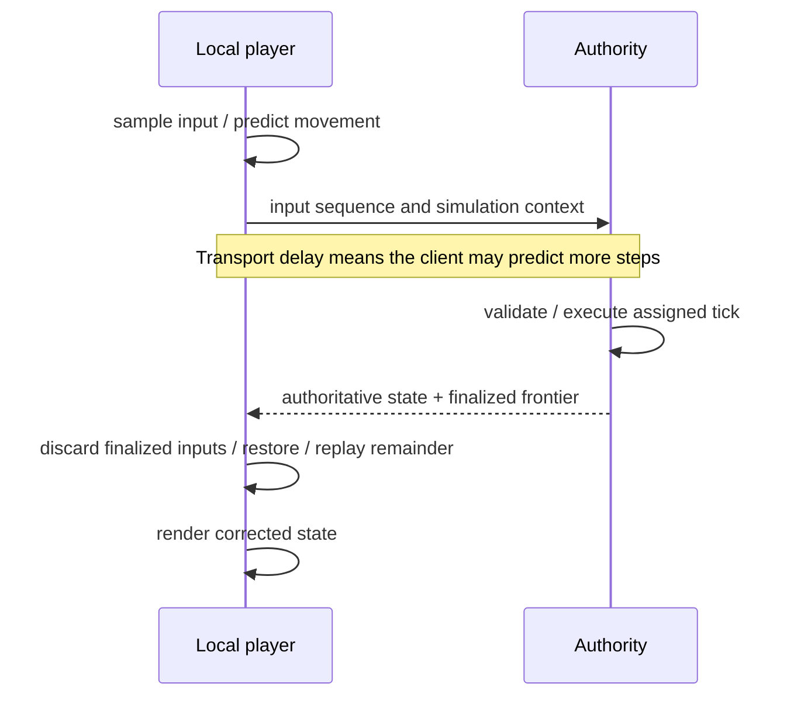

# Multiplayer systems: authority, simulation time and plausible continuity

## 1. Reader, scope and questions

You know [distributed state](../01-distributed-state/README.md), [networking](../07-networking/README.md), [quantitative models](../02-mathematics/README.md) and [collaboration contracts](../11-collaboration/README.md). You need to reason about what a player sees, which machine decides an outcome, and how inputs and observations survive loss, latency and cheating.

This guide answers: why games use different observation contracts from editors; how fixed ticks, input timing and rendering interact; how prediction/reconciliation differs from interpolation; what lag compensation, lockstep and rollback require; how entity replication scales; and which architectures fit eight game categories.

[Project F](../../../playground/synchronization/f-multiplayer/README.md) implements a one-dimensional authoritative simulation with scheduled inputs, UDP snapshots, client replay and remote interpolation. Its seeded logical fault scheduler and actual UDP/process tests exercise explicit boundaries. Weapons, full rollback, graphics, Internet congestion/security, NAT and persistent worlds are explained but not implemented. No undocumented proprietary game architecture is inferred.

Learning route: sections 2–5 establish authority/time; 6–10 explain latency hiding and timeline correctness; 11–13 cover scale, bandwidth and architectures; 14–17 connect code, faults, security and design invariants.

## 2. The same replication problem, a different meaning of success

An editor generally wants to retain independent user work and eventually incorporate permitted operations. A shooter cannot replay an hour-old “move right” now as though the player held the key at this moment. The operation belongs to a simulation interval whose collision and gameplay context has passed.

Games still maintain local, authoritative, replicated and cached state. They add a display state chosen to provide responsive and plausible motion. The local player can be predicted ahead of confirmation; remote players can be displayed behind the latest simulation tick to smooth arrivals. Those different display times are intentional, not evidence that every client should render an identical frame at every wall-clock instant.

Persistent economy or inventory transactions remain another domain. An accepted item purchase needs durable idempotent outcomes and invariant enforcement like [database commands](../06-database-concurrency/README.md). A render snapshot need not be persisted or delivered to every player. Never infer payment completion from a movement ACK.

The architecture has three central contracts:

- **Authority:** who accepts inputs and determines gameplay outcomes?
- **Simulation timeline:** which input belongs to which step, and what happens if it is missing or late?
- **Observation:** which historical/predicted state may the renderer show, and how does it correct it?

Choose those before selecting a packet format or transport.

## 3. Dedicated servers, listen servers and peer architectures

A dedicated server owns the simulation without also being a player's rendering/input process. A listen server is hosted by a participating player; that host may have a local timing advantage and can disappear when the player leaves. Peer-to-peer describes connectivity/replication topology, not automatically equal authority or fair gameplay.

| Architecture | Shared decision | Advantages | Costs and failure assumptions |
|---|---|---|---|
| Dedicated authoritative simulation | Server validates and steps world | Central rule enforcement; hides undisclosed state; client prediction possible | Hosting/regions; server availability; hotspot/tick budget |
| Listen server | One player's host simulation | Lower hosting cost; simple cooperative sessions | Host advantage/trust; migration, NAT and host exit |
| Deterministic peer lockstep | Agreed inputs at each frame | Low state bandwidth when many entities follow few commands | Full determinism, waiting/input delay, slow peer and desync recovery |
| Peer or server-assisted rollback | Deterministic history with corrected late inputs | Immediate speculative response | State save/load, replay CPU, rollback window, peer cheating/privacy concerns |
| Distributed world authority | Region/entity owners | Large persistent worlds and locality | Boundary interactions, ownership transfer/fencing and durable state |

Authority may be split by domain: a match server determines movement while an account service commits inventory. A peer relay routes traffic but does not thereby validate simulation. Host migration must transfer a coherent state/input frontier and fence the old host; a second owner without that contract creates competing outcomes.

## 4. Simulation time is not render time

Let a fixed simulation timestep be `Delta` seconds and integer tick be `k`. State transition is:

```text
S[k+1] = F(S[k], U[k], Delta)
```

`S[k]` includes all state needed by the transition; `U[k]` is the authorized input set for step k; `F` is the movement/gameplay rule. Under a deterministic construction, equivalent initial state and input sequence produce equivalent future simulation. A constant timestep makes the rule's timing explicit; it does not alone make floating-point physics deterministic across machines.

A client can render at 144 frames/s while a server simulates at 60 ticks/s and sends snapshots at 20/s. Rendering samples/interpolates simulation state; it does not grant the client 144 authoritative movement steps. Tick rate, input-send rate, snapshot rate and render rate are four independent choices.

### Fixed accumulator and overload

A host uses monotonic elapsed time, adds it to an accumulator and repeatedly consumes one `Delta` for one simulation step. Retain the remaining fraction for rendering or subsequent callbacks. Variable frame duration can change numerical stability and collision behavior; a fixed loop avoids silently assigning longer physical steps after a pause. Fiedler's first-person article explains this mechanism and the catch-up overload problem. [Fix Your Timestep!, June 2004](https://www.gafferongames.com/post/fix_your_timestep/)

If one step costs `c` seconds and ticks occur at rate `f=1/Delta`, simulation alone uses fraction `c*f` of one processor's time under a serial constant-cost model. For `Delta=0.01667` s (about 60 Hz) and `c=0.010` s, utilization is about 0.60. A 25 ms spike exceeds a 16.67 ms step budget and creates debt. Mean cost alone does not bound tail stalls, garbage collection, networking or worker contention.

Possible overload policies: reduce noncritical work, lower replication frequency, cap catch-up and let simulation lag wall time, degrade interest detail, or migrate/reject load. Increasing `Delta` opportunistically changes gameplay. Project F permits at most five catch-up steps per callback and records dropped wall-time debt; it does not pretend the lost wall time was simulated.

## 5. Transport and packet contracts

IP routes packets. TCP supplies an ordered reliable byte stream; UDP supplies datagrams without its reliability/order/congestion machinery. TCP/IP is a suite, not an alternative single transport to UDP. See [the networking guide](../07-networking/README.md) for framing, head-of-line delay, QUIC, secure establishment and packet loss.

Choose delivery by meaning:

| Data | Recovery need | Useful policy |
|---|---|---|
| Current full render snapshot | Newer full state can supersede it | Drop obsolete packets; interpolate available newer samples |
| Delta snapshot | Required baseline must be known | Name baseline, acknowledge it or send full/keyframe fallback |
| Scheduled input | Must reach simulation before chosen deadline or rollback policy | Redundant recent inputs; bounded retry; explicit late-input rule |
| Discrete fire/action event | One accepted gameplay effect under declared timeline | Stable event identity; validation/ACK; deadline or historical evaluation policy |
| Match/session control | Membership/configuration/generation agreement | Reliable bounded control exchange |
| Inventory/purchase | Durable, invariant-preserving acceptance | Transactional command/outcome protocol |

UDP lets an application avoid waiting for obsolete snapshots, but does not make it faster under every workload. TCP can be suitable for turn-based actions/control; WebSockets simplify browser/server connectivity while inheriting their transport behavior. QUIC datagrams provide an unreliable datagram service within QUIC's security and congestion context; browser availability and APIs need version-specific checks. [RFC 9221, March 2022](https://www.rfc-editor.org/rfc/rfc9221.html)

An application packet typically carries protocol version, match/session generation, packet sequence, payload kind and applicable ACK information. Input sequence and simulation frame are distinct unless the protocol defines a mapping. Packet receipt does not prove input simulation. Modulo sequence arithmetic needs an explicit bounded window; Project F avoids wrap by bounded safe integer counters and a match-length limit.

Reliability over UDP needs received-range/ACK tracking, bounded pending data, retransmission timing, deduplication and congestion response. Repeating everything at a fixed high rate is not Internet-safe reliability. RFC 8085 requires Internet UDP applications to address congestion behavior. [UDP usage guidelines, March 2017](https://www.rfc-editor.org/rfc/rfc8085.html)

### NAT and relay establishment

A public dedicated server still needs authenticated admission and usable UDP paths. Peers behind NAT/firewalls often need candidate gathering, connectivity checks and relay fallback. ICE specifies connectivity establishment; TURN specifies relaying. A relay adds path/hosting cost and may improve reachability without becoming gameplay authority. [ICE, RFC 8445, July 2018](https://www.rfc-editor.org/rfc/rfc8445.html), [TURN, RFC 8656, February 2020](https://www.rfc-editor.org/rfc/rfc8656.html)

Project F binds loopback only and implements neither protocol. Its session token/endpoint checks do not establish cryptographic authenticity or confidentiality against an Internet adversary.

## 6. Input buffering and the authority's finality rule

A packet can arrive before, during or after the simulation step it concerns. Decide the policy explicitly:

1. Execute timely input at its assigned frame, finalize missing input as neutral/held under a defined rule, reject obsolete input.
2. Delay simulation/input processing within a bounded jitter buffer so late arrivals have more time.
3. Roll back/replay permitted state when late input arrives.
4. Evaluate selected historical queries, such as a hit test, without replaying all future simulation.

Project F uses policy 1. A session begins at server tick `b`; input sequence `q` belongs to tick `b+q`. Snapshot tick `k` reports `ack=k-b`, meaning slots through that frontier are finalized. A missing command executes neutral. Acknowledging slot 7 does **not** claim packet 7 arrived or that the client's chosen direction for slot 7 ran.

The client chooses a small lead beyond its latest known frontier. If one-way delay is `d`, jitter allowance `j`, processing allowance `p` and timestep `Delta`, a rough required future horizon is `ceil((d+j+p)/Delta)` slots, plus any clock-estimation margin. Assume those are bounded delays and the client knows the server timeline accurately. For `d=60 ms`, `j=25 ms`, `p=10 ms`, `Delta=50 ms`, the ratio is 95/50=1.9, so at least two full slots, with additional margin often needed. If the latest ACK is itself old, that lead shrinks relative to the actual server tick.

More lead reduces missed deadlines but delays authoritative input effects. Prediction hides some local latency, not the shared execution delay. Measure command age, late rate and input queue depth; do not tune from RTT alone or assume equal forward/reverse paths.

Continuous games usually sample held controls each local simulation interval. One-shot events require their own identity semantics. Holding the last direction forever after a partition can make a character keep running; neutral fallback can interrupt legitimate held input. Define the duration/expiry and recovery policy for each control kind.

## 7. Client prediction and server reconciliation

Waiting for a round trip before moving makes local control lag. Instead, the client simulates its own input immediately using a compatible approximate movement model. It labels that result speculative and keeps the input evidence needed to correct it.

For a simple model, let authoritative state cover finalized input `a`, and let pending inputs be `u[a+1] ... u[n]`. The client resets to authoritative state and applies the remaining transitions in order:

```text
predicted[n] = Replay(authoritative[a], pending[a+1 ... n])
```

`Replay` uses the declared timestep, missing-input policy and necessary collision/velocity/ability state. In Project F neutral gaps have no motion effect, so replaying only recorded unfinalized directions is equivalent. For acceleration, friction or cooldowns, missing frames may still change state and must be simulated explicitly.

### Worked movement timeline

Assume 50 ms steps, +50 mm movement per command, initial x=0, three positive inputs scheduled for ticks 1–3, and timely delivery. The client model has no obstacle before 1,000 mm. The authority stops at 120 mm. This deliberately mismatched collision model makes correction visible; production systems should share compatible movement rules and account for changing authoritative world state.

| Event | Client speculative x | Server x | Finalized inputs |
|---|---:|---:|---|
| User generates input 1 | 50 | 0 | 0 |
| Generates input 2 | 100 | 0 | 0 |
| Generates input 3 | 150 | 0 | 0 |
| Server executes tick 1 | Still 150 until snapshot | 50 | 1 |
| Server executes tick 2 | Still 150 until snapshot | 100 | 2 |
| Server executes tick 3 | Still 150 until snapshot | 120 | 3 |
| Snapshot through 3 arrives | Reset/replay gives 120 | 120 | 3; pending empty |

Correction is `120-150=-30 mm`. If a snapshot only covers input 1 at x=50, replay inputs 2–3 to retain current speculative x=150. Merely resetting to 50 and forgetting those inputs causes avoidable backward jumps; replaying input 1 again causes double movement.

Variation: input 1 never arrives before its deadline. The server finalizes neutral at x=0 and reports ACK 1. The client removes that predicted input. Resending it afterward cannot move the server; replay of old game input is explicitly different from durable offline document mutation.



A renderer can smooth small visual correction over time while collision/gameplay uses the corrected simulation immediately. Do not feed smoothing offsets back as new authoritative movement. Teleports or large errors need explicit snaps/reset handling. Replaying should not repeat irreversible side effects such as sending purchases or playing the same audio event twice.

## 8. Remote interpolation and bounded extrapolation

For another player's entity, the client may lack timely input/control context to predict it correctly. Keep snapshots and render a slightly delayed timeline so two samples often bracket the target time.

Let sample times be `t0<t1`, positions `x0,x1`, and render time `tr` in that interval. Linear interpolation is:

```text
alpha = (tr-t0)/(t1-t0)
xr = (1-alpha)*x0 + alpha*x1
```

All times use one server-timeline convention; positions share a coordinate frame. The construction assumes a linear visual approximation between samples, not exact collision motion. At ticks 4 and 6 with x=0 and x=100 mm, render tick 5 gives alpha=0.5 and x=50 mm. A collision or curved path can make that intermediate location physically wrong; the interpolation is presentation, not authority.

Interpolation delay trades freshness for smoother sample availability. A higher snapshot rate, jitter estimate and observed burst-loss behavior influence the chosen buffer. Do not reuse an author's historical numeric recommendation as a universal latency setting. Fiedler's 2014 article documents the buffering mechanism and its approximation limits. [Snapshot Interpolation, November 30, 2014](https://www.gafferongames.com/post/snapshot_interpolation/)

If the target is newer than the latest sample, options are hold, bounded velocity extrapolation, or a model-based prediction. For constant velocity `v` and elapsed `h`, extrapolation is `x=x_last+v*h`; at v=2 m/s and h=0.1 s it advances 0.2 m. The assumption fails at collisions, turns or unknown forces. Cap h and correction cost; never permit indefinite extrapolation to become a fabricated accepted world.

Project F holds the latest sample on underflow. Its receipt-anchored render clock is deliberately simple and biased by network delay; it is not a synchronized server clock. Real clients estimate/slew timeline offset and adapt buffer occupancy while avoiding sudden backward render-time jumps.

Do not interpolate across entity identity reuse, teleports or incompatible generations as though they were continuous movement. Spawn/despawn and interest-enter/leave require explicit lifecycle evidence. A missing entity is not a position of zero.

## 9. Lag compensation: evaluate a historical observation fairly

A shooter aims at what its renderer showed, often a delayed remote state. By the time a fire input reaches authority, a target may have moved. Testing only against current hitboxes can systematically deny plausible shots. Historical evaluation can test against the relevant retained state while still validating the shot at authority.

An illustrative estimate is:

```text
t_query = t_receive - d_up - I
```

`t_receive` is server receipt time, `d_up` is estimated input one-way delay, and `I` is the shooter's effective remote-view interpolation delay. Assume compatible clocks/context, an approximately known path and no malicious time claim. At receipt 2.000 s, uplink delay 0.060 s and interpolation 0.100 s, target time is 1.840 s. Path asymmetry or inaccurate view timing shifts this query; RTT/2 is not proof of one-way delay.

The authority retains bounded hitbox/entity history, validates weapon/ammo/cadence and plausible command timing, clamps the permitted rewind horizon, performs the historical hit query, then applies the authorized result. It can query historical structures rather than mutate live world state; if it temporarily rewinds live entities, restore them reliably before later simulation.

Valve's public Source SDK implementation includes retained player history, latency/interpolation correction, bounds and restoration machinery. This is inspected source behavior, not proof of all current Valve games or universal rewind settings. [Source SDK lag-compensation source, inspected 2026-10-14](https://github.com/ValveSoftware/source-sdk-2013/blob/master/src/game/server/player_lagcompensation.cpp)

Fairness is a policy choice. A defender may already see themselves behind cover when a historically valid shot arrives. Unlimited rewind rewards implausibly old commands and can expose abuse. Define latency caps, interpolation limits, which entities are eligible and how dynamic cover is represented. The server cannot trust arbitrary client timestamps as authority.

Lag compensation is not the same as client reconciliation or whole-world rollback. Project F implements none of the weapon/hitbox machinery.

## 10. Deterministic lockstep and rollback networking

### 10.1 Lockstep

If every participant begins with equivalent simulation state and executes the same inputs under the same deterministic transition, exchanging commands can replace sending the entire evolving world. Before frame k executes, obtain all required inputs for k or apply an explicitly agreed delay/disconnect policy.

For `n` participants each producing `b` input bytes/frame at `f` frames/s, a client receiving one input per other participant uses roughly `(n-1)*b*f` payload bytes/s, ignoring relay duplication, retransmissions and headers. At n=4, b=8, f=60, that is 1,440 bytes/s. The rule's benefit is command-sized traffic, not a guarantee of responsiveness: one late required input can stall a frame.

Determinism requires more than a fixed timestep: deterministic RNG state, iteration and collision order, floating-point behavior, complete serialized state, version-identical rules, and no unrecorded clock/thread scheduling influence. Periodic state hashes can detect divergence; they do not repair it. Define state transfer/replay and compatible versions before letting a desynchronized peer continue.

### 10.2 Rollback

Rollback lets local simulation proceed using known local inputs and guessed remote inputs. Retain prior complete simulation states and input history. When a late input differs from its guess, restore the state before the first mismatch and replay to the current frame using corrected inputs. The GGPO project documents this approach and its save/load/frame-advance integration interface. [GGPO](https://www.ggpo.net/), [GGPO callback API source](https://github.com/pond3r/ggpo/blob/master/src/include/ggponet.h)

Worked fighting-game example: Dev has health 100 before frame 10. Mira attacks at frame 10; Dev's delayed block input is guessed neutral. The speculative outcome is health 90 and a hit effect. At frame 12, Dev's actual block for frame 10 arrives. Restore pre-frame-10 state, replay frames 10–12 with block, and obtain health 100. The renderer corrects prior speculation; the event/effect layer must not duplicate sounds or external actions during resimulation.

| Frame evidence | Inputs used at 10 | Dev health after 10 |
|---|---|---:|
| Initial prediction | Mira attack, Dev guessed neutral | 90 |
| Actual corrected input | Mira attack, Dev block | 100 |
| Replay from saved pre-10 state | Same corrected inputs | 100 |

Assume the simple rule “block prevents this attack” and no other damage through 12. This authored example illustrates replay, not a tested combat engine.

If a state snapshot costs `B` bytes and the rollback window keeps `w` frames, naive full-state history uses about `B*w` bytes. For B=64 KiB and w=12, storage is 768 KiB before inputs and allocator overhead. If a simulation step costs c=1 ms and a correction replays w=12 steps, its extra CPU is about 12 ms, assuming constant cost. Frequent worst-window corrections can exceed the render budget; compression/deltas complicate restore time and correctness.

Rollback must capture gameplay-relevant state including RNG, timers, input interpretation, entity generations and necessary physics caches. Render/audio/network side effects should be separated or assigned deterministic identities and confirmation policies. A predicted match outcome is not a durable economic transaction.

Compared with authoritative self-prediction, peer rollback can speculate about both players/the whole deterministic interaction. Compared with lag compensation, it revises a simulation history and its downstream state rather than only answering a historical hit query. Hybrid architectures exist; do not equate rollback with a single transport or necessarily trustless peer design.

## 11. Entity replication, interest management and ownership

A two-player lab can send every entity to everyone. A large world cannot. Define relevance by spatial proximity, visibility, team, party, ownership and gameplay dependency. Spatial grids, quadtrees/octrees or other indexes accelerate candidate discovery; they do not define authorization by themselves.

For each relevant entity, transmit identity/generation, required components and lifecycle evidence. Prioritize local interaction, nearby fast movers and important events; reduce rates for distant/static entities. Sending an entity once and then merely ceasing updates can leave a ghost unless the protocol distinguishes interest exit from continued existence.

Interest filtering is also a security boundary. A client receiving hidden enemies or private inventories can inspect that information even if the renderer hides it. Do not send unauthorized state and hope client-side occlusion protects it.

State ownership transfer between zones/servers needs a coherent handoff checkpoint, retained inputs, entity generation and fencing. While ownership is ambiguous, two servers may independently accept attacks or item movement. Cross-zone interactions need a declared decision boundary; sharding the world does not remove those invariants.

MMO persistence often separates transient movement/combat simulation from durable character/inventory/account state. Choose when to checkpoint world state and how to replay or reconcile accepted durable actions after a zone crash. Project F deliberately starts a new ephemeral match instead of claiming recovery it does not implement.

## 12. Bandwidth: snapshots, deltas and quantization

Let `n` clients receive `e` relevant entities each, `b` encoded bytes/entity, at `f` snapshots/s. Under identical relevance, full snapshots and no compression/headers/retries, payload egress is `n*e*b*f`. At n=100, e=50, b=24 and f=20, it is 2,400,000 bytes/s (2.4 MB/s). Overlap does not eliminate unicast delivery work. Actual component masks, per-client relevance and encryption add complexity.

Delta compression names a baseline known by the receiver and transmits differences. If a lost snapshot was the presumed baseline, applying a later delta without it can silently corrupt state. Keep acknowledged baseline history or provide full/keyframe fallback. Independently supersedable full snapshots avoid that dependency but spend bandwidth. Fiedler's compression article explains concrete encoding approaches; the guide's numbers below are original estimates. [Snapshot Compression](https://www.gafferongames.com/post/snapshot_compression/)

For one scalar in range `[xmin,xmax]`, choose quantization step q and represent `round((x-xmin)/q)`. Under nearest rounding and in-range values, position error is at most q/2. With xmin=-100 m, xmax=100 m and q=0.01 m, there are 20,001 distinct codes, requiring `ceil(log2(20001))=15` bits. Error is at most 0.005 m (5 mm); clipping or out-of-range values need a separate policy.

Fifteen bits reduce a 32-bit float field's payload, but do not mean the whole snapshot shrinks by 53%: identifiers, masks, orientations, velocities and headers remain. Quantization can destabilize prediction if reconstructed values feed collision differently across peers. Choose which values are presentation-only and which belong to deterministic simulation.

Keep datagrams within an appropriate measured path budget and support baseline/reset/chunk protocols for larger state. More bandwidth cannot fix CPU overload or an input assigned to the wrong tick. Project F's 1,200-byte budget and two-entity full snapshots are lab choices, not a universal MTU guarantee.

## 13. Architecture by game category

These are **reference design fits**, not assertions about every product in a genre. Fairness, player count, simulation complexity and platform constraints can justify different choices.

| Category | Typical design fit and reason | Conflict/observation contract | Persistence / operating needs | Main trade-off |
|---|---|---|---|---|
| Competitive shooter | Dedicated authority; local prediction, remote interpolation, bounded historical hit queries | Server validates inputs/hits; plausible local response and delayed remote view | Match/session security, regions, history budget; durable results separate | Responsiveness versus defender fairness, anti-cheat and hosting |
| Fighting game | Deterministic rollback often fits a small tightly interacting state | Predict remote input; correct and replay bounded frames | Determinism, complete save/load, replay CPU and effect management | Immediate response versus visible correction and input-delay tuning |
| Racing | Authoritative or hybrid simulation with local vehicle prediction | Vehicle/track state; interpolation/extrapolation; collision authority | Matching physics/configuration, correction smoothing | Responsive handling versus unstable correction near collisions |
| RTS | Deterministic lockstep can represent many units with few commands | Same command history/order; agreed frame execution | Version-identical simulation, state hashes/recovery, admission | Bandwidth efficiency versus stalls/desync and peer trust |
| MMO world | Zoned/sharded authoritative simulation | Interest-filtered world; cross-zone ownership/invariant rules | Persistent characters/economy, leases/fencing, recovery | Scale/locality versus handoff and transactional boundaries |
| Cooperative action | Dedicated or listen host with prediction; looser correction may be acceptable | Host/server rules; shared interactions and revive/item authority | Host exit/migration, session discovery, durable rewards | Cost/convenience versus host trust/advantage and availability |
| Turn-based multiplayer | Authoritative conditional command log/transactions | Validate turn/version; idempotent durable actions | Reconnect/history, timeouts, account/permission state | Simpler transport/consistency versus move availability during partition |
| Physics-heavy sandbox | Authority with interest/ownership and state correction, or tightly controlled deterministic design | Highly coupled bodies; snapshot/model approximation limits | Physics load, object lifetime, world saves, ownership | Simulation cost/bandwidth versus plausible consistency and manipulation risk |

For real deployments, measure input-to-photon behavior, fairness incidents, correction distribution, stalled frames, tick-tail cost, data disclosure and recovery—not merely packet throughput. A cooperative tolerance for visible correction is a product choice, not permission to trust malicious inventory writes.

## 14. Latency budgets explain the observation choices

An unpredicted authoritative display path contains input sampling, uplink, wait for simulation, simulation work, wait for snapshot, downlink and wait for render. Under independently uniform phase waits, expected wait for a periodic interval T is T/2: integrate elapsed wait over the interval or use symmetry.

Illustrative low-load path: uplink 60 ms, simulation interval 50 ms (mean wait 25 ms), snapshot interval 100 ms (mean wait 50 ms), downlink 60 ms and 60 Hz rendering (mean wait 8.33 ms). Ignoring sampling/processing/queue work, total mean is `60+25+50+60+8.33=203.33 ms`. These phases may be coupled; burst queues, loss and retries make tails worse. This is a model, not a measured game.

Local prediction can render the immediate movement at the next local frame while shared acceptance still follows its path. Remote interpolation deliberately adds a buffer. Neither technique reduces actual propagation delay; they choose which plausible state may be shown before complete evidence.

Scheduled input buffering can add another policy-controlled delay and must be accounted for separately. Project F's simple ACK-based lead does not synchronize server time or tune for WAN jitter. A 20 Hz lab is chosen for readable schedules and cheap tests, not as a recommended competitive tick rate.

## 15. Runnable project and correctness checks

[Project F's README](../../../playground/synchronization/f-multiplayer/README.md) includes commands, directory structure, protocol and critical functions. Run:

```sh
cd playground/synchronization/f-multiplayer
npm test
npm run demo
```

The final suite passed 24 tests on Node 26.7.0. It includes actual UDP exchange, deliberate application loss around real sockets, fixture/endpoint checks, revocation, repeated join after lost welcome, fixed-step overload bounds and an actual server SIGKILL/rejoin. Seeded logical schedules separately cover loss, delay, duplication, reordering and a full partition.

The deterministic demo prints predicted 150 mm, authoritative 120 mm, correction -30 mm and no pending commands. Interpolation at tick 5 between remote samples at ticks 4/6 gives 50 mm. Its fixed seed produces ten sends, three drops and two duplicate deliveries. [Validation and evidence record](RESEARCH.md)

These tests assert forbidden histories: duplicate input cannot move twice; packet flood cannot create extra simulation steps; malformed batches cannot partly mutate queued state; stale snapshots cannot rewind; old sessions cannot act in a new match. A latest full snapshot repairs current state only under the matched session/epoch contract; it does not recover every expired user input.

## 16. Failure diagnosis, security and production hardening

| Symptom | Likely boundary | Diagnostic evidence and action |
|---|---|---|
| Local movement repeatedly snaps | Model mismatch, missed deadline or wrong ACK replay | Compare input/frame history, collision state and correction magnitude; fix model/timing |
| High packet rate increases speed | Simulation tied to receive rate/client dt | Run fixed authority steps and bounded input slots |
| Remote entities hitch | Buffer starvation, burst loss or overload | Measure sample age/buffer occupancy; tune rate/delay and bounded fallback |
| Delta produces impossible pose | Missing/wrong baseline or identity reuse | Inspect baseline/generation; request full state, reject bad delta |
| Replay repeats sound/damage/action | Effect duplicated during resimulation | Separate effects; stable event IDs and confirmation policy |
| Hit after cover causes disputes | Historical query policy and delay estimate | Retain timing/hitbox evidence; bound rewind; explain fairness contract |
| Peer simulations drift | Nondeterministic state/transition/version | State hashes and replay logs; isolate first divergence; rebootstrap coherently |
| Zone duplication/lost inventory | Competing authority or non-atomic durable effect | Fence owner generations; reconcile transactional outcomes |
| Join/reconnect storm | Unbounded admission/retries | Rate limit/validate addresses; jitter control retry; bound work |
| Crash loses match | No coherent durable state/input checkpoint | Explicit new-match policy or implemented recovery; do not claim continuity |

Clients must not supply authoritative positions, elapsed simulation time, hit results, inventory grants or permission state. Validate input bounds/cadence/context, control ownership and match/session generation. Cryptographic transport and replay protection are separate from game-rule validation. Endpoint binding and plaintext fixture tokens alone are insufficient for hostile networks.

Do not disclose hidden entities simply because all clients render the same arena. Guard interest data and control-plane privileges. Bound parsing, queues, history, retransmission work and rollback CPU. Adaptive congestion and resource isolation protect other traffic and hosted matches as well as the client experience.

Production observability needs tick duration/tail/debt, input deadlines, packet loss/reorder estimates, ACK age, buffer occupancy, prediction error, rollback depth, baseline failures, session admission and durable economy outcome metrics. Trace match/entity/input generations without logging secrets by default. Load tests should combine fan-out, simulated contention, scheduler pauses and meaningful correctness assertions.

## 17. Invariants, assumptions and next steps

1. One declared authority or agreed deterministic history determines gameplay outcomes.
2. Packet identity, input identity, simulation frame, render time and durable transaction version remain distinct.
3. A fixed step grants bounded simulation work; receive frequency does not grant more movement.
4. Input finality explicitly includes the missing/late policy.
5. Reconciliation restores the correct authoritative boundary and replays only compatible unfinished evidence.
6. Remote interpolation/extrapolation is presentation state, never proof of collision or acceptance.
7. Rollback captures complete deterministic state and controls side effects; historical hit queries have bounded fairness/security rules.
8. Delta baselines, entity lifetimes and ownership transfers carry generations and recovery contracts.
9. Real-time match state and durable economy state have different commit/delivery requirements.
10. Internet UDP requires mechanisms absent from the loopback teaching protocol.

Project F omits graphics, continuous input sampling, complete physics, lag compensation, full rollback, lockstep integration, NAT/relay, secure transport, adaptive congestion, world persistence, delta compression and large-scale interest. Its server restart intentionally creates a new match rather than recovering the old one. The guide explains those missing mechanisms and sources without claiming test evidence for them.

Read GGPO and its callback interface for rollback state obligations; the inspected Source SDK file for concrete lag-compensation checks; Fiedler's timestep/interpolation/compression articles for engineering mechanisms; and IETF transport/NAT specifications for deployment boundaries. Source quality, unavailable pages and review needs are recorded in [RESEARCH.md](RESEARCH.md).

## Release review

Status: **ready — complete for the stated educational scope**.
Reviewer: Codex (AI technical and editorial review); no independent human review claimed.
Review date: 2026-10-14.
Open issues: none blocking this educational release.
Scope limits and further validation: Minimal one-dimensional match; no full physics/rollback, Internet security/congestion/NAT or persistent MMO implementation.

See [the review record](../REVIEW.md) and [actual validation output](../VALIDATION.json).
