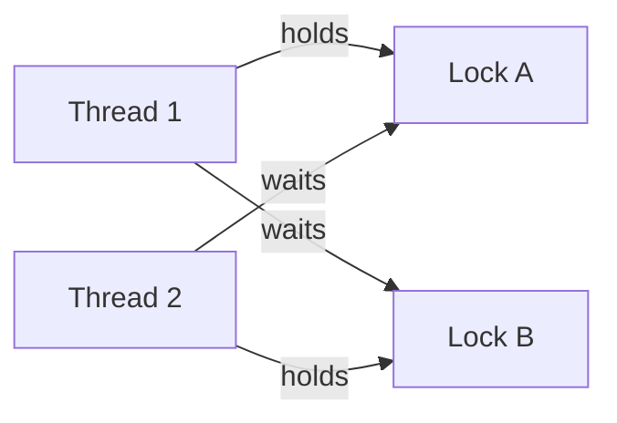

# Local concurrency: atomic transitions, memory ordering and progress

## 1. Reader, scope and questions

You understand [distributed state](../01-distributed-state/README.md) and [database conditional writes](../06-database-concurrency/README.md). You need to reason about threads sharing one process's memory and avoid carrying those guarantees across a network without a mechanism.

This guide answers: which actions are atomic; what establishes visibility/order; how CAS publishes coherent state; what can change while a thread pauses; how blocking primitives protect invariants; which progress guarantee a loop actually has; how JavaScript differs; and whether k-mer terminology identifies a synchronization technique.

Scope: Java atomics/VarHandles, mutexes, semaphores, conditions, read/write locks, ABA, memory reclamation boundaries and concrete tests. Distributed consensus/replication and database isolation remain separate chapters. Native lock-free implementation and biological sequence-analysis performance are outside the implementation scope, but their terminology is clarified.

[The concurrency lab](../../../playground/synchronization/05-local-concurrency/README.md) contains runnable Java scenarios plus a small Node comparison. Study sections 2–5 before relaxed access/ABA, then 6–10 for algorithms/primitives, and 11–15 for boundaries and validation. Java API claims are bound to SE 25; validation used installed OpenJDK 25.0.1 without changing global machine settings.

## 2. Shared memory changes the mechanism, not the need for a contract

Threads can address the same object. Independent machines usually exchange messages and keep independent storage. Both still need to define permitted observations and conflicting state transitions.

A local concurrency design must answer four different obligations:

- **Atomicity:** which transition appears indivisible to participants?
- **Ordering/visibility:** when can another thread safely observe prior initialization/mutation?
- **Safety/invariants:** do all permitted observations satisfy the object contract?
- **Progress:** who eventually completes, under which scheduling/primitive assumptions?

Durability is another obligation. A completed local CAS normally changes volatile process memory, not a persisted log. A process crash can erase it. A thread-safe object need not be replicated, authorized or recoverable.

Example: count initially zero. Each of two threads executes `count = count + 1`. Even if each individual load/store is atomic, the expression contains a read, arithmetic and write. Interleave both reads before either write and get one instead of two. A stronger visibility mode does not merge the operations into one atomic transition.

## 3. Atomic operations and linearization points

### 3.1 Atomic read, fetch-and-add and CAS

An atomic read/write prevents the specified cell access from being torn/interleaved as a partial value. It does not make arbitrary surrounding work atomic. Java ordinary int/reference accesses have relevant per-access guarantees, while nonvolatile long/double treatment has a specification caveat; use the declared APIs rather than guessing from one CPU. [JLS 25 §17.7](https://docs.oracle.com/javase/specs/jls/se25/html/jls-17.html#jls-17.7)

Fetch-and-add atomically replaces integer x with x+d and returns the prior value. Two `getAndIncrement()` calls starting at zero return 0 and 1 in some legal order and leave two. `incrementAndGet()` returns the new value instead. Ordinary Java integer atomics can wrap; a value that cannot wrap needs a checked transition policy. [AtomicInteger SE 25](https://docs.oracle.com/en/java/javase/25/docs/api/java.base/java/util/concurrent/atomic/AtomicInteger.html)

CAS compares a cell with an expected value and, if equal under that primitive's comparison, installs a replacement as one transition:

```text
CAS(cell, expected, replacement):
    if cell == expected: cell = replacement; return success
    else: return failure
```

This is an abstract atomic specification, not code implemented with an unlocked ordinary if statement. `AtomicReference.compareAndSet` compares reference identity using `==`; it does not call equals. Strong CAS fails on a mismatch; weak CAS variants may fail spuriously and have named memory modes. [AtomicReference SE 25](https://docs.oracle.com/en/java/javase/25/docs/api/java.base/java/util/concurrent/atomic/AtomicReference.html)

### 3.2 Linearizability is a history property

An object is linearizable when its concurrent invocation/response history admits a legal sequential object history that preserves completed-before-invoked precedence. Overlapping calls can be placed in either order when semantics permit. A successful simple CAS is a convenient linearization point; some more complex algorithms require a subtler proof rather than one obvious source line. [Herlihy and Wing, July 1990](https://www.cs.columbia.edu/~wing/publications/HerlihyWing90.pdf)

Starting at zero, calls A/B may overlap and return old counter values 1/0 respectively. Order B then A is legal. If A returned before B was invoked, A returning 1 and B returning 0 is illegal. Duplicate zero outcomes are also illegal for two completed fetch-and-increments.

Atomic component objects do not create a multi-field transaction. Balance fields A=100 and B=100 can be separate AtomicIntegers. Transfer decrements A to 99 then increments B to 101. A concurrent sum can observe 199. Each operation is atomic; the desired invariant “every observation totals 200” requires a shared lock, one immutable pair CAS or another atomic aggregate protocol.

## 4. CAS with immutable versioned state

Store fields that must agree in one immutable record and atomically replace its reference:

```java
record State(long value, long version) {}
AtomicReference<State> current = new AtomicReference<>(new State(0, 0));

State increment() {
    while (true) {
        State before = current.get();
        State after = new State(Math.addExact(before.value(), 1),
                                Math.addExact(before.version(), 1));
        if (current.compareAndSet(before, after)) return after;
    }
}
```

This snippet is implemented in the lab's `VersionedCounter`. The expected reference captures both fields together; a successful CAS publishes both together. A failed attempt must reread and compute from the new actual state. Installing a candidate computed from stale state loses the competing update.

Assumptions: every writer replaces the state through this cell; records and their relevant contents remain immutable; no writer reinstalls an old reference; checked arithmetic does not overflow; the atomic primitive has its specified semantics. A record can contain a mutable list, so `record` alone does not guarantee deep immutability.

The successful CAS is the transition's linearization point. A reader's `get()` sees one published pair, never half the old value and half the new version. Returning the pair exposes a coherent snapshot, not a lock held on future updates.

### Pure retry computation

A retry loop may compute several candidates for one successful transition. `updateAndGet` functions similarly require side-effect-free update logic because contention can cause repeated evaluation. Do not charge an account, send a notification or increment an unrelated metric inside a function whose evaluation may be retried. [AtomicReference update functions](https://docs.oracle.com/en/java/javase/25/docs/api/java.base/java/util/concurrent/atomic/AtomicReference.html)

The lab forces two threads to read zero. Both perform a local “attempt effect”; one CAS fails and retries with another effect. There are two accepted counter increments but three effects. Moving an external effect after successful CAS still leaves a process-crash gap between memory acceptance and the effect. Durable outbox/outcome coupling from [the engine guide](../08-sync-engine/README.md) is needed when that boundary matters.

### Cost and contention

If each independent CAS attempt fails with constant probability p, the probability of first success at attempt j is `p^(j-1)*(1-p)`, and mean attempts is `1/(1-p)`. Assume independent attempts and eventual success with p<1. At p=0.25, mean is 1.333; at p=0.9, it is 10. Real contending writers are correlated, p changes with scheduling, and starvation is possible; this estimate is a workload model, not a progress proof.

Each versioned attempt allocates a candidate and may repeat arithmetic. More writers can increase cache-coherence and allocation work without increasing accepted throughput. Batch/shard independent state where semantics permit. A lock can outperform retry under contention; choose from measured workload and proof burden, not the word “atomic.”

## 5. Java memory ordering: visibility needs a communication edge

### 5.1 Why “the write ran first” is insufficient

A compiler/runtime/CPU may transform execution while preserving the language's allowed observations. Independent unsynchronized accesses do not gain an ordering guarantee because a debugger, wall clock or source listing seems to place one earlier.

Java's happens-before relation supplies ordering/visibility guarantees from program order and specified synchronization edges, transitively. Monitor unlock before a later lock of the same monitor, volatile communication, thread start and completion/join are relevant edges. Conflicting unsynchronized ordinary accesses can form a data race. Sleep/yield are not publication mechanisms. [JLS 25 memory model](https://docs.oracle.com/javase/specs/jls/se25/html/jls-17.html#jls-17.4)

Do not confuse this relation with distributed logical-clock metadata. A vector clock describes message causality; a Java synchronization edge constrains observations of actual shared storage under a language/runtime model.

### 5.2 Volatile publication, not atomic increment

```java
final class Published {
    int payload;
    volatile boolean ready;
}
// Writer:
p.payload = 42;
p.ready = true;
// Reader, with a bounded wait in the lab:
if (p.ready) use(p.payload);
```

Assume ready initially false, one publisher, no later payload mutation, and the reader's volatile read observes the publication. Writer initialization precedes its flag write; publication precedes the observing flag read; that precedes the payload read. The transitive chain justifies initialized payload visibility. `volatile count++` still splits read/modify/write; the lab forces its lost update.

A reused publication flag needs generation/handshake rules. Seeing true from an earlier publication does not establish coherence of a concurrently overwritten payload. Prefer immutable snapshots or a complete protocol rather than toggling a Boolean around mutable data without ownership.

### 5.3 Plain, opaque, acquire/release and volatile modes

VarHandle and atomic APIs expose explicitly named access modes. Their guarantees differ; they do not simply request different cache-flush speeds. [VarHandle SE 25](https://docs.oracle.com/en/java/javase/25/docs/api/java.base/java/lang/invoke/VarHandle.html)

| Mode | Design interpretation | Common trap |
|---|---|---|
| Plain | Ordinary-field memory semantics | Assume another thread must promptly see a write |
| Opaque | Coherence for the accessed variable with weak cross-variable ordering | Treat a flag as publishing unrelated payload |
| Release write / matching acquire read | Order prior writer work before dependent reader work through the observed communication | Acquire an unrelated variable or an old flag value |
| Volatile access | Stronger ordering contract suitable for ordinary publication/atomic-cell APIs | Infer compound multi-field atomicity |

The lab's `Released` uses `FLAG.setRelease(p,1)` after ordinary payload initialization and loops on `FLAG.getAcquire(p)` before inspecting that payload. The type/variable/value relationship matters. A failed CAS or a weak CAS with a different suffix must be interpreted according to that method's documented memory effects; never infer them from the unsuffixed name.

At a fence boundary, acquireFence prevents preceding reads from moving after subsequent reads/writes under its specified ordering; releaseFence prevents preceding reads/writes from moving after subsequent writes. fullFence constrains preceding reads/writes relative to subsequent reads/writes. These are ordering contracts implemented by the runtime, not a command to flush every cache. A fence does not grant mutual exclusion, create a matching observation on another thread, persist data or make a racy multi-field protocol correct by itself. Begin with the ownership/publication proof; introduce relaxed modes only when the proof survives.

### 5.4 Safe object publication and final fields

Immutable configuration safely published through a volatile/atomic reference can be read without later locking. Final-field construction semantics have additional rules, but constructor escape and mutable referenced objects require care. Do not publish `this` to callbacks/threads before initialization finishes or assume final makes every nested object immutable. [JLS 25 final fields](https://docs.oracle.com/javase/specs/jls/se25/html/jls-17.html#jls-17.5)

## 6. ABA: unchanged value can conceal changed history

CAS asks whether the cell currently matches the expected value/reference. It does not ask whether nothing happened since it was read.

Controlled unsafe stack schedule:

| Step | Thread 1 | Thread 2 | Head/structure |
|---|---|---|---|
| 0 | Read A; remember A.next=B | — | A→B→C |
| 1 | Paused | Pop A | B→C |
| 2 | Paused | Pop B | C |
| 3 | Paused | Reuse A with A.next=C; push A | A→C |
| 4 | CAS head A→remembered B succeeds | — | B→C: popped B resurrected |

The head returned to exactly the same A reference. The remembered successor no longer describes the current chain. GC prevents an object still strongly referenced by Thread 1 from being reclaimed, but does not forbid application code from mutating/reusing the same object.

### Stamps and coherent pair reads

Use a reference/stamp pair and advance the stamp whenever the protected history changes:

```java
AtomicStampedReference<Node> head = new AtomicStampedReference<>(a, 0);
int[] stamp = new int[1];
Node expected = head.get(stamp); // coherent reference + stamp
Node successor = expected.next;
boolean ok = head.compareAndSet(expected, successor, stamp[0], stamp[0] + 1);
```

The corresponding lab captures A/stamp0, then the other thread changes stamps 1,2,3. The stale A/stamp0 CAS fails against A/stamp3. The successor itself still needs appropriate lifetime/immutability/synchronization; stamping head does not make arbitrary node reads safe. [AtomicStampedReference SE 25](https://docs.oracle.com/en/java/javase/25/docs/api/java.base/java/util/concurrent/atomic/AtomicStampedReference.html)

Every writer must advance the stamp consistently. Reading `getReference()` and `getStamp()` separately can assemble a pair that never coexisted. A finite stamp can wrap: with an unrestricted 32-bit cycle and constant one million advances/s, `2^32/10^6=4,294.97` seconds, about 71.58 minutes, returns to the same stamp value. This is a mathematical collision horizon under those assumptions, not a measured workload; a delayed observer spanning the cycle defeats uniqueness. Use checked overflow/generation change, larger protected versions or an appropriate reuse horizon.

An immutable aggregate with fresh identity and checked version is another solution when its API can forbid old-reference reinstatement. Version stamps and distributed fencing tokens share a stale-history idea, but only the actual protected resource's validation makes either effective.

## 7. Lock-free structures and reclamation

The lab stack stores immutable links. Push reads head and CASes a fresh `(value,next)` wrapper. Pop reads head and CASes its unchanged successor. Empty pop linearizes at a head read of null. Successful push/pop linearize at successful CAS.

Why a failed strong CAS can still indicate progress: another writer changed the head since the read. Retrying allows some logical transition to win even if a particular thread repeatedly loses. The proof assumes atomic primitives, intact immutable links, adequate memory and participating execution; it does not bound GC pauses or scheduling.

Head can return to an earlier immutable link after a temporary push/pop. That ABA can be harmless because the link's successor remains the same valid reference and the abstract pop still applies to the current stack. The unsafe example changes/reuses a successor relationship. Do not classify every A→B→A as automatically corrupt or assume GC eliminates every ABA.

Native structures add memory reclamation: a paused reader may hold an address after another thread frees/reuses its storage. Hazard pointers, epochs and related schemes delay reclamation under explicit participant/lifetime rules. They address safe access/reuse, not every logical invariant. This guide does not implement a native reclamation scheme; JVM references/GC provide a different lifetime boundary.

## 8. Progress guarantees are separate from safety

| Property | Abstract requirement | What it does not promise |
|---|---|---|
| Blocking | Completion may depend on an owner/wait condition progressing | Owner can stop or deadlock; no independence guarantee |
| Obstruction-free | A participant running in isolation long enough completes | Completion under continuous contention |
| Lock-free | Continuing system execution guarantees operation progress by some participant | Every caller completes or receives a fair turn |
| Wait-free | Each operation completes in a finite bounded number of its own steps under the model | A wall-clock deadline when preemption, GC or blocking dependencies exist |

These properties are about algorithms and assumptions, not adjectives inferred from an API class name. Herlihy's wait-free work formalizes progress and primitive power. [Herlihy, January 1991](https://cs.brown.edu/people/mph/Herlihy91/p124-herlihy.pdf)

A retrying CAS loop usually has no bound on one thread's attempts. A lock-free algorithm can starve a caller while others succeed. Memory allocation, callbacks, logging, thread scheduling and I/O can weaken end-to-end progress even when the core abstract data structure has a stronger property. Java atomic API semantics do not certify a hard real-time platform guarantee.

Linearizability is safety: acceptable histories. A mutex-based counter can be linearizable while blocking. A nonblocking algorithm can be incorrect. “Completed 20,000 updates” establishes that test outcome, not wait-freedom or a universal latency bound.

## 9. Mutexes, lock granularity and read/write ownership

A mutex protects a critical section so one holder updates a declared invariant. In Java, synchronized uses a monitor; ReentrantLock supplies explicit locking APIs. All relevant readers/writers must use the same discipline. A lock on one object does not protect code locking another guard or directly mutating escaped state.

```java
lock.lock();
try {
    // Read/check/update the complete protected invariant.
} finally {
    lock.unlock();
}
```

Use interruptible acquisition or bounded tryLock when cancellation/wait budgets matter. Fairness options constrain contention policies but do not guarantee scheduler fairness, low tail latency or deadlock freedom; untimed tryLock has its documented fairness exception. [ReentrantLock SE 25](https://docs.oracle.com/en/java/javase/25/docs/api/java.base/java/util/concurrent/locks/ReentrantLock.html)

### Invariants and lock order

Transferring between accounts requires protecting both balances through the check and updates. A global lock is easy to prove and reduces concurrency. Per-account locks let independent transfers overlap but need a global acquisition order; otherwise T1 holds A waiting B while T2 holds B waiting A.



A timeout alone does not roll back arbitrary mutations already made. Keep an invariant-valid boundary, cancel/roll back locally where defined, and separately reconcile external effects. Avoid calling unknown callbacks or network/database operations while holding a hot local lock unless the dependency/timeout/ordering contract is intentional.

### Read/write locks

A read/write lock permits multiple readers of stable protected state while excluding conflicting writers. Reads must really be reads. Its overhead can exceed a mutex for small operations or frequent writes; starvation/admission policy matters.

ReentrantReadWriteLock supports downgrading by acquiring read ownership while still holding write ownership, then releasing write. Read-to-write upgrade is not automatic: release read, acquire write and revalidate, or design a different protocol. Two readers each waiting for an upgrade can block each other. [Read/write lock SE 25](https://docs.oracle.com/en/java/javase/25/docs/api/java.base/java/util/concurrent/locks/ReentrantReadWriteLock.html)

## 10. Semaphores and condition variables

A semaphore bounds a count of permits, useful for finite connections/jobs. Unlike an owner-bound lock, its API can allow release from another thread; the application must prevent unbalanced releases from inventing capacity. Bracket successfully acquired work and release in finally. Admission to two active tasks does not make their shared mutations thread-safe or limit an unbounded pre-admission queue. [Semaphore SE 25](https://docs.oracle.com/en/java/javase/25/docs/api/java.base/java/util/concurrent/Semaphore.html)

A condition variable waits for a predicate over state protected by its associated lock. It is not a stored “event happened” bit. Check the predicate while holding the lock; await atomically releases the lock and enters waiting; reacquire before rechecking. State change and signal use that same lock discipline.

```java
lock.lockInterruptibly();
try {
    while (item == null) notEmpty.await();
    T result = item;
    item = null;
    notFull.signal();
    return result;
} finally {
    lock.unlock();
}
```

Recheck because another consumer can take the item before this waiter obtains the lock, a signal need not satisfy this predicate, and spurious wakeups are permitted. signal selects eligible waiters; it does not transfer lock ownership or prove completion. Use separate conditions for distinct predicates where appropriate. [Condition SE 25](https://docs.oracle.com/en/java/javase/25/docs/api/java.base/java/util/concurrent/locks/Condition.html)

The lab signals an empty one-slot buffer, then confirms its consumer remains blocked until actual data arrives. It also interrupts a waiting consumer and checks the lock remains usable. This models cancellation/resource cleanup; it does not force a VM-originated spurious wakeup.

## 11. JavaScript: one event loop does not remove logical concurrency

Synchronous callbacks on one event loop do not execute JavaScript instructions in parallel with another callback on that same agent. But await separates a logical operation across turns:

```javascript
const before = count;
await nextTurn();
count = before + 1;
```

Two invocations can both capture zero, then each write one. The lab makes this ordering deterministic. Serialize the complete logical operation, use a domain conditional write, or keep a truly local state transition synchronous when that matches the intended scope. Network/storage decisions remain separate boundaries.

Worker threads can execute concurrently and share SharedArrayBuffer-backed memory. Atomics operate on specified integer typed-array storage, including compareExchange/add/load/store/wait/notify; they do not atomically swap arbitrary JavaScript object graphs. ECMAScript's atomic/shared-memory model differs from Java's API/memory modes and must be read on its own terms. [ECMAScript Atomics specification, accessed 2026-10-14](https://tc39.es/ecma262/multipage/structured-data.html#sec-atomics-object)

Node workers can share memory and exchange messages. The lab runs four actual workers incrementing one shared Int32 cell and uses a second atomic cell for publication/waiting. Keep blocking waits off the main event loop; browser blocking policies differ and require platform-specific checks. [Node 26.7.0 worker documentation](https://nodejs.org/download/release/v26.7.0/docs/api/worker_threads.html)

One successful local Atomics.compareExchange still says nothing about another process's independent database or a remote replica.

## 12. From thread safety to distributed consistency

| Primitive/boundary | Participants coordinated | Evidence supplied | Missing obligations |
|---|---|---|---|
| AtomicReference/CAS | Threads sharing that JVM cell | Atomic reference transition/order | Disk durability, other JVMs, authorization, replication |
| SharedArrayBuffer atomics | Agents sharing that buffer under its model | Atomic shared integer transition | Independent machines/storage; durable effects |
| Mutex/condition | Participants using the same lock/protocol | Protected state and ordering | Remote nodes/crash recovery; external transaction coupling |
| Database conditional update | Transactions on the chosen authoritative record | Atomic predicate/effect subject to commit/isolation | Original operation replay, replicas/failover policy, offline intent |
| Consensus/replicated authority | Modeled nodes in one decision group | Agreed committed history under its assumptions | Domain permission/invariants, UI optimism, cross-group atomicity |

Two JVMs each construct AtomicInteger(0), then both CAS 0→1 successfully. There is no conflict because there is no shared cell. Requiring one machine to host a service exposing conditional updates creates a distributed protocol around a local decision; retries, durable outcomes, partitions and authority fencing still need the [engine/database mechanisms](../08-sync-engine/README.md).

A local mutex cannot fence an obsolete regional leader. A local version cannot prevent ID reuse after a process restore unless recovery preserves/fences its generation. A Java barrier is not a distributed transaction. These analogies help derive the shape of a precondition check while keeping failure domains explicit.

## 13. k-mer: a data problem that can use concurrency primitives

A k-mer is a contiguous substring of length k. For DNA `ACGACG` and k=3, windows are ACG, CGA, GAC, ACG, giving counts ACG:2, CGA:1, GAC:1. If sequence length is n, the number of windows is `max(0,n-k+1)` for positive k without crossing separate-read boundaries. With n=6,k=3 this is four. Ambiguous bases, reverse-complement normalization and multi-read boundaries need domain policies.

This counting/sequence-analysis problem is not itself a synchronization-engine algorithm. The connection can be implementation-specific: the **2011 Jellyfish paper** uses a multithreaded lock-free hash table/CAS approach for parallel k-mer counting. CAS coordinates shared table updates; the k-mer determines what is being counted. [Marçais and Kingsford, 2011 paper](https://dna.cs.byu.edu/bio465/papers/fastparallel.pdf), [authors' historical software page](https://www.cs.cmu.edu/~ckingsf/software/jellyfish/)

The paper is primary authored research hosted in a university archive; PMC retrieval was blocked by a browser check. The author's page is historical and its old “current version” is not adopted as today's release. No Jellyfish package, performance claim or production hash-table implementation was tested here.

The lab includes a simple sequential substring/map counter solely to make the terminology concrete. Its straightforward cost is proportional to the number of windows times substring/hash work, about O((n-k+1)*k) for ordinary copied strings; it does not implement rolling encodings or Jellyfish. If another similarly named concept was intended, no evidence here identifies it; do not invent an inherent synchronization role.

## 14. Runnable worked path, tests and use cases

Follow [lab setup](../../../playground/synchronization/05-local-concurrency/README.md): run the Python/JDK runner and Node comparison. Expected Java results are 20 in-process scenarios plus one separate-JVM boundary check; Node has three scenarios. Tests use actual threads/workers but deliberately control selected schedules.

Start with the volatile lost-update experiment, replace it conceptually with fetch-and-add, then examine immutable-pair CAS. Next follow pointer-only/stamped ABA and the one-slot condition. Finally run the process-boundary example to see why local success does not establish shared-machine agreement. [Validation record](RESEARCH.md)

| Context | Appropriate mechanism | Operating requirements / success evidence |
|---|---|---|
| Immutable configuration snapshot | Atomic/volatile publication | No later unsynchronized mutation; reader sees coherent version |
| Exact local ID/ticket counter | Atomic increment/CAS with range policy | Define overflow and restart identity; no lost/duplicate local allocation |
| Multi-field workflow in one process | One pair CAS or common lock | All accesses honor invariant; invalid intermediate state not exposed |
| Bounded background work | Semaphore plus bounded queue | Cancellation releases permits; resource use bounded |
| Producer/consumer buffer | Lock/conditions or established blocking queue | Correct predicate, capacity, cancellation and ordering |
| Very contended shared structure | Proven nonblocking or locking algorithm | Reclamation, progress assumptions and realistic benchmark |
| Durable synchronization server | Database/log protocol plus local thread safety | Commit/retry/auth/replication evidence, not local CAS alone |

Use established library queues/maps/locks when they match requirements. A short custom CAS loop can hide a long proof obligation. Protect private/security state with the same discipline as ordinary data: a stale authorization cache or resource-limit race can turn a correctness bug into a disclosure/exhaustion bug.

## 15. Failure diagnosis, validation limits and invariants

| Symptom | Suspect mechanism | Inspect / repair |
|---|---|---|
| Lost increments despite volatile | Split read-modify-write | Atomic transition or common protected section |
| Initialized object looks incomplete | Missing publication edge / constructor escape | Write/read ordering and lifetime; proper publication |
| Pair fields disagree | Independently updated atomic fields | Atomic aggregate or lock across full invariant |
| Stack/object resurrects old state | ABA, reuse, stale successor | Identity/history/lifetime rules; coherent stamps or safe immutable design |
| Waiter stuck or proceeds empty | Wrong predicate, lock or signal interpretation | While-recheck, associated lock, cancellation |
| Resource capacity shrinks/grows | Missing/double semaphore release | Track successful acquisition; finally/ownership policy |
| Deadlock | Cyclic ownership/dependency | Thread dump, common lock order, avoid callbacks while locked |
| CAS CPU spikes | Hot cell/retry allocation | Attempt distribution, shard/batch if valid, benchmark lock alternative |
| JVM test passes but remote duplicate remains | Wrong failure/commit boundary | Durable original ID/outcome transaction and recovery |

Correctness testing needs controlled interleavings, state invariants and real-time histories; stress can reveal bugs but cannot certify all schedules. A harness can accidentally publish payload through latches, joins, queues or logs and conceal the race under study. OpenJDK's jcstress investigates JVM/library/hardware concurrency behaviors; it was researched but not executed in this dependency-free lab. [jcstress source/project README](https://github.com/openjdk/jcstress)

Core invariants and rules:

1. Name the atomic cell/aggregate and require all writers to use the same protocol.
2. Publish initialized data through a valid ordering edge; atomicity and visibility are different obligations.
3. Retry from fresh state with pure speculative computation.
4. Protect lifetime/history assumptions against reuse/ABA; stamps need coherent capture and noncollision policy.
5. Lock/wait on the actual predicate's owner; release resources on cancellation and failure.
6. State progress guarantees with primitive/runtime/scheduling assumptions; avoid time claims from stress counts.
7. Keep local memory, durable storage and independent machines' coordination boundaries distinct.
8. Treat k-mer counting as a domain workload that may use CAS, not as the CAS/replication protocol itself.

Remaining work: technical review, exhaustive/model-based weak-memory checks, jcstress/JMH measurements, additional architectures and native reclamation analysis. The guide/lab do not prove hard real-time, starvation-freedom, arbitrary external-effect atomicity or distributed durability. See [RESEARCH.md](RESEARCH.md) for source/version/validation boundaries.

## Release review

Status: **ready — complete for the stated educational scope**.
Reviewer: Codex (AI technical and editorial review); no independent human review claimed.
Review date: 2026-10-14.
Open issues: none blocking this educational release.
Scope limits and further validation: Controlled Java/Node schedules; no exhaustive weak-memory/progress proof, jcstress/JMH or native reclamation validation.

See [the review record](../REVIEW.md) and [actual validation output](../VALIDATION.json).
