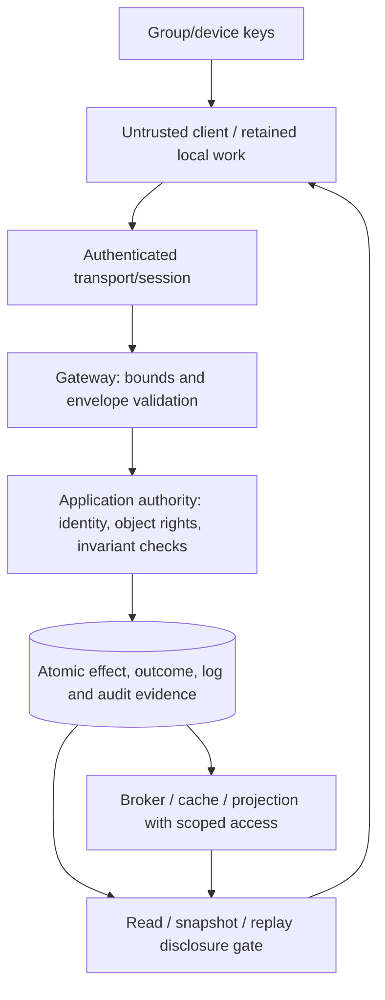

# Synchronization security: authority, disclosure, replay and encrypted state

## 1. Reader, scope and questions

You understand [engine responsibilities](../08-sync-engine/README.md), [offline reconciliation](../10-local-first/README.md) and [game authority](../12-multiplayer/README.md). You need to decide which parties may cause effects, receive history and retain evidence when clients are stale, compromised or malicious.

This guide answers: how are authentication and authorization applied at every lifecycle boundary; how do revocation and tenant scope interact with retries/caches; which replay is legitimate; what does server validation establish; how are resource use and transport protected; what changes with end-to-end encryption; and what makes an audit history detectably altered?

The scope is protocol/application security, not a complete identity-provider, cryptography, legal-compliance or penetration-testing manual. Sources name protocol properties; the architecture is an authored design. [Project G](../../../playground/synchronization/g-fault-harness/README.md) provides local fault and boundary tests, not a production security implementation. Public fixture tokens and loopback transport in earlier labs must remain visible limitations.

## 2. Begin with assets, adversaries and trust boundaries

Assets include plaintext content, membership, operation outcomes, durable work, hidden game state, keys, resource capacity and audit evidence. A correct convergent merge can still leak content, accept an unauthorized mutation or exhaust a host.

Distinguish failure models:

- A crash/retry client repeats its original permitted request without knowing whether it committed.
- A stale client retains old permission/schema/history assumptions.
- A malicious client can fabricate fields, identities, order, size and timing; its UI checks do not constrain its protocol bytes.
- A compromised account/device can use legitimate credentials and retained plaintext.
- An untrusted network can observe/modify unprotected traffic or replay captured evidence.
- A compromised server/storage/audit administrator exceeds a crash-only model and needs separately defined protection.



A gateway authenticating a connection does not prove every future operation is authorized. A broker fan-out path and a deduplication response are disclosure paths just as ordinary reads are. Map each asset to every path that can expose/change it, including exports, snapshots, search indexes, attachments and debug logs.

## 3. Authentication is evidence about identity; authorization is a current decision

Authentication establishes an identity/session under a trusted mechanism. Authorization decides whether that identity may perform an action on a resource in its current policy context. Token validity alone does not prove access to every named object.

For an illustrative bearer-token service:

1. Validate the credential through the actual trusted issuer/session mechanism.
2. Derive actor and eligible tenant context server-side.
3. Resolve object/channel identity within that scope.
4. Check action-specific current rights and domain predicates.
5. Enforce those predicates at the declared acceptance/disclosure boundary.
6. Record the outcome without treating client-supplied author/tenant/role as authoritative.

JWT deployments must validate expected algorithms, issuer/audience and appropriate token context; parsing claims is not verification. A credential intended for another resource must not be accepted merely because its signature is valid. Avoid letting untrusted token metadata select arbitrary keys or verification behavior. [JWT BCP, RFC 8725, February 2020](https://www.rfc-editor.org/rfc/rfc8725.html)

OAuth security guidance addresses token privilege/replay/refresh risks, but OAuth is not itself an application's object ACL or a reason to equate every token with a login identity. Follow the chosen identity provider's verified protocol; no real refresh flow is implemented in these labs. [OAuth security BCP, RFC 9700, January 2025](https://www.rfc-editor.org/rfc/rfc9700.html)

Separate read, write, comment, administrative grant, execution and terminal-control rights. A shared-code reader may still inspect secrets through a debugger if those capabilities are accidentally bundled. [Collaboration control boundaries](../11-collaboration/README.md) explain that distinction.

## 4. Permission revocation is a consistency contract

Suppose Dev queued an offline edit while permitted. Mira revokes Dev at the authority. Dev's local work still exists; it is no longer automatically eligible for shared acceptance. A refreshed token can prove Dev's identity while the object permission remains denied.

A dangerous race:

| Step | Writer | Revoker |
|---|---|---|
| 1 | Read cached grant generation 8: allowed | — |
| 2 | Pause before mutation | Commit revoke generation 9 |
| 3 | Commit using old decision | — |

To require revocation ordering at acceptance, coordinate the permission decision with the mutation: lock the relevant grant, validate its version inside the transaction, or use another authority protocol covering both. A separately cached allow decision has a staleness window. Define it instead of promising instantaneous enforcement.

Project C authorizes inside its authority transaction and reauthorizes original outcome replay. Project B uses membership locks for writes; pages use their declared read snapshot. Transactions/reads that began before revocation may finish under that contract. Bytes already copied or queued cannot be remotely retracted. If the product requires a stricter drain/invalidation barrier, implement it across active subscriptions, caches and outgoing queues rather than merely deleting a database row.

A long-lived WebSocket can outlive its access token or object grant. Define reauthentication, expiry, policy-generation checks and closure/resubscription. A heartbeat establishes liveness evidence, not authorization renewal. Presence updates should also be scoped to current membership.

Offline revocation cannot be learned immediately by a disconnected device. Preissued offline capabilities need scope, expiry and bounded rights; their expiry/revocation policy may differ from ordinary online access. Private export/recovery of retained work needs a product policy, not silent deletion of the only local copy.

## 5. Tenant, object and subscription scope must survive every hop

A logical operation namespace may include `(tenant,object,generation,actor,opId)`. Queries, uniqueness keys, outcomes, broker topics, cache entries, snapshots and metrics/log access must preserve compatible scope. A client cannot claim a different tenant and have routing treat that claim as an authenticated fact.

Separator concatenation can collide: `('t:a','d')` and `('t','a:d')` both become `t:a:d`. Encode tuples or use unambiguous structured keys. Project G tests that mechanical distinction; it does not establish multitenant authorization. A perfectly unique key can still expose a resource to an unauthorized actor.

Cross-object references need scope validation too. Moving a block into another page can change inherited permission; a visible link is not necessarily authorization ancestry. Cache sharing must account for eligibility/policy generation, not just identical object IDs. A cached snapshot built for an administrator must not be reused as a member's response.

Database row-level security can add a second enforcement boundary, but role/owner configuration and bypass paths matter. PostgreSQL documents default-deny behavior when enabled without applicable policy, owner/BYPASSRLS behavior and separate old-row/new-row checks. Run policy tests using the actual application roles, not only a superuser fixture. [PostgreSQL 18 row security](https://www.postgresql.org/docs/18/ddl-rowsecurity.html)

RLS does not fix an unscoped Redis topic, archive URL or client-side permission grant. Constraint/error behavior can also reveal existence; choose whether unauthorized/missing responses differ according to the threat model and usability requirements. Database/service credentials must grant only the operations needed by the trusted component.

## 6. Legitimate retry and malicious replay need different defenses

A retry repeats a logical operation because completion is unknown. An attacker may replay a stolen token, reuse an operation ID with changed payload, or resend old-generation state. Those have different identities and consequences.

Required acceptance sequence for a reference durable command:

```text
authenticate current session
resolve trusted actor/tenant/object scope
begin atomic acceptance boundary
  authorize current action/disclosure
  validate operation identity, epoch and semantics
  if original identity exists:
      require unchanged canonical request meaning
      return original outcome only if currently disclosable
  else:
      enforce domain preconditions
      commit effect + original outcome + accepted log/outbox evidence
```

Do not attach new credentials to the operation fingerprint if refreshing them should preserve original identity. Do bind operation kind/payload, object scope, generation and semantic schema. A changed intent gets a new ID. Different encoded CRDT blobs can contain overlapping evidence; exact blob hash identity is not automatically a user-gesture identity. [Project D provider boundaries](../../../playground/synchronization/d-collaborative-text/README.md)

A UUID makes accidental collision unlikely under its generation assumptions; it is not a permission or signature. Deduplication prevents repeated counted effects within its retained namespace, not credential theft. Rate-limit duplicate traffic because harmless repeated effects can still consume CPU/reads.

Generation fencing handles discarded history. If disaster restore can lose accepted outcomes, continuing under the old generation may turn retries into new effects. Require reconciliation/reset and explicit review of unknown old work. Expired retention is not proof that an operation never happened.

Project G drops a real response after commit, duplicates upstream submission, changes an original payload and revokes access before replay. Each tests the declared original-ID/permission contract. Its fixture credentials do not test attacker-resistant token issuance.

## 7. Server validation must name the invariant

Clients propose intent; authority decides accepted effects. Validation should cover envelope/schema, decoded bounds, resource references, current state/dependencies and domain rules. Parameterized values protect a SQL boundary; identifiers and routing still need validation. A structurally valid CRDT update is not proof of an authorized or meaningful business transition.

Examples:

| Operation | Required authority decision | Invalid shortcut |
|---|---|---|
| Set task Done | Current status, role and approval predicate | Merge a client-provided status unconditionally |
| Reserve last inventory unit | Atomic nonnegative-stock transition | Trust local availability or convergent arithmetic |
| Add text | Current document write access and supported structure/bounds | Trust library item clientID as authenticated authorship |
| Move page/object | Valid ancestry/rank plus access to affected scope | Independent field writes that form a cycle or grant access |
| Game movement/fire | Valid timing, input bounds/cadence, weapon/collision rules | Accept claimed position or hit result |
| Terminal command | Current host/control epoch and execution capability | Treat read-only source access as process control |

Encrypted payloads may prevent plaintext validation; that is a change in available evidence, not permission to assert that the blind server enforces hidden invariants. If critical domain state must be authority-validated, keep that decision in an enforceable representation/protocol.

## 8. Transport protection and session admission

TLS protects a communication channel under its authentication/cryptographic assumptions. It does not decide document membership and does not make application messages durably processed. TLS terminated at a gateway leaves that gateway inside the plaintext trust boundary; protect and authenticate subsequent service hops appropriately. [TLS 1.3, RFC 8446, August 2018](https://www.rfc-editor.org/rfc/rfc8446.html)

WebSocket Origin checks can help constrain browser-origin session use but are not user authorization; non-browser clients can choose headers. Cookie-authenticated applications need their appropriate cross-site request/session defenses. Validate protocol version, path/tenant/document scope and frame limits before expensive subscription/bootstrap work. [WebSocket specification, RFC 6455](https://www.rfc-editor.org/rfc/rfc6455.html)

Do not put bearer tokens in broadly logged URL paths or debug payloads. A trusted proxy must strip/replace client-controlled identity headers before downstream services rely on them. A network connection resumption is not permission resumption; recheck session/resource compatibility.

UDP games need suitable transport integrity, address validation and replay/session protection as well as simulation checks. Project F's endpoint binding/public fixtures are loopback examples, not secure Internet admission. Transport encryption does not prevent a malicious authenticated player from sending a semantically invalid input.

## 9. Resource exhaustion is a protocol correctness boundary

Bound work before acknowledging admission. Useful limits include connection/subscription counts, encoded and decoded bytes, operation count, pending queue, per-object contention, snapshot work, fan-out recipients, outgoing buffers and retry budgets. A per-client cap without a global budget can still exhaust memory when many clients fill it simultaneously.

Compression, nested schemas, CRDT deferred dependencies and snapshot reconstruction can expand processing cost beyond simple frame length. Validate supported structure, bound retained evidence, isolate expensive parsing/merge work, and test rejection/cancellation. A text-length cap alone does not prove every hidden encoding is cheap.

Slow consumers should not hold an unbounded durable-event buffer. Disconnect with a recovery cursor or pause production under a declared budget. Ephemeral events can be coalesced/expired; accepted durable work needs retained catch-up. Admission denial before commit means no accepted effect; timeout after admission/commit means unknown outcome and requires original-ID retry.

Security and overload policies must preserve tenant fairness and recovery work. Rate-limit credential failures, join/reconnect storms and duplicate requests without permanently starving legitimate catch-up. [Production budgets](../15-production/README.md) quantify these choices.

## 10. End-to-end encryption changes the authority boundary

Transport encryption leaves plaintext at the service. End-to-end encryption keeps payload decryption with authorized endpoints. A server can still enforce visible membership, route opaque envelopes, bound sizes and deduplicate declared identities; it cannot inspect hidden text, search it or decide a hidden semantic merge without an additional mechanism.

An encrypted operation should bind the intended namespace, key/document generation, schema and integrity context. Define who may produce valid evidence, device enrollment, nonce/key management, missing key epochs, recovery and malicious-member behavior. Signed/authenticated bytes establish origin/integrity under the key assumptions, not application-level correctness.

Membership and key history are distinct. Removing a user should stop future authorized delivery/key access under the chosen protocol, but cannot erase already decrypted copies. An offline authorized device may need retained key epochs or explicit rejoin before it can read catch-up. Key compaction and data compaction must be coordinated with recovery eligibility.

MLS specifies group-key security with explicit epochs and member changes; it does not implement CRDT merge, database invariants or durable synchronization checkpoints. [RFC 9420, July 2023](https://www.rfc-editor.org/rfc/rfc9420.html)

Project G/labs implement no application encryption or key rotation. This section states evidence requirements and consequences, not a validated encrypted deployment.

## 11. Audit trails and tamper-evident histories

An audit event should identify actor, resource/action, authority generation, policy decision, operation identity/outcome and committed boundary while minimizing secret payload. If acceptance must always have an audit event, couple that event or an audit outbox with the effect transaction. Best-effort logging after commit can lose the only record of an accepted change.

Append-only permissions and backups help preserve history, but a party controlling all storage may rewrite it. A hash chain can detect changes relative to a trusted digest; recomputing the entire chain and replacing the digest defeats that check. Truncation leaves a valid prefix unless an independent anchor records the later boundary.

Project G's journal hashes each finite-JSON event with its ordinal and prior hash. Its tests edit an event and truncate a suffix: editing fails verification; truncation fails with a retained anchor but succeeds as an unanchored prefix. This is an executable boundary demonstration, not an unsigned journal magically protecting against its administrator.

Transparent append-only systems can use signed checkpoints, witnesses and consistency proofs. Certificate Transparency specifies a particular Merkle-log ecosystem; its mechanisms are further reading, not proof that an application's log automatically inherits those guarantees. [RFC 9162, December 2021](https://www.rfc-editor.org/rfc/rfc9162.html)

An audit log also creates a retention/access obligation. Restrict logs, avoid embedding tokens or plaintext private branches by default, preserve evidence needed for incident reconciliation and test whether projections/backups share deletion policy. A UI tombstone does not itself erase archived bodies.

## 12. Worked revocation/retry example

Assume Mira and Dev have document/task access. Dev saves local operation D:17. Authority commits it and its outcome; response disappears. Mira then revokes Dev. Dev reconnects and retries D:17 with its original meaning.

1. Authentication still establishes Dev's identity.
2. The authority resolves the original object in its trusted scope.
3. Current permission denies replay disclosure and new mutations.
4. The old accepted effect remains in durable history; denying disclosure does not undo it.
5. Dev's device retains pending/private evidence until an explicit product recovery policy acts.
6. If access is later restored, the authority can reveal the original accepted outcome and catch-up without repeating the effect.

Variation: D:17 never committed. Permission denial still preserves the local proposal but prevents shared acceptance. Variation: Dev changes payload under D:17 after restoration. The fingerprint check rejects changed-ID meaning instead of guessing whether the new intent should replace history.

Project G exercises those boundaries with Project C and real HTTP/storage/process faults. Its tuple/forged-field tests are limited single-workspace checks; a complete multitenant/service deployment needs dedicated isolation, role, key and cache tests. [Harness setup](../../../playground/synchronization/g-fault-harness/README.md)

## 13. Security tests, diagnosis and invariants

| Symptom/test | Evidence to inspect | Correction |
|---|---|---|
| Revoked user gets old result/snapshot | Replay/read/broadcast policy and decision generation | Reauthorize disclosure, drain/resubscribe according to contract |
| Cross-tenant cache result | Scope tuple, principal/policy generation, cache key | Namespace and validate every path; test real app roles |
| Duplicate accepted effect | Original ID/fingerprint/outcome commit | Coupled acceptance; retained generation-aware replay evidence |
| Forged author/role accepted | Trusted principal derivation | Derive from authenticated context, reject client authority fields |
| Valid signature but invalid transition | Schema/domain predicate and state context | Enforce semantics at authority or change claimed guarantee |
| High memory under small frames | Decoded/retained cost, subscriptions and buffers | Bound total work/evidence; isolate parsing and slow readers |
| Audit prefix appears valid after deletion | Independent checkpoint/witness | Anchor/proof policy; do not trust a rewritable digest |

Test wrong/missing credentials, wrong audiences/scopes, every object action, active revocation, cached snapshots, replay after permission/schema/epoch changes, malformed encodings and workload exhaustion. A crash-tolerant convergence test does not cover malicious participants. Review cryptographic/identity implementations with qualified expertise rather than extending fixture tokens into production.

Invariants: trusted identity binds effects; current action/disclosure policy is enforced at a named boundary; operation meaning cannot change under retained identity; every route/cache/log retains appropriate scope; resource work remains bounded; encryption/audit claims name their key/anchor trust assumptions; clients never enforce critical authority alone.

## Release review

Status: **ready — complete for the stated educational scope**.
Reviewer: Codex (AI technical and editorial review); no independent human review claimed.
Review date: 2026-10-14.
Open issues: none blocking this educational release.
Scope limits and further validation: Trust-boundary guide and fixture tests; real identity/TLS/E2EE, multitenant deployment, abuse and fuzz/security audits need separate implementation review.

See [the review record](../REVIEW.md) and [actual validation output](../VALIDATION.json).
