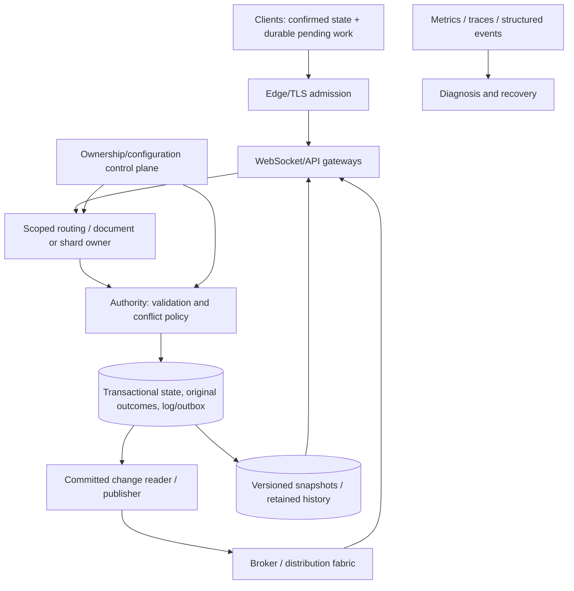

# Production synchronization: scaling, overload, recovery and correctness testing

## 1. Reader, scope and central questions

You can design the [mutation/recovery protocol](../08-sync-engine/README.md), choose [application conflict semantics](../11-collaboration/README.md) and name [security boundaries](../14-security/README.md). You need to make that design survive scale, changing deployments and partial outages without silently changing its guarantees.

This guide asks: what is the ownership/partition unit; how do millions of connections and hot objects consume capacity; how is overload bounded; what survives gateway/broker/database/region failure; how are snapshots and mixed versions managed; which telemetry reveals lost work; and how do tests reject wrong histories rather than merely generate requests?

Scope: an illustrative durable collaborative service, with game-specific differences cross-referenced. Deployment commands for a particular cloud, audited disaster recovery and measured production capacity are outside this installment. [Project G](../../../examples/synchronization/g-fault-harness/README.md) is a runnable local failure harness; it does not certify an Internet/multi-region cluster.

## 2. Start with contracts that survive replacement

Treat processes as replaceable owners of explicit responsibilities. A socket gateway can restart if a reconnect protocol recovers accepted history. An authority can restart if its original outcomes/log survive. A cache can disappear if readers know how to fetch a valid base. An outbox publisher can repeat if downstream effects are idempotent.

Before scaling, write these artifacts:

- namespace and current authority/generation;
- accepted-operation identity/fingerprint/outcome boundary;
- replicated log/checkpoint or datatype anti-entropy contract;
- local persistence and offline eligibility;
- snapshot/retention/reset contract;
- authorization decision/disclosure boundary;
- overload/admission outcomes and retry budgets;
- recovery evidence for each durable owner.

A process returning to health does not prove those artifacts remained coherent. Moving requests to a second server without transferring/fencing accepted ownership can increase throughput while corrupting state.

## 3. Architecture and data/control paths

Edge admission handles transport/session/resource checks. Gateways own connection state and bounded buffers. The authority owns domain acceptance. Database/log owns the chosen durable boundary. Brokers distribute work/hints according to their separate contract. Snapshot storage preserves a named projection boundary. Control-plane ownership must be enforced at the resource, not just in routing hints.

These are logical roles, not a mandate for seven microservices. Small deployments can combine them; explicit boundaries make replacement and scaling decisions testable.

## 4. Connections, gateways and sticky sessions

Long-lived sockets consume descriptors, memory, TLS/kernel buffers, heartbeat work and subscription indexes even when idle. Requests/s is not a sufficient capacity model. Load balance new connections with awareness of gateway load; draining a node should stop new admission, allow bounded completion and provide reconnect recovery.

Illustrative sizing: let n=1,000,000 connections and m=48 KiB of attributable memory each. Raw connection memory is n*m=49,152,000,000 bytes, about 49.15 GB. Across g=20 evenly loaded gateways this is 2.46 GB/gateway before process baseline, caches and imbalance. These are assumed numbers, not measurements; actual TLS/library/kernel accounting can dominate.

A 256 KiB per-connection outgoing allowance could permit another 262.14 GB if every client fills it. Enforce per-connection and global budgets; independent limits do not establish a bounded fleet total. Track queued bytes and message age, not only queue length.

Sticky sessions can improve cache locality or keep a short-lived state machine on one gateway. They do not persist pending outcomes, elect a valid authority, prevent two owners or recover a lost connection. Clients need reauthentication and generation/cursor-aware resubscription wherever they reconnect. Google SRE's frontend chapter explains routing/load-distribution mechanisms; the protocol responsibilities here remain application decisions. [Frontend load balancing](https://sre.google/sre-book/load-balancing-frontend/)

Presence/session leases are distributed observations with expiry. A delayed disconnect from an old session must not clear a newer one. Store ephemeral state in an appropriate shared/partitioned mechanism or reconstruct it; avoid treating stale presence as authorization. Persistent document state follows a different retention path.

## 5. Partitioning, hot objects and coordination cost

Partition by the state/invariant unit: channel, document, workspace, key range or game zone. Route `(tenant,object,generation)` to its valid owner. A million cold objects and one heavily contended document are different workloads.

A single authority row/log can serialize accepted decisions. More gateways/connections do not make that decision parallel. Options:

- split independent fields/subdocuments while preserving cross-boundary invariants;
- batch compatible operations with individual identities/outcomes;
- use a merge datatype allowing independent preparation/integration;
- allocate bounded independent rights when the domain allows it;
- retain central validation for constraints that require a shared decision.

Every option changes the proof/latency/workload boundary. Splitting a tree across shards introduces cross-shard moves/cycles; splitting inventory introduces transfer rights. A hot owner needs admission/queue controls even when surrounding gateways scale freely.

Large subscriber counts amplify accepted changes. One canonical message can yield thousands of deliveries. Coalesce channel fetches per gateway, use bounded scoped caches and notify only gateways with eligible subscribers. Avoid each connection independently polling one hot row at high frequency, as Project B deliberately does for clarity. Cache reuse must preserve current permission and subscription semantics.

## 6. Ownership, regions and fencing

Regional locality reduces interaction round trips, but writes requiring one authoritative decision still need that decision's location/quorum. Independent regional writes require a merge/invariant policy, not just a geographically replicated database.

A reference owner transfer:

1. Select a committed state/log boundary and stop accepting conflicting new work under the old ownership protocol.
2. Provision the new owner from that boundary and retained tail.
3. Advance authoritative owner generation through the control protocol.
4. Enforce generation on every protected resource mutation.
5. Reroute/close clients as needed; preserve original operation identities during retry.
6. Reconcile accepted outcomes and invalidate obsolete cache/presence state.

An illustrative storage predicate is `WHERE object_id=:id AND owner_epoch=:authorizedEpoch AND version=:expectedVersion`. The writer epoch comes from trusted coordination and must actually be checked; a stale worker learning a new record version must not regain write rights. A routing-cache update alone cannot fence a process that still reaches storage.

Leases need clock/failure assumptions. A paused owner can wake after its lease expires; downstream fencing prevents it from writing anyway. Multi-primary CRDT content can remove a central merge order for some operations while permissions, scarce resources and membership still need their own authority model.

Replication durability/read behavior depends on configured acknowledgment and promotion rules. PostgreSQL distinguishes asynchronous/synchronous standby behavior; remote flush/apply are different evidence. A freshly promoted server must also restore/fence the application's generations and operation outcome history. [PostgreSQL 18 standby servers](https://www.postgresql.org/docs/18/warm-standby.html)

## 7. Overload: decide admission before work becomes ambiguous

A queue cannot create capacity. If admitted arrival exceeds service capacity long enough, waiting grows until timeouts/retries consume more resources. Use bounded queues, deadlines, tenant fairness and load shedding that prioritizes meaningful accepted/recovery work.

Separate overload outcomes:

- Rejected **before** authoritative admission: no accepted effect under the declared path; client can retain its original pending intent.
- Timed out **after** possible commit: unknown completion; retry original identity or query its outcome.
- Accepted but distribution delayed: preserve durable history; slow live fan-out is not reason to erase the update.
- Ephemeral state expired/coalesced: do not replay it as current durable activity.

Backpressure must propagate: a slow DB should reduce accepted authority work rather than simply pile up gateway tasks; a slow subscriber should lose its connection and catch up rather than monopolize memory. Keep heartbeat/readiness work from falsely declaring healthy processes dead solely because their ordinary queues are saturated.

Google SRE documents load shedding and failure amplification mechanisms. Use those mechanisms as design context, not a claimed benchmark for this implementation. [Handling overload](https://sre.google/sre-book/handling-overload/), [cascading failures](https://sre.google/sre-book/addressing-cascading-failures/)

### Retry storms and reconnect jitter

If N=100,000 clients reconnect immediately after an outage, admission can spike far above ordinary load. With independent uniform initial delays over W=20 s, mean first attempts are roughly N/W=5,000/s. Assume one attempt/client, an even random distribution and no retry feedback. This spreads load but does not ensure service capacity or bound random bursts.

Use bounded exponential jitter, server admission/backoff hints and a total retry budget; reauthentication/bootstrap pages also consume work. If original successful submissions lost responses, deduplication lookup load can surge even without new writes. Separate retry traffic from new intent in telemetry. Nested retries across gateway/client/storage layers multiply attempts unless coordinated.

## 8. Database, broker and fan-out boundaries

Connection pools should limit in-flight database work, not simulate capacity with thousands of waiting sessions. Keep transactions short, index relevant predicates and inspect lock/serialization contention. Retries of serialization failures need the whole transaction's fresh context; timeout ambiguity needs original outcome evidence.

A transactional outbox or committed change stream closes the gap between acceptance and publication. The publisher can crash after publish before marking and repeat. A consumer inbox/projection checkpoint must share its effect boundary where exact counted processing matters. Pub/Sub hints may be lost; retained history/anti-entropy repairs them. See [messaging](../09-messaging/README.md).

CDC consumers must treat restart redelivery and retained-history pressure explicitly. PostgreSQL logical decoding documents replay behavior and slot retention; a stopped consumer can retain storage even while the primary accepts writes. [PostgreSQL 18 logical decoding](https://www.postgresql.org/docs/18/logicaldecoding-explanation.html)

Replica reads can lag accepted writes. To provide a session guarantee, carry an accepted watermark in the relevant scope and wait/route to a replica that has applied it. A global wall-clock timestamp or unsafely allocated sequence does not prove the required prefix. The watermark itself must retain namespace/generation and authorization.

## 9. Snapshots, log compaction and metadata retention

Snapshot work has competing costs: frequent snapshots spend CPU/storage bandwidth; rare snapshots lengthen replay and retain more log. Choose a checkpointed projection boundary, not merely the newest source head.

If a snapshot covers every K=10,000 accepted operations at steady rate r=100/s, its interval is K/r=100 seconds. With snapshot encoding cost c=0.2 seconds, amortized CPU is c/(K/r)=0.002 CPU-seconds/second, about 0.2% of one core. This assumes constant costs and no storage wait. A synchronous 200 ms snapshot can still cause a visible tail stall; low average cost does not justify blocking interactive work.

At r=100 operations/s, log-entry size b=400 bytes and retention d=86,400 seconds, raw log bytes are r*b*d=3,456,000,000 (3.456 GB/day) for that hot stream before indexes, replication and compression. Workload bursts and datatype metadata change it. Track retained bytes/floor, not just operation count.

Compaction procedure under the reference log model:

1. Obtain a coherent projection at boundary h and generation g.
2. Store/validate the snapshot including schema/manifest/checkpoint.
3. Retain the tail after h and preserve concurrent writes correctly.
4. Publish snapshot availability before raising the incremental retention floor.
5. Route expired cursors to explicit reset, preserving private pending work and unknown outcomes.
6. Delete only history whose recovery obligation is replaced.

Operation outcomes, tombstones and causal metadata have different duties. A snapshot does not authorize deleting dedup evidence or CRDT removal history. Eligibility/lease/generation rules must prevent obsolete replicas from reviving discarded information. [Local-first retention](../10-local-first/README.md) explains that proof.

Project G actually prunes Project C's change log while retaining original outcomes, then checks snapshot reconciliation. It does not implement safe outcome/tombstone GC or a distributed snapshot compactor.

## 10. Mixed versions and rolling deployment

Separate wire version, operation meaning, shared schema, local disk schema and snapshot/encoding version. Feature negotiation says what a client can interpret; it does not retroactively remove old queued work.

Use a staged compatibility plan:

- deploy readers capable of old/new accepted state before emitting new forms;
- preserve original fingerprints across authorized semantic translation;
- enforce a supported-old-client horizon with explicit upgrade/reset/review;
- migrate durable queues/checkpoints coherently, with resumable stages for large state;
- keep rollback compatibility or state clearly when a migration is irreversible;
- test clients sleeping through several releases and old/new server overlap.

A rolling deployment that sends unsupported rich-text nodes to an old renderer can converge at the byte level while becoming unusable. A changed snapshot format can make a backup unrestorable. Test protocol matrix/history compatibility, not only each current endpoint in isolation.

Project G tests explicit rejection of unsupported operation schema while preserving private work. It does not execute a real mixed-version cluster or schema migration.

## 11. Observability: record evidence for the user promise

Metrics summarize rates/distributions; traces follow paths; structured events retain identities/outcomes/frontiers for diagnosis. OpenTelemetry defines signal/context mechanisms, not the application's correctness oracle. [Observability primer](https://opentelemetry.io/docs/concepts/observability-primer/)

| Signal | Why it matters | Scope/caveat |
|---|---|---|
| Local commit failure / pending age | Work may not be safely stored or shared | Client storage/session/privacy |
| Acceptance latency / unknown-outcome rate | User intent reaches authority slowly or ambiguously | Include retries/original IDs |
| Outbox age / consumer lag | Accepted work not yet distributed/projected | Log/generation-aware units |
| Applied replica frontier | Detect stale/missing incorporation | Not sender queued cursor |
| Conflict/rejection reason | Distinguish expected stale work from implementation regressions | Domain/permission/schema labels |
| Reset/expired cursor rate | Retention/lease policy is forcing rebootstrap | Client age/scope/version |
| Socket queued bytes / slow closures | Memory/backpressure risk | Per-connection and global |
| Hot-key lock/merge cost | Authority saturation invisible in fleet mean | Object/tenant sampling |
| Snapshot bytes/time / retained floor | Compaction cost and eligibility | Projection checkpoint distinct from source head |
| Dropped-update verification | Coherence failure, not merely latency | Original outcome/log/client state evidence |

Use low-cardinality metric dimensions; operation/document/user IDs belong in appropriately sampled/access-controlled events, not unbounded metric labels. Avoid tokens and private bodies by default. Retain enough correlation to connect an original operation across retries, commit and application without fabricating a single wall-clock causal order.

A socket liveness dashboard can be green while clients miss updates. Verification can compare canonical logical state at a shared boundary, or audit source/outcome/projection relationships. Plain string equality can miss CRDT metadata/deletion divergence; byte inequality can reflect compatible internal encodings. Select the datatype equivalence relation.

## 12. SLOs and actionable alerts

Define user outcomes such as “eligible connected clients incorporate accepted changes within X seconds” or “locally saved work remains recoverable after process restart.” Name eligibility, exclusions and measurement boundary. Offline clients do not make an online-lag SLO fail automatically; permanently lost work is not an acceptable ordinary latency exclusion.

For an illustrative success target s=0.999, error-budget fraction is 1-s=0.001. If observed eligible failure fraction e=0.01, burn rate is e/(1-s)=10. This assumes comparable event populations over the selected window; biased sampling, small counts or changed eligibility distort it. Multi-window alerts can distinguish short spikes from sustained budget loss. [Google SRE workbook: SLO alerting](https://sre.google/workbook/alerting-on-slos/)

Correctness incidents may need immediate handling even at low volume: one unauthorized disclosure or a proven silently lost accepted operation can violate a hard invariant that a general availability percentage hides. Alert based on outcomes and actionable diagnosis, not every duplicate retry or expired ephemeral presence event.

## 13. Load testing needs correctness oracles

A benchmark reporting requests/s without original IDs, outcomes and replica state can count duplicates as success. Build workloads with meaningful operations and check accepted history.

Vary independently: active/idle connections, operations/s, document fan-out, hot-key skew, body/schema cost, offline age, catch-up depth, slow readers, retry fraction and snapshot work. Include reconnect storms, queue saturation and region/dependency failure while load continues. Record latency percentiles, accepted outcomes and dropped work, not only averages.

An open-loop generator schedules arrival independently of service response and reveals queue buildup; a closed-loop generator waits for completion and can reduce offered load during stalls, concealing overload. Neither is universal—state which model reflects the experiment and avoid omitting stall time from measured latency.

Correctness oracles might require:

- one counted effect per original accepted operation under its scope/generation;
- coherent projection/checkpoint and no missing committed prefix;
- merge convergence after finite faults under eventual delivery;
- no unauthorized read/write/outcome replay;
- no resurrection after deletion/reset;
- no obsolete owner/session effect;
- recoverable private conflict/pending evidence;
- game finality/prediction rules rather than unlimited input replay.

Separate valid application conflicts from correctness bugs. A rejected stale title is expected under CAS; a successful stale overwrite is not. An expired game input is expected under a deadline policy; treating it as a durable task edit would test the wrong model.

## 14. Deterministic schedules, real faults and minimization

Use complementary evidence levels:

1. Algebra/model tests over permutations and explicit invariants.
2. Seeded virtual-time schedules with normalized traces and recovery assumptions.
3. Real implementation/socket/storage tests with controlled failure points.
4. Realistic cluster/load/operational tests for deployment behavior.

Deterministic simulation can expose deep repeatable fault sequences, but only for the parts represented in that environment. FoundationDB's 2021 primary paper describes its integrated simulation approach; Project G is a far smaller reference harness, not an equivalent validation program. [FoundationDB paper, SIGMOD 2021](https://www.foundationdb.org/files/fdb-paper.pdf)

[Project G](../../../examples/synchronization/g-fault-harness/README.md) has reusable seeded scheduling, a bounded loopback HTTP proxy and an owned-process supervisor. It checks five seeds twice, real duplicate/lost/delayed HTTP behavior, SQLite transaction ABORT and actual SIGKILL boundaries. A trace hash chain verifies retained event integrity relative to a supplied anchor; it does not prove the authority told the truth.

Keep the failing seed/workload version/first violated invariant. Minimize the schedule without deleting required causality, original identity or fault boundary. An arbitrary race that disappears after extra logging is still a bug; instrumentation adds ordering and can change it. Use explicit phase signals instead of guessing timing with sleeps.

Project G's delayed-response test waits for captured response evidence, and watchdog kills are not counted as intended crash-phase success. Startup failure is distinguished from readiness. These harness properties prevent invented positive results.

## 15. Failure scenarios and recovery procedures

These are reference runbooks; adapt them to the deployed protocol and verify them with rehearsal.

| Incident | First decision/evidence | Recovery steps | Unsafe shortcut |
|---|---|---|---|
| Network partition | Which authority/generation may still commit? | Fence obsolete writers; retain pending work; reauthenticate/resume from applied boundary when healed | Let both isolated owners accept invariant-changing work without a merge/rights rule |
| Duplicate events | Original ID/fingerprint and counted downstream effect | Return recorded outcome; inbox/checkpoint dedup; repair projections | Delete all “duplicate-looking” user intents by body equality |
| Stale replica / expired cursor | Source generation/floor and client private queue | Install valid snapshot/tail; reconcile unknown outcomes; preserve conflicts | Replace the local database and erase unsent evidence |
| Gateway restart | Accepted state survives elsewhere; client applied checkpoint | Reconnect with jitter, reauthorize, restore subscriptions/catch-up | Assume sticky affinity restored protocol state |
| Authority restart | Committed effect/outcome/log boundary | Roll back incomplete TX; reopen/replay accepted evidence; fence ownership; original-ID retries | ACK state read before commit or allocate new IDs for unknown effects |
| Broker outage | Durable acceptance/log retained? | Bound publisher backlog; repair via authoritative history; resume idempotent publication | Make transient broadcast the only copy of accepted work |
| Storage failure | Was commit definitely absent, durable or unknown? | Stop unsafe admission; preserve evidence; recover from verified storage/backup; reconcile unknowns | Claim no effect because caller timed out |
| Conflicting writes | Domain policy/base/dependency and original proposal | Merge/transform or expose conflict; explicit new resolution ID | Silently retry changed payload under old identity |
| Disaster restore loses history | Accepted watermark/outcomes and authority epoch | Fence old epoch; restore coherent state/log; reconcile eligible clients/proposals | Keep old generation and pretend lost outcomes never existed |

Do not delete/compact forensic evidence while repairing an unresolved accepted-work incident. Minimize disclosure when collecting it; preserve current state, operation outcomes and affected client checkpoint/private queue where permitted. Recovery can require human domain decisions rather than a generic “re-sync” button.

## 16. Backups, RPO/RTO and reconciliation

A backup is useful only if it restores a coherent usable boundary and required keys/schemas. Replication is not a backup against accidental deletion or corrupt application writes. Include original outcomes, logs/snapshots, permissions, schema/protocol metadata and encryption-key recovery appropriate to the design. Local unsent work may exist only on devices.

RPO is the allowed amount of accepted data loss; RTO is the recovery-time objective under a defined disaster. A service claiming durable acceptance must reconcile its ACK policy with RPO: asynchronous replication can leave an accepted-primary window absent on a promoted standby. Specify what accepted means and when clients may safely forget their evidence.

PostgreSQL PITR uses a base backup and suitable retained WAL to restore a selected state; application promotion, original-operation identity and client epochs still need coordination. Rehearse restores and verify coverage rather than relying on an untested backup-success notification. [PostgreSQL 18 PITR](https://www.postgresql.org/docs/18/continuous-archiving.html)

After restore, compare accepted-operation/outcome/projection boundaries in their actual scope. A checksum can establish equality of chosen content but cannot prove missing history never existed. Client pending work and independent audit/checkpoints may reveal discrepancies. Fence old generations when lost knowledge makes retry unsafe, and preserve proposals for explicit reconciliation.

Project G tests process restart against the same surviving SQLite file and a simulated rollback response. It does not execute backup restore, power-loss recovery, replicated failover or key recovery. The distinction is part of the evidence contract.

## 17. Worked operational scenario

Assume a durable channel/task authority commits operation M:17 with state, outcome and log. Its gateway loses the ACK, broker distribution is paused, and a client remains at an old applied checkpoint. Then the gateway restarts.

1. The original client retains M:17 because completion is unknown.
2. The new gateway authenticates and routes to the valid authority generation.
3. Retry M:17 returns the recorded result after current authorization; it does not repeat the effect.
4. Missed broker hints are repaired by authoritative catch-up rather than reconstructed from transient broadcasts.
5. If history has expired, snapshot installation reconciles retained M:17 outcome and private queue atomically.
6. The client advances its applied checkpoint only with the projection update.
7. Metrics distinguish acceptance, distribution lag, unknown outcome and recovery; no dropped update is hidden as a successful socket send.

Project G implements the equivalent Project C lost-response/duplicate/reset branches locally. Its seeded default sends/repeats 16 original increments, accepts total count 30/head16 despite faulty delivery, then prunes and recovers both clients. Variation: revoke the client before replay. Deny subsequent disclosure/acceptance while retaining its private evidence; old committed work still exists.

## 18. Invariants, evidence and next work

Production rules: ownership is enforced at storage/authority; accepted effects have recoverable original outcomes; distribution can repeat/drop under a declared recovery path; client checkpoints follow applied/persisted state; overload is bounded with explicit ambiguity; snapshots replace only the history obligations they actually cover; mixed versions preserve meaning or fail explicitly; observability and tests check user outcomes; disaster restore cannot silently reuse lost authority history.

Project G's final expanded suite passed 25 tests on Node 26.7.0 / SQLite 3.53.4, with same-seed replay and a documented demo. It tests local process/network/transaction boundaries, not production scale or a secure regional deployment. No fault command targets external systems or modifies global network configuration.

Status remains **draft** pending technical review. Open gaps include multi-region/replicated recovery, broker failure integration, actual migrations, secure admission, production load and disaster rehearsals. [Evidence notes](RESEARCH.md) label all measurements and untested mechanisms. The next installment consolidates the implementation handbook, architecture comparison matrices and final synthesis while preserving these limits.
