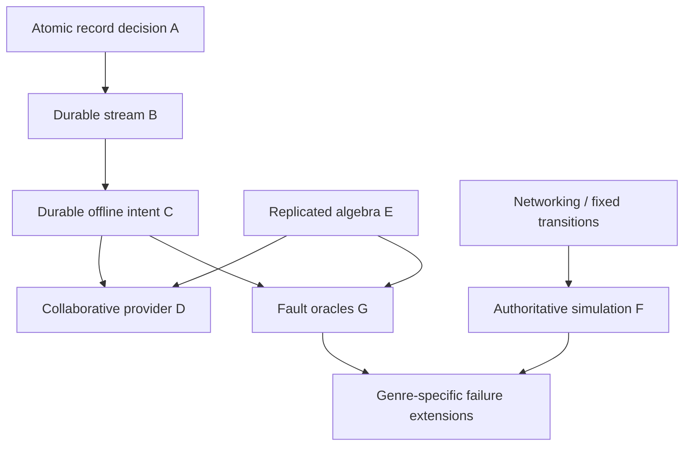

# Implementation handbook

## 1. Reader, purpose and boundary

You know why synchronization is difficult and now need to connect a correctness claim to executable code, a failure schedule and an observable result. This handbook provides a route through Projects A–G, explains their dependency and decision boundaries, and gives a method for extending them without weakening their guarantees.

The questions are concrete: what must be installed; which process owns state; where does acceptance become durable; how does recovery determine whether a pending effect already happened; what does each test establish; and what is required before the code could serve real users?

Complete project source, directory maps, setup, expected output and function walkthroughs live in the linked project READMEs. This document connects those implementations rather than copying code that could diverge from the runnable version. Cloud deployment, browser interfaces and audited storage/security are outside this handbook. See [production](../15-production/README.md) for operating obligations and [security](../14-security/README.md) for trust boundaries.

## 2. Environment and execution contract

The common validated Node runtime is **26.7.0**. Projects C, D and G use its bundled SQLite API (observed SQLite 3.53.4); an older runtime without that API is insufficient. Project A and the concurrency lab were validated with JDK 25.0.1. A and B use Docker Compose v2; their images pin PostgreSQL 18.4 and B additionally Redis 7.4.3. These are validation versions, not a promise that every newer version behaves identically. The project files identify lower runtime requirements where relevant.

From the repository root, inspect your versions before running:

```sh
node --version
npm --version
java --version
docker compose version
```

Java/version-manager selection is a user environment concern. If a shim has no selected Java, invoke the installed JDK's `bin/java`; the exercises do not require changing the machine's default. Dependency installation is needed only for B and D. Their package locks are part of reproducibility: use `npm ci --ignore-scripts` inside each project, then run its tests. No root-level package or hidden monorepo build exists.

A/B containers have fixed, dedicated lab names. Check for name collisions before starting them. B uses loopback-only published ports; A publishes no ports. Fixture tokens and local passwords are public teaching values. Neither project accepts a production database URL. Run these exercises on a development machine, keep listeners on loopback, and do not turn them into a publicly reachable service by changing a bind address.

Automated disk-backed tests create and remove their own randomized temporary stores; A/B use generated schemas. Manual CLI stores and the B demo schema persist until their documented cleanup. `down --volumes` deletes the specified lab's data; read the exact project command and stop its manual clients/servers first. Do not substitute a general Docker cleanup command.

## 3. Project map and learning sequence

| Project | Runnable entry and prerequisites | New mechanism | Verification boundary |
|---|---|---|---|
| [A](../../../playground/synchronization/a-versioned-store/README.md) | SQL test script + Java source launcher; Node/Docker/JDK | Atomic expected-version decision, stable replay result, serializable retry | Real PostgreSQL sessions; local Java threads |
| [B](../../../playground/synchronization/b-durable-chat/README.md) | `npm test`, `npm run demo`; Node/Docker/pinned packages | Durable message/result/outbox; WebSocket delivery; Redis hints | Real gateway processes, PostgreSQL, Redis and sockets |
| [C](../../../playground/synchronization/c-offline-engine/README.md) | `npm test`, `npm run demo`; Node 26.7.0 | Durable client queue, outcomes, cursor, snapshot reset and private conflict | Real SQLite/HTTP/client and authority crashes |
| [D](../../../playground/synchronization/d-collaborative-text/README.md) | `npm test`, `npm run demo`; Node/pinned Yjs/ws | Mergeable text evidence, custom durable provider, selective undo, relative anchors | Real WebSockets/server storage; memory-only client |
| [E](../../../playground/synchronization/e-crdts/README.md) | `npm test`, `npm run demo`; no dependencies | Replicated algebra plus adverse delivery and explicit repair | In-memory logical schedules; shared datatype source |
| [F](../../../playground/synchronization/f-multiplayer/README.md) | `npm test`, `npm run demo`; no dependencies | Fixed input slots, authority, prediction/replay and interpolation | Real UDP/process restart plus logical loss schedules |
| [G](../../../playground/synchronization/g-fault-harness/README.md) | `npm test`, `npm run demo`; Node 26.7.0 | Seeded trace, HTTP proxy faults, transaction aborts and supervised crashes | Logical schedules + actual application/SQLite/process boundaries |

For the mathematical path, run E before D. For the durable application path, run A → B → C, then D. F branches from networking and speculation; it does not require text merging. G adds faults to protocols with an already defined oracle. The [supporting labs](../README.md) isolate math, pairwise OT, networking and local concurrency before the larger projects.



These are learning dependencies. G currently adapts C and CRDT branches; it does not automatically execute every possible failure against B, D and F.

## 4. The common implementation skeleton

Every project chooses a state transition and a decision owner before a transport. A transition consumes an identity, payload and relevant base/dependency information, then produces a result or explicit rejection. The storage boundary determines which artifacts must become visible together. The transport may lose the response after this decision.

| Boundary | Atomic set of artifacts | What remains outside it |
|---|---|---|
| A record acceptance | Record/version + original outcome + change entry | Java cell, remote clients and external effects |
| B submission | Membership decision with its locking policy + channel sequence/message + replay outcome + outbox | Broker publication, gateway send and client projection |
| C local enqueue | Valid pending intent and its stored identity | Server acceptance |
| C authority acceptance | Record + head/change + retained outcome | Client receipt/checkpoint |
| C install | Confirmed projection + cursor + receipts + pending retirement | Next network request |
| D provider acceptance | Valid candidate snapshot + retained exact blob + acceptance sequence | Every peer integrating dependencies; client persistence |
| F tick | Scheduled commands applied by one simulation owner | Disk durability, render interpolation and future slots |

There is no cross-project distributed transaction. In B, a broker hint is sent after the database decision and may repeat. In C, a missing ACK leaves pending intent until its retained outcome and confirmed prefix establish incorporation. In D, convergence of library evidence and persistence of server acceptance are separate obligations. F intentionally expires commands after their scheduled slots; retries cannot recover elapsed game time.

## 5. Project A: establish a decision boundary

Read `schema.sql`, then `psql-session.mjs`, then the controlled concurrent histories. Run the exact container/source-launch commands in [A's setup](../../../playground/synchronization/a-versioned-store/README.md).

The vulnerable history reads zero twice and assigns one twice. Row locking serializes physical writes but cannot reconstruct the lost increment. The corrected atomic increment updates the current stored value. The expected-version variant rejects a stale base instead of guessing the user's revised intent. `submit_increment` additionally retains the decision under a stable identity; replay returns its original outcome even after newer writes.

Expected checks include unsafe result one, safe result two, a single successful final-stock reservation, and a Serializable doctor-history retry that rereads the whole decision. The Java implementation atomically replaces an immutable value/version pair. Its successful CAS does not coordinate the SQL store or another JVM.

When extending A, add a domain constraint and a test with two individually valid decisions. Unique/FK/CHECK constraints enforce expressible local invariants; a predicate spanning rows may need Serializable or an explicit shared lock. PostgreSQL Serializable can reject transactions, so retries must cover their complete read/decision/write body. [PostgreSQL 18 isolation documentation](https://www.postgresql.org/docs/18/transaction-iso.html) specifies these behaviors; see the [database chapter](../06-database-concurrency/README.md) for the worked SQL histories.

## 6. Project B: durable acceptance and recoverable delivery

Run B's Compose stack, install its locked packages, then execute its tests/demo. Initialize the persistent manual schema only for the CLI workflow. Follow `Repository.submit` into the database transaction and then trace the server's notification loop and the client's cursor checks.

A channel owns a sequence. The database retains accepted content, original operation outcome and outbox work. Redis Pub/Sub wakes gateways; periodic history checks repair missed hints. A client catches up from its applied contiguous sequence, not from the highest packet it happened to receive. The server's ACK certifies acceptance without proving all receivers have applied the message.

The demo accepts sequence one, replays the same identity without another message, then reconnects after one to obtain only sequence two. If you remove retained outcomes, an ACK loss may create a duplicate; if you remove catch-up, a broker miss may become permanent data loss in the UI. These are two different defects.

Its client is memory-only. A new client process must bootstrap rather than infer a durable checkpoint it never stored. Real chat needs durable client storage, long-term history policy, per-message edit/delete semantics, moderated content rules and production authentication. Broker partition/outage and genuine database failover remain additional integration scenarios, not claims established by the earlier passing suite.

## 7. Project C: durable offline intent and coherent installation

C has no npm dependencies. Its CLI allows bootstrap, offline enqueue, synchronization, inspection and explicit conflict resolution. Study `OfflineClient.enqueue`, `Authority.submit`, `Authority.pull` and `OfflineClient.install` in that order.

The client view is confirmed state with active pending intents overlaid. An accepted intent stays overlaid until the installed source prefix includes it. `pull` returns receipts and either changes or a snapshot from one coherent database view. `install` rejects an obsolete response and commits projection, cursor, receipt updates and pending retirement in one transaction. This avoids an accepted increment appearing both in the snapshot and in a surviving pending overlay.

C preserves rejected conditional title edits. A human resolution creates a new identity based on current state; retrying an unknown old outcome keeps the original identity. Those actions must not share a code path that blindly regenerates IDs. Source epoch changes quarantine old unknown work for review. An expired log cursor triggers a snapshot; outcome retention makes unknown success discoverable even after changes are pruned.

The implementation supports one record and fixture actors, bounded queues and numeric ranges. It stores deletion evidence and refuses unsupported schemas; it does not implement production migrations, durable browser storage, E2EE or safe outcome GC. The transport's retry logic must remain separate from user intent revision.

## 8. Project D: separate merge semantics from provider durability

Install its pinned dependencies and run the documented test/demo or two CLI clients. Start with the provider's store acceptance, then the client update handler, flush behavior, undo origin and relative cursor handling.

The library's binary updates convey CRDT evidence. They tolerate repeated/reordered update application under their design assumptions; eventual synchronization requires delivery of the needed updates. Yjs documents these properties and differential state exchange in its [update API](https://docs.yjs.dev/api/document-updates). The provider still needs current authorization, bounded input, durable server acceptance and reconnect exchange.

The lab validates a separate candidate document before committing its encoded snapshot and update row. It publishes the candidate only after the transaction commits. This avoids corrupting live memory with an update whose persistence failed. Exact blob replay identity differs from internal CRDT item identity: overlapping differently encoded blobs can create several accepted log rows while integrating one logical character effect.

Undo tracks local origin; it does not restore an old whole document and erase Dev's later work. Relative anchors resolve against the current compatible document; integer offsets alone would drift. Server storage is durable, client state is memory-only, rich text/UI bindings are absent, and deferred structures require bounded validation beyond visible text. Do not treat this custom protocol as interchangeable with an existing provider's wire format.

## 9. Project E: isolate algebra, liveness and domain correctness

E supplies the explicit Project E directory while reusing the earlier datatype implementations. It adds four seeded full-state dissemination adapters. Run its test/demo commands in the [project README](../../../playground/synchronization/e-crdts/README.md).

A snapshot join takes cumulative evidence, not a command to repeat a side effect. Duplicated counter state takes maxima per writer. Removed OR tags retain suppression evidence. Concurrent title alternatives remain visible until a new causally informed assignment supersedes them. Sequence deletion hides an anchor without discarding its descendants.

Ten seeds per adapter run twice with normalized logical traces. After the faulted rounds, a reliable exchange supplies all remaining evidence and the oracle compares canonical metadata. Complete permanent loss deliberately fails the liveness precondition. Two unsynchronized branches using one writer converge while losing an intended increment; two local stock decrements can converge to minus one. These are correct tests of invalid assumptions/domain policies, not bugs to patch by changing the oracle.

The combined command runs 23 existing datatype tests and seven adapter tests. The fixtures are finite, states trusted and storage volatile. Use a lossless codec, durable exclusive identities and tested membership/GC rules before connecting these structures to an untrusted network.

## 10. Project F: make speculative time explicit

F has no npm dependencies. Run its tests/demo, then use two clients against the loopback UDP server. Trace input slot allocation, server tick finalization, acknowledged slot watermark, `Predictor.reconcile` and `Interpolator.sample`.

The client predicts using the same bounded movement rule, retains unfinalized input slots, resets to a newer authoritative position and replays only remaining slots. ACKs finalize slots even when a missing command used neutral fallback. A late command cannot be applied as if it had arrived on time. Remote entities are rendered between buffered authoritative samples; interpolation adds deliberate display delay.

A server restart creates a new match epoch; old session packets fail validation. Match movement is not durable inventory. Persistent rewards or purchases need a separate transaction/identity protocol. The demonstration has one-dimensional integer movement, no full physics/rollback implementation, no production congestion control or Internet identity. [RFC 8085](https://www.rfc-editor.org/rfc/rfc8085.html) requires Internet UDP applications to address congestion and other transport responsibilities; loopback test success does not establish those properties.

## 11. Project G: inject failure at the claimed boundary

Run G after C and E. Its scheduler controls logical message order; its proxy faults actual HTTP requests/responses; its supervisor kills actual fixture processes; SQLite triggers force transaction aborts. Each exposes a different mechanism.

A stable-ID oracle counts original accepted intents rather than transmitted attempts. A projection/checkpoint oracle demands coherent old or new local state across installation crashes. A revocation oracle checks current permission before replay disclosure. The journal verifies trace continuity against an independent anchor; an unsigned hash chain alone cannot expose replacement by an attacker or prove the author.

A seeded trace records redacted labels, phases and timing, not private document bodies. OS scheduling, process PIDs and actual network timings remain nondeterministic. Startup/phase watchdogs fail tests when the intended crash boundary is not reached; an arbitrary process exit is not sufficient evidence.

## 12. A worked end-to-end investigation

Goal: show that a response lost after acceptance does not repeat an increment. Assumptions: C's authority retains outcomes in the same transaction as effects; the surviving client retains its original pending operation; authority history has not been destructively replaced; authorization permits replay.

1. Bootstrap the client's confirmed record and authority epoch.
2. Enqueue `increment 2`; record the pending operation ID. Local view increases while confirmed state stays unchanged.
3. Forward submission through G's `drop-after` proxy. The authority commits record, change and outcome; the response never reaches the client.
4. Verify the network request failed but the authority counter increased by two and has one retained outcome.
5. Retry the exact pending operation. The authority returns its original result without another increment.
6. Pull changes or a snapshot with receipts; atomically install and retire the now-incorporated pending overlay.
7. Verify confirmed state equals authority state, pending queue is empty and exactly one accepted effect exists for the original ID.

G's named lost-response test executes this sequence. Run it alone from that project directory:

```sh
node --test --test-name-pattern='HTTP lost response after commit' harness.test.mjs
```

Variation: revoke permission after step three. The old effect remains accepted, but unauthorized replay/read is denied. Private pending evidence remains for later review. The correct recovery cannot claim rejection proves the earlier operation never happened. Variation: delete outcomes while retaining the record, then retry—this changes the model and can double the effect. Do not delete replay evidence unless the protocol prevents that retry generation from being accepted.

## 13. Diagnostic map

| Symptom | First evidence to inspect | Plausible mechanism | Corrective action |
|---|---|---|---|
| Increment doubled | Original ID, retry ID, retained outcome and effect transaction | New ID on unknown outcome or dedup deletion | Preserve identity; reconcile outcome; restore a safe retry horizon |
| Cursor ahead of data | Client transaction/installed source boundary | Checkpoint committed separately | Atomically install projection and cursor; rebuild from safe boundary |
| Pending effect appears twice | Snapshot boundary and accepted sequence | Snapshot plus pending overlay both include effect | Reconcile receipts with snapshot in one install |
| Text equal now, later diverges | Canonical deletion/dependency evidence | Visible-only snapshot/unsafe GC | Repair missing causal evidence or require explicit reset |
| Database state correct, UI stale | Applied cursor vs broker notification | Missing transient hint/no pull | Catch up from durable history |
| Client work disappears on restart | Actual local storage and outbox commit | Volatile queue or projection-only write | Durable intent transaction; expose storage failure |
| Game snaps after packet delay | Finalized slots and pending replay range | Late command reused or wrong ACK meaning | Respect slot finality and reconcile newer snapshots |
| Crash test passes suspiciously fast | Phase acknowledgment and watchdog outcome | Killed before reaching target boundary | Fail unmet-phase tests and instrument the boundary |

Diagnostic logs must avoid credential/body disclosure. Tenant/object scope and permission checks apply to diagnostic endpoints too. Keep unknown outcomes distinct from definitive conflicts, unsupported schemas and source discontinuity.

## 14. Extension and hardening contract

Before adding a feature, write the transition, invariant, decision owner, identity scope, durability point and permitted failure recovery. Add a history that fails the naive design. Then implement the minimal mechanism and verify the boundary with the right kind of fault.

A chat edit adds a stable message identity and conditional revision semantics; it does not reinsert an old message with a new position. A document move adds tree constraints and move/remove policy; a generic map join does not forbid cycles. A reward triggered by a game event needs a persistent event identity and transactional ledger, distinct from disposable movement snapshots. A durable CRDT client needs atomic local evidence/outbox persistence and identity continuity, not simply writing rendered text after each keystroke.

Performance work starts with per-object contention, queue/memory bounds, history size and replay cost. Measure open-loop arrival load and tail latency with correctness oracles enabled. Do not batch across an ordering/authorization boundary unless the batch preserves it. Do not skip validations in a benchmark then claim that result as capacity of the correct system.

Production hardening requires real authentication/current authorization, TLS, tenant isolation, bounded parsing/queues, schema evolution, ownership fencing, supported offline horizon, safe history policy, operational telemetry and actual restore drills. Each project lists its more specific omissions. No passing count establishes security, arbitrary scheduling correctness or storage power-loss durability.

## 15. Review and further work

The [validation ledger](RESEARCH.md) separates this installment's executions from earlier project records. The [comparison matrices](../17-comparisons/README.md) select mechanisms by domain; the [synthesis](../18-synthesis/README.md) supplies a complete design exercise.

Invariants: preserve original identities after unknown outcomes; commit mutually dependent artifacts together; acknowledge the exact fact certified; compare causal metadata when it matters; restore delivery for liveness; enforce domain rules and permissions independently of convergence.

## Release review

Status: **ready — complete for the stated educational scope**.
Reviewer: Codex (AI technical and editorial review); no independent human review claimed.
Review date: 2026-10-14.
Open issues: none blocking this educational release.
Scope limits and further validation: All runnable projects checked in this environment; independent fresh-machine reproduction and production certification are not claimed.

See [the review record](../REVIEW.md) and [actual validation output](../VALIDATION.json).
