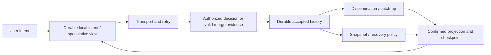

# Synthesis: derive a synchronization design from constraints

## 1. Reader and outcome

You have studied shared state, causality, consistency, conflicts, storage, transport, collaborative applications and games. This chapter connects them into a method for deriving an unfamiliar system. It answers: how do you define the problem precisely; decide what must coordinate; separate speculative from confirmed observations; design identity/recovery/retention; and demonstrate that the resulting protocol preserves its declared rules?

The worked design is a field-maintenance workspace with offline checklists, shared instructions, limited spare parts and optional live operator presence. It is an authored exercise, not a claim about a deployed product. No full new application is implemented here; Projects A–G supply executable components and counterexamples. Review and production integration remain necessary.

## 2. One model, several obligations

A process has private memory. It receives information through messages or storage reads, interprets that information and performs a transition. Other processes do not observe that transition until information reaches them. A network delay cannot tell a sender whether a receiver has not seen a request, has seen but not committed it, or has committed and lost the reply.

A useful synchronization design therefore has at least these distinct obligations:

1. **Meaning:** define the logical object, operation and application invariants.
2. **Decision:** determine which process/evidence may authorize an accepted transition.
3. **Dissemination:** eventually deliver accepted evidence under a declared connectivity model.
4. **Observation:** define which histories a user may see, including speculative state.
5. **Recovery:** retain enough identity/history to reconstruct a safe interpretation after failure.
6. **Trust:** authenticate, authorize and bound operations at the correct decision boundary.

No single transport, merge datatype or database supplies all six. A live socket helps dissemination; a CRDT join addresses compatible evidence merging; a transaction establishes an atomic storage decision; prediction alters a local observation; fencing protects ownership; current authorization governs acceptance and disclosure. The mechanisms fit together because their boundaries differ.

Ephemeral presence and game inputs alter this diagram: they have expiration/finalized-time rules rather than an indefinitely durable local intent queue. The difference follows from their meaning, not from the transport's speed.

## 3. A minimum design specification

Before selecting technology, fill this table for each operation family. Blank cells are unresolved engineering decisions.

| Question | Required answer |
|---|---|
| Object and invariant | Exact state and forbidden outcomes, including permissions and structural constraints |
| Operation | Payload meaning, base/dependency information, identity and whether it can expire |
| Decision scope | Object/channel/partition/transaction boundary and accepted-history owner |
| Failure model | Crash/recovery, message loss/duplication/reorder, partition, malicious input, storage assumptions |
| Observation contract | Read freshness, session guarantees, ordering, speculative UI and convergence |
| Commit promise | Exact artifacts durable before acceptance ACK; which failures are included |
| Identity | Actor/device/session/operation/source epoch scopes; restart and cloning policy |
| Recovery | Unknown-outcome query/retry, cursor gap, source reset, private rejected work |
| Retention | Offline/retry horizon, snapshots, tombstones, outcomes and membership assumptions |
| Security | Current authorization decision, confidentiality and resource bounds |
| Evidence | Proof obligation, oracle, fault schedule, measurements and review gaps |

“Eventually consistent” is not a complete answer to any row. It says neither how stale a session may become, whether a deleted object can return, whether an acknowledged write survives, nor whether a revoked user may receive it.

## 4. Determine what requires coordination

First try the concurrent history. Take a common state, let Mira and Dev make individually legal operations independently, then combine their results under the proposed rule. If the rule preserves the invariant for every permitted history, coordination may be avoidable for that invariant. A counterexample proves the candidate rule is insufficient; it does not prove every imaginable decentralized design impossible.

For example, stock is one. Mira and Dev each observe one and decrement by one. Each local result is zero. A merge preserving both decrements yields minus one. A join that selects one decrement loses a legitimate claim and cannot tell which user physically took the item. The problem is allocation rights, not just arithmetic.

Alternatives:

- Coordinate reservation at one transactional invariant owner; disconnected requests remain pending.
- Allocate spend rights before disconnection. Each participant spends only its exclusive allotment; transfers of rights preserve the bound and cannot be replayed twice.
- Permit temporary oversubscription and compensate later only if the product explicitly tolerates it. Compensation cannot undo every physical-world action.

By contrast, a grow-only set of completed observations can union independent additions if duplicate identity and validation are handled. A text sequence can preserve distinct concurrent insertions, but “mergeable” does not settle prose meaning, rich-text intent or who may write.

The general design question is whether all independently permitted transitions preserve the global invariant when combined. Formal results require a specific model; use the [conflict chapter](../03-conflict-resolution/README.md) and [CRDT chapter](../05-crdts/README.md) for their exact properties and counterexamples.

## 5. Worked design: offline maintenance workspace

### 5.1 Context and requirements

A team maintains equipment in areas with poor connectivity. Each job has stable identity, checklist, editable instructions, status, assigned operator and spare-part reservations. Mira and Dev may work offline for seven days. A completed checklist cannot silently disappear; status transitions and exclusive assignment must be valid; spare stock must not become negative; revoked users must not regain shared access by replaying work. Presence is useful only during a connected session.

Assumptions: clients can crash but have durable local databases; a workspace shard has one fenced acceptance owner backed by transactional storage; network requests/responses may drop or duplicate; clients are untrusted; storage durability follows a separately specified deployment policy. Permanent partition cannot promise shared agreement and successful globally constrained decisions. The offline horizon is a product requirement, not a measurement of existing labs.

### 5.2 Decompose state and operation families

| State | Proposed transition | Why it fits | Remaining boundary |
|---|---|---|---|
| Checklist evidence | Add a uniquely identified completion observation; corrections explicitly reference prior observations | Concurrent independent observations can coexist without overwriting | Who can certify completion; contradictory observations; signed evidence if required |
| Shared instructions | Pinned CRDT text provider with durable client evidence/outbox | Supports concurrent offline insertion/deletion under library semantics | Rich-text schema, dependencies, identity continuity, rejected branch handling |
| Job title | Version-conditional replacement, retain stale alternative locally | Prevents silent lost title intent | Human chooses revised meaning on conflict |
| Status / assignment | Conditional transition in transaction against current job state | Prevents forbidden lifecycle or duplicate exclusive claim | Acceptance may wait for connectivity |
| Spare reservation | Atomic predicate and stable reservation identity at stock owner | One valid reservation for the final unit | Offline physical use requires preallocated rights or separate policy |
| Permissions | Authoritative current grants, separate from editable job content | Writers cannot grant themselves rights | Revocation cannot erase already disclosed plaintext |
| Presence | Expiring session record; coalesced update | Old cursor/online signal has no durable business value | Clock/heartbeat policy and authorized visibility |

A correction is not necessarily removal of a completion bit. If evidence must be auditable, append a retraction/correction referencing the original observation and derive current interpretation. Whether it can be merged automatically depends on the certification rules. Choose a narrower structure only after those rules are settled.

### 5.3 Protocol envelope

An illustrative durable request has protocol/schema version, authenticated scope, source epoch, device generation, immutable operation ID, operation kind, payload and optional dependency/base. Authentication context arrives through the session, not through a client-controlled `actor` field taken on trust. Include object/domain scope in the idempotency key and semantic fingerprint; bind the same identity to the same meaning.

A response distinguishes accepted(original sequence/outcome), explicit conflict/rejection, unsupported version and source discontinuity. A timeout has no equivalent definitive response. Presence uses a different envelope with session identity and expiry. Text item identities and blob submission IDs differ; neither is the user's authenticated identity.

The server serializes the applicable decision, validates current permission and payload, looks up original outcome, checks domain predicates, commits accepted state/outcome/change/outbox, then ACKs. Replayed IDs return the retained original outcome after current authorization and fingerprint checks. A later state change cannot reinterpret that old decision as a fresh one.

The client stores local intent before reporting crash-safe offline success. Catch-up installs confirmed state/checkpoint and reconciles accepted overlays in one local transaction. An old response cannot overwrite a newer installed base. A rejected title/status intent remains privately inspectable; human revision creates a new ID rather than rewriting the original request.

### 5.4 Concurrent timeline

Initial title is “Pump inspection”, version 12; stock is one. Both clients have confirmed job state. Mira's title intent is M17 = “Inspect pump A” at version 12. Dev's is D22 = “Inspect pump B” at version 12. They also request one spare each.

| Step | Authority state | Mira state | Dev state |
|---|---|---|---|
| Offline branches | Title v12, stock 1 | Durable M17 and reservation M18; speculative title A | Durable D22 and reservation D23; speculative title B |
| Dev reconnects | D22 accepted, title B v13; D23 accepted, stock 0 | Still private pending | Accepted outcomes, then confirmed installation |
| Mira reconnects | M17 fails version predicate; M18 fails stock predicate | Original work retained as conflict/rejection | Confirmed title B and reservation |
| Mira edits resolution | Unchanged until new request | New M19 based on v13: “Inspect pumps A and B” | Unchanged |
| M19 commits; reply lost | Title combined v14; original M19 accepted outcome retained | Unknown outcome with original M19 pending | Can catch up to combined title |
| M19 retry / catch-up | No second effect; retained outcome returned | Confirmed v14, incorporated pending retired | Confirmed v14 |

The table uses separate domain revisions for real implementation: a title edit need not invalidate a stock counter, and independent fields should not accidentally share one whole-record conflict rule. The compact history presents title version and stock side by side. Explicit rejected reservation outcomes also remain retained for replay; a future restock does not turn M18 into a new reservation. Mira must issue a deliberate fresh request if appropriate.

For text, simultaneous CRDT edits can both integrate under their sequence policy. This differs from rejecting a stale conditional title. For presence, an offline queue of week-old cursors is discarded. These policies coexist within one workspace.

### 5.5 Delivery and recovery

Use a live bidirectional channel for prompt updates, but make recovery independent of that channel. The durable cursor is scoped to the accepted-history owner and source epoch. Broker hints trigger catch-up; missed hints are repaired by reconnect/periodic checks. Order is promised within the relevant stream, not across unrelated workspace shards without additional coordination.

Snapshots include a coherent source boundary and the required semantic evidence. When a cursor expires, reset the projection at that boundary and reconcile pending original outcomes. Text snapshots retain necessary dependency/deletion evidence; a render-only plain-text snapshot cannot safely resume the original CRDT history. Permissions and schema version can change during seven offline days, so reconnect may reject old work or require migration/review.

Choose outcome/tombstone retention from the admitted retry and replica membership horizon. Seven days offline does not imply seven-day deletion is safe: the client may also retry later, a snapshot may be restored, or a former device may return. If the product cannot retain old identity/evidence indefinitely, establish an explicit generation/reset/rejection rule before removing it. “Reconnect downloads a snapshot” is not itself a deduplication protocol.

### 5.6 Scaling and measurement

Partition by workspace/job only where all required invariants fit or have explicit cross-shard coordination. A popular job is a hot object; adding gateways does not parallelize its single decision owner. Separate ephemeral coalescing from durable acceptance queues, cap bootstrap payloads, and fence old owners at the protected storage boundary.

Set illustrative success measures: local intent commit p99 below 30 ms on target devices; confirmed catch-up within two seconds after stable connectivity for an agreed workload; zero duplicate accepted reservations, invalid status transitions and silent private-intent losses; bounded memory and eventual queue drainage after recovery. These are proposed targets, not measured repository results. The device, document size, backlog, concurrency and failure distribution must be named before the latency claims have meaning.

For a worked latency budget, suppose reconnect setup takes 80 ms, a request round trip 100 ms, server read/encoding 20 ms and local validation/install 15 ms. Assume one snapshot fits one response with adequate bandwidth and no retries/overlap. Total is 215 ms by adding these nonoverlapping stages. A large transfer, multiple pages, packet loss, queueing or simultaneous reconnect storm breaks that simple bound. Use [mathematical foundations](../02-mathematics/README.md) for transfer, queue and tail-latency models rather than treating this example as a capacity estimate.

### 5.7 Verification plan

Create an oracle before introducing the workload. It checks accepted original identities and outcomes, stock/assignment invariants, canonical text evidence, projection/checkpoint coherence and current read/write permission. Then generate concurrent offline operations, retries with stable IDs, duplicate/delayed delivery, client crash before/after local commit, server crash before/after acceptance, cursor expiry, revocation and source reset.

Use A for the final-stock/conditional decision, C/G for unknown success and atomic installation, D for provider/dependency/undo behavior, and E for convergence/domain counterexamples. Their separate tests are evidence for their boundaries, not a proof of this unbuilt integrated workspace. Add actual owner failover, broker/DB partition and backup restore tests to a deployed system. Keep power-loss claims distinct from process SIGKILL.

## 6. Why multiplayer is the same foundation with a different time contract

Replace a job edit with “move right during slot 17.” The intent is tied to a simulation interval. Applying it after slot 17 expired changes the match timeline and may violate fairness. F therefore finalizes slots, uses neutral fallback for missing input and rejects/retires elapsed commands. A document edit can remain meaningful after days; a movement command often cannot.

Prediction computes a locally useful future state before confirmation. Reconciliation replaces the confirmed base and replays only commands still valid after the authoritative watermark. Interpolation renders a remote past between received snapshots. These are observation strategies, not acceptance or durability guarantees. A hit decision may use bounded historical rewind, while an inventory reward needs an exact persistent transaction.

Rollback and CRDT merge solve different problems. Rollback reruns a deterministic transition sequence after correcting historical input. A CRDT joins compatible concurrent evidence according to its datatype semantics. Deterministic simulation needs the same ordered input prefix and state-transition behavior; deterministic tie-breaking in a register merely chooses a repeatable winner. Neither word “deterministic” alone establishes domain correctness.

## 7. A compact proof-obligation map

| Claim | What must be established | Common missing assumption |
|---|---|---|
| Retry has one effect | Stable scoped identity, immutable meaning, atomic retained decision/effect, defined retention horizon | An external side effect lies outside the transaction |
| Replicas converge | Correct join/operation rules, compatible evidence, eventual delivery and deterministic projection | Missing deletion/ancestor evidence or permanent loss |
| Read is linearizable | One permitted real-time-respecting sequential history at the claimed object boundary | Stale replica read or unfenced old owner |
| Transaction preserves invariant | Chosen isolation/locking and constraints cover all writers and predicate scope | Write skew, bypass path, external state |
| Offline work survives crash | Intent/identity/evidence durable at acknowledged local boundary | Only rendered view was saved |
| Reconnect is coherent | Valid epoch/cursor, consistent snapshot, original outcomes, atomic installation | Cursor advances before data or unknown effect overlays twice |
| Revocation holds | Current grant checked/serialized at defined decision/disclosure point | Cached session authority or data already disclosed |
| Simulation reconciles | Correct finalized watermark and deterministic replay of still-valid inputs | Packet ACK confused with slot finality |

Proofs are model-specific. Finite tests seek counterexamples and validate implementation boundaries; a passing run is not a universal proof. Fault simulation is powerful when it executes the real mechanisms and records failures reproducibly. FoundationDB's [2021 paper](https://www.foundationdb.org/files/fdb-paper.pdf) describes an extensive deterministic simulation approach; the local Project G scheduler has a deliberately narrower application-level model.

## 8. How to read a new paper or codebase

1. Write down the model before the algorithm: crash vs Byzantine participants, synchrony/delivery assumptions, shared clock assumptions, membership and durability.
2. Identify the exact object and operation grammar. Determine whether an operation is a command, event, cumulative state or delta evidence.
3. Locate identities and ordering scope. A database sequence, Lamport clock, source cursor and fencing epoch certify different facts.
4. Find the invariant and acceptance/linearization point. Follow every writer, including admin/migration paths.
5. Follow one concurrent history and one lost-response history. Keep intermediate metadata, not just rendered output.
6. Read recovery/GC before deciding the design is simple. Determine what happens to old devices and restored snapshots.
7. Inspect authorization and resource bounds separately from convergence.
8. Separate proof from finite tests and historical benchmarks; ask whether the implementation satisfies the proof's assumptions.
9. Reproduce the smallest executable mechanism, then mutate an assumption and require an explanatory failure.

For further study, use the [annotated sources and further reading](../SOURCES-AND-FURTHER-READING.md): clocks/consistency first, OT/CRDT papers with the worked histories second, database/runtime/network specifications third, product engineering reports after their mechanism prerequisites. Use the [dependency map](../DEPENDENCIES.md) to fill a missing prerequisite instead of treating unexplained jargon as a result.

## 9. Self-assessment with answer criteria

| Exercise | A technically adequate answer must include |
|---|---|
| Two offline users edit/delete the same object | Common base, operation identities, concurrency relation, chosen remove/update semantics, tombstones and reconnect horizon |
| An increment times out | At least the unreceived/uncommitted/committed-with-lost-response cases; original identity recovery; transaction/outcome scope |
| A “latest timestamp” loses work | Clock assumptions and tie-break; deterministic convergence vs preserved intent; alternative domain policy |
| A successful local CAS is offered as a distributed lock | Shared-memory boundary, durable authority/fencing required across hosts, process restart and partition behavior |
| A snapshot restores a task but doubles its count | Accepted pending overlay and source boundary; original receipt reconciliation and atomic installation |
| A socket reconnects with an unread gap | Durable stream cursor/epoch, history/reset, distinction between sent packet and applied projection |
| A shooter should merge movement like text | Input expiration, authority, prediction/reconciliation, fairness and separate durable reward state |
| A PN counter tracks stock | Concurrent last-unit counterexample; coordinated reservation or exclusive allocated rights |
| A revoked user replays an accepted ID | Current authorization before disclosure; old effect remains accepted; inability to revoke already disclosed plaintext |
| A hash-chained log is called tamper-proof | Anchor/witness/authorship assumptions, prefix truncation and replacement limits |

Use source and tests to verify your answers. A response that merely names “CRDT”, “transaction”, “WebSocket” or “consensus” leaves the mechanism unresolved.

## 10. Completion and review boundaries

The repository now contains all eighteen planned chapter drafts, shared references and runnable Projects A–G. This is structural coverage, not a declaration that every requested production mechanism is implemented or every chapter independently verified. Examples are deliberately limited; their READMEs/evidence notes list omissions. Technical review, fresh-machine reproduction, deeper hostile-state testing, WAN/cluster failover, power-loss validation and production identity/encryption remain meaningful work.

The unified rule is to define accepted state, permitted observations and recoverable evidence first. Independent computers coordinate only through mechanisms whose ordering, atomicity, identity, delivery and trust assumptions are explicit. When a requirement changes, derive which assumption or boundary must change; do not expect a transport or algorithm name to make the change for you.

Reviewer: pending technically informed reader. Review date: pending. Open issues: integrated workspace implementation is absent, independent technical review and production validation remain open. No formal ASD-STE100 compliance claim.
