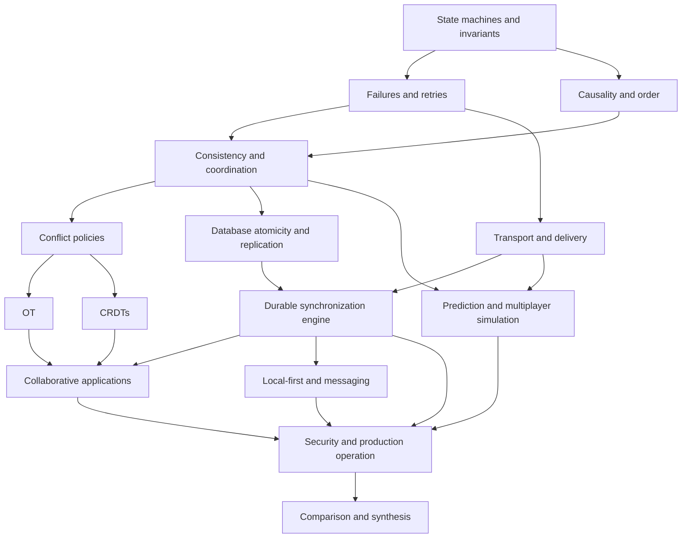

# Concept dependency map

The arrows are learning dependencies, not software call edges. Mathematics is introduced where needed and consolidated in its reference. Java memory ordering is a separate local concurrency branch: learn state transitions and linearization first, then connect atomic server/database operations to distributed protocols.

Implementation dependencies: A establishes atomic acceptance; B adds durable delivery; C adds disconnected writes; D adds a text merge model; E tests replicated algebra independently; F adds simulated time and latency hiding; G tests every branch. Project D does not depend on implementing a CRDT sequence from scratch.

## Installment 5 implementation path

Database atomicity + networking → [engine lifecycle](08-sync-engine/README.md) → [messaging](09-messaging/README.md) → [Project B](../../examples/synchronization/b-durable-chat/README.md). Project C will add durable client state/outbox and reset recovery; Project B proves only the server acceptance and history-delivery branch.

## Installment 6 implementation path

[Engine commit boundaries](08-sync-engine/README.md) + [conflict policies](03-conflict-resolution/README.md) → [local-first recovery](10-local-first/README.md) → [Project C](../../examples/synchronization/c-offline-engine/README.md). Project C adds actual local file persistence, snapshot/outcome reconciliation and client crashes. Rich text, browser storage, cryptographic membership and production retention require their own mechanisms.

## Installment 7 implementation path

OT/CRDT mechanics + engine/local-first boundaries → [application contracts](11-collaboration/README.md) → [Project D](../../examples/synchronization/d-collaborative-text/README.md). Shared source editing is a different domain from execution/terminal control. The next branch is fixed-step multiplayer simulation and its prediction/reconciliation contract.

## Installment 8 implementation path

Transport/latency + speculative-state boundaries → [multiplayer timelines](12-multiplayer/README.md) → [Project F](../../examples/synchronization/f-multiplayer/README.md). Deterministic lockstep/rollback additionally need complete deterministic state and reproducible transitions; persistent economy/world recovery additionally needs database/durable-outcome mechanisms. The seeded link is an initial adverse-schedule component, not completion of the general Project G harness.

## Installment 9 implementation path

Linearizable transitions + database/engine boundaries → [local concurrency](13-local-concurrency/README.md) → [Java/Node lab](../../examples/synchronization/05-local-concurrency/README.md). Publication and lifetime proofs precede relaxed memory modes or custom nonblocking structures. Local atomic state does not supply the durable/network authority needed by prior synchronization projects.

## Installment 10 implementation path

Engine/database acceptance + local-first recovery → [security boundaries](14-security/README.md) → [production ownership and recovery](15-production/README.md) → [Project G](../../examples/synchronization/g-fault-harness/README.md). A protocol oracle must precede its fault workload. Logical seeded schedules, real application-level HTTP faults, process crashes and full cluster/physical failures establish different evidence; success at one level does not prove the others.
