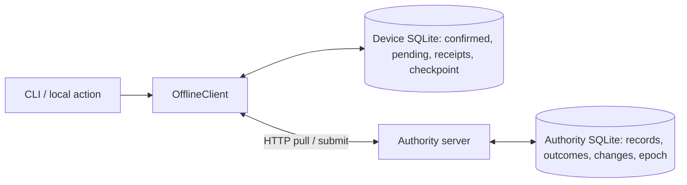

# Project C: durable offline mutation queue and synchronization

Status: **ready educational implementation**. Reader: an engineer who understands [the engine lifecycle](../../../guides/synchronization/08-sync-engine/README.md), transactions and conditional versions. The project demonstrates local persistence, retry identity, accepted-history catch-up, snapshot reset and conflict retention. It deliberately uses one task and one loopback authority; it is not a production local-first platform.

## 1. Questions and architecture

Can a device retain work through a crash without reaching a server? Can the server commit while its response disappears? Can a client apply a snapshot containing an unknown accepted operation without displaying that operation twice? What happens to a stale edit, its dependent children and a deleted object? Can an obsolete stream generation be retried safely?



Each device has a separate durable SQLite database. The authoritative SQLite database is a separate file. Local changes never write it directly. HTTP is a request/response synchronization transport; there is no WebSocket subscription or broker in this project. Project B covers that branch.

## 2. Setup and commands

Use **Node 26.7.0**, the validated runtime. `node:sqlite` was a release candidate in its versioned documentation; later runtime APIs can change. No npm dependencies or database containers are needed. SQLite here is bundled by Node, measured as 3.53.4.

From the repository root:

```sh
cd playground/synchronization/c-offline-engine
npm test
npm run demo
```

Expected demo output:

```text
offline: Mira=Plan/2; Dev=Proposal/3
reconnected: title=Proposal; count=5; Mira conflicts=1
resolved: both=Plan + Proposal/5; Mira pending=0
```

The demo uses temporary files and removes its own directory after closing stores and server. It models several days offline by the ordering of operations, not by waiting or manipulating a clock.

### Manual two-device experiment

Start a server in terminal 1:

```sh
node cli.mjs serve data/server.sqlite 8088
```

Bootstrap both devices in terminal 2, then make local changes:

```sh
node cli.mjs sync data/mira.sqlite M http://127.0.0.1:8088
node cli.mjs sync data/dev.sqlite D http://127.0.0.1:8088
node cli.mjs enqueue data/mira.sqlite M title Plan
node cli.mjs enqueue data/mira.sqlite M increment 2
node cli.mjs enqueue data/dev.sqlite D title Proposal
node cli.mjs enqueue data/dev.sqlite D increment 3
node cli.mjs show data/mira.sqlite M
node cli.mjs sync data/dev.sqlite D http://127.0.0.1:8088
node cli.mjs sync data/mira.sqlite M http://127.0.0.1:8088
node cli.mjs show data/mira.sqlite M
```

`enqueue` and `show` work while the authority is stopped. The first bootstrap is required because this lab has no offline object creation. A failed `sync` leaves queued operations intact; run it again after the server returns, using the same server file. Restarting the server does not generate a new epoch when its database remains intact.

Copy the conflicting operation ID from `show` to resolve it explicitly:

```sh
node cli.mjs resolve data/mira.sqlite M OP_ID title 'Plan + Proposal'
node cli.mjs sync data/mira.sqlite M http://127.0.0.1:8088
node cli.mjs sync data/dev.sqlite D http://127.0.0.1:8088
```

Replace `OP_ID` with the printed UUID; it is a placeholder, not a valid example ID. `discard` removes a private unresolved proposal; `title` atomically replaces it with a new logical operation. It never edits the original operation under its old identity. Use Ctrl-C to stop the server. Manual `data/` files persist for inspection and are ignored by Git; tests/demo clean only their own temporary files.

## 3. Directory map

```text
c-offline-engine/
  package.json       scripts; no external dependencies
  storage.mjs        SQLite transaction boundary and value validation
  authority.mjs      acceptance, outcomes, change log, pruning and epoch control
  server.mjs         loopback HTTP transport and fixture identities
  client.mjs         local intent, projection, receipts, pull/install and retry
  cli.mjs            manual commands and supervisor-controlled crash hooks
  demo.mjs           two-device divergence, snapshot recovery and resolution
  engine.test.mjs    durable-state, protocol and real process-crash tests
  README.md          setup, mechanisms and validation boundary
```

## 4. Representation and invariants

A task has `{id,title,count,version,deleted}`. Title changes and deletion use a whole-record expected version. Increment means `count += delta`, not `count = locallyObservedCount + delta`; valid positive increments compose at the server. Every accepted mutation increments the record version and authority log head in the same transaction. A tombstone remains in snapshots and prevents all later edits/increments. There is no resurrection operation.

A logical operation stores protocol version, schema version, authority epoch, UUID, record ID, kind, payload and optional predecessor ID. The server derives actor from authentication. Deduplication scope is `(actor,epoch,opId)`. A canonical tuple fingerprint makes changed-payload reuse an error. Epoch is not a wall-clock timestamp.

Local tables:

- `meta`: fixed actor, device UUID, confirmed epoch and applied cursor;
- `confirmed`: the authoritative projection incorporated through that cursor;
- `pending`: original immutable operations, ordinal and queued/accepted/conflict/rejected/review status;
- `receipts`: retained original outcomes.

`view()` derives the speculative projection from confirmed state and active pending operations. Because the view is derived, the enqueue transaction only needs to store the validated operation. There is no separate visible-state row that could commit without its queue entry.

Authoritative tables: current `records`, actor `grants`, immutable `outcomes`, ordered `changes`, and epoch/head/floor `meta`. No separate broker outbox is necessary because clients pull the transaction-coupled change log directly.

### Dependency policy

A conditional title/delete operation depends on the previous active local operation when one exists. Before applying it, the server checks that predecessor's accepted outcome in the same actor/epoch. This prevents accidental execution of a child whose expected version happens to match after an unrelated remote write. Increments deliberately have no predecessor: they carry independent arithmetic intent. This is a domain policy, not a general dependency-graph engine.

## 5. Critical functions

`enqueue` runs `BEGIN IMMEDIATE`, reads confirmed state plus pending overlay, builds and validates a stable operation, stores it, and commits before returning its UUID. A pre-commit crash loses the proposal; a post-commit crash preserves it. A caller cannot safely assume a crash prevented enqueue: inspect the durable queue before repeating user work.

`Authority.submit` validates the envelope, opens a write transaction, checks current permission/epoch, reads any prior outcome and verifies fingerprint. For new work it checks dependency, tombstone and CAS version, then either stores a conflict/rejection outcome or commits updated record, sequence, change entry and accepted outcome together. SQLite serializes writers in this lab; a distributed authority needs an equivalent coordination boundary.

`pull` reads records/log and requested outcomes within one database read transaction. A matching cursor at or above retained floor receives up to four ordered changes. An initial, expired or wrong-generation cursor receives a complete snapshot at head. Pruning actually deletes change rows and advances floor, but retains operation outcomes. Current snapshots retain the tombstone.

`install` validates scope, schema, numeric sequence, page completeness and expected local checkpoint. It then atomically writes projection, outcomes, pending-state changes and checkpoint. An invalid page rolls back every partial write. A same-epoch source head behind the applied cursor is rejected as rollback. A new epoch quarantines unresolved old work as `review`, because its effect history may no longer be knowable.

### The unknown-success snapshot trap

Suppose a queued increment of 4 commits remotely, its ACK disappears, and its change entry is compacted. A naive client installs a snapshot containing count 4 but retains that queued increment. Its overlay displays 8. This client requests outcomes for all retained pending IDs; snapshot installation incorporates the accepted receipt and removes the covered pending operation in the same transaction. The resulting visible count remains 4.

Accepted submit receipts alone do not move the applied stream cursor. Accepted operations remain in the overlay until a subsequent installed page covers their sequence. Snapshot receipts are read at the same boundary as the snapshot, rather than obtained separately with a race between them.

`synchronize` catches up/reconciles outcomes first, submits queued operations in local order and catches up again. There is no transaction held across HTTP. `HttpTransport` retries only bounded transient failures with the exact same encoded request: at most three attempts, a fresh 3-second attempt timeout and small exponential full jitter. Authorization, validation, schema and stale-version outcomes require action, not endless retry. The 20 ms base is a test-friendly illustrative choice; production reconnects need larger measured budgets and admission control.

`resolve` stores a new intended title with a fresh ID and current expected version, or discards private work. Reauthorization and version checking still occur when that new operation is submitted.

## 6. Failure schedules and tests

`npm test` reported **25 tests passed, zero failures** on 2026-10-13. Tests use actual file-backed SQLite, loopback HTTP and child-process SIGKILL. No injected crash is a remotely accessible command: fault controls are test supervisor environment values.

| Scenario | Expected durable result |
|---|---|
| Client killed before enqueue commit | No new pending operation; unchanged derived view |
| Client killed after enqueue commit | Same operation UUID and proposal survive restart |
| Server killed before acceptance commit | Record, outcome and change log all roll back |
| Server killed after commit before HTTP response | One accepted effect survives; restart/retry recovers original outcome |
| Client killed after response before receipt | Original queued ID remains; next pull reconciles the unknown success |
| Client killed during page installation | Old projection and old checkpoint survive together |
| Client killed after installation commit | New projection and new checkpoint survive together |
| Response lost after successful HTTP submission | Identical-body retry returns original accepted result |
| Log pruned after unknown success | Snapshot plus retained receipt avoids double overlay |
| Two stale title branches | One accepted branch; other retained as private conflict |
| Rejected parent with matching child version | Dependency failure prevents unintended child execution |
| Deleted object | Tombstone prevents stale operations from reviving it |
| Revoked actor | Reads, writes and historical outcomes denied; local queue remains |
| Authority epoch changes | Old unresolved operations move to review; no automatic retry |
| Bad/reordered page | No partial projection or cursor advancement |

Other tests cover 13-entry pagination, actor binding, future disk/wire schema refusal, numeric cursors, well-defined queue states, WAL/FULL settings and integrity checks. Lost response is an explicit transport fault over a real successful HTTP request. Several-days offline is a causal schedule; real elapsed-day suspension is not tested.

## 7. Performance and operating boundaries

The queue retains at most 100 unresolved/accepted entries and pages at most four changes. Synchronization is single-flight per client object and bounded to 100 pull pages per catch-up phase. Concurrent processes can share SQLite transactions, but this is not a production multi-tab sync-owner protocol; a changed checkpoint rejects a stale page. Database calls are synchronous and block Node's event loop.

Snapshots contain the entire single task. General collections need chunked, versioned snapshot staging and an atomic manifest switch. Whole-record change entries cost more than field deltas but simplify recovery; a delta needs an exact baseline. Receipts and authoritative outcomes grow without garbage collection. The snapshot path does not justify deleting deduplication evidence.

WAL and `synchronous=FULL` are configured on every connection. Actual SIGKILL verifies process-restart behavior, not host power failure, disk corruption or hardware flush correctness. SQLite WAL requires preserving its associated state correctly; use a supported backup method rather than copying only an actively changing main database file. [SQLite WAL](https://www.sqlite.org/wal.html), [backup API](https://www.sqlite.org/backup.html)

## 8. Security and production work

Fixture tokens are public and the listener is restricted to `127.0.0.1`. There is no TLS, token refresh, encryption or real authorization service. Actor access is all-or-nothing for one record. Trusted code with database access can bypass application policy. Files are not application-encrypted and contain local private proposals, deleted titles and receipts.

Before real deployment: bind actor/tenant/authority identity to each local store; use real authenticated TLS; enforce per-object permission and revocation ordering; define bootstrap/create, filters and dependency graphs; implement data/protocol migrations; bound history/outcome retention safely; stage large snapshots; implement multi-process sync ownership; protect/export/backup local work; measure disk-full, suspension, outage, slow-link and overload behavior. Browser IndexedDB storage needs its own transaction and quota lifecycle. None of these are established by this lab.

See [the local-first guide](../../../guides/synchronization/10-local-first/README.md) for the full offline/reconnect argument and [research notes](../../../guides/synchronization/10-local-first/RESEARCH.md) for evidence and review gaps.

Validation record: 2026-10-13; 25 tests passed, zero failures; demo matched all three documented lines; separate CLI bootstrap/enqueue/sync/show/resolve workflow passed. Tests, demo and workflow closed their services and removed their disposable files. Markdown local-path/fence checks and git diff --check passed. No unrelated services were changed.

Release review: 2026-10-14, Codex (AI technical/editorial review). Status: ready for this exercise's stated scope. [Review and rerun evidence](../../../guides/synchronization/REVIEW.md) record the actual checks; production-hardening limitations above still apply.
