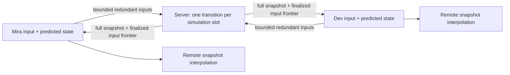

# Project F: authoritative multiplayer simulation

Status: **ready educational implementation**. Reader: an engineer familiar with [networking](../../../guides/synchronization/07-networking/README.md), ordering and speculative state. This lab demonstrates a fixed-step authority, scheduled inputs, client prediction/reconciliation, remote interpolation and bounded adverse schedules. It is a one-dimensional command-line simulation, not a production game engine.

## 1. Design questions and boundary

Which machine decides movement? What does an input ACK prove? Can a duplicate packet move a player twice? What happens to a late input? How does an imperfect prediction recover? How are older snapshots and obsolete sessions fenced? How does rendering handle missing samples?

Mira and Dev control separate one-dimensional entities measured in millimetres. Server simulation runs at 20 Hz (50 ms/step). A direction -1/0/+1 moves at most 50 mm per slot. The server's positive obstacle is 120 mm; the predictor intentionally assumes a free path up to 1,000 mm to make correction visible. Production prediction should share compatible movement/collision rules; this difference is a deliberate teaching fault.

There are no player-player collisions, held-key input sampling, graphical rendering, lag-compensated weapons, rollback engine, persistence or Internet transport security. Sessions/world are memory-only. A server restart starts a new match epoch and resets positions.

## 2. Setup and expected output

No dependencies or containers are required. Use Node 22 or later; validation used **Node 26.7.0**. Earlier compatible versions were not tested.

```sh
cd playground/synchronization/f-multiplayer
npm test
npm run demo
```

Expected demo:

```text
predicted before confirmation=150mm
authoritative=120mm; correction=-30mm; pending=0
remote at tick5=50mm
seeded link: sent=10; dropped=3; duplicated=2
```

The deterministic demo uses the same simulation/reconciliation modules as the network adapter, but not UDP. Integration tests exercise actual UDP independently. This distinction prevents a logical fault scheduler from being mistaken for measured WAN behavior.

### Manual network simulation

Terminal 1:

```sh
node cli.mjs serve 8086
```

Terminal 2:

```sh
node cli.mjs client M 8086
```

Terminal 3:

```sh
node cli.mjs client D 8086
```

Client commands:

```text
right
show
right
show
left
neutral
reconnect
quit
```

Each direction submits **one fixed-step command**, not continuous held movement. The client immediately shows a speculative displacement. Snapshots arrive periodically and can correct it. `remote` displays an interpolated/held sample from the other entity. Initial absence returns `missing` rather than inventing an entity.

`reconnect` creates a new session and discards expired gameplay commands. It preserves the server's current entity position if the same match is still alive; a new server match starts at zero. Ctrl-C stops the server. Neither commands nor outcomes are persisted to disk. Do not treat game `ack` as the durable ACK used in Projects B/C/D.

## 3. Files and architecture

```text
f-multiplayer/
  package.json       dependency-free Node scripts
  protocol.mjs       strict envelopes, bounds, snapshot validation
  simulation.mjs     World and bounded fixed-step accumulator
  prediction.mjs     Predictor, reconciliation, Interpolator
  faults.mjs         seeded logical loss/duplicate/delay scheduler
  server.mjs         loopback UDP sessions and fixed-step authority
  client.mjs         connected UDP client and timed resend
  cli.mjs            server launcher / interactive commands
  demo.mjs           deterministic prediction/interpolation example
  game.test.mjs      pure and real UDP/process-crash checks
```



## 4. Protocol: packet identity is not input identity

Join uses a public fixture token and a UUID nonce. Repeating a lost join request uses the same nonce so the server returns the same session. A new nonce creates a new actor session, invalidating the old token/endpoint binding. Retired nonces are remembered in a bounded cache; this is not cryptographic replay protection.

The welcome includes a full snapshot and a new random session ID. Every input datagram contains:

```text
{type:'input', v:1, epoch, session, packetSeq, commands:[{seq,dir}, ...]}
```

`packetSeq` identifies a datagram attempt; a new attempt can repeat earlier commands. `seq` identifies an input slot in this session. If the session begins at server tick `startTick`, input `seq` belongs to tick `startTick + seq`. Snapshot `ack = tick - startTick` means every slot through that frontier is finalized, including slots for which no input arrived.

This is **finality evidence**, not cumulative packet receipt or proof that each intended command ran. A missing slot executes neutral direction. A late command cannot change it. A conflicting direction under an already queued input ID is rejected. Packet reordering within the retained packet window is permitted because an older packet can still carry a useful future command.

The client defaults to two slots of scheduling lead. At ACK 0, its first input uses sequence 3; slots 1–2 remain neutral. Lead improves delivery chances at the cost of delayed authoritative execution. The UI predicts the requested displacement immediately. An input can target at most 12 slots beyond the server's finalized frontier. Sending more packets or queued directions cannot make the authority run more than one movement step per server tick.

Every outgoing datagram is bounded to 1,200 encoded bytes, a lab budget rather than a proven path MTU. The server binds to 127.0.0.1 and sends only to registered loopback endpoints. Connected client UDP sockets restrict ordinary incoming peer traffic to their server endpoint. Tokens/session IDs are plaintext fixtures; this is not secure against hostile network spoofing.

## 5. Key functions and invariants

`World.receive` validates epoch, actor session, complete packet shape, sequence window and command identities before replacing the queued-command map. One invalid member does not partly enqueue a valid member. Exact packet duplicates have no new effect; changed content under a retained packet ID fails. Old already-finalized input slots are ignored.

`World.step` advances one fixed server tick. It chooses exactly the command for that tick/session or neutral input, applies the authoritative obstacle, and removes that slot. It does not use packet count, client elapsed time or client position as simulation authority.

`Predictor.input` records an immutable scheduled direction and updates the local speculative position. Its window is bounded by the newest known finalized frontier; if snapshots stop, prediction reaches `PREDICTION_WINDOW_FULL` instead of growing an unbounded queue.

`Predictor.reconcile` validates a newer matching-epoch/session snapshot, resets to the authoritative position, removes every pending slot at or below finality, and replays remaining commands in sequence order. A stale snapshot cannot rewind it. A finalized neutral slot removes a missed command even though it was never received.

`Interpolator` keeps up to 32 monotonic full snapshots and samples between server ticks. If two snapshots bracket the target, it linearly blends that entity's positions. It holds the oldest/latest known position outside the bracket; it does not extrapolate indefinitely. A missing entity on either side yields `missing`. This is presentation state, never collision authority.

`renderTick` anchors an approximate server timeline to the most recently received snapshot plus local monotonic elapsed time, then subtracts two ticks. It does not estimate one-way network delay or implement clock synchronization. Under delay/jitter its estimate is biased; production presentation clocks need measured timing and adaptive buffering.

`FixedClock` accumulates monotonic elapsed milliseconds and performs only 50 ms steps, with at most five catch-up steps per callback. It records excess wall-clock elapsed time as dropped debt. This limits work after a long scheduler stall but lets simulation fall behind physical time. It never fixes overload by multiplying movement dt.

The server periodically sends complete snapshots every two simulation ticks (10 Hz), avoiding delta-baseline dependencies in this lab. Client resends use a fresh packet sequence with pending commands every 50 ms. Neutral/empty packets also renew the session lease. Resending only helps before a command's fixed deadline; it does not turn UDP into indefinitely reliable operation delivery.

## 6. Tests and failure cases

The expanded suite reported **24 tests passed, zero failures** on 2026-10-14. Earlier in the same authoring session, the initial 22-test suite also passed. Tests distinguish pure logical schedules from actual UDP sockets and a real server-process SIGKILL.

| Schedule | Required result |
|---|---|
| Three predicted +50 mm steps, server obstacle at 120 | Correction -30; final confirmed/predicted 120 |
| Snapshot covers only first of three commands | Replay remaining two, never replay finalized first |
| Input misses its fixed slot | Server executes neutral; later finality removes local guess |
| One packet lost before deadline | Redundant later packet can deliver its still-future input |
| Duplicate/reordered packet | Each slot affects motion at most once |
| Many packets per tick | Server movement remains one bounded step |
| Changed ID or malformed batch | Reject without partial queue mutation |
| Older snapshot | No prediction rewind |
| Interpolation underflow | Hold latest, never invent unlimited future motion |
| Entity disappears | Explicit missing sample |
| Seeded loss/duplicate/jitter/reorder | Reproducible schedule; final full snapshot repairs current state |
| Complete logical partition | Expired inputs remain neutral; fresh input can proceed after recovery |
| Actual UDP input/snapshot drop in adapter | Redundant/future snapshot recovery |
| Wrong fixture token/endpoint/position field | No authoritative movement |
| Lost welcome | Same join nonce preserves assigned session |
| Revoked actor | Subsequent input and snapshot disclosure stop |
| Server SIGKILL | New ephemeral match epoch; explicit rejoin resets prediction |

The adverse link uses a seeded xorshift generator and logical delivery slots; it is not an OS network emulator. Actual UDP drop cases deliberately discard a datagram before transmit or before application processing; they do not measure random loss inside a real router. The crash test proves epoch/reset behavior, not persistent match recovery.

## 7. Operating and security limitations

Bounds include two fixture actors, 12 future input slots, 64 packet-history distance, 256 retired join nonces, 32 interpolation snapshots and a server token bucket. Input/collision validation prevents a simple client-position or packet-rate speed claim from becoming authoritative. It does not solve aimbots, hidden-information disclosure, client binary modification or real identity abuse.

UDP sends use fixed pacing and limited budgets, but **no adaptive congestion control, cryptographic transport, NAT traversal or relay** is implemented. The loopback restriction is part of the lab contract. RFC 8085 explains the additional congestion responsibility of Internet UDP applications. [UDP usage guidelines](https://www.rfc-editor.org/rfc/rfc8085.html)

Before real deployment: use a suitable secure congestion-controlled transport; implement authenticated admission/session renewal and address validation; synchronize simulation versions/collision data; tune input lead and packet budgets; add held-input sampling, continuous rendering and display-only correction smoothing; manage entity generations/interest; define disconnect/rejoin behavior; separate durable inventory/economy effects from ephemeral match state; measure tail tick cost, packet/ACK age, correction magnitude and interpolation starvation.

Lag compensation, deterministic lockstep, rollback networking, quantization/delta compression, world partitioning and persistent MMO state are explained in [the multiplayer guide](../../../guides/synchronization/12-multiplayer/README.md) but are not implemented here. Tests clean up only their owned UDP sockets/processes; no database files or external services are involved.

See [research and validation notes](../../../guides/synchronization/12-multiplayer/RESEARCH.md). Material is ready for the stated educational scope; see the release review.

Final validation: 2026-10-14; 24 tests passed, zero failures; demo matched all four documented lines; separate CLI input/show/reconnect/quit workflow passed. Owned sockets and child processes were closed/stopped. Markdown local-path/fence checks, new-file whitespace and git diff --check passed.

Release review: 2026-10-14, Codex (AI technical/editorial review). Status: ready for this exercise's stated scope. [Review and rerun evidence](../../../guides/synchronization/REVIEW.md) record the actual checks; production-hardening limitations above still apply.
