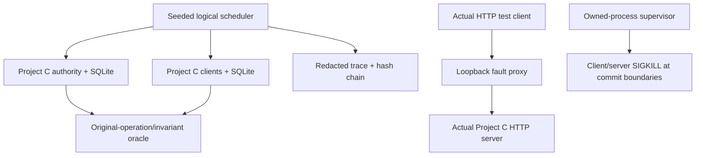

# Project G: reproducible synchronization failure testing

Status: **ready educational harness**. Reader: an engineer who understands Projects C/E-style state, original operation identity, commit boundaries and cursor recovery. The harness tests real implementation boundaries and deterministic schedules. It is not a production chaos platform, an Internet fault injector, or a proof of all distributed histories.

## 1. Questions and architecture

Can a fault schedule be replayed? Does a lost response duplicate a committed effect? Can partial storage failure advance a projection without its checkpoint? What survives a process kill? Does healing repair state while preserving conflicts/permissions? Can a test distinguish a harmful trace edit from truncation?



The scheduler/proxy/supervisor are reusable small components; the main scenario adapter targets Project C. CRDT tests reuse the earlier dependency-free datatype lab. Network/process boundaries are separate from the logical scheduler, so replay claims are precise.

## 2. Setup

Use **Node 26.7.0**, validated with bundled SQLite 3.53.4. Project C is imported by relative path. No dependencies, containers or database services are required.

```sh
cd playground/synchronization/g-fault-harness
npm test
npm run demo
node demo.mjs 42
```

Expected default seed-7 demo:

```text
{"seed":7,"operations":16,"count":30,"head":16,"network":{"sent":86,"dropped":11,"duplicates":21,"delivered":96}}
same-seed replay=true; anchored trace valid=true
```

The demo repeats a seed, compares normalized traces and verifies the retained anchor. It uses temporary file-backed stores and removes them. Fault decisions/order are deterministic for the logical adapter/version; actual operating-system HTTP/process timings are not claimed to replay bit-for-bit.

## 3. Directory structure

```text
g-fault-harness/
  package.json       runnable commands; no dependencies
  scheduler.mjs      seeded random generator, loss/dup/delay, bounded queue
  scenario.mjs       Project C adapter and original-operation oracle
  journal.mjs        finite-JSON trace chain and tuple namespace helper
  proxy.mjs          bounded loopback HTTP fault path
  supervisor.mjs     owned Project C child startup/crash/stop
  harness.test.mjs   pure, SQLite, HTTP and process checks
  demo.mjs           replay/check a seed twice
  README.md          operation, expected evidence and limits
```

## 4. Critical mechanisms

### Scheduler and adapter

`Scheduler.send` records a label, chooses drop/duplication/delivery slot from a seeded xorshift generator, clones the payload and queues delivery. `advance` orders due events by logical slot then enqueue ordinal. Delay can reorder delivery; duplicate delivery invokes the receiver twice. Queue capacity and drain rounds are bounded. One logical slot is not a measured millisecond or UDP packet transmission.

`runScenario` creates an authority and two local SQLite clients. Each queues eight positive increments with stable IDs. The workload and fault schedule use deterministic seed-derived choices. Labels such as M:3 normalize UUID/epoch differences between fresh runs; a label does not replace the real stored operation ID.

During the fault window the scheduler sends/repeats original operations and ACKs; ACK loss leaves local pending evidence. After the finite fault window, restore delivery, submit every original operation again under its unchanged identity, actually prune the change log, then install retained-outcome-aware snapshots. The scenario intentionally separates faulted acceptance/ACK delivery from final reliable pull/reset. It does not implement a concurrently faulted push/pull control algorithm.

The oracle derives expected count from original intended deltas, not network sends. It requires one authority outcome/log-head increment per original operation, coherent record version/head, both clients matching authority, empty accepted queues and no double optimistic overlay. Five seeds are each run twice in the suite. This exercises selected histories; it is not exhaustive state-space coverage.

### HTTP fault proxy

`startProxy` accepts only a 127.0.0.1 HTTP target and only POST /pull or /submit. It limits request/response bodies, active connections and upstream time. Tests create their own target; do not point the proxy at unrelated services.

Plans can drop before forwarding, duplicate an identical forward, drop a response after successful forwarding, or delay a captured response. A partition flag drops requests before forwarding until explicitly healed. The duplicate/drop-after paths exercise real successful upstream commits, not only fake success objects. These are application request/response faults over actual HTTP, not kernel packet emulation.

The delay test waits for the proxy's captured-response counter, then accepts a newer mutation/pull. Installing the older response fails against the changed checkpoint. No arbitrary sleep is used to guess when the old database read occurred.

### Transaction failure and crash supervision

SQLite TEMP triggers inject ABORT at the authority change-log insert and at the client's checkpoint update. They test rollback coupling after earlier writes, not physical disk-full/fsync errors. Remove the trigger and retry unchanged evidence to show recovery.

`authorityProcess` starts only the local Project C CLI and waits for IPC readiness or startup failure. `crashedClient` runs only that CLI with a supervisor-selected fault setting. SIGKILL hooks are environment settings in owned test children, never client-facing protocol commands. Watchdog termination is reported as a phase timeout, not counted as a successful crash at the intended boundary.

Before-server-commit and after-server-commit cases restart against the same SQLite file. Client cases kill before/after install commit and after server response before local receipt. Each checks actual durable old/new state and final catch-up. Host power loss, networked storage and replicated failover remain different tests.

### Trace journal and namespace helper

The journal hashes a restricted finite-JSON event with its ordinal and prior hash. `entries` returns a deep copy. `verify` checks each link and optionally a trusted final `(seq,hash)` anchor. Editing a retained event fails verification; deleting a suffix is detectable against the retained anchor, while an unanchored valid prefix remains valid.

This is tamper-evident relative to an independently trusted anchor. An attacker controlling the entire journal and anchor can rewrite/re-hash history. The journal is memory-only and unsigned; it is not a durable security audit log or a Certificate Transparency implementation. Labels/statuses avoid private fixture bodies in logical traces.

`scopeKey` encodes a tuple to avoid separator collisions. It is not an authorization check. The test showing different tenant keys does not establish an end-to-end multitenant deployment; Project C still has one fixture task/workspace.

## 5. Tests and evidence classification

The expanded suite reported **25 tests passed, zero failures** on 2026-10-14.

| Boundary | Cases |
|---|---|
| Logical schedules | Five seeds replayed twice; loss, duplicate, delay/reorder, bounded queue, healing oracle |
| CRDT assumptions | Cumulative G-counter anti-entropy; retained OR tombstones; oracle catches deliberately discarded metadata |
| Trace/namespace | Tuple collision prevention; event edit and anchored truncation; valid unanchored prefix |
| Actual HTTP | Lost response after commit, duplicate forward, full request partition, delayed old response |
| Actual SQLite transaction | Authority log ABORT; client checkpoint ABORT; unchanged retry |
| Application/security | Offline CAS conflict, revocation, altered ID payload, forged extra scope, mixed schema refusal |
| Recovery | Actual pruning/snapshot outcome reconciliation; simulated rollback response rejection |
| Actual process | Server SIGKILL before/after commit; client SIGKILL at three boundaries; failed startup reported |

The logical scenario has a known fixed workload. It proves convergence after finite faults only because original evidence survives, current permissions allow it, storage works, and reliable recovery is explicitly restored. A permanent partition, lost device database or revoked actor changes the contract.

## 6. Performance, adaptation and production limits

Run many seeds in CI with a recorded workload version; retain seed/config/first failed invariant and a sanitized event trace on failure. Minimize a failing schedule by removing events while preserving dependencies and the invariant failure. Do not reduce away the original operation identity or necessary commit boundary and then claim the shortened schedule reproduces the same bug.

For a new adapter, specify its state machine, identity/ordering scope, persisted evidence, acceptance oracle and liveness assumptions. Chat, CRDT and game adapters require different finality rules. Project F expires late input; Project C retries permitted original writes. “Every message eventually executes” is not a valid universal oracle.

Large model sweeps need bounded queues, event counts, fixture data and trace retention. Real-process tests are slower and affected by scheduling. Keep deterministic core tests plus actual implementation tests; neither substitutes for the other. This harness does not perform production load, rolling cluster versions, regional partitions, broker outages, TLS attacks or DB replication tests.

Public fixture tokens and local SQL access remain educational assumptions. Fault controls must not be exposed to deployed clients. Tests remove only their temporary directories and stop their own child processes. No global network rules, external stores or unrelated processes are modified.

Read [security](../../../guides/synchronization/14-security/README.md) and [production engineering](../../../guides/synchronization/15-production/README.md) for the wider threat/recovery requirements. Their research records identify evidence gaps. Material is ready for the stated educational scope; see the release review.

Release review: 2026-10-14, Codex (AI technical/editorial review). Status: ready for this exercise's stated scope. [Review and rerun evidence](../../../guides/synchronization/REVIEW.md) record the actual checks; production-hardening limitations above still apply.
